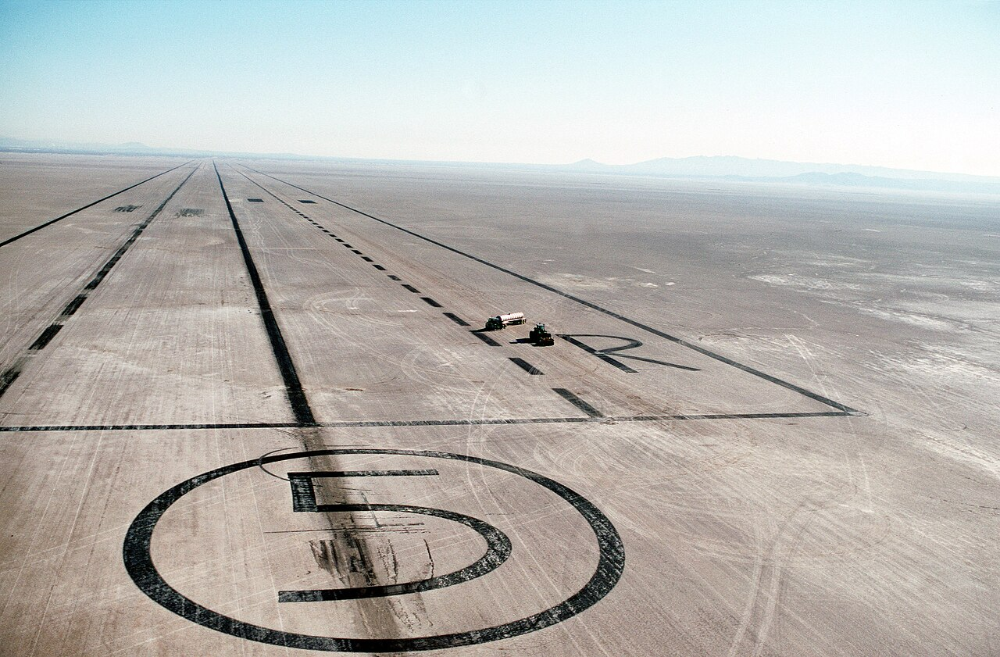
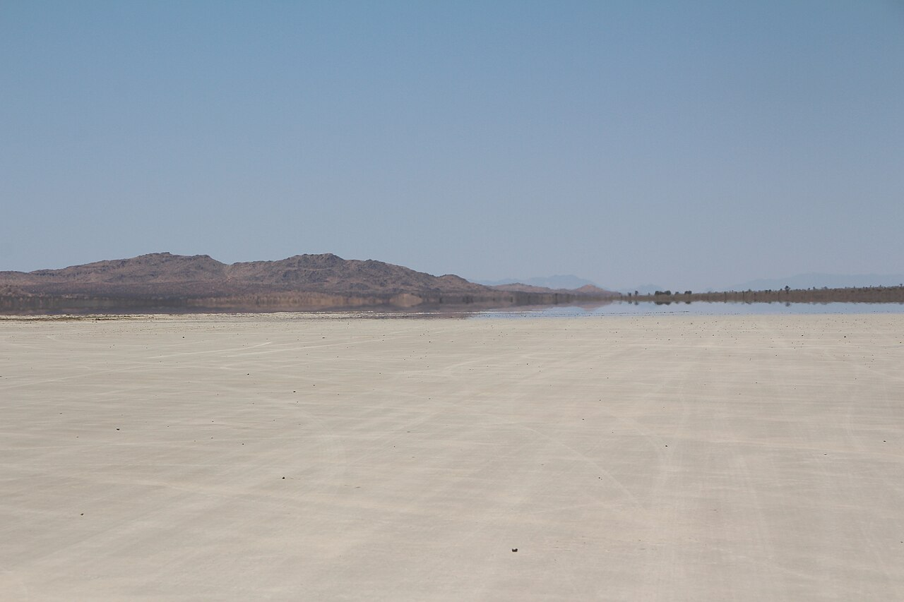

# Muroc: Where Everybody Raced at Once

*Side by side at Muroc until the SCTA brought the stopwatch, and then the air base took the lake*

!!! abstract "Article record"
    **Confidence:** Medium · **Source types:** club history, secondary, oral · **Last verified:** 2026-10-13 (Round 4) · **Open issues:** First-meet date conflict open · [How we rate this](../reference/source-standards.md)

!!! quote "In their own words"
    "There might be a 100 cars there waiting in line for their run, and the guys at the front of the line always ran faster than the guys toward the end of the line."

    — Blackie Gold, 2006 interview, on 1930s Muroc. [Full context in Voices](../voices/blackie-gold.md)

<figure markdown>
{ loading=lazy }
<figcaption markdown>Rogers Dry Lake at Edwards AFB in 1990: a runway marked on the lakebed. Rogers is the lakebed racers knew as Muroc (renamed in 1950, per [Wikipedia](https://en.wikipedia.org/wiki/Rogers_Dry_Lake)). Photo: CMSgt Donald Sutherland, U.S. Air Force, 1990-12-18. Source: [Wikimedia Commons](https://commons.wikimedia.org/wiki/File:Edwards_AFB_Runway_5_on_Rogers_Dry_Lake.jpg). License: Public domain.</figcaption>
</figure>

<figure markdown>
{ loading=lazy }
<figcaption markdown>El Mirage Dry Lake, San Bernardino County, today a BLM off-highway vehicle area. It is a modern view of the lakebed, not a period racing photo. Photo: Bureau of Land Management California, 2015-06-08. Source: [Wikimedia Commons](https://commons.wikimedia.org/wiki/File:El_Mirage_Dry_Lake_Off-Highway_Vehicle_Recreation_Area_(29486068103).jpg). License: Public domain.</figcaption>
</figure>

Partly to get away from the police, the weekend racers of greater Los Angeles drove roughly 100 miles north to Muroc Dry Lake in the 1920s and raced side by side.[^mojave] In 1937 the Southern California Timing Association put a stopwatch on those lineups. Then the air base took the lake, and after the war El Mirage became the main lakebed.

They brought modified four-cylinder Fords and raced them across the lakebed in unruly "lineups."[^mojave] Someone, by the early 1930s, was trying to organize it. Bell Auto's George Wight is said to have worked with the young Gilmore Oil company to organize dry-lakes events at Muroc in the early 1930s.[^jj-bell]<a href="#q-1" title="Single source so far: see Open questions">◐</a>

## Enter the stopwatch

On November 29, 1937, the Southern California Timing Association was organized to run speed trials on the dry lakes and to set safety guidelines. The mass starts gave way to running against the clock.[^rr][^mojave]<a href="#q-5" title="Sources disagree: see Open questions">⚠</a>

It is still open who was in the room.<a href="#q-2" title="Sources disagree: see Open questions">⚠</a>

The clubs in Drake's *Flat Out* are the Hollywood Throttlers, 90MPH Club, Road Runners, Bungholers, Night Owls, and Mercuries & Centuries, meeting at the Throttlers' clubhouse. Carrol's book names the Knight Riders, Sidewinders, Throttlers, Idlers, Ramblers, Road Runners and 90MPH Club.

Every account has just three names in common: Throttlers, 90MPH Club, Road Runners. Of the charter clubs, the Road Runners and the Sidewinders are still around today.[^rr]

Coachbuilt.com adds that George DuVall and Julian Doty, charter Hollywood Throttlers, were "present when the SCTA was founded."[^cb]<a href="#q-3" title="Single source so far: see Open questions">◐</a>

## May or March?

The new association grew fast. Even its first meet has two dates.<a href="#q-4" title="Sources disagree: see Open questions">⚠</a> By mid-1938 the SCTA had 23 member clubs and 451 members. The Road Runners were the third largest club, with 31 members, and Wally Parks was coordinating patrols at the first meet.[^rrpdf] Among the founding Road Runners were Wally Parks and Ak Miller. Parks went on to found the NHRA in 1951, and Miller later became SCTA president.[^rr]

## The lakebed gets drafted

Then Muroc was gone. It became restricted, and was absorbed into what is now Edwards Air Force Base (today Rogers Dry Lake). Harper was too short and Rosamond was too soft, and after the war El Mirage became the main lakebed.[^mojave] The November 1941 meet, as Barney Navarro remembered it, was "the last Muroc meet before the war."[^navarro]

They came roughly 100 miles and raced side by side in those lineups. The mass starts gave way to running against the clock on November 29, 1937. Then the air base took the lake, and after the war El Mirage became the main lakebed.

## Open questions & disputed details

*From the detective's notebook: where the sources disagree, where we have only one, and what we are still looking for. Each item links back to its place in the story.*

**Single source so far.** **Did Bell's Wight organize the early Muroc meets?** Only the Jalopy Journal says so; we need a period source.[^jj-bell] <a class="hr-q-back" href="#qr-1" title="Back to the story">↩</a>

**Disputed.** **Which clubs founded it?** The Road Runners' research packet reports that two books disagree: Drake's *Flat Out* and Carrol's book give different lists, and only the Throttlers, 90MPH Club and Road Runners are on both.[^rrpdf] Coachbuilt puts charter Throttlers George DuVall and Julian Doty at the founding.[^cb] We have not read either book. <a class="hr-q-back" href="#qr-2" title="Back to the story">↩</a>

**Single source so far.** **Were DuVall and Doty there at the founding?** Coachbuilt says they were charter Throttlers "present when the SCTA was founded"; nothing else confirms it.[^cb] <a class="hr-q-back" href="#qr-3" title="Back to the story">↩</a>

**Disputed.** **March or May 1938?** The Road Runners' history puts the first official SCTA meet at Muroc on **May 15, 1938**.[^rr] A 2014 StreetMuscle article says **March 15, 1938**.[^sm] The tiebreaker is a 1938 Muroc timing tag in the Jimmy Summers family album that reads "May 15, 1938, Muroc Roadster Races" (94.73 mph, stock V8).[^summers] That is primary-ish physical evidence for May, so **our working conclusion is May 15, 1938.** <a class="hr-q-back" href="#qr-4" title="Back to the story">↩</a>

**Disputed.** **1937 or 1938?** The Road Runners and the Mojave Project date it to late 1937,[^rr][^mojave] and [Blackie Gold](../voices/blackie-gold.md) also remembered 1937. Kong Jackson, in Tom Medley's 1988 interview as quoted by Fuel Curve, put it a year later: "Before the Road Runners, Ninety Mile an Hour, Sidewinders, and Throttlers formed the SCTA in 1938, guys were getting killed at the lakes, running into each other."[^fc] His is a recollection fifty years on, so we keep November 29, 1937; see [Kong Jackson](../people/kong-jackson.md). <a class="hr-q-back" href="#qr-5" title="Back to the story">↩</a>

**The club lists' sources:** the packet doesn't fully cite "Drake" and "Carrol." Running those books down is on the [Research Trail](../research-trail.md).

[^fc]: Fuel Curve, "'Kong' Jackson – The King of Early Flathead Ignitions" (quoting Medley's 1988 interview in *Tex Smith's Hot Rod History*). https://fuelcurve.com/kong-jackson/ (accessed 2026-10-13)
[^mojave]: The Mojave Project, "Land Speeding at El Mirage." https://mojaveproject.org/dispatches-item/el-mirage-land-speed/ (accessed 2026-10-12)
[^jj-bell]: Ryan, "The History Of Bell Auto," The Jalopy Journal, May 12, 2010. https://www.jalopyjournal.com/?p=8704 (accessed 2026-10-12)
[^rr]: Road Runners SCTA Est. 1937 (club site). http://www.ussarcherfish.com/roadrunners/ (accessed 2026-10-12)
[^rrpdf]: Road Runners "RR Info Package" (PDF), notes & research section. http://www.ussarcherfish.com/roadrunners/RR%20Info%20Package.PDF (accessed 2026-10-12)
[^sm]: "Brief History Of SCTA And The 2014 El Mirage Dry Lake Racing Season," StreetMuscle. https://www.streetmusclemag.com/news/brief-history-of-scta-and-the-2014-el-mirage-dry-lake-racing-season/ (accessed 2026-10-12)
[^summers]: Kustomrama, "Jimmy Summers" (Jimmy Summers Photo Collection). https://kustomrama.com/wiki/Jimmy_Summers (accessed 2026-10-12)
[^navarro]: Tony Thacker, "Barney Navarro," American Hot Rod Foundation. https://ahrf.com/pioneer/barney-navarro/ (accessed 2026-10-12)
[^cb]: Coachbuilt.com, "George DuVall." http://www.coachbuilt.com/des/d/duvall/duvall.htm (accessed 2026-10-13)
