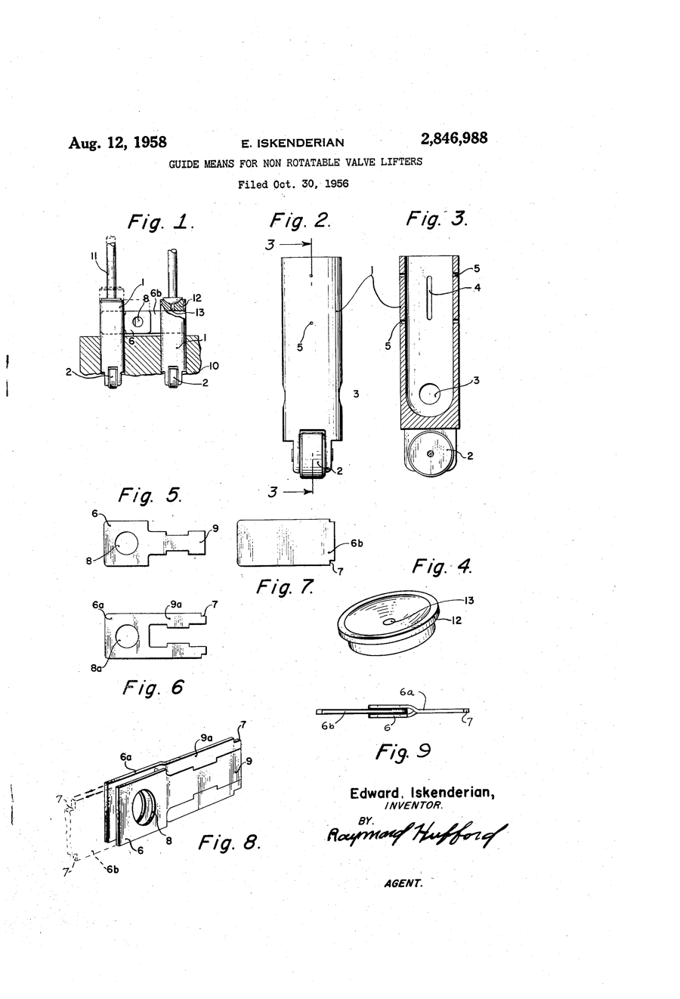
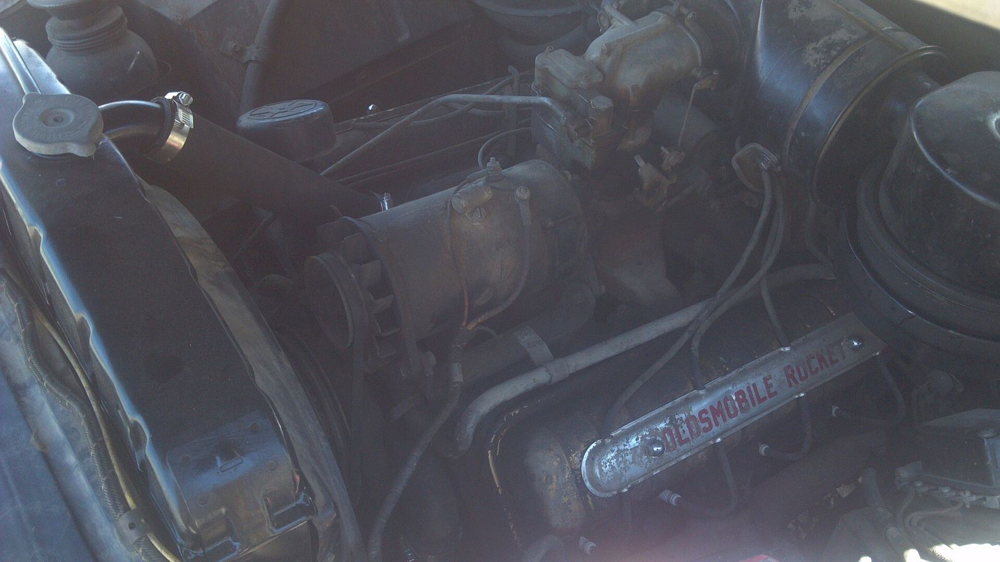

# The Camgrinder Wars

*1956–64: how a polite page of cam ads turned into a brawl*

!!! abstract "Article record"
    **Confidence:** Medium · **Source types:** oral (1994 Wallace interviews), secondary · **Last verified:** 2026-10-13 (Round 3) · [How we rate this](../reference/source-standards.md)

In the first issue of HOT ROD, January 1948, Weber Tool Co. was the only cam advertiser. By the second issue the others had shown up, and the headlines were still mild: "Winners Use Iskenderian Cams" and "CRA Track Cars 5 and 66 Use Howard Cams."[^hr]

It did not stay that way.

*Principal source: Dave Wallace, who interviewed the surviving "generals" (Iskenderian, Engle, others) in 1994.*[^hr]

## The paper that didn't blink

*Drag News* carried hero ads within three days of Sunday's finals, and it was free of Wally Parks's guidelines at Petersen ("some said censorship"). *Hot Rod* covered the same events two months later, if at all.[^hr] If you wanted to shout at a rival while the race was still warm, you bought space in *Drag News*.

## How it escalated

**1956.** Howard's Cams called Red Henslee's roadster "The World's Fastest-Accelerating Roadster." Isky answered in the March 1956 HRM with Jazzy Nelson's fuel Fiat as "The World's Fastest-Accelerating Car," on a 9.10 e.t. that historian Robert C. Post says was "almost certainly not" real.[^hr]

**February 1957.** Isky claimed Emery Cook's 166.97 mph at Lions for his "5-Cycle" cam. Howard answered with ads of four bicyclists and a fifth bike ridden by a clown.[^hr]

**September 1958.** This is the ad at the center of our open lead. Per Iskenderian, **Howard Johansen's hero ad heralding Doug Cook's defection from Iskenderian products** started the Gasser Wars: "After that, we started to play up any little success we had."[^hr]

**Jack Engle** opened a third front with type-only ads "signed" by gasser stars, though the satirical style pointed to Engle himself.[^hr]

**1959.** Howard countered Isky's five cycles with "eight-cycle" cams, and Chet Herbert became the first serious challenger for Top Eliminator business.[^cp59]

**1960.** Garlits broke a $1,000 Isky contract for Ray Giovannoni's $10,000 offer (only $5,000 was ever paid). The good-natured tone ended there. Isky still called his rival "Giova phony."[^cp60] An ad signed by Doug Cook, but "likely dictated by Howard Johansen," attacked rivals in the Sept 24, 1960 *Drag News*.[^cp60]

## From the detective's notebook

**Still open:** the September 1958 ad itself (page, wording). Wallace's 1958 Drag Rags installment should reproduce it.

## Was any of it real?

Engle, looking back: "There was some hostility, but I would say the intent was competitive in nature... it was more or less a game."[^hr] Isky never visited Johansen, thinking he was angry.

Then, at Johansen's funeral (c.1988), someone told him: "Howard used to get a kick out of reading your ads!"[^hr]

## Images

<figure markdown>
{ width="300" loading=lazy }
<figcaption markdown>US 2,846,988, "Guide means for non rotatable valve lifters," sheet 1, filed by Edward Iskenderian of Inglewood in Oct 1956, the opening year of the Camgrinder Wars. Creator: Edward Iskenderian (inventor); USPTO. Date: filed 1956-10-30, issued 1958-08-12. Source: [Google Patents](https://patents.google.com/patent/US2846988A/en). License: Public domain (U.S. patent drawing).</figcaption>
</figure>

<figure markdown>
{ loading=lazy }
<figcaption markdown>An unrestored 1949 Oldsmobile Rocket V8, the engine family for which Jack Engle's cams made his name (see [Jack Engle](../people/jack-engle.md)). Creator: Regushee. Date: 2012-06-21. Source: [Wikimedia Commons](https://commons.wikimedia.org/wiki/File:1949_Oldsmobile_Rocket_V8_engine.jpg). License: [CC BY-SA 3.0](https://creativecommons.org/licenses/by-sa/3.0).</figcaption>
</figure>

## Visual references (external)
*These are copyrighted or rights-restricted images, so we link to them instead of copying them.*

- [Dave Wallace, "Who Started The Camgrinder Wars? – Part 1" (period ads)](https://www.hotrod.com/news/who-started-the-camgrinder-wars-part-1)

[^hr]: Dave Wallace, "Who Started The Camgrinder Wars? – Part 1," Hot Rod, Dec 29, 2014. https://www.hotrod.com/news/who-started-the-camgrinder-wars-part-1
[^cp59]: Dave Wallace, "Drag Rags: 1959, Part 2 — How the Smokers Beat the Fuel Ban," Competition Plus (search excerpt). https://competitionplus.com/drag-rags-1959-part-2-how-the-smokers-beat-the-fuel-ban/
[^cp60]: Dave Wallace, "Drag Rags of 1960 – Tragedy, Popcorn Speeds and a Camshaft Rivalry," Competition Plus (search excerpt). https://competitionplus.com/drag-rags-of-1960-tragedy-popcorn-speeds-and-a-camshaft-rivalry/
