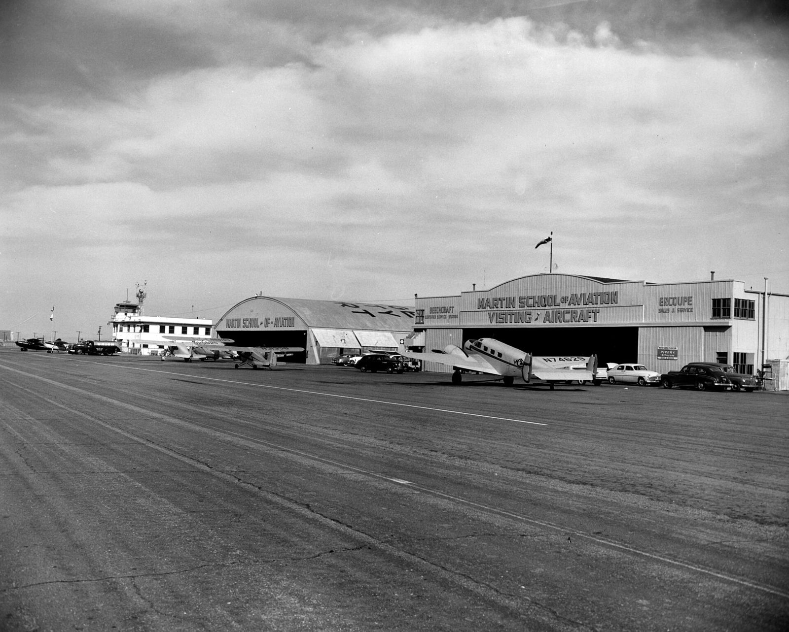
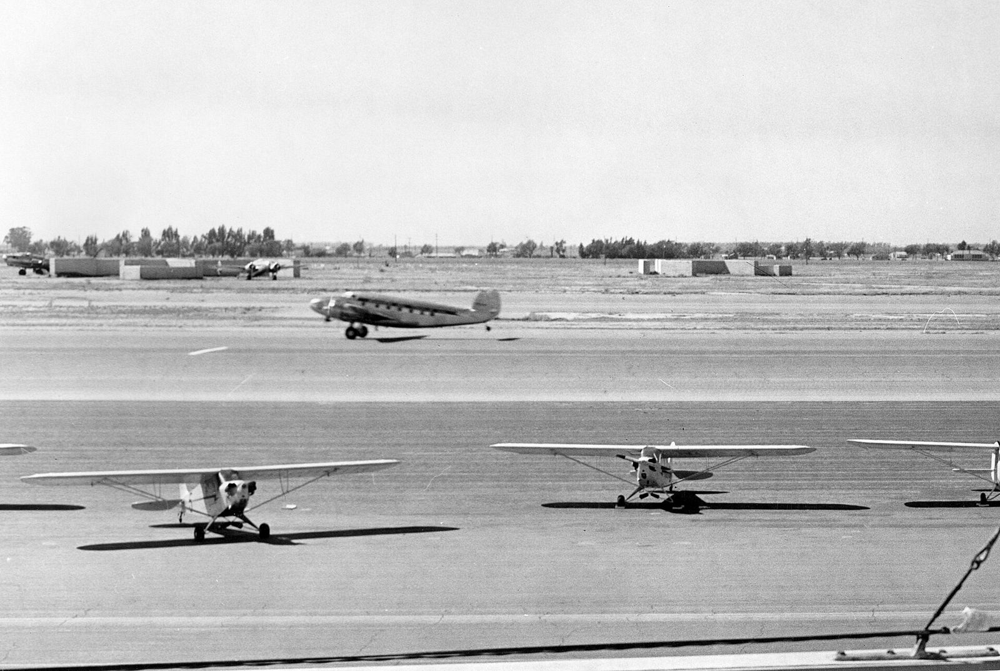

# Pappy Hart and the Bayonets

*Santa Ana and the first commercial drag strip, 1950–59*

!!! abstract "Article record"
    **Confidence:** High · **Source types:** obituaries (5+ agreeing), secondary · **Last verified:** 2026-10-13 (Round 3) · **Open issues:** Lions tenure conflict open · [How we rate this](../reference/source-standards.md)

!!! quote "In their own words"
    "I saw a need to get people to stop racing on the streets; that was dangerous."

    — C.J. Hart, National Dragster interview, 2001 (quoted by NHRA.com, 2004). [Full context in Voices](../voices/harts-santa-ana.md)

## Routed by bayonets

In the late 1940s, Orange County hot rodders raced on abandoned wartime airstrips such as the Navy's **Mile Square**. C.J. "Pappy" Hart recalled the good part: "We used to run off seven, eight abreast... With that many cars running, you'd have to beat somebody!" The bad part came one Sunday, when a company of U.S. Marines with fixed bayonets ran them off.[^mshf]<a href="#q-1" title="Single source so far: see Open questions">◐</a>

Hart's answer was a real strip.

## A strip, a Victrola and $1,000

The Orange County Airport manager (today John Wayne Airport) offered an unused strip if Hart paid the airport 10% of proceeds and got insurance. With less than $1,000, Hart, his wife **Peggy**, and two backers opened on **June 19, 1950**.[^mshf] The backers were **Frank Stillwell and Creighton Hunter**, fellow members of the Santa Ana Elks Lodge. The project had the blessing of CHP commissioner Clifford E. Peterson and the county supervisors, and Hunter and Stillwell sold out to Hart a few months in.[^pe]

It was a shoestring operation. The timing system was "cobbled together from an old Victrola" (NHRA, 2004).[^nhra04]

The gate was cheap. Spectators paid 50 cents, later raised to $1, and racers paid $1. The LA Times and NYT agree on this, as does the 2015 Press-Enterprise.[^lat][^pe] The NYT adds a quarter more to watch the mechanics work.[^nyt] MSHF's "50 cents, race or watch" looks like a simplification. The LA Times puts opening day at about 500 spectators and 50 cars, a typical Sunday at about 2,500, and the last day at over 4,000.[^lat]

It became a Sunday habit. Hart's son Gerald recalled races every Sunday "except Mother's Day. They tried it once and they wouldn't let that happen again." He said the only other strip he knew of was at Goleta.[^pe] Peggy Hart raced her 1933 Willys coupe there.[^pe] There was one fatality in nine years: a spectator struck by a flywheel.[^pe]

Hart was emphatic that he'd invented nothing: "I didn't invent drag racing... When I was growing up in Ohio, every stoplight, every night was a race."[^mshf]

## How the rules got invented

The rules came from wherever they could be found. The **quarter mile** was borrowed from horse racing, because "there was a lot of talk in those days that quarter horses were faster than cars," and the public could relate to it. **Timing** started with a stopwatch, then homemade electric timers.[^mshf]

**Classes** came next: stockers split by axle ratio, model year and displacement, with "hot-car" classes added when lakes racers showed up, along with the first cash awards. The "Dollar-A-Mile" program paid Top Eliminator $1 per mph.[^mshf]

The cars soon tested those rules. Chet Herbert's stripped Harley "The Beast" ran 121 and then 129 mph at Santa Ana in 1950, beating every bike and car there.[^herbert]

## Eviction and after

The airport that made the strip possible also ended it. The strip ran until **June 21, 1959**, when the county evicted Hart to expand the airport.[^pe] In 1965 he succeeded Mickey Thompson as manager of **Lions Drag Strip**, staying until 1971. There he created the Junior Fuel class and developed bracket and grudge racing.[^sema][^pe]

Hart died on **June 25, 2004**. NHRA, the Orange County Register, the NYT, AP and the Press-Enterprise all give June 25, and the NYT and AP quote his son Gerald.[^nhra04][^nyt] The LA Times wrote "died Saturday" (June 26) and MSHF gives June 26. Both are outliers.<a href="#q-2" title="Open question: see the bottom of the page">?</a>

## Open questions & disputed details

*From the detective's notebook: where the sources disagree, where we have only one, and what we are still looking for. Each item links back to its place in the story.*

**Single source so far.** *Single source (the Hall of Fame biography); we have not found a period report.* <a class="hr-q-back" href="#qr-1" title="Back to the story">↩</a>

**Open question.** **June 25 or June 26, 2004?** NHRA, the Orange County Register, the NYT, AP and the Press-Enterprise give June 25 for Hart's death, and the NYT and AP quote his son Gerald.[^nhra04][^nyt] The LA Times wrote "died Saturday" (June 26), and MSHF gives June 26. We follow the majority; a death record would settle it. <a class="hr-q-back" href="#qr-2" title="Back to the story">↩</a>

### More from the notebook

**⚠ Lions tenure** is still in conflict: 1965–71 per MSHF and SEMA, 1963–1970 per the OC Register.[^nhra04] See also [Peggy Hart](../people/peggy-hart.md).

⚠ **Round 10 notes:** (1) June 19, 1950, was a Monday. The Long & Tuttle clippings pamphlet dates the "first race" to Sunday, **July 2, 1950**. See [Peggy Hart](../people/peggy-hart.md#founder-of-the-strip-not-just-the-wife-of-one). (2) The same January 1980 *Hot Rod* profile that dates Hart's Lions start to "'65" also refers to "his very first act in '63." The 1965 date fits its own statement that he succeeded Mickey Thompson, who left in 1963.[^hr80]

## Images

<figure markdown>
{ loading=lazy }
<figcaption markdown>Orange County Airport in the 1950s, the airport whose unused strip hosted the Santa Ana Drags (1950–59). The view is not dated more precisely and does not show the drags. Creator: Orange County Archives. Date: 1950s (archive's date). Source: [Wikimedia Commons](https://commons.wikimedia.org/wiki/File:Orange_County_Airport,_1950s.jpg). License: [CC BY 2.0](https://creativecommons.org/licenses/by/2.0). Courtesy line requested by the archive: "Photo courtesy Orange County Archives."</figcaption>
</figure>

<figure markdown>
{ loading=lazy }
<figcaption markdown>An Orange County Airport runway, circa 1950s (archive's date). **We have not established which strip the drags used.** Creator: Orange County Archives. Date: circa 1950date QS:P,+1950-00-00T00:00:00Z/9,P1480,Q5727902s. Source: [Wikimedia Commons](https://commons.wikimedia.org/wiki/File:Orange_County_Airport_runway,_circa_1950s.jpg). License: [CC BY 2.0](https://creativecommons.org/licenses/by/2.0). Courtesy line requested by the archive: "Photo courtesy Orange County Archives."</figcaption>
</figure>

## Visual references (external)

*These are copyrighted or rights-restricted images, so we link to them instead of copying them.*

- [LOC, LOOK magazine job 55-6363 "Drag races" (1956, Bob Sandberg). Rights restricted; location not stated](https://www.loc.gov/pictures/item/2016713335)

[^mshf]: Dave Wallace, "C. J. Hart," Motorsports Hall of Fame of America. https://www.mshf.com/hall-of-fame/inductees/c-j-hart.html
[^pe]: Johan Moreno, "Santa Ana Drags: 65 years after...," Press-Enterprise, Oct 1, 2015. https://www.pressenterprise.com/2015/10/01/santa-ana-drags-65-years-after-the-strip-was-founded-it-still-brings-back-fond-racing-memories/
[^sema]: SEMA Hall of Fame 1981, "C.J. Hart." https://www.sema.org/hof/1981/cj-hart
[^herbert]: Daniel Strohl, "Chet Herbert," Hemmings, Sept 23, 2018. https://www.hemmings.com/stories/chet-herbert/
[^lat]: Shav Glick, LA Times, June 30, 2004. https://www.latimes.com/archives/la-xpm-2004-jun-30-me-hart30-story.html
[^nyt]: New York Times obituary, July 4, 2004, reproduced at wediditforlove.com. https://wediditforlove.com/cj-2.html
[^nhra04]: Phil Burgess, NHRA.com, 2004, and the OC Register / AP obituaries, reproduced at wediditforlove.com. https://wediditforlove.com/cj-2.html
[^hr80]: Dave Wallace, "The Hart of Drag Racing," *Hot Rod*, January 1980 (web reprint 2023). Accessed 2026-10-15. https://www.hotrod.com/features/the-hart-of-drag-racing-january-1980-982-1130-22-1
