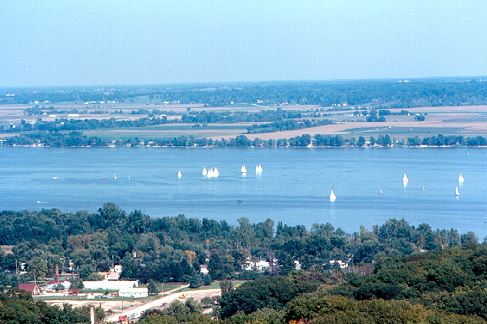
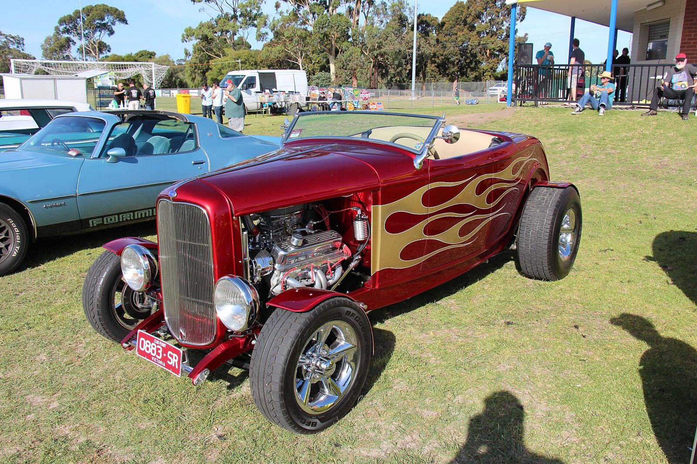

# Peoria, and the Boss Who Never Said Yes

*Peoria in August 1970: the first Street Rod Nationals, with no OK from the 7th floor, and 600 street rods came*

!!! abstract "Article record"
    **Confidence:** Medium · **Source types:** secondary, oral · **Last verified:** 2026-10-13 (Round 3) · **Open issues:** Best Car conflict open · [How we rate this](../reference/source-standards.md)

!!! quote "In their own words"
    "We couldn't get an OK from the 7th floor (Petersen Publishing upper management), but we were already into this thing so we went ahead and did it."

    — Tom Medley, Rod & Custom, 2007. [Full context in Voices](../voices/peoria-1970.md)

Street rodders by the late 1960s were again "lightning rods, much like the hot rodders of the '40s," with several states passing unfriendly laws.[^rc] At *Rod & Custom* the national gathering was planned by editor Tom Medley ("Street is Neat"), Bud Bryan, Jim "Jake" Jacobs and freelancer LeRoi "Tex" Smith. Petersen management ("the 7th floor") never approved it. The staff went ahead anyway. On August 14–16, 1970, 600 street rods came to a hayfield in Peoria for the first Nationals.

Bryan, explaining why: "The sport, at that point, was fragmented nationally. The Midwest and the East Coast guys didn't know much about the West Coast guys."[^rc]

## Why Peoria

The first question was where to hold it. Medley picked the Slo-Pokes club of Peoria, Illinois. The reason: Peoria "was almost the center of the population of the U.S." He met the mayor and council to assure them "we weren't a bunch of greasy fingered motorcycle guys."

Permission was the second question, and it never came. Petersen management ("the 7th floor") never approved it. The staff went ahead anyway. Gary Magner, of the Minnesota Street Rod Association, co-hosted.[^rc]

The event was a homemade one. A hayfield loaned by a Mr. Forest Lemmons hosted the show. On hand were a swap meet, a ~45-minute driving rally that about 200 rodders ran, and an improvised cone slalom Tex Smith called a "Streetkhana."[^rc]

Some of the rodders came a very long way. Andy Brizio drove ~2,000 miles from San Francisco in his America's Most Beautiful Roadster-winning '23 T-bucket, four friends with him, towing a broken car 740 miles to Cheyenne. Then he watched Best Car go to a trailered car.[^rc]

That Best Car call is still a puzzle. See [Midwest & East Threads](../places/midwest-east.md) for the Slo-Pokes and the two stories (Orv Elgie's 8,000-mile drive vs Brizio's "trailer" complaint).

## The numbers

That count holds up. Hagerty, citing MotorTrend, gives August 14–16, 1970, with 600 street rods. Nearly 5,000 rods by the 10th Nationals (1979, St. Paul), and the event's first Louisville stop in 1988, are what it reports.[^nsra] We checked those figures on Hagerty's page.

Two years after the event, *Hot Rod* gave the same count: the first Nationals "drew 600 rods and a couple of thousand surprised and delighted" fans.[^hr72] Rod & Custom's account uses a figure of about 200, and that figure counts the drivers in the rally, not the whole turnout.[^rc] An NSRA source has not yet confirmed the NSRA's founding date.

The 7th floor never approved it. The staff went ahead anyway, and that hayfield in Peoria is where the 600 street rods came.

*See also:* [Pro Street, from a Dayton Garage](1980s-pro-street.md).

## Images

<figure markdown>
{ loading=lazy }
<figcaption markdown>Upper Peoria Lake from the Peoria Heights water tower, Sept 19, 1970, a month after the first NSRA Street Rod Nationals. It shows the place and the year, **not the event**. Creator: Roger Wollstadt. Date: 1970-09-19. Source: [Wikimedia Commons](https://commons.wikimedia.org/wiki/File:Peoria_Heights_-_View_from_Water_Tower_1970.jpg). License: [CC BY-SA 2.0](https://creativecommons.org/licenses/by-sa/2.0).</figcaption>
</figure>

<figure markdown>
{ loading=lazy }
<figcaption markdown>A modern 1932 Ford roadster street rod. The uploader notes the '32 roadster and coupe have been the most popular street-rod bases since the 1950s. It is not a Peoria car. Creator: Sicnag. Date: 2014-12-17 17:49. Source: [Wikimedia Commons](https://commons.wikimedia.org/wiki/File:1932_Ford_Roadster_Hot_Rod_(16068067015).jpg). License: [CC BY 2.0](https://creativecommons.org/licenses/by/2.0).</figcaption>
</figure>

## Visual references (external)
*These are copyrighted or rights-restricted images, so we link to them instead of copying them.*

- [Peoria Magazine, "Hot Rods & Cool Cruisin'" (1970 photos)](https://www.peoriamagazine.com/archive/as_article/hot-rods-cool-cruisin/)

[^rc]: Dick Martin, "1st Street Rod Nationals – The Road to Peoria," Rod & Custom, Aug 7, 2007 (web). https://www.hotrod.com/news/0710rc-1st-street-rod-nationals (accessed 2026-10-12)
[^hr72]: "Street!", *Hot Rod*, October 1972 (web). https://www.hotrod.com/features/street-october-1972-982-698-120-1 (accessed 2026-10-22)
[^nsra]: Wikipedia, "National Street Rod Association." https://en.wikipedia.org/wiki/National_Street_Rod_Association ; Hagerty, "Celebrating the 55th year of the NSRA Street Rod Nationals." https://www.hagerty.com/media/events/celebrating-the-55th-year-of-the-nsra-street-rod-nationals/ (accessed 2026-10-12)
