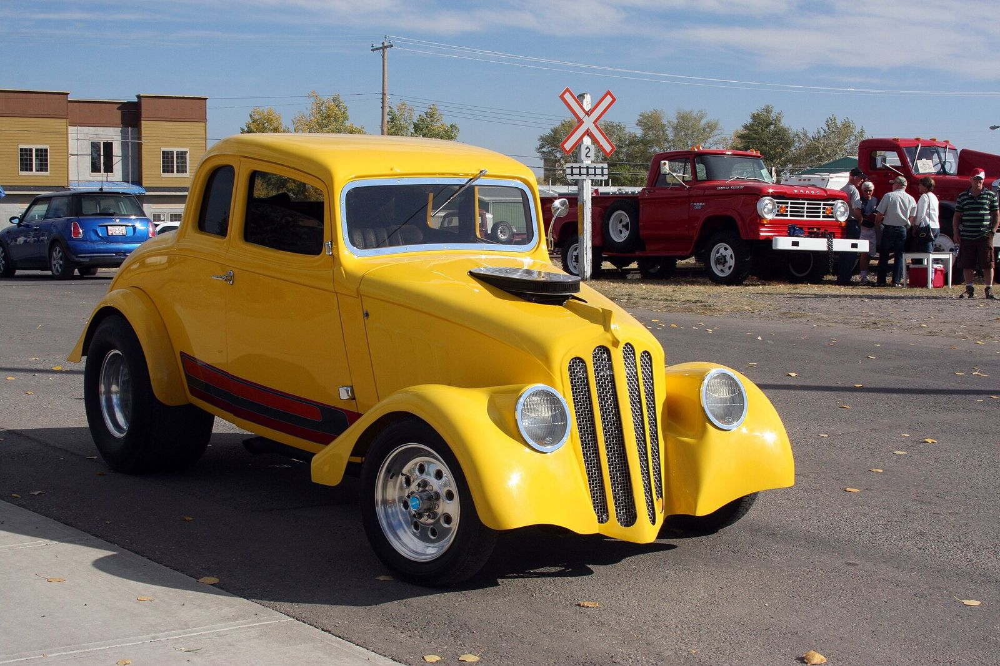

# Pro Street, from a Dayton Garage

*The 1980s*

!!! abstract "Article record"
    **Confidence:** Low · **Source types:** secondary · **Last verified:** 2026-10-12 (Round 1) · **Open issues:** Origin article unidentified · [How we rate this](../reference/source-standards.md)

"I don't ever recall a Pro Stocker having a supercharger on it."[^hr] That is Scott Sullivan, pushing back on the common description of Pro Street as an NHRA Pro Stocker for the street.

Sullivan, a self-taught builder working from a small shop in Dayton, Ohio since 1977, is cited as one of the style's originators.[^hr] What he was after was "something that looks like a race car, is plenty fast, but is fun to drive," putting "all the things I saw as a kid at the dragstrip on a street car."[^hr]

## Who named it

The name came before anyone agreed on the origin. Sullivan dates the label to **1979**, when photographer-writer **Steve Reyes** wrote an article featuring Sullivan's '66 Nova, a '66 Chevelle called "Goldenrod," and others, and called the trend "Pro Street." Sullivan admits the real start is "much harder to pin down": in **1974** he tucked 15x9 Cragars and 11.5-wide tires under a '71 Demon by tubbing it.[^hr]<a href="#q-1" title="Single source so far: see Open questions">◐</a>

The cars were meant to be driven, and he proved it: in 1988 he drove his '55 Chevy "Cheez Whiz" cross-country with photographer Jeff Smith.[^hr]

## The look (1979–late 80s)

The recipe: large rear tires under stock-looking bodies via wheel tubs, back-halved or tube chassis, roll cages, and often superchargers.[^hr2]<a href="#q-2" title="Single source so far: see Open questions">◐</a>

## Open questions & disputed details

*From the detective's notebook: where the sources disagree, where we have only one, and what we are still looking for. Each item links back to its place in the story.*

**Single source so far.** *The 1979 Reyes article is not yet identified by magazine/issue; open lead.*[^hr] <a class="hr-q-back" href="#qr-1" title="Back to the story">↩</a>

**Single source so far.** *Trait list from magazine summaries; to be expanded with period features.*[^hr2] <a class="hr-q-back" href="#qr-2" title="Back to the story">↩</a>

## Images

<figure markdown>
{ loading=lazy }
<figcaption markdown>A 1933 Willys built "into a Pro Street dragster with a Chevrolet 355cid V8" (uploader). It shows the tubbed, big-rear-tire stance. Photographed in 2011; build date unknown. Creator: dave_7 from Lethbridge, Canada. Date: 2011-09-25 15:20. Source: [Wikimedia Commons](https://commons.wikimedia.org/wiki/File:1933_Willys_Coupe_Pro_Street_(6239182633).jpg). License: [CC BY 2.0](https://creativecommons.org/licenses/by/2.0).</figcaption>
</figure>

[^hr]: John McGann, "What is Pro Street? Builder Scott Sullivan Answers the Question," Hot Rod, Apr 1, 2024. https://www.hotrod.com/features/pro-street-pioneer-scott-sullivan-interview (accessed 2026-10-12)
[^hr2]: Hot Rod, "What Is the Definition of Pro Street?" https://www.hotrod.com/features/where-it-all-began-what-is-pro-street (accessed 2026-10-12)
