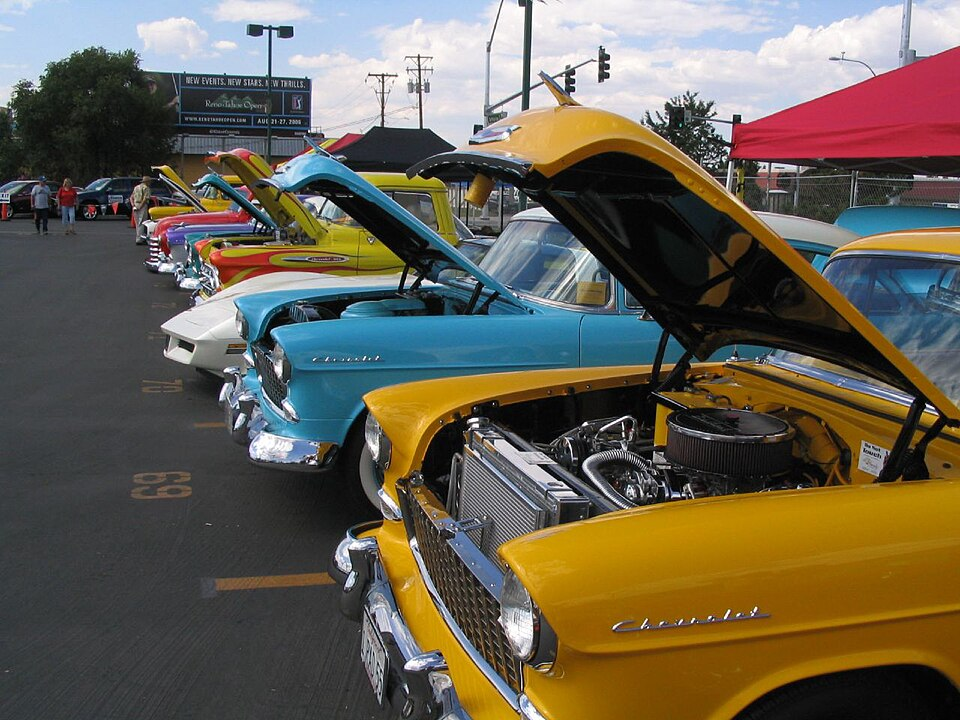

# A Dance That Grew Cars: How Hot August Nights Started in Reno (1986)

*A charity sock hop, a car club on the Easter Seals board, and a softball tournament's lesson*

!!! abstract "Article record"
    **Confidence:** Medium (the founding is one founder's own written account, printed in a local column in 2018; the event's own history page and a 2000 alternative-weekly retrospective agree on the outline but not on the name) · **Source types:** Grassroots a founder's firsthand account (Jim Webster, in Harry Spencer's *Sparks Tribune* column, 2018); local alt-weekly (*Reno News & Review*, 2000, reprinted 2026); the event's own history page; regional newspaper travel story (*Spokesman-Review*, 2000) · **Last verified:** 2026-11-17 (Round 42) · **Open issues:** ⚠ who named it and why (and how he spelled his name) · [How we rate this](../reference/source-standards.md)

!!! quote "In their own words"
    "I've never raced on a strip. It always used to be the back roads. And that was 35 years ago."

    — Mike Shaal, lined up in his stock MGA at the Hot August Nights runway drags, to the *Spokesman-Review*, July 9, 2000.[^sr00]

<figure markdown>
{ loading=lazy }
<figcaption markdown>Chevrolets with their hoods up at an outdoor show in Reno, August 3, 2006. The photographer titled the picture Hot August Nights. Photo: Ken Lund, via Wikimedia Commons, CC BY-SA 2.0. See [Image credits](../reference/image-credits.md).</figcaption>
</figure>

## A dance for Easter Seals

Hot August Nights did not start as a car show. It started as a dance, and the cars came along to raise a little more money.

In 1986 Jim Webster was the special event coordinator for the Easter Seal Society of Northern Nevada. In 2018, when Reno columnist Harry Spencer asked him to sort out the many stories about how Hot August Nights began, Webster wrote it down. A man from the Reno Board of Realtors called him, sent over by Webster's friend, radio DJ Jim McClain, wanting to hold a '50s-themed dance to benefit Easter Seals. The chairman of that year's realtors' dance was "a young, charismatic, commercial real estate agent" named Chuck Rose.[^web18]

Easter Seals had a board member, Bob Casey, who was president of the local Classic Chevys car club. "To expand the event's income possibilities," Webster wrote, he told Rose they should hold a classic car show with the dance. The club agreed to put on a show and shine the day of the dance, with all proceeds to Easter Seals.[^web18]

## The softball lesson

Then came what Webster called "the most significant part of the Hot August Nights story." That spring, for the first time, the Easter Seals softball tournament had invited teams from outside Reno-Sparks, from Sacramento, Carson, Lake Tahoe, Redding, Chico and Stockton, and had its best year yet. "We found the softball teams loved the magic of Reno," he wrote, the neon arch, the casinos, the parties. Car clubs, he thought, might feel the same. Most of them did their own local events. So the Classic Chevys became the host club, and the plan became reaching out to neighboring cities and states. "In a matter of days, we had gone from a local dance to a regional car show and major entertainment event. At least, in theory!" The whole thing came together in about four months, and when it was over, Easter Seals got the first donation.[^web18]

The event's own history puts the first night at August 1, 1986, at the Reno-Sparks Convention Center, with 10,000 people inside to see the Righteous Brothers, Wolfman Jack and Jan & Dean. "The first year of Hot August Nights was more of a nostalgia event than a car event," it says. "But it was the car parade that was the highlight," with crowds along Virginia Street.[^hanhist] The *Reno News & Review* counted a three-day event in 1986, with a sock hop, car shows, concerts and Elvis and Marilyn lookalike contests, and an estimated 28,000 people at the events.[^rnr00]

## The name, three ways

Webster's account gives the name to "superstar Willie Davidson" of Coors New West Distributing, the first real sponsor. At a meeting there, Davidson said he had planned an August concert series at Rancho San Rafael Park, the county park that hosted the first show and shine, and was going to call it Hot August Nights "in honor of my favorite Neil Diamond album." The group voted.[^web18] The *Reno News & Review*, which calls him Willie Davison, a Coors marketing executive and co-founder, quoted him in 2000 with a different reason: he wanted a month-long event, with a Chevrolet week, a Ford week and an "obsolete iron" week. "That's why I named it Hot August Nights," he said. "I intended the event to take up the whole month." The event's own history says simply that the weather was hot and August was right.<a href="#q-1" title="Sources disagree: see Open questions">⚠</a>[^rnr00][^hanhist]

## When the cars took over

The month never happened. The 1987 event ran eight days and ended $250,000 in debt, and Davison and other organizers left. In 1988 it came back at three and a half days with a prom night, car parades, cruises and swap meets, and by 1990 it was out of debt. By the mid-1990s hotel rooms sold out and car registration was capped after 3,500.[^rnr00] By 2000 there were about 4,000 cars registered, all 1969 or older, from what one registrar called "30 to 40 states."[^rnr00][^sr00] Cruising, the *Spokesman-Review* noted, was once "barely tolerated by the men in blue"; in Reno they barricaded cross traffic for it. A runway served as the drag strip, where Mike Shaal lined up his stock MGA against a stock Mustang. The Mustang crossed the finish while the MGA had barely reached midcourse, and Shaal idled back grinning.[^sr00] "We started this in 1986 to earn money for the Easter Seal Society," Webster told the paper. "I don't think any of us knew how large it would grow."[^sr00]

The dance came first, and the cars were a way to sell a few more tickets. That is how it began, and the cars have run it ever since.

*See also:* [Rope Barriers, Water Drums and the Show Circuit](show-circuit.md); [Las Vegas and Henderson drag strips](../drag-racing/las-vegas-henderson-drag-strips.md); [Dragging Main](../places/dragging-main.md); [Draggin' Main in Clovis](../places/draggin-main-clovis-new-mexico.md), another town that brought its cruise back as an event.

## Open questions & disputed details

*From the detective's notebook: where the sources disagree, where we have only one, and what we are still looking for. Each item links back to its place in the story.*

**Disputed.** **Who named Hot August Nights, and why?** Webster (2018) says Willie Davidson proposed the name he had planned for a concert series, after his favorite Neil Diamond album, and the founders voted.[^web18] Davison himself told the *Reno News & Review* in 2000 that he named it because he wanted the event to fill the whole month.[^rnr00] The event's history page ties the name to the hot August weather.[^hanhist] The accounts agree on the man and differ on the reason, and also on his surname: Webster's text spells it Davidson, the *Reno News & Review* Davison. <a class="hr-q-back" href="#qr-1" title="Back to the story">↩</a>

### Next leads

The *Reno Gazette-Journal*'s coverage of the first event (August 1986), which the *Reno News & Review* quotes; the four founders' 2019 talk at the Nevada Historical Society; Classic Chevys of Reno club records; Easter Seals of Northern Nevada.

## Sources

[^web18]: Harry Spencer, "Hot August Nights," *Sparks Tribune*, August 21, 2018 (column printing Jim Webster's written account). https://sparkstrib.com/2018/08/21/hot-august-nights-8/ (accessed 2026-11-17)
[^hanhist]: "History of Hot August Nights," Hot August Nights. https://hotaugustnights.net/history-of-hot-august-nights/ (accessed 2026-11-17)
[^rnr00]: Jimmy Boegle, "The turbulent history of Hot August Nights," *Reno News & Review*, July 27, 2000, reprinted as "From the Archives" (2026). https://renonr.com/newsletter/from-the-archives-hot-august-nights-now-in-its-15th-year-survives-despite-a-history-of-controversy-july-27-2000/ (accessed 2026-11-17)
[^sr00]: Dan Leeth, "Revved Up Reno: Classic Cars From Across the West Cruise to Hot August Nights," *Spokesman-Review*, July 9, 2000. https://www.spokesman.com/stories/2000/jul/09/revved-up-reno-classic-cars-from-across-the-west/ (accessed 2026-11-17)
