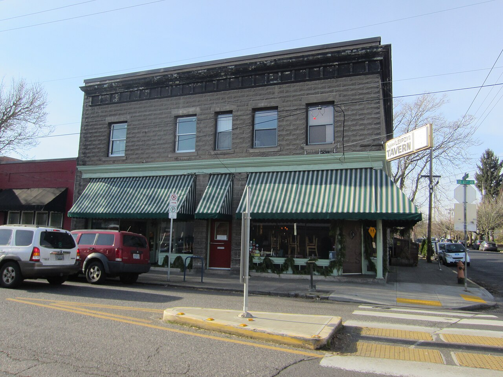

# Street Rod Before *Street Rodder*

*The Portland magazine (1971–73) and Bruce Miller*

!!! abstract "Article record"
    **Confidence:** Medium · **Source types:** collector's cover-and-contents index with a publication history informed by co-founder Bruce Craig (99W Speed Shop), founders' recollections (*Street Rodder* 40th anniversary, 2012/2014), period magazine profile (*Hot Rod*, July 1978), enthusiast memoir · **Last verified:** 2026-10-15 (Round 10) · **Open issues:** ⚠ First NSRA president (Bruce Miller vs Dick Wells); ⚠ "first Street Rod Nationals in Memphis in 1970" is a misstatement (Peoria 1970, Memphis 1971); single main source for business history; no copy of an issue seen · [How we rate this](../reference/source-standards.md)

!!! quote "In their own words"
    "We originally intended to call it Street Rod, but not long before we went to print Bruce Miller in Portland, Oregon, came out with Street Rod magazine. So we changed our name."

    — Jim Clark, first editor of *Street Rodder*, recalled for its 40th anniversary (posted Apr 8, 2014). *Told about 40 years later.* [More in Voices](../voices/street-rodder-founding.md)

Before ***Street Rodder*** there was ***Street Rod***. It was a 64-page, 75-cent monthly put together in Portland, Oregon, apartments by two men who met at church. It ran for **20 issues, October 1971 to July 1973**, and its title forced the California founders of *Street Rodder* to rename their magazine. That makes it one of the first periodicals devoted entirely to the new street-rod movement, and a Pacific Northwest one. Round 7 left it as an open question on our [Street Rodder founding](../voices/street-rodder-founding.md) page; this article answers it.

## The founders

*Street Rod* "was started by **Bruce Miller and Bruce Craig** in Portland, Oregon." Miller was "the publisher and the controlling owner."[^99w]

Miller moved to Portland in **1971** to work for United Medical Lab. He met Craig **at church**. Craig offered to help because his wife "had experience with typesetting."[^99w]

The 99W history calls Miller "a real 'schmoozer'" who connected with **Tex Smith**. That connection "ultimately yielded a contract with **Kable News Service** for Street Rod's printing and distribution."[^99w] ◐

## Where the idea came from (⚠ disputed)

99W: Miller "was part of a conversation with other founders of the street rod movement — Tex Smith, Tom Medley, Bud Bryan and others." Talk turned to a street-rod magazine and to rumors that Petersen might close *Rod & Custom*. "After everyone left the brainstorming session, **many believe that Miller took ideas and even the magazine title** name and launched the magazine. This was apparently a source of frustration for some involved."[^99w] ◐ *Reported belief, not a documented fact.*

⚠ **Venue and date:** 99W places that talk "at the first Street Rod Nationals in **Memphis**, Tennessee in **1970**." The first Nationals was held at **Peoria, Ill., in August 1970**, and the second at Memphis in 1971. See [NSRA and the early Nationals](../street-rodding/nsra-early-nationals.md). The conversation probably took place at Peoria in 1970, or around the 1971 Memphis event, before *Street Rod*'s October 1971 debut. Either way, the 99W date and place cannot both be right.

Jim Clark's account matches the title story from the other side. *Street Rodder* "originally intended to call it Street Rod," but Miller's magazine came out first, "so we changed our name. It was released in **May 1972**."[^sr40]

## Bruce Miller and the NSRA

99W: "Mr. Miller held NSRA membership number **#1** as he was the **first President**."[^99w] ◐

In a July 1978 *Hot Rod* profile, Tex Smith lists the NSRA's founders as "me, Tom [Medley], Bud [Bryan], **Bruce Miller**, Vern Walker, Billy Weber and Cotton Werksman."[^tex] This period source confirms that Miller was a founder, though not that he was president. Greg Wapling's memoir says Cotton Werksman, Dick Royer, Bruce Miller, Bugg and Walker "chipped in" and "became a part of the NSRA."[^wap] ◐

⚠ **From the detective's notebook:** Hagerty's 2024 Nationals history, cited on our [NSRA page](../street-rodding/nsra-early-nationals.md), says **Dick Wells** was the NSRA's first president.[^hag] The two claims could be reconciled if Miller held the office first and Wells the first salaried post, or the reverse. We have not found an NSRA document that settles it. **Unresolved.**

## Making the magazine

The first issue drew heavily on a **June 1971** trip Miller and Craig made to the **Yellowstone Rod Run** in a group of six to eight cars. The group included **John Slaughter**, "another church member, fellow hot rodder and investor." "Both Bruce's wrote copy and took photographs."[^99w]

Miller "funded the first year of production largely with his credit card."[^99w] **Spence Murray** traveled to Portland to help Craig produce the first issue.[^99w] ◐

The first issue ran **10,000 copies**. Production moved from Craig's apartment to Miller's (until March 1972), then to rented offices in Portland's **Sellwood** neighborhood. 99W places that "near Milwaukee, Oregon," meaning neighboring **Milwaukie**.[^99w]

**Dale Moreau** was the photographer. Miller met him at United Medical Labs, and Moreau later became Freightliner's corporate photographer. **Russ Meeks**, "another well known Portland hot rodder," was technical editor.[^99w]

Sales were about **40,000 per month** net paid, as 99W tells it. Its own data note adds that the publisher "did not provide net paid circulation data to N.W. Ayer," so the figure cannot be checked against Ayer's directory.[^99w] ◐ The format was 64 pages at $0.75, with coverage of "how-to-do-its, rod run coverage, rodding trends, car features and club activities."[^99w]

## The end (1973)

In **January 1973** Craig "had not been paid." In a restructuring he took an ownership percentage and **a '39 Ford**. Miller's ownership "was ended by trading for a **Model A truck**." Slaughter, who owned a business that designed and installed golf courses, took control as publisher and editor.[^99w]

Craig later explained that the magazine bought paper on 90-day credit. During the **mid-1973 paper shortage**, with no supply contract, the printer required three months' prepayment, "and cash flow did not allow them to keep the magazine operating." It folded **after the July 1973 issue**.[^99w] ◐ *Craig's recollection, as relayed by 99W.*

### Issue run (per the 99W cover index)

| Volume | Issues |
|---|---|
| Vol 1 | No 1 **Oct 1971**; No 2 Dec 1971 |
| Vol 2 | No 1 Jan 1972 through No 12 Dec 1972 (monthly) |
| Vol 3 | No 1 Jan/Feb 1973; No 3 Mar; No 4 Apr; No 5 May; No 6 June; No 7 **July 1973 (last)** |

That is 20 issues, which matches 99W's count. There is no Vol 3 No 2, apparently because the combined January/February 1973 issue took that number.[^99w]

**See also:** [Street Rodder founding voices](../voices/street-rodder-founding.md), [NSRA and the early Nationals](../street-rodding/nsra-early-nationals.md), [Pacific Northwest](../places/pacific-northwest.md), [Street Rod Nationals era](../eras/1970s-street-rod-nationals.md), [The drag rags](../eras/1960s-drag-rags.md).

## Images

<figure markdown>
{ loading=lazy }
<figcaption markdown>Sellwood, Portland, Oregon, in 2015. *Street Rod* rented offices in this neighborhood from March 1972. **Neighborhood context only; this is not the magazine's building.** Creator: Another Believer. Date: 2015-01-02. Source: [Wikimedia Commons](https://commons.wikimedia.org/wiki/File:Sellwood,_Portland,_Oregon_(2015)_-_03.JPG). License: [CC BY-SA 4.0](https://creativecommons.org/licenses/by-sa/4.0).</figcaption>
</figure>

## Visual references (external)
*These are copyrighted or rights-restricted images, so we link to them instead of copying them.*

- [99W Speed Shop, *Street Rod* covers and tables of contents, 1971–73](http://99wspeedshop.com/streetrod.html)

[^99w]: 99W Speed Shop, "Street Rod – Magazine Covers 1971 to 1973" (overview and publication data). Accessed 2026-10-15. http://99wspeedshop.com/streetrod.html
[^sr40]: *Street Rodder*, "Street Rodder's 40th Anniversary – Time Flies" (hotrod.com, posted Apr 8, 2014). Accessed 2026-10-15. https://www.hotrod.com/features/street-rodders-40th-anniversary
[^tex]: "Tex Smith: The Rodfather," *Hot Rod*, July 1978 (hotrod.com repost). Accessed 2026-10-15. https://www.hotrod.com/features/tex-smith-the-rodfather-july-1978-982-1376-52-1
[^wap]: Greg Wapling, "The Street Rod Nats Past and Present," Hot Rod History. Accessed 2026-10-15. https://hotrod.gregwapling.com/hot-rod-history/the-street-rod-nats-past-and-present.html
[^hag]: Hagerty, "Celebrating the 55th year of the NSRA Street Rod Nationals" (2024). https://www.hagerty.com/media/events/celebrating-the-55th-year-of-the-nsra-street-rod-nationals/
