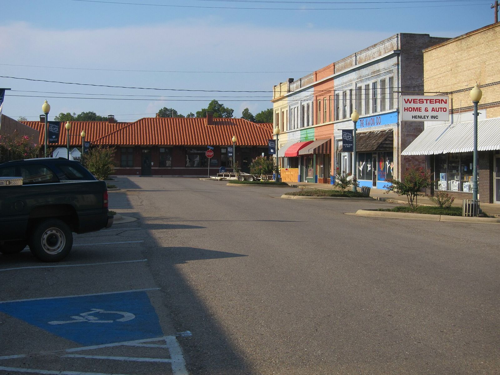

# *Street Rod* in the Small-Town Paper: Henry Gregor Felsen's Serial (1953–1954)

!!! abstract "Article record"
    **Confidence:** Medium · **Source types:** Grassroots small-town dailies that ran the serial (*Escanaba Daily Press*, Mich.; *Hope Star*, Ark.; *Harrisburg Daily Register*, Ill.; 1954, read as page OCR), university archive finding aid (University of Iowa Special Collections), a 1953 trade review (*Kirkus*), Open Library catalog record, a 2010s book review (Speedreaders), a collector's blog · **Last verified:** 2026-10-16 (Round 14) · **Open issues:** ⚠ which Felsen novel carries the "Iowa Timing Association" dedication; the novel's own text could be seen only as search snippets (the scans are lending-only) ◐; we have not identified the Iowa Timing Association's members or meets · [How we rate this](../reference/source-standards.md)

!!! quote "In their own words"
    "We'd clobber the guy that fouled it up."

    — **Ricky Madison**, the hero of Felsen's *Street Rod*, after his father asks whether a supervised drag strip would work in his town; installment in the *Hope Star*, Hope, Arkansas, May 29, 1954.[^hope0529]

In the spring of 1954 a kid in Hope, Arkansas, could follow a hot rodder's fight with city hall in the local paper, one installment a day. The same story ran that May in Escanaba, Michigan, and that July in Harrisburg, Illinois. Each installment carried the same small print: "Copyright 1953 by Henry Gregor Felsen. Printed by arrangement with the publishers, Random House, Inc. Distributed by NEA Service."[^esc0511][^harr0701]

The novel was *Street Rod*. Its hero, 16-year-old Ricky Madison of "Dellville," Iowa, buys a car without permission, builds it up, and tries to talk his town into a supervised drag strip.[^kirkus][^ol]

## The writer from the Iowa Writers' Project

Felsen was born in Brooklyn in 1916. The University of Iowa's archive says he spent two years at the university, left because he could not afford the tuition, came back to Iowa City to write for the Iowa Writers' Project guidebook, served with the Marines in the Pacific writing for *Leatherneck*, and returned to Iowa in 1946 to stay for most of his life. His car novels, *Hot Rod*, *Street Rod* and *Crash Club*, sold about eight million copies, and *Hot Rod* stayed on a children's bestseller list for nearly thirty years, the finding aid says.[^uiowa]

Random House published *Street Rod* in 1953, 277 pages.[^ol] *Kirkus* priced it at $2.50 and did not go easy: "Hot rodding and the competitive spirit born of boredom and the wish to be a big shot, get a scathing denunciation," the review began, in a novel that "probes further than Felsen's former Hot Rod."[^kirkus]

## The drag-strip episodes

The newspaper version keeps the book's civic argument front and center. In the *Hope Star*'s May 29 installment, Ricky's father admits he has been reading his son's magazines: "I've read about these hot-rod clubs around the country that have drag strips," he says, and he has noticed that clubs with strips pledge themselves to safe driving and cooperation with the law. Ricky's answer is the line at the top of this page.[^hope0529]

By the May 31 installment Ricky is in front of the mayor, explaining the new Dellville Timing Association. "We're trying to help solve a problem," he says, and he explains that a drag race is an acceleration race: "It tests cars." Gus Vorkle, at the meeting, isn't buying it: "You want the city to give you a race track and encourage hot-rod driving."[^hope0531] In the novel the council turns the boys down, and *Kirkus* says an out-of-town wreck makes the town's elders so wary that they forbid dating in cars.[^ebsco][^kirkus]

None of that is history; it's a novel. But the argument is the one real towns were having that same year. In June 1954 the police of Columbia, Missouri, started the Motor Sports Club ([City planners, 1955](../drag-racing/planners-report-1955.md)), and that December eight members organized the Drag-n's in Escanaba, the same town whose paper had run *Street Rod* in May ([The Cop and the Auto Shop](../drag-racing/escanaba-dragns.md)). We have found nothing that connects the serial to either club.<a href="#q-1" title="Open question: see the bottom of the page">?</a>

## Open questions & disputed details

*From the detective's notebook: where the sources disagree, where we have only one, and what we are still looking for. Each item links back to its place in the story.*

### ⚠ Whose dedication?

The Internet Archive's scans of *Street Rod* (1953 and a 1962 printing) can't be read in full, but their full-text search shows the dedication at the front: "To my fellow members of the Iowa Timing Association." A 2010s review of the 1962 Bantam paperback quotes the same line for *Street Rod*.[^iasnip][^speed]

A children's-book collector's blog puts that dedication in ***Hot Rod*** instead, along with a grim note it says Felsen added: that he was mailing the manuscript on Friday afternoon, January 16, 1953, and that by the time it reached New York, statistics said two Iowa teenagers would die in car crashes.[^ccb] January 16, 1953, was a Friday, and *Hot Rod* came out in 1950, so the note fits *Street Rod* better. We have not seen that note in either book.

Felsen calls himself a member, so an Iowa Timing Association existed by early 1953. Who belonged and where they ran, we don't know yet. Des Moines got a drag strip in 1957, built by a farmer, Ernest Day, at his son's urging, according to a 2011 drag-racing history piece; nothing we read connects it to Felsen.[^dmd]

<figure markdown>
{ loading=lazy }
<figcaption markdown>Main Street in Hope, Arkansas, in 2010. The *Hope Star* ran *Street Rod* as a daily serial in May and June 1954; context only. Creator: Jay Cross (Flickr: Hope, Arkansas, Family Council). Date: 2010-09-18. Source: [Wikimedia Commons](https://commons.wikimedia.org/wiki/File:Downtown_Hope,_AR.jpg). License: [CC BY 2.0](https://creativecommons.org/licenses/by/2.0).</figcaption>
</figure>

**Visual references (external):** book covers of the 1953 Random House and 1962 Bantam editions are on the [Open Library record](https://openlibrary.org/works/OL6663722W/Street_rod) and the [Speedreaders review](https://speedreaders.info/8720-street-rod/) (copyrighted, linked only). <a class="hr-q-back" href="#qr-1" title="Back to the story">↩</a>

[^esc0511]: *Street Rod* installment whose synopsis says Ricky feels lost because his friends have hot rods while he has only a bicycle, *Escanaba Daily Press* (Mich.), May 11, 1954, read as page OCR. https://archive.org/details/escanaba-daily-press-1954-05-11 (accessed 2026-10-16)
[^harr0701]: *Street Rod* installment, *Harrisburg Daily Register* (Ill.), July 1, 1954 (also July 9, 1954). https://archive.org/details/harrisburg-daily-register-1954-07-01 (accessed 2026-10-16)
[^hope0529]: *Street Rod*, installment XIV, *Hope Star* (Hope, Ark.), May 29, 1954, read as page OCR. https://archive.org/details/hope-star-1954-05-29 (accessed 2026-10-16)
[^hope0531]: *Street Rod* installment, *Hope Star*, May 31, 1954. https://archive.org/details/hope-star-1954-05-31 (accessed 2026-10-16)
[^kirkus]: Review of *Street Rod* (Random House, $2.50), *Bulletin from Virginia Kirkus' Bookshop Service*, May 15, 1953 (supplement). https://archive.org/details/sim_kirkus-reviews_1953-05-15_21_supplement (accessed 2026-10-16)
[^ol]: Open Library, *Street rod* by Henry Gregor Felsen (Random House, 1953; 277 p.). https://openlibrary.org/works/OL6663722W/Street_rod (accessed 2026-10-16)
[^uiowa]: "Papers of Henry Gregor Felsen" (MsC 601), Special Collections, University of Iowa Libraries, finding aid with biographical note. https://www.lib.uiowa.edu/scua/msc/tomsc650/msc601/felsen.html (accessed 2026-10-16)
[^ebsco]: "Street Rod by Henry Gregor Felsen," EBSCO Research Starters (plot summary). https://www.ebsco.com/research-starters/literature-and-writing/street-rod-henry-gregor-felsen/ (accessed 2026-10-16)
[^iasnip]: Internet Archive full-text search results for "Iowa Timing Association," showing the dedication in scans of *Street Rod* (1953 Random House; 1962 printing). https://archive.org/details/streetrod00fels ; https://archive.org/details/bwb_T4-AKE-303 (accessed 2026-10-16; text lending-restricted, snippet only)
[^speed]: Review of *Street Rod* (1962 Bantam paperback), Speedreaders. https://speedreaders.info/8720-street-rod/ (accessed 2026-10-16)
[^ccb]: Peter D. Sieruta, "And Tell All the Stars Above...," *Collecting Children's Books* (blog), April 23, 2009. http://collectingchildrensbooks.blogspot.com/2009/04/and-tell-all-stars-above.html (accessed 2026-10-16)
[^dmd]: Andrew Wolf, "Flashback Friday: Iowa's Des Moines Dragway," Dragzine, July 15, 2011. https://www.dragzine.com/news/flashback-friday-iowas-des-moines-dragway/ (accessed 2026-10-16)
