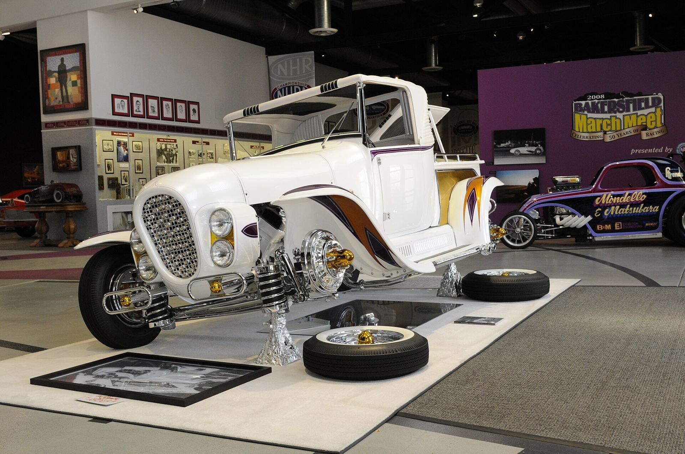
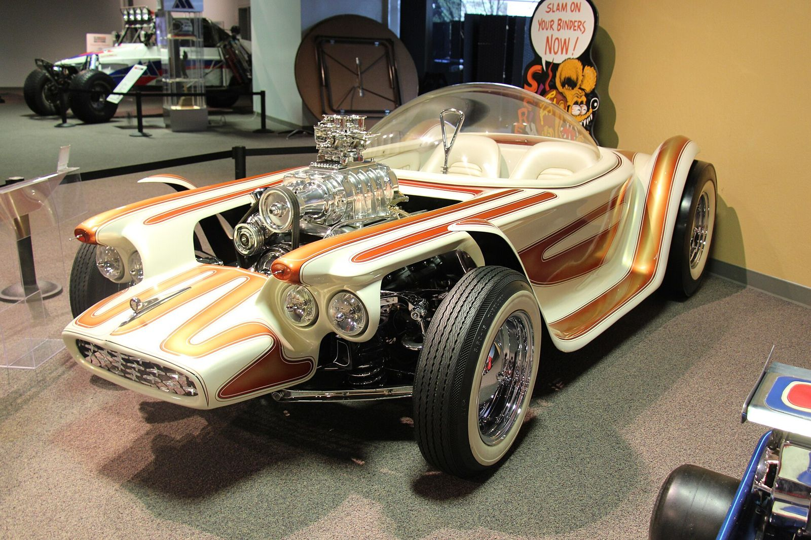
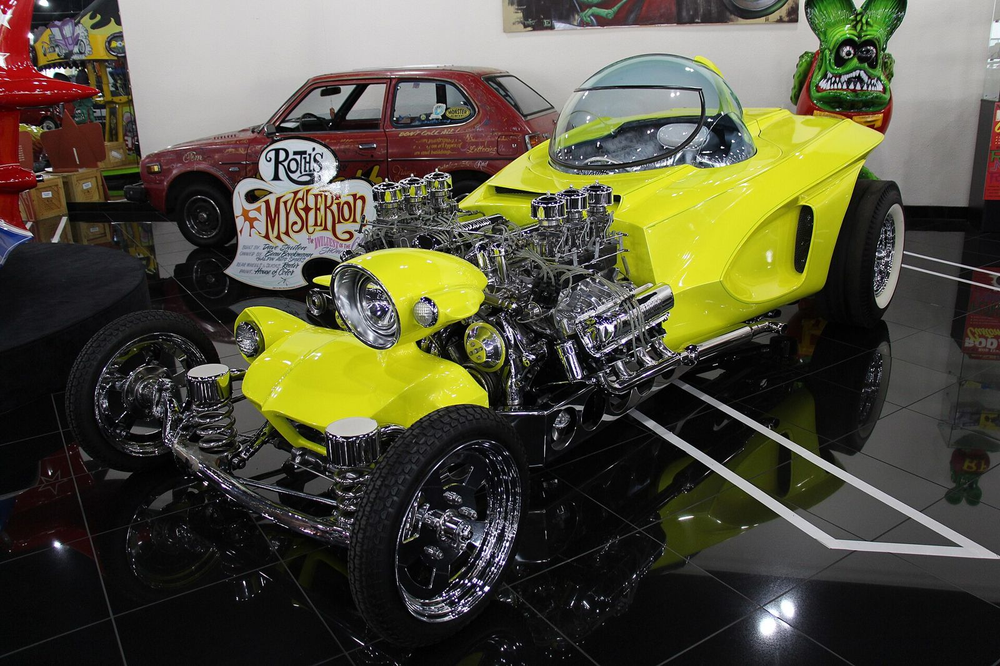
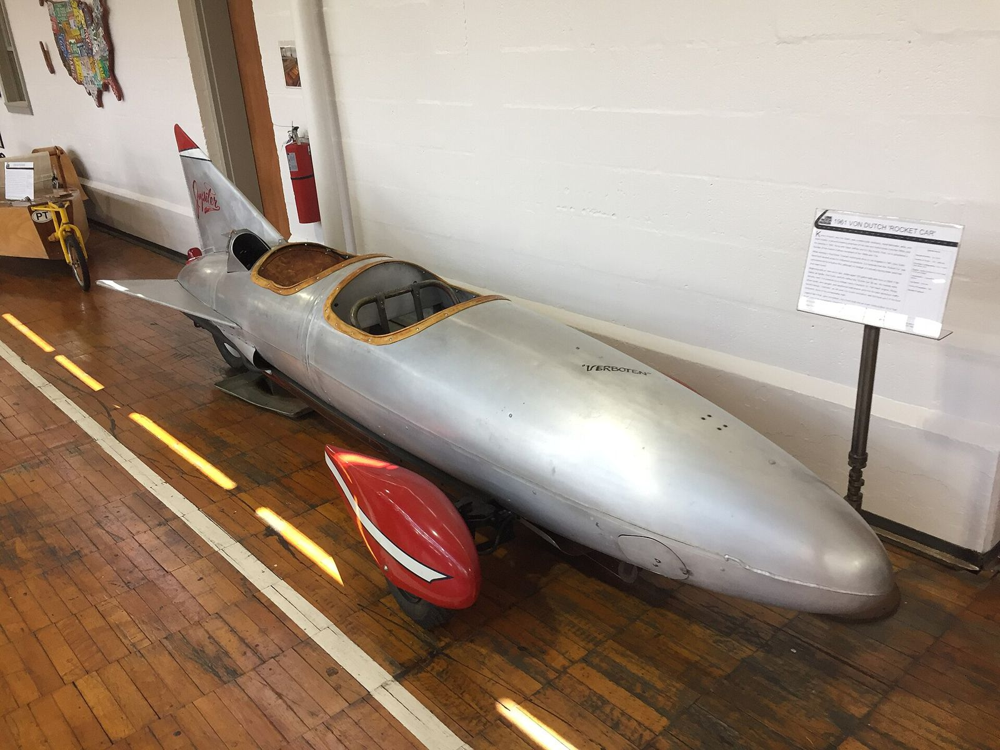

# Customs on Paper and in Plastic

*Trend Books, model kits and Roth*

!!! abstract "Article record"
    **Confidence:** Medium · **Source types:** reference (Kustomrama), hobby-press history, company history, secondary · **Last verified:** 2026-10-13 (Round 6) · **Open issues:** Roth royalty figure is "debated" · [How we rate this](../reference/source-standards.md)

!!! quote "In their own words"
    "Nothing is original. Everything is in the subconscious, we just 'tap' it sometimes and think we have originated something."

    — Von Dutch, hand-lettered sign (via LA Times, 2002). [Full context in Voices](../voices/von-dutch.md)

## The 1951 Trend Book

Petersen's *Custom Cars* Trend Book No. 101 (1951) was published by Robert R. Lindsay and R.E. Petersen and edited by Walter A. Woron. It drew a line between **"restyled"** and **"custom"** cars: "A restyled car can include any or all of the following modifications without actually being a custom job: a bull-nose, a deck job, fadeaways, a new grille, and/or new bumpers. When it gets to chopped tops and channeling, the car would more properly be termed a custom job."[^tb]

Kustomrama's index of the book shows how *national* the first annual already was. Dick Bair's '39 Ford came from Akron, Ohio, and was driven to Barris in California and back. Ray Birky was from Antioch, Illinois; Woody's Body Shop from Grand Island, Nebraska; Rudy Makela's '42 Cadillac from Indianapolis. Other cars came from Denver, Seattle, Vermont, Augusta (Georgia), Miami Springs, Chicago and Pennsylvania.[^tb]<a href="#q-1" title="Single source so far: see Open questions">◐</a>

According to the 99W Speed Shop list (and Kustomrama), the Custom Cars annuals ran from No. 101 (1951) to No. 206 (1962). The line was then rebranded **Spotlite Books**.[^99w]<a href="#q-2" title="Single source so far: see Open questions">◐</a>

## AMT's 3-in-1 (1958): customizing becomes a toy

Seven years later the custom went into the toy box. In 1958 AMT took unassembled promotional models, "add[ed] some extra parts," and sold them as kits that could be built **stock, competition or custom**. The custom parts were skirts, continental kits and spotlights (Promotex, 2002).[^px] Round2, today's owner of the AMT brand, says the response was "phenomenal" and that AMT built its own plant in Troy, Michigan, by 1961.[^r2]

The 1959 custom options included louvers, spotlights, moon discs, bubble skirts, lowering blocks, lake pipes, and flame and scallop decals (Centerline Hobbies).[^cl] This was a mail-order vocabulary of 1950s customizing, sold to teenagers nationwide.<a href="#q-3" title="Sources disagree: see Open questions">⚠</a>

Soon the customizers' names were on the box. Coachbuilt's interview with Gene Winfield says AMT included Barris tips in 1961 and 1962. From 1963 there was an "AMT Customizing Team": Barris, the Alexander Brothers, Bill Cushenbery and Winfield.[^cbw] Winfield said he was a consultant from 1962 and later ran AMT's **Speed & Custom Division**.[^cbw] Round2 says that division was founded in 1965 and based in Phoenix.[^r2] AMT kitted replicas of real show cars, including the Ala Kart.[^r2]

## Roth and Revell

Revell's customizer was Roth. Revell's first Roth car kit, the **Outlaw** (kit 1282), came out in 1962 (Museum of American Speed; Scalemates).[^mas] Several sources report that Roth earned **one cent per kit** and made about **$32,000 in 1963**. Hemmings is reported to call the figure debated; we have not read the Hemmings text first-hand.[^rf]<a href="#q-4" title="Single source so far: see Open questions">◐</a>

## Open questions & disputed details

*From the detective's notebook: where the sources disagree, where we have only one, and what we are still looking for. Each item links back to its place in the story.*

**Single source so far.** That is evidence that regional builders were working, and being published, by 1951. Many of them seem to be forgotten now.[^tb] <a class="hr-q-back" href="#qr-1" title="Back to the story">↩</a>

**Single source so far.** **When did Trend become Spotlite?** The rebranding after No. 206 (1962) comes from the 99W Speed Shop list.[^99w] Lead: the books' own imprint pages. <a class="hr-q-back" href="#qr-2" title="Back to the story">↩</a>

**Disputed.** **Who invented the "annual" kit?** The Crittenden Automotive Library, citing Doty (2007), says **SMP** created the 3-in-1 annual kit and its logo, and AMT adopted them when it bought SMP in 1961.[^cal] Promotex and Round2 credit AMT, from 1958.[^px][^r2] <a class="hr-q-back" href="#qr-3" title="Back to the story">↩</a>

**Single source so far.** **One cent a kit?** The "one cent per kit" and "$32,000 in 1963" figures are widely repeated, and Hemmings is reported to call them debated; we have not read the Hemmings text.[^rf] Lead: Revell's or Roth's own accounts. <a class="hr-q-back" href="#qr-4" title="Back to the story">↩</a>

## Images

<figure markdown>
{ loading=lazy }
<figcaption markdown>The restored **Ala Kart**, the Barris-built '29 Ford roadster pickup that won AMBR in 1958 and 1959 and that AMT kitted. Photographed at the Wally Parks NHRA Motorsports Museum. Creator: Wally Parks NHRA Motorsports Museum. Date: 2008-07-07. Source: [Wikimedia Commons](https://commons.wikimedia.org/wiki/File:Ala_Kart_(custom_car)_restored.jpg). License: [CC BY-SA 2.0](https://creativecommons.org/licenses/by-sa/2.0).</figcaption>
</figure>

<figure markdown>
{ loading=lazy }
<figcaption markdown>Ed Roth's **Beatnik Bandit** (1960), photographed in 2015. It was one of the Roth show cars that Revell turned into kits. Creator: Sicnag. Date: 2015-08-14 07:44. Source: [Wikimedia Commons](https://commons.wikimedia.org/wiki/File:1960_Ed_Roth_Beatnik_Bandit_(21048862644).jpg). License: [CC BY 2.0](https://creativecommons.org/licenses/by/2.0).</figcaption>
</figure>

<figure markdown>
{ loading=lazy }
<figcaption markdown>Roth's **Mysterion** (1963), photographed in 2015. The uploader identifies the car; we have not checked whether this is the original or a recreation. Creator: Sicnag. Date: 2015-08-07 04:01. Source: [Wikimedia Commons](https://commons.wikimedia.org/wiki/File:1963_Ed_Roth_Mysterion_(21048904934).jpg). License: [CC BY 2.0](https://creativecommons.org/licenses/by/2.0).</figcaption>
</figure>

<figure markdown>
{ loading=lazy }
<figcaption markdown>Von Dutch's 1961 "Rocket Car" at the Lane Motor Museum. The museum label says it was built from an F-86 drop tank with a Harley flathead. Creator: Tim Farley. Date: 2017-08-19 13:07:45. Source: [Wikimedia Commons](https://commons.wikimedia.org/wiki/File:1961_Von_Dutch_Rocket_Car_in_the_Lane_Motor_Museum_in_Nashville_TN_USA.jpg). License: [CC BY-SA 4.0](https://creativecommons.org/licenses/by-sa/4.0).</figcaption>
</figure>

## Visual references (external)

*These images are copyrighted, so we link to them instead.*

- [Kustomrama: Trend Book 101 page scans](https://www.kustomrama.com/wiki/Custom_Cars_Trend_Book_No._101)
- [Centerline Hobbies: AMT kit boxes and flyers](https://centerlinehobbies.com/kitsrunwild)
- [Museum of American Speed: Outlaw tribute](https://www.museumofamericanspeed.org/outlawtribute.html)

[^tb]: Kustomrama, "Trend Book 101 Custom Cars" (citing *Barris Kustom Techniques of the 50's* Vol. 4). https://www.kustomrama.com/wiki/Custom_Cars_Trend_Book_No._101
[^99w]: 99W Speed Shop, "Petersen Trend Books." http://99wspeedshop.com/trendbooks.html
[^px]: Promotex Online, "3-in-1:87" (Cawthon, 2002). https://promotex.ca/articles/cawthon/2002/12-15-2002_article.html
[^r2]: Round2, "AMT." https://www.round2corp.com/amt-4/
[^cl]: Centerline Hobbies, "60's AMT Kits Run Wild." https://centerlinehobbies.com/kitsrunwild
[^cal]: Crittenden Automotive Library, "AMT: History." https://www.carsandracingstuff.com/library/a/amt_history.php
[^cbw]: Coachbuilt.com, "Gene Winfield." http://www.coachbuilt.com/des/w/winfield/winfield.htm
[^mas]: Museum of American Speed, "Outlaw Tribute"; Scalemates, Revell 1282. https://www.museumofamericanspeed.org/outlawtribute.html ; https://www.scalemates.com/kits/revell-1282-outlaw--195031
[^rf]: Rat Fink (Roth museum) biography. https://www.ratfink.com/ed-roth-museum/big-daddy-roth-bio
