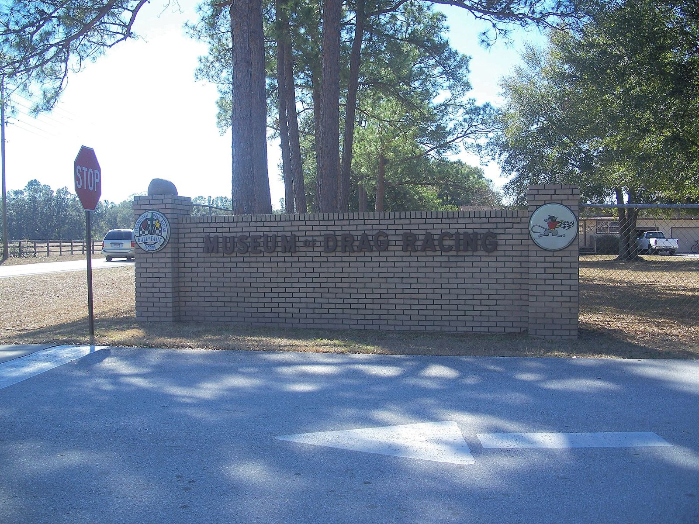

# Al Bergler: The Tin Man Who Bent It Himself

*Detroit builder, first Ridler winner, Motown Shaker*

!!! abstract "Article record"
    **Confidence:** Medium–High · **Source types:** Hagerty interview (2024), MMSHOF bio · **Last verified:** 2026-10-14 (Round 9) · **Open issues:** Exact shop street numbers; Motown Shaker chassis serials · [How we rate this](../reference/source-standards.md)

!!! quote "In their own words"
    "I made a bench on which I could clamp the pipe down. Still have it. Still using it."

    — Al Bergler on learning aluminum work on a 4-inch pipe, Hagerty, Feb 2024. [Voices](../voices/injection-and-tin.md)

When a Logghe-associated aluminum man quoted **$300** for a digger nose (three weeks' body-shop pay), Al Bergler bent the piece himself over a **4-inch pipe**, and soon did "almost all the aluminum work for Logghe-built dragsters and funny cars."[^hag] MMSHOF: he did the interior tinwork on Logghe Bros. cars.[^mms]

**Al Bergler** (Detroit-born; still building in Shelby Township, Mich., as of Hagerty's Feb 2024 visit at age 87) is the fabricator whose aluminum interiors finished countless [Logghe](../companies/logghe-stamping.md) diggers and Funny Cars, the winner of the **first Don Ridler Memorial Award** (Detroit Autorama, **1964**), and the campaigner of the **Motown Shaker** Funny Cars through the match-race era.[^hag][^mms]

## Gratiot Avenue kid

About age five in **1941**, he was already playing with wheeled toys (family photo caption).[^hag] At 16 (**1950**) he bought a **'41 Ford convertible** for $75 borrowed from grandparents, after polishing cars at a Gratiot used-car lot for 50¢/hour; he also sold peanuts at Motor City Speedway.[^hag]

He left Pershing High for **Washington Trade School**: mornings academics, afternoons welding and sheetmetal. He chopped a teacher's **'36 Ford** in his last semester.[^hag]

A brief shop on Gratiot hosted touring racers (Tom Ivo worked nights with loud music; neighbors complained; Bergler lost the lease). Later he worked from a shop on **Groesbeck**, around the corner from Logghe.[^hag]

## From Aggravation to Ridler

Early builds were a '34 Ford (top cut off, stock Chrysler Hemi, six Strombergs); a rear-engine Crosley **"The Exterminator"**; then Bantam-bodied competition coupes.[^hag]

His first Bantam coupe, **Aggravation**, had Chassis Research kit rails, a Logghe front axle and a near-stock blown Chrysler. It ran the **1960** U.S. Nationals in Detroit and Detroit Dragway.[^hag]

**Aggravation II** had a new Logghe chassis, a stroker blown Chrysler bought from Connie Kalitta, a Bantam body and Bergler's own finish work. It won the **first Ridler Award** at the **1964** Detroit Autorama; on the strip, Super Eliminator and Best Appearing at the **1966** NHRA SpringNationals (8.10 / 184 mph on gasoline cited by Hagerty).<a href="#q-1" title="Single source so far: see Open questions">◐</a>[^hag][^mms]

MMSHOF also records Division 3 Super Eliminator points (**1966**), World Finals runner-up (**1966**), and the P.A. Sturtevant Mechanic Hall of Fame award (**1966**).[^mms] A later '23 T-based coupe with canopy won competition coupe and Best Appearing at the **1967** Winternationals, and Super Eliminator at the **1967** SpringNationals (MMSHOF/Hagerty).[^hag][^mms]

## Motown Shaker

In **1971** came the Vega-bodied Funny Car on a Logghe chassis with Tom Prock, with a name inspired by Pete Seaton's **"Seaton's Shaker."** Prock left; **Butch Maas** drove the Coca-Cola Cavalcade circuit in **1972**;[^mms] Bergler drove more from **1973**, with Mustang, then Corvette (**~1977**), then Firebird (**~1980**) bodies.[^hag]

He was a match-race regular (U.S. 30 Gary, Ind., Wednesday night eight-car shows) and retired from driving about **1983** when match-race money dried up.[^hag][^mms]

Honors: NHRA Hot Rod Reunion honoree (**2004**); MMSHOF **2006**; International Drag Racing Hall of Fame; NHRA Lifetime Achievement (Hagerty summary).[^hag][^mms]

## Still at the pipe

As of early 2024 he still worked four–five hours a day in a pole-barn shop behind his Shelby Township home, bending aluminum on the same pipe-bench setup, with old Logghe hand **Bob Pacitto** among regular visitors. He has restored and "cackled" Aggravation II and other period cars; the Ridler coupe is in a Nebraska motorsports museum per Hagerty.[^hag]

**See also:** [Logghe Stamping](../companies/logghe-stamping.md), [Detroit Dragway & Cordova](../drag-racing/detroit-cordova.md), [Show Circuit](../media/show-circuit.md), [Injection & Tin voices](../voices/injection-and-tin.md).

## Open questions & disputed details

*From the detective's notebook: where the sources disagree, where we have only one, and what we are still looking for. Each item links back to its place in the story.*

**Single source so far:** It won the **first Ridler Award** at the **1964** Detroit Autorama; on the strip, Super Eliminator and Best Appearing at the **1966** NHRA SpringNationals (8.10 / 184 mph on gasoline cited by Hagerty). <a class="hr-q-back" href="#qr-1" title="Back to the story">↩</a>

## Images

<figure markdown>
{ loading=lazy }
<figcaption markdown>The 1985 Detroit Autorama. Bergler won the first Ridler here in 1964 with Aggravation II. Creator: Joetregembo. Date: 2023-02-03. Source: [Wikimedia Commons](https://commons.wikimedia.org/wiki/File:1985_Detroit_Autorama.jpg). License: [CC BY-SA 4.0](https://creativecommons.org/licenses/by-sa/4.0).</figcaption>
</figure>

<figure markdown>
{ loading=lazy }
<figcaption markdown>Entrance to the Don Garlits Museum of Drag Racing, Ocala, Fla. Bergler is an IDRHOF inductee in that museum's hall. Creator: Ebyabe. Date: 2009-02-07. Source: [Wikimedia Commons](https://commons.wikimedia.org/wiki/File:Garlits_museum_entr01.jpg). License: [CC BY 2.5](https://creativecommons.org/licenses/by/2.5).</figcaption>
</figure>

## Visual references (external)

- [Hagerty, "The Ridler Award's First Winner..." (Bergler family archive photos)](https://www.hagerty.com/media/motorsports/al-bergler-first-ridler-award-winner-profile/)
- [MMSHOF, Al Bergler](https://www.mmshof.org/index.php/inductees/inductees/27-al-bergler)

[^hag]: Paul Stenquist, "The Ridler Award's First Winner, Now 87, Is Still Building Hot Rods," Hagerty Media, Feb 21, 2024. https://www.hagerty.com/media/motorsports/al-bergler-first-ridler-award-winner-profile/
[^mms]: Michigan Motor Sports Hall of Fame, "Al Bergler" (2006). https://www.mmshof.org/index.php/inductees/inductees/27-al-bergler
