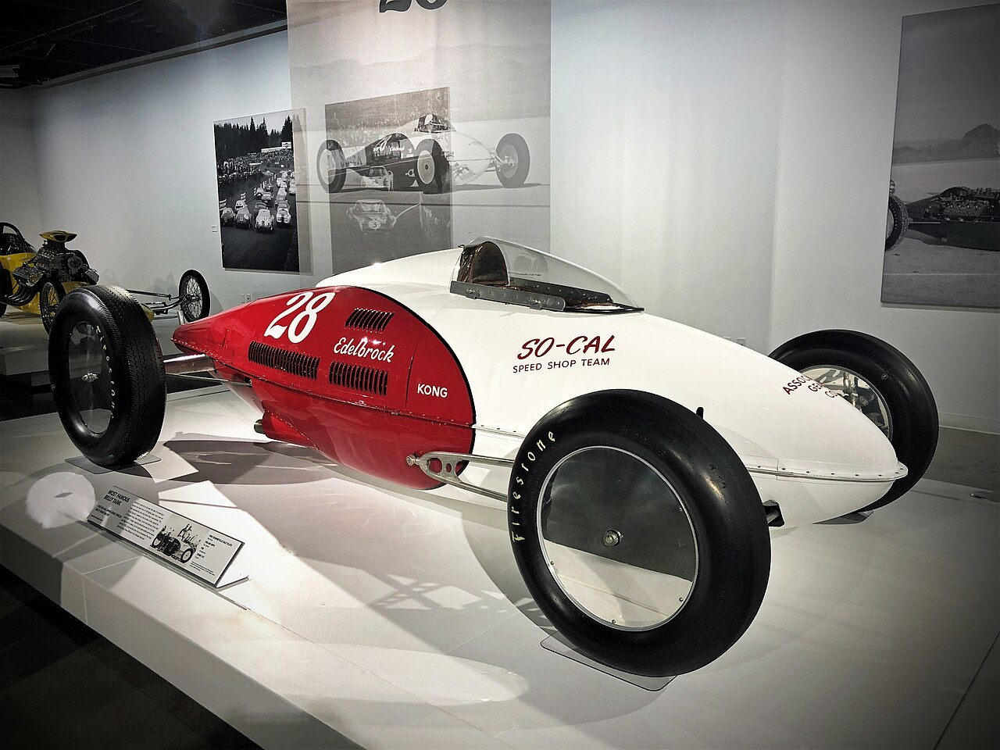

# Alex Xydias: Hanging Out the So-Cal Shingle

*Born 1922*

!!! abstract "Article record"
    **Confidence:** Medium · **Source types:** oral, secondary · **Last verified:** 2026-10-12 (Round 1) · [How we rate this](../reference/source-standards.md)

<figure markdown>
{ loading=lazy }
<figcaption markdown>A belly tank racer shown at the Petersen Automotive Museum and titled "1952 So-Cal Speed Shop Special Belly Tank Racer." The uploader says it is built from a P-38 drop tank. The identification is the uploader's. Photo: CALChux (Flickr), uploaded 2019 (date field reads 1 Jan 2019). Source: [Wikimedia Commons](https://commons.wikimedia.org/wiki/File:1952_So-Cal_Speed_Shop_Special_Belly_Tank_Racer_(48083256906).jpg). License: [CC BY-SA 2.0](https://creativecommons.org/licenses/by-sa/2.0).</figcaption>
</figure>

Alex Xydias entered the Army Air Corps in 1942. On furlough he watched San Fernando Valley street races, and it got him thinking: "I was really surprised at how fast the cars ran and I got the idea to open a speed shop."[^yum]

## Before the Army

The cars had been in his life for years. He was born **March 22, 1922**, in Los Angeles. His first hot rod was a '29 roadster he drove to Fairfax High.[^yum] He hung around Jimmy Summers' shop across the street ([see Summers](jimmy-summers.md)).[^sm]

## The name

The shop needed a name. He liked the name of a speed shop in Culver City<a href="#q-1" title="Single source so far: see Open questions">◐</a> and coined "So-Cal": "then I was the only one."[^css]

He opened on Olive Avenue, Burbank, on his discharge day, **March 3, 1946**, with borrowed money.[^yum] That name came with an obligation: "If I had 'speed shop' in the name I had to start to race."[^css]

## Racing the name

So he raced. His V8-60 belly tank lakester ran 136 mph in 1948 and made the cover of Hot Rod. A Batchelor-designed streamliner topped 210 mph in 1952. He closed the shop in 1961 as OHV engines overtook flatheads.[^fc]

After the shop he went on to produce films, edit Car Craft and Hot Rod Industry News, and help start the SEMA Show. And he revived So-Cal with Pete Chapouris after Bruce Meyer and Chapouris restored the belly tank.[^fc][^css]

## Open questions & disputed details

*From the detective's notebook: where the sources disagree, where we have only one, and what we are still looking for. Each item links back to its place in the story.*

**Single source so far:** He liked the name of a speed shop in Culver City (very likely Orr's, inference, not stated) and coined "So-Cal": "then I was the only one." <a class="hr-q-back" href="#qr-1" title="Back to the story">↩</a>

**To verify:** his current status and any date of death are not yet confirmed from a source; do not add from memory.

[^yum]: "Alex Xydias – SO-CAL Speed Shop" (company bio, references American Rodder Oct 1991). https://www.yumpu.com/en/document/view/34870683/alex-xydias-so-cal-speed-shop
[^sm]: StreetMuscle, "The Garage With Dennis Episode 14." https://www.streetmusclemag.com/news/video-the-garage-with-dennis-episode-14-so-cal-speed-shop/
[^css]: Classic & Sports Car, "Meeting Alex Xydias and the iconic So-Cal Belly Tank Lakester." https://www.classicandsportscar.com/features/meeting-alex-xydias-and-iconic-so-cal-belly-tank-lakester
[^fc]: Goodguys / Fuel Curve, "5 Minutes With Alex Xydias." https://fuelcurve.com/alex-xydias/
