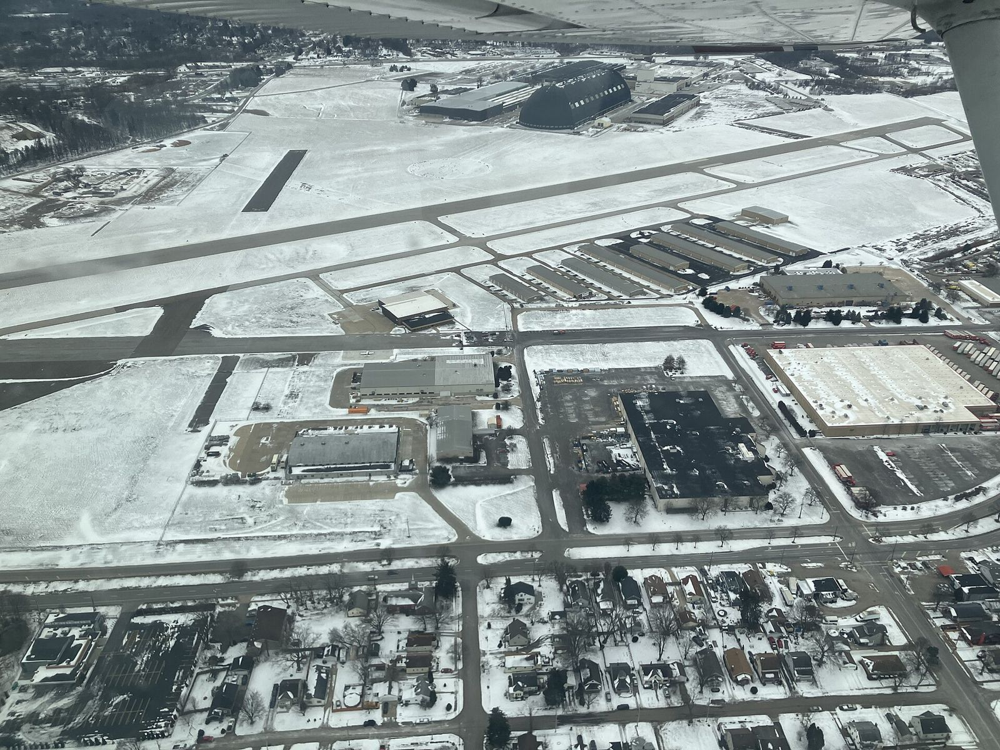

# "Akron" Arlen Vanke: Backyard Racer from Ohio

*c. 1937–2017*

!!! abstract "Article record"
    **Confidence:** Medium · **Source types:** obituary, HOF, secondary · **Last verified:** 2026-10-13 (Round 4) · **Open issues:** Start year conflict (1951 vs 1953) · [How we rate this](../reference/source-standards.md)

Hemmings says Arlen Vanke built cars "in a residential garage that didn't even have a proper lift."[^hem]

## Akron

Akron's strip has its own place in history. NHRA (2017) calls the Akron airport strip "the first NHRA sanctioned racetrack east of the Mississippi River." In 2016 it received an Ohio Historical Marker naming Vanke, Walt and Art Arfons, and Otis "Otie" Smith.[^nhra]<a href="#q-2" title="Single source so far: see Open questions">◐</a><a href="#q-1" title="Sources disagree: see Open questions">⚠</a>

Then came the '56 Chevy gasser. MMSHOF: Arlen and his father Lou found that "for another $200" a Chevy coupe could have the Corvette options. The car won "36 straight victories in regional events."[^mm]<a href="#q-3" title="Single source so far: see Open questions">◐</a>

## Knafel Pontiac and the Tin Indians

Then he switched to Pontiacs. In fall 1961 he went into Bill Knafel Pontiac in Akron, asked about a Super Duty 421, and ordered a 1962 Catalina Super Duty.[^tin][^hem] Hemmings says he set an NHRA A/Stock record with it, and Knafel hired him as service manager on weekdays and racer on weekends.[^hem]<a href="#q-4" title="Sources disagree: see Open questions">⚠</a>

## Mopar, the "Vanked" Hemi, and Pro Stock

Chrysler was next. In 1964 he bought both a Max Wedge and a Hemi Belvedere.[^hem]

Hemmings' obituary says his dual-quad intake work on the 426 Hemi coined the word "Vanked." It also traces the nickname to his calls to Chrysler, where he introduced himself as "Arlen Vanke from Akron, Ohio."[^hem2]<a href="#q-5" title="Single source so far: see Open questions">◐</a>

NHRA results: Jr. Stock at the 1966 Springnationals and Super Stock at the 1968 U.S. Nationals.[^nhra] MMSHOF says he won all five 1970 SWC points meets in a Duster and calls him the first man to do so.[^mm]<a href="#q-6" title="Single source so far: see Open questions">◐</a>

He died June 15, 2017, at a care facility in Deming, New Mexico; Hemmings gives his age as 80.[^nhra][^hem2] See [Midwest & East Threads](../places/midwest-east.md) and [Mr. Gasket](../companies/mr-gasket.md) (the "Ohio Gassers").

*See also:* [Akron Fulton Airport strip](../drag-racing/akron-fulton-airport.md) (the 2016 marker text, Otie Smith) and [The Ohio Gassers](../places/ohio-gassers.md).

## Open questions & disputed details

*From the detective's notebook: where the sources disagree, where we have only one, and what we are still looking for. Each item links back to its place in the story.*

**Disputed.** **When did he start?** MMSHOF says his first race was in **1953**, at sixteen, at Akron Municipal Airport in a 1940 flathead Ford sedan.[^mm] Hemmings says that in **1951** his mother watched him lose and then wrote a $600 check for parts.[^hem] The Knafel Pontiac fan site gives the car's times as 14.80 at 87 mph with tri-carbs. It says he raced B/Gas every weekend in summer 1953 and usually lost to George Montgomery's Cadillac-powered '34 Ford.[^tin] <a class="hr-q-back" href="#qr-1" title="Back to the story">↩</a>

**Single source so far.** The Knafel site says the strip opened in 1951 and ran until 1959.[^tin] <a class="hr-q-back" href="#qr-2" title="Back to the story">↩</a>

**Single source so far.** Single source.[^mm] <a class="hr-q-back" href="#qr-3" title="Back to the story">↩</a>

**Disputed.** The Knafel site says "salesman" and calls it an eight-year relationship.[^tin] <a class="hr-q-back" href="#qr-4" title="Back to the story">↩</a>

**Single source so far.** **Where did "Vanked" come from?** Only Hemmings' obituary explains it, and it gives two stories: his dual-quad intake work on the 426 Hemi, and his calls to Chrysler as "Arlen Vanke from Akron, Ohio."[^hem2] <a class="hr-q-back" href="#qr-5" title="Back to the story">↩</a>

**Single source so far.** *This is a promotional HOF claim and needs checking.*[^mm] <a class="hr-q-back" href="#qr-6" title="Back to the story">↩</a>

## Images

<figure markdown>
{ loading=lazy }
<figcaption markdown>Akron Fulton International Airport, Ohio, from the air in January 2026. The airport was formerly called Akron Municipal Airport (per [Wikipedia](https://en.wikipedia.org/wiki/Akron_Fulton_International_Airport)), where Vanke first raced in the 1950s. **We have not identified which pavement the drags used.** Creator: Designism. Date: 2026-01-24 15:58:13. Source: [Wikimedia Commons](https://commons.wikimedia.org/wiki/File:Akron_Fulton_International_Airport_(KAKR)_20260124_(3).jpg). License: [CC0](https://creativecommons.org/publicdomain/zero/1.0/deed.en).</figcaption>
</figure>

## Visual references (external)

*These are copyrighted or rights-restricted images, so we link to them instead of copying them.*

- [Hemmings, Vanke stories (period race photos)](https://www.hemmings.com/stories/akron-arlen-vanke/)
- [Knafel Pontiac 'Tin Indians' site (Super Duty and GTO photos)](http://www.tinindian.com/drivers/arlenvanke.html)

[^mm]: Michigan Motor Sports Hall of Fame, "Vanke, 'Akron Arlen' 2016." https://www.mmshof.org/index.php/inductees/inductees/368-akron-arlen-vanke (accessed 2026-10-13)
[^hem]: Hemmings, "Akron Arlen Vanke." https://www.hemmings.com/stories/akron-arlen-vanke/ (accessed 2026-10-13)
[^hem2]: Hemmings, "Drag racer 'Akron' Arlen Vanke dead at age 80," 2017. https://www.hemmings.com/stories/drag-racer-akron-arlen-vanke-dead-at-age-80/ (accessed 2026-10-13)
[^tin]: Knafel Pontiac "Tin Indians" site, "Arlen Vanke." http://www.tinindian.com/drivers/arlenvanke.html (accessed 2026-10-13)
[^nhra]: NHRA, "NHRA pioneer 'Akron Arlen' Vanke dies," June 20, 2017. https://www.nhra.com/news/2017/nhra-pioneer-akron-arlen-vanke-dies (accessed 2026-10-13)
