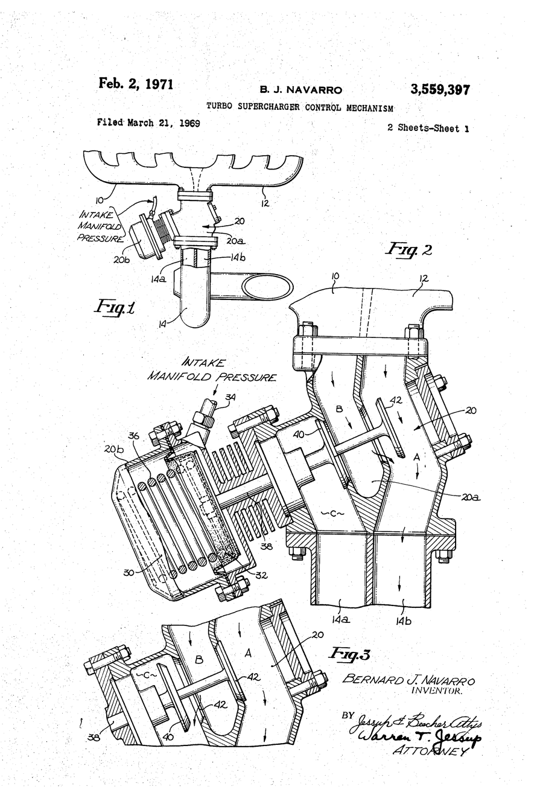

# Barney Navarro: Paying for Parts with Labor

*1919–2007, Glendale's blower pioneer*

!!! abstract "Article record"
    **Confidence:** Medium · **Source types:** oral, secondary, primary (patent) · **Last verified:** 2026-10-13 (Round 4) · [How we rate this](../reference/source-standards.md)

<figure markdown>
{ width="300" loading=lazy }
<figcaption markdown>US3559397, "Turbo supercharger control mechanism," sheet 1. Inventor: Bernard J. Navarro, Glendale, filed 1969-03-21, issued 1971-02-02. Source: [Google Patents](https://patents.google.com/patent/US3559397A/en). License: public domain (U.S. patent drawing). See [Patents](../reference/patents.md).</figcaption>
</figure>

His '39 Tudor ran **the first Weiand intake Phil Weiand ever made**, and Navarro paid for it by machining Weiand's first batch of 10 castings.[^ahrf]<a href="#q-1" title="Single source so far: see Open questions">◐</a>

He had been around machines since boyhood. He got his start at 10, as a gofer during the overhaul of his father's Willys-Knight. He attended Eagle Rock High and night machine-shop classes at Glendale High, and he once cut a straight-eight Locomobile in half for the Weaver brothers' midget.[^ahrf]

## Strokers and a last Muroc

Then came the club and the lakes. In 1940 came the **Glendale Strokers**: Navarro with Tom Beatty, George Hill and Doane Spencer.[^ahrf]<a href="#q-2" title="Sources disagree: see Open questions">⚠</a> At the last prewar Muroc meet, in November 1941, he ran 107 mph.[^ahrf]

## Business on credit, and a belly tank

After the war came the business, built on credit. In 1947 he went into business, with patterns by Hermann Husbey and castings on credit from Victor Caliva's Aircraft Foundry ("pay for them as he sold them").[^ahrf]

His own engine was the advertisement. His **blown flathead** was advertised in the first issue of HOT ROD (1948). It was a de-stroked 176 ci '41 block with Winfield cam, Kurten ignition and a 3-71 GMC blower driven by four V-belts, with four Strombergs mounted back-to-back. It ran 139.75 mph at El Mirage, Sept 25–26, 1948.[^ahrf]

The old club friendship produced a record car. With Tom Beatty, he built a 4-71-blown 295 ci Merc belly tank that set a Class D Lakester record of 185.80 mph at the 1951 Bonneville Nationals<a href="#q-3" title="Sources disagree: see Open questions">⚠</a>, and 197.17 mph two-way in 1952.[^ahrf]

## Beyond the lakes

The machine shop outgrew racing. Navarro Engineering started at 718 Verdugo Road, then moved to 5142 San Fernando Road, Glendale. The shop built a Hemi boat for Henry Kaiser, a heart-lung machine used for 13 years at Kaiser Hospital in Hollywood, and concrete-cutting tools.[^ahrf]

He died **August 20, 2007**, his 88th birthday. His patterns went to Mike Herman of H&H Flatheads. His favorite saying: "There's nothing more fun than learning."[^ahrf]

## Open questions & disputed details

*From the detective's notebook: where the sources disagree, where we have only one, and what we are still looking for. Each item links back to its place in the story.*

**Single source so far.** **The first Weiand intake?** That Navarro's '39 Tudor ran the first intake Phil Weiand made, paid for by machining Weiand's first ten castings, comes only from the AHRF profile.[^ahrf] <a class="hr-q-back" href="#qr-1" title="Back to the story">↩</a>

**Disputed: Strokers or Stokers?** AHRF writes "Glendale Strokers";[^ahrf] Kustomrama spells it "Stokers" (see [Tom Beatty](tom-beatty.md)). <a class="hr-q-back" href="#qr-2" title="Back to the story">↩</a>

**Disputed.** **185.80 or 188.284 mph?** AHRF gives the 1951 Class D Lakester record as 185.80 mph;[^ahrf] the auction listings for the car give "188.284 MPH At Bonneville In 1951, A Record The First Time Out."[^gooding] The SCTA's 1951 record list would settle it. <a class="hr-q-back" href="#qr-3" title="Back to the story">↩</a>

[^gooding]: "1951 Tom Beatty Belly-Tank Lakester," Gooding & Company, Pebble Beach auction, 2007 (lot page). https://www.goodingco.com/lot/1951-tom-beatty-belly-tank-lakester (accessed 2026-10-22)
[^ahrf]: Tony Thacker, "Barney Navarro," American Hot Rod Foundation. https://ahrf.com/pioneer/barney-navarro/ (accessed 2026-10-12)
