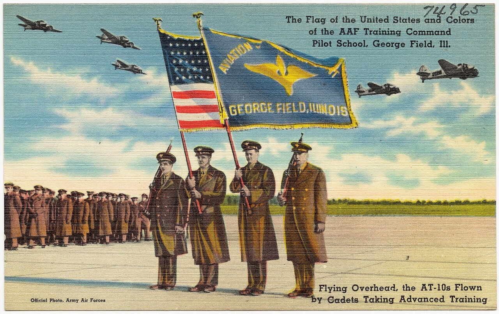
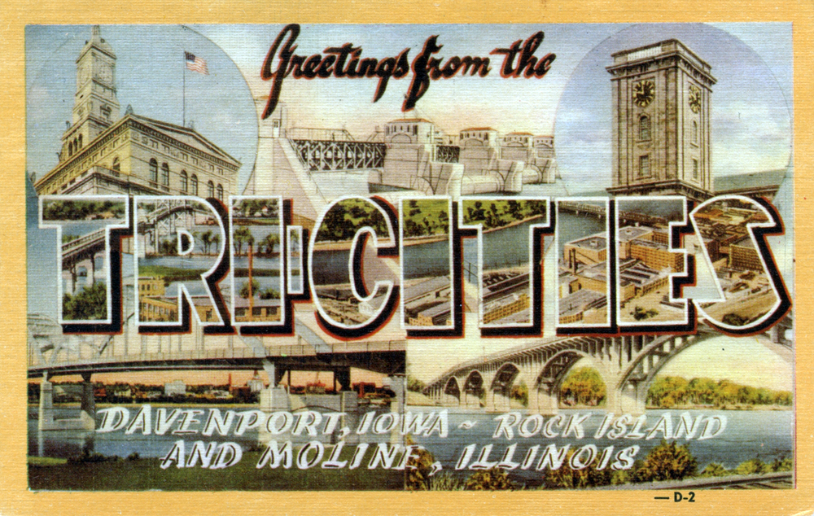

# Bob Bartel: The Sears Man Who Built Cordova

*1921–2018: the World Series of Drag Racing and the Midwest's own national meet*

!!! abstract "Article record"
    **Confidence:** Medium · **Source types:** Grassroots funeral-home obituary (family facts), Competition Plus / BangShift tribute (Bret Kepner text), local-paper summaries (◐), forum · **Last verified:** 2026-10-15 (Round 10) · **Open issues:** ⚠ First World Series year (1954 vs 1956 vs IRG's "1953"); ATAA "absorbed" by NHRA in 1957 (single-source); birthplace Sterling vs "Moline native" · [How we rate this](../reference/source-standards.md)

!!! quote "In their own words"
    "I've spent so much time at this place I couldn't stand to be stuck here for eternity."

    — Bob Bartel, asking not to be buried at the Cordova track, quoted in the Competition Plus tribute, Feb 20, 2018. [More in Voices](../voices/strip-owners-and-door-slammers.md)

When Bob Bartel's car clubs couldn't afford a drag strip, he cashed Sears stock and, with businessmen from Moline, Rock Island, Davenport and Bettendorf, bought river-silt farmland from the **Sullivan** family two-thirds of a mile from the Mississippi.[^cp]

**Robert J. "Bob" Bartel** was a Sears employee and Quad Cities car-club man who helped start a national drag-racing body outside California. He built the Quad City Drag Strip at **Cordova, Illinois**, and kept the **World Series of Drag Racing** there from 1957 until 2015. His story widens our [Detroit Dragway & Cordova](../drag-racing/detroit-cordova.md) page: for a few years in the mid-1950s the Midwest ran its own national meet, with cash purses, separate from NHRA.

## The man (from the obituary)

Born **Aug. 5, 1921, in Sterling, Ill.**, to Joseph and Ethal (Logsdon) Bartel, he graduated from Sterling schools and attended the University of Illinois.[^obit] He married **Dawn Sheridan** at Sacred Heart Church, Moline, **Nov. 28, 1946**, and they were married more than 71 years.[^obit]

He worked for **Sears Roebuck**. "In 1956, Bob, his brother, Don, and two local businessmen, purchased a farm in Cordova, IL. This venture became the Cordova Dragstrip." He retired in **1986**.[^obit] He was a member of the Antique Car Club and the "Over The Hill Coffee Group," and died **Feb. 18, 2018**, at Friendship Manor, Rock Island, aged 96.[^obit]<a href="#q-1" title="Sources disagree: see Open questions">⚠</a>

## The ATAA and a Midwest national meet

The tribute's text (bylined Bobby Bennett at Competition Plus and credited to **Bret Kepner** on BangShift) makes several claims.[^cp][^bs] It says that in **1953**, at 31, Bartel and **Jim Lamona** began hosting races under the **Automobile Timing Association of America (ATAA)**. Unlike NHRA, which posted "only trophies and contingency prizes," the ATAA "paid cash purses."<a href="#q-2" title="Single source so far: see Open questions">◐</a>

In **October 1954**, the tribute says, they held the **first World Series of Drag Racing** on a taxiway at **George Field, Lawrenceville, Ill.**, which the tribute calls "one year before the NHRA... had a similar race." Entries came "from as far away as California and New York." The meet moved to a full runway in 1955 and stayed at Lawrenceville "for two more seasons."

It credits Bartel and **Ed Otto** with brokering a deal with **Bill France Sr.** for a NASCAR drag-racing branch. The tribute says it "continued to sanction drag races all over the eastern seaboard for another fifteen years."<a href="#q-3" title="Single source so far: see Open questions">◐</a>

The ATAA's own run ended when NHRA "absorbed" (bought out) it in **1957**, "a takeover which required the vast majority of cash assets of the NHRA." Bartel then formed the **National Association of Drag Strips**, which sanctioned Midwest and East Coast tracks through the 1960s.<a href="#q-4" title="Single source so far: see Open questions">◐</a><a href="#q-5" title="Open question: see the bottom of the page">?</a>

## Building Cordova

Bartel belonged to the **Moline Moons** car club (formed late 1940s). The tribute says street racing in the Quad Cities "eventually led to the fatalities of several of his childhood friends," and the nearest strips were in Chicago. He proposed a strip "paid for and operated by a union of local car clubs." When the clubs couldn't afford it, he cashed Sears stock and bought the farmland (above).[^cp]

The **Quad City Drag Strip** opened Labor Day weekend 1956. It hosted the ATAA North Central Regional that fall. The new asphalt then shifted, and Bartel paid to resurface it himself.[^cp]

A late-1956 government mandate pushed racing off airports, and the World Series came to Cordova the weekend before Labor Day **1957**: the "first of sixty consecutive" there.[^cp] (The local paper, from the 2009 interview, says "old timing equipment and scales were given to Cordova" when the track took over the event.[^qc]<a href="#q-6" title="Single source so far: see Open questions">◐</a>)

Cordova also paid. Bartel told the paper that early racers ran "for merchandise and maybe scholarships," with total prize packages of "$500 to $1,000." Cordova was "the first track to put up good money: $1,000 to win in a number of different classes."[^qc]<a href="#q-7" title="Single source so far: see Open questions">◐</a>

And he knew how to draw a crowd. He brought the current winner of TV's *The $64,000 Question* to the track for the whole meet. The tribute says "as many people came to the track to meet the TV personality as came to see the drag racers."[^cp]<a href="#q-8" title="Single source so far: see Open questions">◐</a>

In **1957** Don Garlits beat Emery Cook in the semifinal. Per the tribute, Garlits "proudly states he was 'nobody'" until that win. See [Detroit & Cordova](../drag-racing/detroit-cordova.md).[^cp]

In **1968**, floods washed out the surface, so Bartel shortened the World Series to **1,000 feet** for the fastest classes. The tribute says he was also "the first to offer a true National Title for Funny Car competitors."<a href="#q-9" title="Single source so far: see Open questions">◐</a>[^cp] The track hosted events from "nine different drag racing associations" over its life.[^cp]

## Later owners and the name fight

Cordova was sold to racer **Bob Gipson (1986)**, then **Scott Gardner (1996)**. The **IHRA** (IRG Sports + Entertainment) bought it in late **2014**.[^cp]

IRG moved the **2016** World Series to Memphis International Raceway. Bartel was "emotionally crushed," and the event returned to Cordova in **2017**, which Bartel attended at 96.[^cp]

Bartel and racer **Ron Colson** said they owned the World Series name, citing a USPTO document dated **Oct. 11, 2016**. Colson said the name had never been contested under Gipson or Gardner.[^qc]<a href="#q-10" title="Single source so far: see Open questions">◐</a> (Colson raced a B/Gas '41 Studebaker before driving the *Chi-Town Hustler*. See [Ohio & Midwest Gassers](../places/ohio-gassers.md).)

*See also:* [Detroit Dragway & Cordova](../drag-racing/detroit-cordova.md), [Setto Postoian](setto-postoian.md) (World Series winner over Garlits; which years is disputed), [Ohio & Midwest Gassers](../places/ohio-gassers.md), [Akron Fulton Airport strip](../drag-racing/akron-fulton-airport.md) (another early airport strip).

## Open questions & disputed details

*From the detective's notebook: where the sources disagree, where we have only one, and what we are still looking for. Each item links back to its place in the story.*

**Disputed.** The Competition Plus tribute calls him a "Moline, Illinois, native." The obituary's **Sterling** birthplace is the stronger record. He married and lived in Moline.[^cp][^obit] <a class="hr-q-back" href="#qr-1" title="Back to the story">↩</a>

**Single source so far:** Unlike NHRA, which posted "only trophies and contingency prizes," the ATAA "paid cash purses." <a class="hr-q-back" href="#qr-2" title="Back to the story">↩</a>

**Single source so far:** The tribute says it "continued to sanction drag races all over the eastern seaboard for another fifteen years." <a class="hr-q-back" href="#qr-3" title="Back to the story">↩</a>

**Single source so far.** *Single tribute source; we have seen no NHRA record of the purchase.* <a class="hr-q-back" href="#qr-4" title="Back to the story">↩</a>

### ⚠ When was the first World Series?

The sources can't agree on the year, and the disagreement is worth a look:

| Source | Says |
|---|---|
| Competition Plus / BangShift tribute (2018) | **October 1954**, George Field, Lawrenceville[^cp][^bs] |
| Moline Dispatch/Rock Island Argus (2017), summarizing Bartel's Aug 2009 interview | "first... held in **1956** in Lawrenceville," run by the ATAA, which "quickly ran into financial problems due to the lack of any full-time staff"[^qc] ◐ *(article rate-limited; read via search excerpt only)* |
| IRG Sports + Entertainment, via a 2016 local report | "began in Lawrenceville, IL, in **1953** and moved to... Cordova in **1954**"[^c1] ⚠ *Contradicts Cordova's own 1956 opening; treat as promotional* |

**Working position:** 1954 (Lawrenceville), with 1956 kept open, until a dated program or newspaper ad turns up. The tribute's own note that Illinois racer **Dave Jamison** attended "all but the 1955" World Series, having been "at the inaugural," fits a pre-1956 start.[^cp] ◐

**A period source, sponsor-written but dated:** a June 1955 Chilton's *Motor Age* article bylined to a Maremont Automotive Products staffer says the first annual World Series was held at Lawrenceville "last October" (October 1954) and "attracted some 350 hot rodders and approximately 10,000 spectators," and that the second annual would run "August 17 through 21." It also quotes Gov. William Stratton welcoming hot rodders to "the 1954 World Series of Drag Racing." That supports 1954 over the 1953 and 1956 claims, though it is the ATAA's own publicity and we still lack a program or ad. It dates the ATAA's founding to **1952**, not 1953. See [Half Day, Illinois](../drag-racing/half-day-ataa-maremont.md).[^r12ma] <a class="hr-q-back" href="#qr-5" title="Back to the story">↩</a>

**Single source so far.** **The timing equipment.** That "old timing equipment and scales were given to Cordova" comes from one 2017 *Dispatch-Argus* story, drawing on Bartel's 2009 interview,[^qc] and that page refused our last fetch. Lead: the Moline *Dispatch* or Rock Island *Argus* for August 1957. <a class="hr-q-back" href="#qr-6" title="Back to the story">↩</a>

**Single source so far.** **The prize money.** Bartel's "$500 to $1,000" packages and Cordova's "$1,000 to win" come only from the same 2017 *Dispatch-Argus* story.[^qc] Lead: Cordova's own ads in the Quad Cities papers, 1957–60, which would print the purses. <a class="hr-q-back" href="#qr-7" title="Back to the story">↩</a>

**Single source so far:** The tribute says "as many people came to the track to meet the TV personality as came to see the drag racers." <a class="hr-q-back" href="#qr-8" title="Back to the story">↩</a>

**Single source so far:** The tribute says he was also "the first to offer a true National Title for Funny Car competitors." <a class="hr-q-back" href="#qr-9" title="Back to the story">↩</a>

**Single source so far.** **Who owns the World Series name?** Bartel and Ron Colson's claim, and the USPTO document of Oct. 11, 2016, are reported only in the 2017 *Dispatch-Argus* story.[^qc] Lead: a USPTO trademark search for "World Series of Drag Racing." <a class="hr-q-back" href="#qr-10" title="Back to the story">↩</a>

## Images

<figure markdown>
{ loading=lazy }
<figcaption markdown>A wartime linen postcard: "The Flag of the United States and Colors of the AAF Training Command Pilot School, George Field, Ill." The tribute says the first World Series of Drag Racing ran on a taxiway at George Field, near Lawrenceville, in 1954. **This shows the field in WWII, not the drags.** Creator: Tichnor Brothers, Publisher (Boston Public Library Tichnor Brothers collection #74965). Date: c. 1930–1945. Source: [Wikimedia Commons](https://commons.wikimedia.org/wiki/File:The_flag_of_the_United_States_and_colors_of_the_AAF_Training_Command_Pilot_School,_George_Field,_Ill,_flying_overhead,_the_AT-10s_flown_by_cadets_taking_advanced_training_(74965).jpg). License: Public domain.</figcaption>
</figure>

<figure markdown>
{ loading=lazy }
<figcaption markdown>"Greetings from the Tri-Cities, Davenport, Iowa – Rock Island and Moline, Illinois," a large-letter postcard of about 1945 (Peterson Paper Co. / Dexter Press). This is the home market of the Moline Moons and Bartel's backers. **Not a racing image.** Creator: Steve Shook (scan, from his collection). Date: c. 1945 (production; scan 2013-11-06). Source: [Wikimedia Commons](https://commons.wikimedia.org/wiki/File:Greetings_from_the_Tri-Cities,_Davenport,_Iowa_-_Rock_Island_and_Moline,_Illinois_-_Large_Letter_Postcard_(10716517204).jpg). License: [CC BY 2.0](https://creativecommons.org/licenses/by/2.0).</figcaption>
</figure>

## Visual references (external)

*These are copyrighted or rights-restricted images, so we link to them instead of copying them.*

- [SVTPerformance forum, "Quad Cities Drag Racing photos from the 50's"](https://www.svtperformance.com/threads/quad-cities-drag-racing-photos-from-the-50s.737744/)

[^obit]: Wendt Funeral Home, "Robert J. Bartel" obituary (Feb 2018). Accessed 2026-10-15. https://www.wendtfuneralhome.com/obituaries/robert-j-bartel
[^cp]: Bobby Bennett (the family obituary and BangShift both credit the text to Bret Kepner), "Quad Cities Drag Racing Legend Bob Bartel Passes," Competition Plus, Feb 20, 2018. Accessed 2026-10-15. https://competitionplus.com/quad-cities-drag-racing-legend-bob-bartel-passes/
[^bs]: Bret Kepner, "Drag Racing Legend Bob Bartel Passes," BangShift. Accessed 2026-10-15 (search excerpt matches the Competition Plus text). https://bangshift.com/bangshift1320/drag-racing-legend-bob-bartel-passes/
[^qc]: Roger Ruthhart, "Drag race begins over use of World Series name," *Dispatch-Argus* / QConline (Feb 2017). Page returned "Too Many Requests" on 2026-10-15; facts above are from the search-engine excerpt only. ◐ https://qconline.com/news/local/drag-race-begins-over-use-of-world-series-name/article_0cceb035-79af-5d61-b6a1-6cb86e429a6c.html
[^c1]: thecity1.com, "World Series of Drag Racing Leaving Cordova" (2016), quoting IRG Sports + Entertainment (search excerpt). https://thecity1.com/world-series-of-drag-racing-leaving-cordova/
[^r12ma]: M. Robert Wolfson (Maremont Automotive Products, Inc.), "The World Series Comes Early" and "For 1955 Hot Rodders," Chilton's *Motor Age*, June 1955 (scanned OCR; sponsor-written). https://archive.org/details/sim_motor-age_1955-06_74_7 (accessed 2026-10-15)
