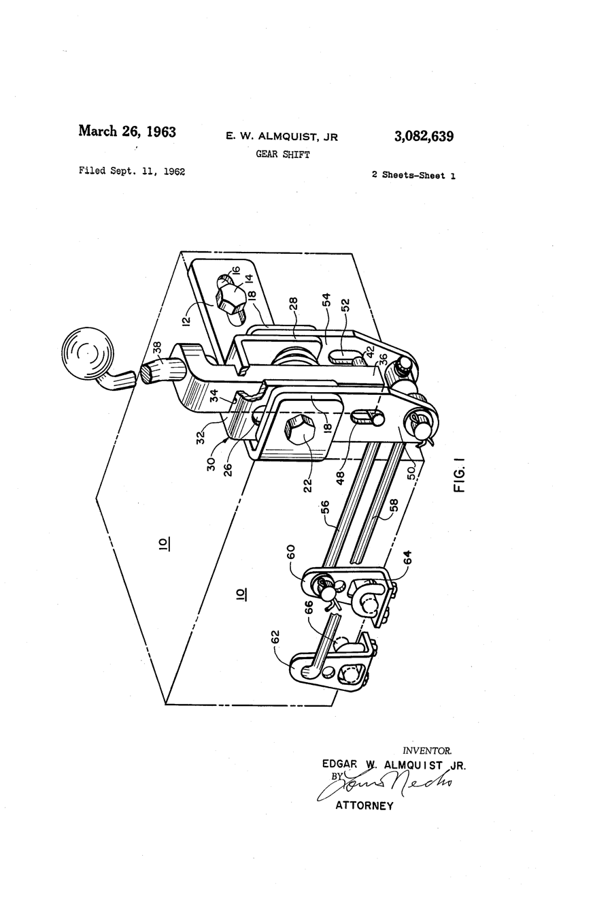

# Ed Almquist: Speed by Mail from Milford, Pennsylvania

*1921–2015*

!!! abstract "Article record"
    **Confidence:** Medium · **Source types:** Grassroots obituary, HOF, primary (patents) · **Last verified:** 2026-10-13 (Round 4) · **Open issues:** Hurst co-design claim single-sourced · [How we rate this](../reference/source-standards.md)

<figure markdown>
{ width="300" loading=lazy }
<figcaption markdown>US3082639, "Gear shift (Almquist Engineering Co.)," sheet 1. Inventor: Edgar W. Almquist, filed 1962-09-11, issued 1963-03-26. Source: [Google Patents](https://patents.google.com/patent/US3082639A/en). License: public domain (U.S. patent drawing). See [Patents](../reference/patents.md).</figcaption>
</figure>

*A rare non-California founder.* One of his early products was a water/alcohol vapor injector made from a Mason jar that cost 50¢ to make and sold for $6. He also sold a two-carb "log manifold" for $12.95. He started in a $35 rented room, then moved to a partitioned gymnasium. (Port Jervis *Times Herald-Record*, via search excerpt<a href="#q-1" title="Single source so far: see Open questions">◐</a>.)[^thr] The paper said that while California makers had the West Coast, Almquist equipment was the choice in the Midwest and East.[^thr]

## From celery farm to ship's engine room

He came to it from Minnesota. He was born Nov 24, 1921, in Zim, Minnesota, and died July 22, 2015, at home in Milford, PA.[^obit] Before the war he farmed celery and worked as a part-time railroad brakeman, raced "jalopies" on weekends, and took University of Minnesota extension courses in diesel engineering.[^hem]

The war took him to sea. He served in the U.S. Maritime Service 1943–47 per his obituary.[^obit] He became a licensed marine engineering officer and wrote down his Minnesota racing hop-up knowledge while aboard ship.[^hem]

## The manual

Those shipboard notes became a business. He printed two small books on a borrowed mimeograph and advertised the *Speed and Mileage Manual* with a **$12 ad in Popular Mechanics**. He estimated more than 10,000 copies sold.[^hem] He is credited with the first widely circulated performance how-to, copyrighted **1946**.[^hem][^hof]<a href="#q-2" title="Sources disagree: see Open questions">⚠</a>

## Shifters, shifts in the market

The market moved on. Hemmings says the mail-order business declined after the 1955 small-block Chevy, which "Ed wasn't ready for."[^hem]

He had already diversified: Almquist started Sparkomatic in 1954, with partner Jonas Anchel. A 1959 partnership with **George Hurst and Bill Campbell** on floor shifters dissolved, and the Times Herald-Record calls him co-designer of the Hurst shifter.[^thr]<a href="#q-3" title="Single source so far: see Open questions">◐</a>

The obituary lists Almquist Engineering, Sparkomatic and **Offy Products** "through 1965," more than 100 products, and 7 U.S. patents. He later wrote *Hot Rod Pioneers*.[^obit] He received the International Drag Racing Hall of Fame Founder's Award in 2011.[^hof]

His name also turns up in period custom literature: a pamphlet from "Pennsylvania speed merchant Ed Almquist" taught restyling techniques alongside Dan Post's *Blue Book*.[^revs]

*See also:* [Techniques & Styles](../cars/techniques-and-styles.md).

## Open questions & disputed details

*From the detective's notebook: where the sources disagree, where we have only one, and what we are still looking for. Each item links back to its place in the story.*

**Single source so far.** **A Mason-jar injector and a $35 room?** The 50¢ vapor injector, the $12.95 log manifold, the rented room and the gymnasium all come from the Port Jervis *Times Herald-Record* obituary, which we could read only in a search excerpt.[^thr] <a class="hr-q-back" href="#qr-1" title="Back to the story">↩</a>

**Disputed.** **What year did the business start?** Hemmings and the Hall of Fame say Almquist Engineering started in 1946;[^hem][^hof] his obituary says he moved to Milford and created it in 1947.[^obit] <a class="hr-q-back" href="#qr-2" title="Back to the story">↩</a>

**Single source so far.** *Single local-press source; Hurst histories should be checked.*[^thr] <a class="hr-q-back" href="#qr-3" title="Back to the story">↩</a>

## Images

<figure markdown>
{ width="300" loading=lazy }
<figcaption markdown>US 3,172,301, "Gear shift" by George H. Hurst Jr. and William G. Campbell, filed Oct 1962. Compare it with Almquist Engineering's US 3,082,639 above. Creator: George H. Hurst Jr. & William G. Campbell (inventors); USPTO. Date: filed 1962-10-15, issued 1965-03-09. Source: [Google Patents](https://patents.google.com/patent/US3172301A/en). License: Public domain (U.S. patent drawing).</figcaption>
</figure>

[^obit]: "Edgar Almquist" (obituary), Pike County Courier, July 28, 2015. https://www.pikecountycourier.com/milestones/obituaries/edgar-almquist-EWPC20150728150729961
[^hem]: Hemmings, "Ed Almquist" (read via search excerpt; page blocked direct fetch). https://www.hemmings.com/stories/ed-almquist/
[^thr]: "Ed Almquist, motorhead inventor and pioneer dies," Times Herald-Record, July 30, 2015 (paywalled; via search excerpt). https://www.recordonline.com/story/news/local/port-jervis/2015/07/30/ed-almquist-motorhead-inventor-pioneer/33784642007/
[^hof]: Don Garlits Museum, International Drag Racing Hall of Fame, Class of 2011. https://garlits.com/hall-of-fame-inductees-2011/
[^revs]: Ken Gross, "Emerald Icon from a Lost Era," Revs Institute. https://automedia.revsinstitute.org/emerald-icon-from-a-lost-era-the-saga-of-the-hirohata-mercury
