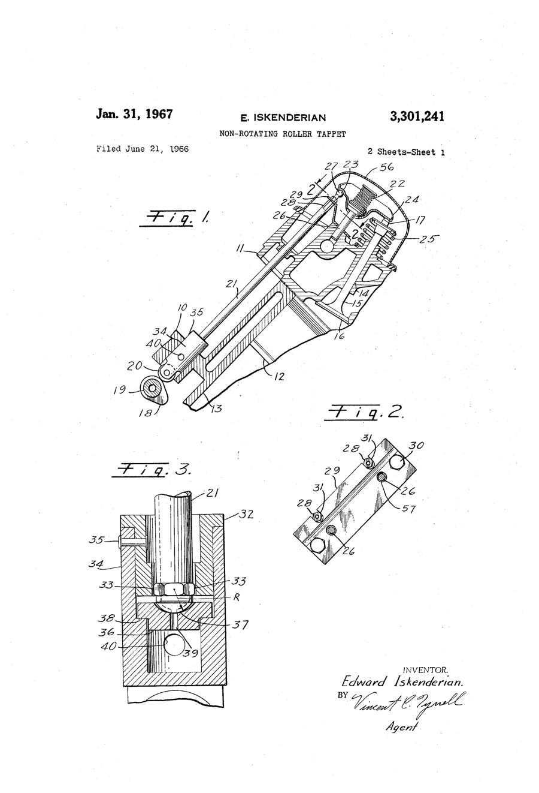

# Ed "Isky" Iskenderian (1921–2026)

!!! abstract "Article record"
    **Confidence:** High · **Source types:** obituaries (5 agreeing), oral, primary (patents) · **Last verified:** 2026-10-13 (Round 4) · [How we rate this](../reference/source-standards.md)

<figure markdown>
{ width="300" loading=lazy }
<figcaption markdown>US3301241, "Non-rotating roller tappet," sheet 1. Inventor: Edward Iskenderian, filed 1966-06-21, issued 1967-01-31. Source: [Google Patents](https://patents.google.com/patent/US3301241A/en). License: public domain (U.S. patent drawing). See [Patents](../reference/patents.md).</figcaption>
</figure>

!!! note "Verified"
    His death on **February 4, 2026**, at 104, in Los Angeles is confirmed by NHRA, Hagerty, Car and Driver, SEMA, and Legacy.com.[^nhra][^hag][^cd][^sema][^leg]

- Born **July 10, 1921** in Cutler, Tulare County, California, to Armenian immigrant parents. Frosts ruined the family vineyard, and they moved to Los Angeles when he was a year old.[^nhra][^leg]
- He attended LA Polytechnic High and built a Model T roadster that is now at the Museum of American Speed. It has a flathead V8 with Maxi heads, which moved the exhaust valves into the head.[^leg][^hag]
- In 1940 Jimmy Summers "pounded out a few dents" on that T for $10 ([Jimmy Summers](jimmy-summers.md)).[^summers]
- He served in the Army Air Forces Air Transport Command in the Pacific.[^leg]
- **Mentored by Ed Winfield** in starting cam grinding.[^hag] This links to [Winfield](ed-winfield.md), whom Hemmings calls the model for Iskenderian.
- He was a founding member and first president of SEMA (1963), and its last surviving founder.[^sema][^leg]
- He was the chief instigator of the [Camgrinder Wars](../eras/1950s-camgrinder-wars.md), and his ads brought Don Garlits west in 1959.[^cp59g]
- His last interview, in a nursing home south of LA in September 2025, ended with "Goodbye, boys!"[^hag]

**Correction:** the earlier wiki note "1921–2026 (unverified)" from the Garlits Museum list is now confirmed.

## Images

<figure markdown>
{ width="300" loading=lazy }
<figcaption markdown>US 2,846,988, sheet 1: Isky's earliest patent found (1956). The text gives his address as Inglewood, Calif. Creator: Edward Iskenderian (inventor); USPTO. Date: filed 1956-10-30, issued 1958-08-12. Source: [Google Patents](https://patents.google.com/patent/US2846988A/en). License: Public domain (U.S. patent drawing).</figcaption>
</figure>

[^nhra]: Phil Burgess, "Ed Iskenderian, beloved 'Camfather' of hot rodding, passes away at 104," NHRA, Feb 4, 2026. https://nhra.com/news/2026/ed-iskenderian-beloved-camfather-hot-rodding-passes-away-104
[^hag]: Brandan Gillogly, "Ed Iskenderian, 'The Camfather,' Has Passed Away at Age 104," Hagerty, Feb 4, 2026. https://www.hagerty.com/media/news/ed-iskenderian-the-camfather-has-passed-away-at-age-104/
[^cd]: Elana Scherr, Car and Driver, Feb 4, 2026. https://www.caranddriver.com/news/a70250198/ed-isky-iskenderian-obituary/
[^sema]: SEMA News, "SEMA and PRI Mourn the Loss of Industry Icon Ed 'Isky' Iskenderian, 104." https://www.sema.org/news-media/enews/2026/06/sema-and-pri-mourn-loss-industry-icon-ed-isky-iskenderian-104
[^leg]: Legacy.com, "Ed Iskenderian Obituary." https://www.legacy.com/legacy/notable-deaths/ed-iskenderian
[^summers]: Kustomrama, "Jimmy Summers." https://kustomrama.com/wiki/Jimmy_Summers
[^cp59g]: Dave Wallace, "Drag Rags: 1959 – Garlits Goes from Zero to Hero," Competition Plus (search excerpt). https://competitionplus.com/drag-rags-1959-garlits-goes-from-zero-to-hero-turns-pro/
