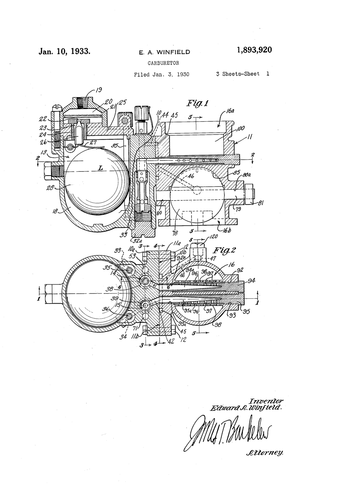
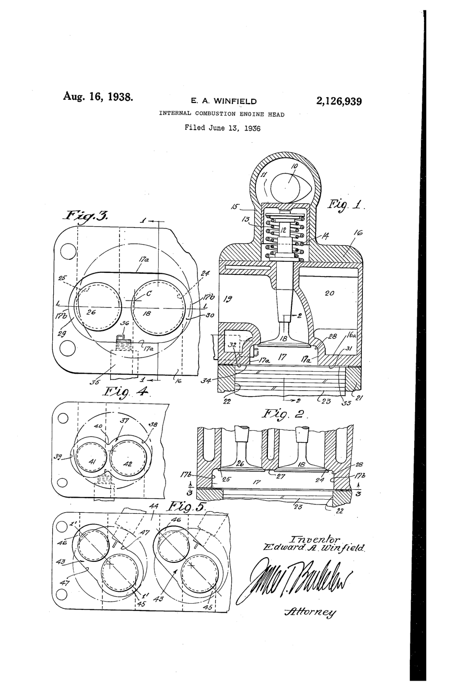

# Ed Winfield: Three-Quarters of the Way to Full Race

*1901–1982*

!!! abstract "Article record"
    **Confidence:** Medium · **Source types:** HOF, secondary, primary (patents) · **Last verified:** 2026-10-13 (Round 4) · **Open issues:** Indy years conflict open · [How we rate this](../reference/source-standards.md)

<figure markdown>
{ width="300" loading=lazy }
<figcaption markdown>US1893920, "Carburetor," sheet 1. Inventor: Edward A. Winfield, filed 1930-01-03, issued 1933-01-10. Source: [Google Patents](https://patents.google.com/patent/US1893920A/en). License: public domain (U.S. patent drawing). See [Patents](../reference/patents.md).</figcaption>
</figure>

Ed Winfield's formal schooling ended at the eighth grade.[^mshf] At 14 he joined Harry A. Miller's shop, starting in the carburetor department at 60¢ an hour per the Motorsports Hall of Fame (Hemmings says sweeping floors). He learned alongside draftsman Leo Goossen and machinist Fred Offenhauser.[^mshf][^hem1]

Edward Arnold Winfield was born **October 4, 1901**,[^mshf][^hem1] in or near Flintridge, northeast of Los Angeles.[^hem1]<a href="#q-1" title="Sources disagree: see Open questions">⚠</a>

## A motorcycle that could climb anything

At 16, with hand tools, he reworked the cam in his single-cylinder motorcycle: "I could climb any mountain road around here in high gear!"[^mshf]

The cams came next. In **1919** Winfield converted a used grinding machine into a cam grinder.[^mshf]

## The origin of "three-quarter race"

Pete Crane relayed Winfield's own account of how a term hot rodders still use got its name. He first made only two masters, semi race and full race, then a third in between, and combined the full-race master (intake) with the new one (exhaust): "It was three-quarters of the way to a full..."[^hem2] It is a rare first-hand origin story for a bit of shop talk.

## Carburetors and Indy

Cams led to carburetors. The Winfield Carburetor Company formed in **1924**.[^hem2][^sema]<a href="#q-2" title="Sources disagree: see Open questions">⚠</a>

Hemmings also credits Winfield with what is "widely regarded as the first harmonic balancer" and a continuous-flow fuel injection unit in 1934.[^hem2] With brother **Bud**, he created the 1938 Winfield straight-eight that became the basis of the Novi V8.[^ims] In the early 1960s, Ford consulted him on its Indy engine program.[^hem1]

He died in 1982.[^hem2] Hemmings names him the model for Ed Iskenderian and Ed Donovan,[^hem2] and Hagerty's 2026 Isky obituary says Winfield mentored him into cam grinding. (See [Iskenderian](ed-iskenderian.md).)

*See also:* [George Riley and the Heads That Cracked](george-riley.md).

## Open questions & disputed details

*From the detective's notebook: where the sources disagree, where we have only one, and what we are still looking for. Each item links back to its place in the story.*

**Disputed.** **1901 or 1910?** Three sources give October 4, 1901;[^mshf][^hem1] the International Drag Racing Hall of Fame list gives **1910–1982**,[^idrhof] which is probably an error. <a class="hr-q-back" href="#qr-1" title="Back to the story">↩</a>

**Disputed.** **How long was the Indy winning streak?** The IMS Museum says every Indy 500 winner 1933–1946 used Winfields except Wilbur Shaw's Maserati (1939–40).[^ims] Another Hemmings piece says every winner **1927–1937**.[^hem1] <a class="hr-q-back" href="#qr-2" title="Back to the story">↩</a>

## Images

<figure markdown>
{ width="300" loading=lazy }
<figcaption markdown>US 2,126,939, "Internal combustion engine head," sheet 1, by Edward A. Winfield. Creator: Edward A. Winfield (inventor); USPTO. Date: filed 1936-06-13, issued 1938-08-16. Source: [Google Patents](https://patents.google.com/patent/US2126939A/en). License: Public domain (U.S. patent drawing).</figcaption>
</figure>

[^mshf]: Motorsports Hall of Fame of America, "Ed Winfield." https://www.mshf.com/hall-of-fame/inductees/ed-winfield.html (accessed 2026-10-12)
[^hem1]: Hemmings, "Ed Winfield." https://www.hemmings.com/stories/ed-winfield/ (accessed 2026-10-12)
[^hem2]: Hemmings, "Ed Winfield: The Master of Hot-Rodding and Performance." https://www.hemmings.com/stories/ed-winfield-2/ (accessed 2026-10-12)
[^ims]: IMS Museum Hall of Fame, "Ed Winfield." https://imsmuseum.org/fame_inductee/ed-winfield/ (accessed 2026-10-12)
[^sema]: SEMA Hall of Fame 1971, "Ed Winfield." https://www.sema.org/hof/1971/ed-winfield (accessed 2026-10-12)
[^idrhof]: Don Garlits Museum, International Drag Racing Hall of Fame list (Class of 1991). https://garlits.com/hall-of-fame-inductees-2011/ (accessed 2026-10-13)
