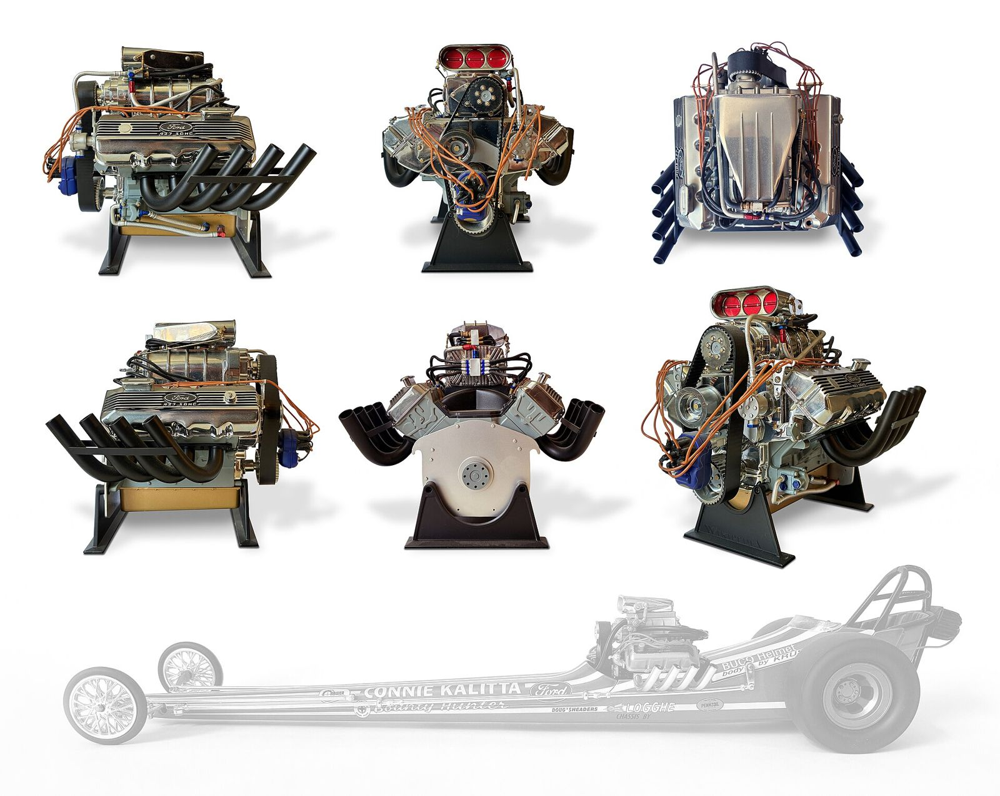

# "Fast Eddie" Schartman: Taking Out the Finish-Line Lights

*Cleveland gasser to the first Funny Car title*

!!! abstract "Article record"
    **Confidence:** Medium · **Source types:** oral (2016 interview), secondary · **Last verified:** 2026-10-13 (Round 4) · **Open issues:** Self-reported firsts flagged · [How we rate this](../reference/source-standards.md)

!!! quote "In their own words"
    "On my first pass, I went 166 mph and took out the [finish-line] lights."

    — Eddie Schartman, NHRA.com, 2016. [Full context in Voices](../voices/show-custom-voices.md)

*Principal source: Phil Burgess's 2016 interview with Schartman, then 78, in National Dragster/NHRA.com.*[^nhra] This is first-person oral history.

## The flip-top Comet

His first ride came in December 1965 at Motor City Dragway. "I said, 'What the hell is this?' It was a dragster with a body on it and the driver in the back seat... On my first pass, I went 166 mph and took out the [finish-line] lights."[^nhra]

It was a new kind of car. It had a [Logghe](../companies/logghe-stamping.md) chromoly chassis with a 116-in. wheelbase. Al Turner said they were the first drag car with coil-over shocks. The bodies came from Plastigage of Jackson, Mich., and the hinged "flopper" idea is credited to Ron Logghe (per John Logghe). Al Bergler did the tin work.[^nhra]<a href="#q-1" title="Single source so far: see Open questions">◐</a>

Within a year it was a winner. At the 1966 World Finals in Tulsa he beat Nicholson (8.38/174.08) for **NHRA's first Funny Car eliminator win**.[^nhra]

In 1967 came Air Lift sponsorship, with "Famous Amos" Satterlee as crew chief. He claimed the first seven-second run in a stock-bodied car at **Detroit Dragway** in April, though he "doesn't put a lot of stock" in such firsts.[^nhra]

That season also produced his claim to an accidental rear spoiler, from Maple Grove in 1967: angle iron bolted to the trunk. "It went straight and picked up 5 mph. We'd invented the [rear-deck] spoiler and didn't even know it."[^nhra]<a href="#q-2" title="Single source so far: see Open questions">◐</a>

## Wrecking yard kid

He started young. His father, Ed Sr., raced dirt tracks, and the family owned a wrecking yard. Eddie built a flathead '40 Ford drag car at 14. He finished Berea High School in 1956 and drove a street '56 Chevy (338 ci) to Daytona Speed Week, where he "won everything in sight." He then set the NHRA B/Gas record in a '55 Chevy.[^nhra] He was one of the "Ohio Gassers" (see [Mr. Gasket](../companies/mr-gasket.md)).

## Jackshaw Chevrolet, Dyno Don, and the Comet wagon

The road to the Comet ran through a Chevy dealer. He worked at Jackshaw Chevrolet in Cleveland. In 1964 he moved to Atlanta to build engines for "Dyno Don" Nicholson. He drove Nicholson's '62 Chevy for 50 percent of the winnings, then got the A/FX Comet wagon "The Ugly Duckling." Mercury later gave him his own Comet and $5,000 from Cleveland-area Mercury dealers.[^nhra]

## Later

The end came in small ways. In Pro Stock, the 1972 Gatornationals tech crew disqualified his Maverick because it had Mercury Comet taillights. He quit match racing in 1975 over rainouts ("The rainout money was like $150") and went into car dealerships and NAPA stores. He was inducted into IDRHOF in 2012.[^nhra]

*See also:* [The Ohio Gassers](../places/ohio-gassers.md) (his Cleveland circle) and [Houston Freeway](../drag-racing/houston-freeway-dragstrip.md) (Roy Gay was runner-up to Schartman at the 1967 Manufacturers Championships).

## Open questions & disputed details

*From the detective's notebook: where the sources disagree, where we have only one, and what we are still looking for. Each item links back to its place in the story.*

**Single source so far.** *These are attributions within one article.* <a class="hr-q-back" href="#qr-1" title="Back to the story">↩</a>

**Single source so far.** *Self-reported "first."* <a class="hr-q-back" href="#qr-2" title="Back to the story">↩</a>

## Images

<figure markdown>
{ loading=lazy }
<figcaption markdown>A Top Fuel display engine based on the Ford 427 SOHC. Schartman's 1966 flip-top Comet ran an injected 427 SOHC (it was not supercharged until 1967). This is a modern blown example, not his engine. Creator: Auge=mit. Date: 2025-06-22. Source: [Wikimedia Commons](https://commons.wikimedia.org/wiki/File:Top_Fuel_Engine_Ford_427_SOHC_Display_noBG.jpg). License: [CC BY-SA 4.0](https://creativecommons.org/licenses/by-sa/4.0).</figcaption>
</figure>

## Visual references (external)

*These are copyrighted or rights-restricted images, so we link to them instead of copying them.*

- [NHRA, "'Fast Eddie' Schartman" (period photos of the A/FX Comet, the flip-top Comet and the Air Lift Cougar)](https://www.nhra.com/news/2016/fast-eddie-schartman)

[^nhra]: Phil Burgess, "'Fast Eddie' Schartman," NHRA.com, Feb 12, 2016. https://www.nhra.com/news/2016/fast-eddie-schartman
