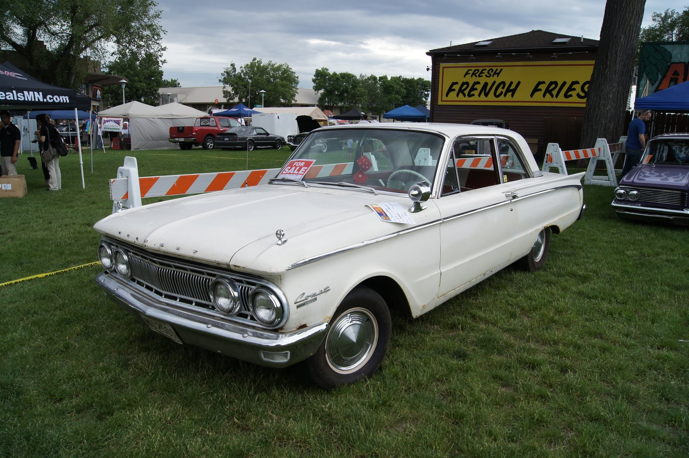
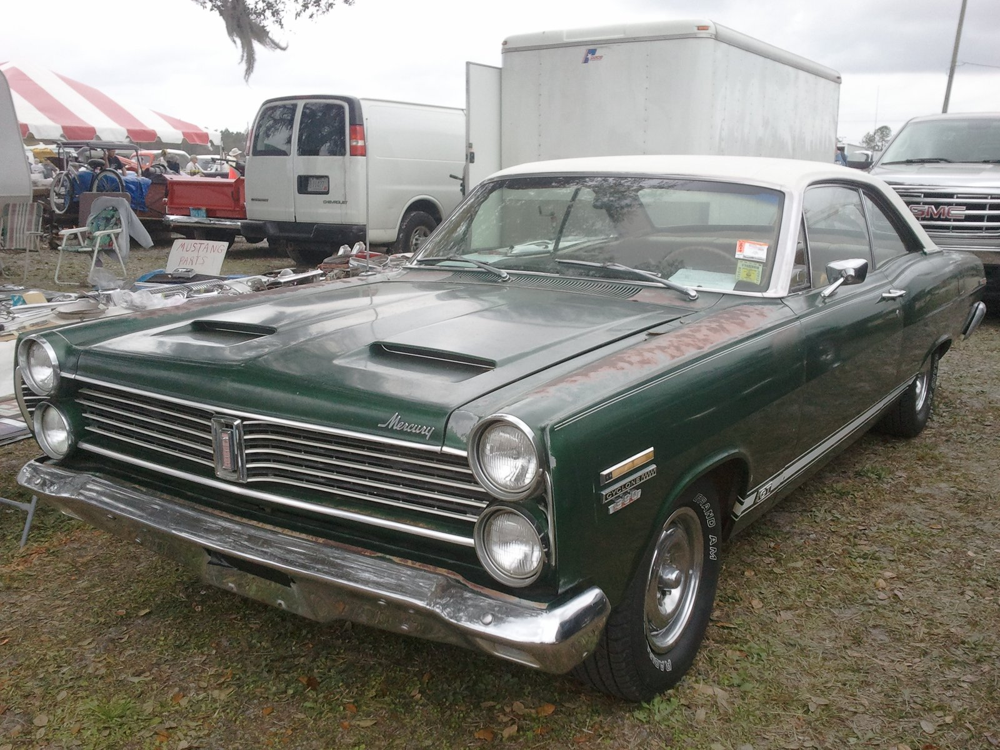

# Fran Hernandez: From Goleta Nitro to Lincoln-Mercury Racing

*Francisco "Fran" Hernandez, Feb 8, 1922 – Jan 5, 2011*

!!! abstract "Article record"
    **Confidence:** Medium · **Source types:** Detroit News obituary (via HAMB), Hemmings, Hot Rod, MMSHOF-style bios · **Last verified:** 2026-10-14 (Round 9) · **Open issues:** Hemmings 2005 death date (resolved against Detroit News); "coined Funny Car" is family attribution · [How we rate this](../reference/source-standards.md)

!!! quote "In their own words"
    "His work was everything... Cars, racing—he was just consumed by it. That was his passion."

    — Randy Hernandez, on his father Fran, Detroit News, Jan 20, 2011 (via H.A.M.B.). [Voices](../voices/injection-and-tin.md)

## April 10, 1949: Goleta

The Santa Barbara Acceleration Association's first Sunday races at the **Goleta** airstrip access road hosted a grudge between Fran Hernandez and street/lakes racer **Tom Cobbs**. Per Robert C. Post (*High Performance*, via Hemmings): Cobbs ran a blown flathead roadster; Hernandez a trailered fenderless **'32 three-window** with a **296-ci Mercury** flathead that looked nearly stock. He won on **nitromethane**, a fuel he and Edelbrock had studied in tether cars.[^hem][^hr]

Hot Rod and family obituaries call this among the first sanctioned drag races and credit Hernandez with early four-cycle nitro use. Treat "first" claims as contested historiography; the date and win are well attested across secondary sources.[^hr][^dn]

Hot Rod notes Cobbs dyno'd engines at [Stu Hilborn](stu-hilborn.md)'s injection shop, a cross-link between the two scenes.[^hr]

The man who won that grudge race went a long way from Goleta. Hernandez (born in Chihuahua, Mexico; died in Tecumseh, Mich.) grew up in Los Angeles, raced the dry lakes, helped put nitromethane into early drag racing, then ran Lincoln-Mercury's performance program that ordered the first [Logghe](../companies/logghe-stamping.md) flip-top Comets.[^dn][^hem]

## Lakes, Navy, Edelbrock

The family and the Detroit News fill in the early years: born in Chihuahua, the family's move to California, lakes racing as a teen, and WWII service as a Navy first-class machinist's mate on **USS Cabot (CVL-28)** in the Pacific.[^dn]

After discharge he partnered with **Fred C. Offenhauser** in Offenhauser Sales, then sold his share and joined **Vic Edelbrock** around the late-1948 move to West Jefferson Blvd. Classmate **Bobby Meeks** is credited with bringing him in; Tom Madigan's Edelbrock book (via Hemmings) places him with Meeks and Don Towle in Vic's inner circle.[^hem]

He raced with Meeks's Coupes Club in the Rusetta Timing Association and held lakes records.<a href="#q-1" title="Single source so far: see Open questions">◐</a>[^hem]

## Stroppe, Autolite, Lincoln-Mercury

Then came the factories. In the late 1950s he was with Bill Stroppe's team and an Autolite consultant. After Ford bought Autolite (**1961**), Hernandez became director of Autolite Racing while Stroppe stayed independent.[^hem]

As head of Lincoln-Mercury racing, he ran A/FX Comets with drivers including Dyno Don Nicholson and Ronnie Sox. Trans-Am contacts went through Dearborn Steel Tubing and then [Logghe Stamping](../companies/logghe-stamping.md) for the **1966** flip-top Comets with Al Turner.[^hem][^gar]

Family and obituary circles credit him with helping coin **"Funny Car"** and with the first-generation Mercury Comet Cyclone GT floppers.<a href="#q-2" title="Single source so far: see Open questions">◐</a>

In **1969–70** he managed Ford's Brighton (Kar Kraft) facility for the **Boss 429** Mustang program with Roy Lunn.[^dn][^hem] Later came Ford fabrication/build (family says presidential limousines for Reagan and G.H.W. Bush), retirement in the 1990s, and consulting.[^dn]

## The end of the road

Our **working date** for his death is Jan 5, 2011, at age 88, in Tecumseh, Mich. (Detroit News, Jan 20, 2011; family funeral text posted on H.A.M.B. Jan 2011).[^dn]<a href="#q-3" title="Sources disagree: see Open questions">⚠</a>

The News named his survivors: wife Patricia (68 years), sons Randy and Rick, daughter Nancy, brother Luis, seven grandchildren.[^dn]

*See also:* [Edelbrock's Slingshot](../companies/edelbrock-slingshot.md), [Logghe Stamping](../companies/logghe-stamping.md), [Eddie Schartman](eddie-schartman.md), [Stu Hilborn](stu-hilborn.md).

## Open questions & disputed details

*From the detective's notebook: where the sources disagree, where we have only one, and what we are still looking for. Each item links back to its place in the story.*

**Single source so far.** **Meeks's Coupes Club and lakes records?** Only Hemmings places him with the club in the Russetta Timing Association and gives him lakes records.[^hem] Lead: Russetta results in the late 1940s. <a class="hr-q-back" href="#qr-1" title="Back to the story">↩</a>

**Single source so far.** **Did Hernandez coin "Funny Car"?** The credit comes from family and obituary circles; it is an attribution, not a documented coinage.[^dn] <a class="hr-q-back" href="#qr-2" title="Back to the story">↩</a>

**Disputed.** **Did he die in 2005 or 2011?** Daniel Strohl's Hemmings profile says "when he died in **2005**"; the 2011 obituaries and *Hot Rod* say January 2011. We treat **2011** as correct and flag the Hemmings line as an error.[^hem][^hr][^dn] <a class="hr-q-back" href="#qr-3" title="Back to the story">↩</a>

## Images

<figure markdown>
{ loading=lazy }
<figcaption markdown>A 1962 Mercury Comet custom at the Minnesota Street Rod Association's Back to the Fifties (2012). Context only—not a Hernandez race car. Creator: Greg Gjerdingen. Source: [Wikimedia Commons](https://commons.wikimedia.org/wiki/File:1962_Mercury_Comet_Custom_(7445284414).jpg). License: [CC BY 2.0](https://creativecommons.org/licenses/by/2.0).</figcaption>
</figure>

<figure markdown>
{ loading=lazy }
<figcaption markdown>A 1967 Mercury Comet Cyclone GT. Family/obituary accounts tie Hernandez's L-M program to the Cyclone GT racing effort; this is a street example. Creator: Michel Curi. Source: [Wikimedia Commons](https://commons.wikimedia.org/wiki/File:1967_Mercury_Comet_Cyclone_GT.jpg). License: [CC BY 2.0](https://creativecommons.org/licenses/by/2.0).</figcaption>
</figure>

<figure markdown>
{ loading=lazy }
<figcaption markdown>A modern blown Ford 427 SOHC display engine. The 1966 Logghe flip-top Comets ordered through Hernandez's Lincoln-Mercury program used SOHC 427s (injected, then blown). Creator: Auge=mit. Date: 2025-06-22. Source: [Wikimedia Commons](https://commons.wikimedia.org/wiki/File:Top_Fuel_Engine_Ford_427_SOHC_Display_noBG.jpg). License: [CC BY-SA 4.0](https://creativecommons.org/licenses/by-sa/4.0).</figcaption>
</figure>

## Visual references (external)

- [Hemmings, "Fran Hernandez"](https://www.hemmings.com/stories/fran-hernandez/)
- [Hemmings, "Fran Hernandez: A Life in Pictures"](https://www.hemmings.com/stories/fran-hernandez-a-life-in-pictures/)
- [H.A.M.B. thread with Detroit News obituary text](https://www.jalopyjournal.com/forum/threads/hot-rod-legend-from-the-greatest-generation-fran-hernandez-rip.555417/)

[^dn]: Mark Hicks, "Natural mechanic led race car division," Detroit News, Jan 20, 2011, as quoted on The H.A.M.B. (Harms Way), Jan 29–30, 2011. https://www.jalopyjournal.com/forum/threads/hot-rod-legend-from-the-greatest-generation-fran-hernandez-rip.555417/ (accessed 2026-10-14)
[^hem]: Daniel Strohl, "Fran Hernandez," Hemmings, Sept 23, 2018. https://www.hemmings.com/stories/fran-hernandez/ (accessed 2026-10-14)
[^hr]: Hot Rod, "Where it All Began: Street/Lakes/Strip" (Fran Hernandez '32). https://www.hotrod.com/news/hrdp-1303-where-it-all-began-street-lakes-strip (accessed 2026-10-12)
[^gar]: Don Garlits Museum, "Ron & Gene Logghe." https://garlits.com/hall-of-fame/ron-gene-logghe/ (accessed 2026-10-14)
