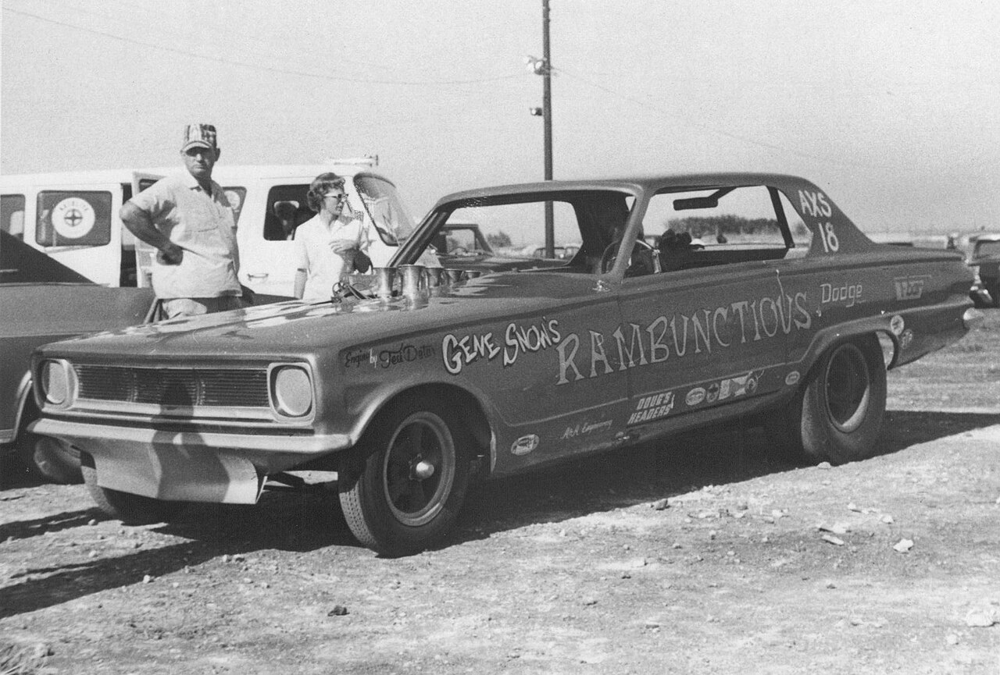
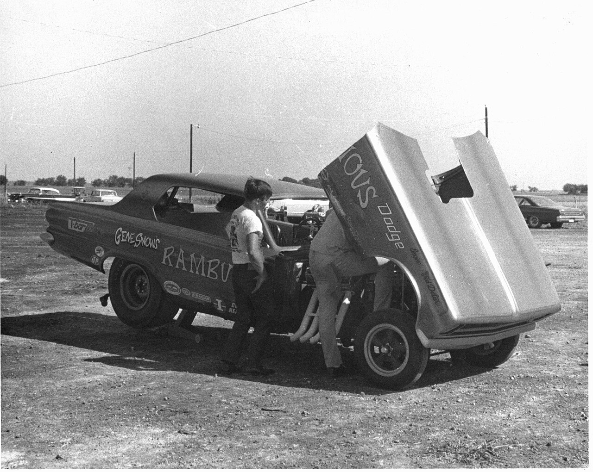
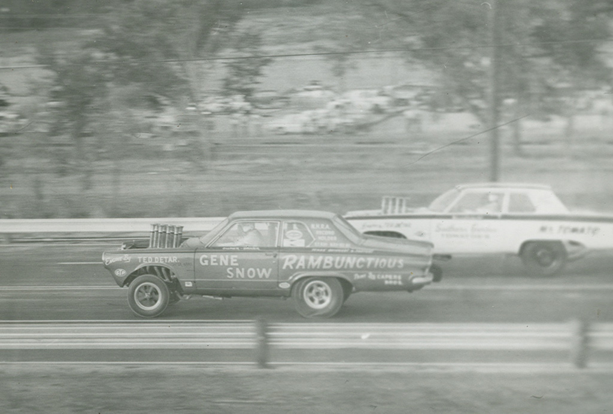

# Gene Snow: Win on Sunday, Sell on Monday

*Fort Worth's* Rambunctious *and the first 200-mph Funny Car*

!!! abstract "Article record"
    **Confidence:** Medium–High · **Source types:** NHRA Top 50 bio (Snow quoted), NHRA National Dragster history column, *Hot Rod* June 1969 feature (period tech sheet), UPI 1988 wire, Wikipedia (◐) · **Last verified:** 2026-10-15 (Round 10) · **Open issues:** ⚠ Date of the first 200.88-mph pass (Aug 17, 1968 vs "early 1969" vs "autumn 1969"); no timing slip seen · [How we rate this](../reference/source-standards.md)

!!! quote "In their own words"
    "The sea level location gave us extra horsepower, and we went 200.88 mph on the first pass. I didn't think it such a big deal at the time, but we kept running more than 200 mph at just about every race after that."

    — Gene Snow, quoted in John Jodauga's NHRA Top 50 profile (No. 26, 2001). [More in Voices](../voices/strip-owners-and-door-slammers.md)

Gene Snow's sales method was to race cars off his own lot. "I would win a race with a dealership car on Sunday and usually sold the winning entry the next day."[^top50]

**Gene "the Snowman" Snow** was a Fort Worth used-car dealer who became one of the early Funny Car's most technical drivers. His Logghe-chassis Dodge Charger *Rambunctious* made the class's first 200-mph pass at Don and Carl Gay's track in Dickinson, Texas, the [Houston Freeway Dragstrip](../drag-racing/houston-freeway-dragstrip.md). He also ran the first official 200-mph Funny Car pass at an NHRA national event (Dallas, May 3, 1970).[^top50][^nd16]

## From engineering to the used-car lot

Snow left the University of Texas at Arlington after three years of electrical engineering. "I did that because I could make more money [selling used cars] than what engineers were making at General Dynamics," he told NHRA.[^top50]

He went into partnership with **L.G. Melton** in Fort Worth and raced cars from the lot to promote sales.[^top50] His progression: a 348 '58 Chevy Impala, a new 409 Chevy (1962), then a 413 '62 Plymouth Sport Fury midseason, which began the **Rambunctious** Chrysler line. Next came a '63 Max Wedge 426 Dodge and a '64 426 Hemi Dodge.[^top50]

## The altered-wheelbase Dart (1965–68)

In 1965 Snow began racing against the new Funny Cars in an **altered-wheelbase Dodge Dart built by fellow Texan Don Hardy**. The chassis was lengthened in 1966 to improve handling.[^top50][^nd16]

NHRA did not yet recognize Funny Cars, so the Dart ran as a **C/Fuel Dragster** in Competition eliminator. Snow won Comp at the **1966 Nationals** (9.04) and the new **Super Eliminator** at the 1967 Nationals (8.67).[^top50][^nd16] At the **1968 Winternationals** he switched to gasoline and won **B/Altered** class and Comp.[^top50]

The photographs below, which the uploader dates to Austin, Texas, 1967, show the Dart with "Engine by Ted Detar" lettering and a tilt front end.<a href="#q-1" title="Single source so far: see Open questions">◐</a>

## Direct drive and the Logghe Charger

Snow ran a supercharged '68 Dart, then a '68 Charger body, and dropped the automatic transmission for direct drive. "We worked with Crower to come up with a four-disc Crowerglide centrifugal clutch," he said. "Though it was sluggish off the line, it would mow down the automatic cars, which always nosed-over at about 185 mph."[^top50] National Dragster's Phil Burgess places the direct-drive experiments in **late 1968 and into 1969**.[^nd16]

***Hot Rod*, June 1969** (photos by Don Green) printed the period spec sheet. It describes the '69 Dodge Charger as built by Snow with mechanic **Jake Johnston** "a job lasting nearly two months and involving over $13,000." Its "backbone" was a **Logghe Stamping Company chassis** on a 118-inch wheelbase, with a Logghe tube axle. The engine was a '69 426 Hemi with a Keith Black No. 2 cam, Larkin-prepared 6-71 blower and Enderle 3-port injector. Halibrand mags, Hurst/Airheart disc brakes and a Simpson "200-mph" chute completed it. The Fiberglas Ltd. body was reworked by Stewart's Corvette Shop and painted by Sir Nat of Oklahoma City. The headline: "it trips 7.51 e.t.'s on 205-mph blasts."[^hr69] See [Logghe Stamping](../companies/logghe-stamping.md).<a href="#q-2" title="Open question: see the bottom of the page">?</a>

## 1970: the "Super Season"

In 1970, the year NHRA expanded to seven national events, Snow won the **Summernationals** (York, Pa.), the **World Finals** (Dallas) and the postseason **Supernationals** (Ontario). He was runner-up at the Winternationals and Springnationals and also won the **AHRA** championship and its Driver of the Year award. He ran 6.76/218.44 at Lions late in the season. "We carried a spare motor the whole year and never had to use it," he said.[^top50][^nd16]

## Teams, Top Fuel, and the first four

In **1971** Snow ran one of the first multicar teams, with two mini-Chargers and Jake Johnston driving the second. Then came the **Revell Snowman** colors for a 1/16 kit (1972), a Top Fueler for Chip Woodall, and an injected car for Terry Pringle.[^top50]

He left racing after 1978, blaming the gas crisis and poor seasons, and returned in **Top Fuel in 1981**. With Bob Brooks at AFT he developed a direct-drive Top Fuel setup.[^top50]

On **Oct. 6, 1988, at Houston Raceway Park, Baytown**, he ran a **4.997/279.06** on his first pass at the new track, the first sub-five-second run at an NHRA event. "It was neat, it was fun and we've been trying for a long time to achieve this performance," he told UPI.[^upi] (Houston Raceway Park was co-founded by the Gay family. See [Houston Freeway](../drag-racing/houston-freeway-dragstrip.md).)

He retired after a crash at the 1992 Dallas national event and returned in 1997 with an A/Fuel dragster run "on a hobby basis."[^top50]

## Loose ends

**Life dates:** We found no verified obituary for this Gene Snow. A 2018 obituary for a "Thomas Eugene 'Gene' Snow" of Florida is **a different man**, and we do not use it.

**Editorial note:** Wikipedia's biography, citing a May 2007 WFAA/TXCN report, records criminal charges against Snow in 1999 and 2007. It says the 2007 case ended in a plea to a reduced charge.[^wp]<a href="#q-3" title="Single source so far: see Open questions">◐</a> This page covers his racing record.

**See also:** [Logghe Stamping](../companies/logghe-stamping.md), [Houston Freeway Dragstrip](../drag-racing/houston-freeway-dragstrip.md), [Texas](../places/texas.md), [Eddie Schartman](eddie-schartman.md) (the 1966 Funny Car title), [Voices: Strip Owners & Door-Slammers](../voices/strip-owners-and-door-slammers.md).

## Open questions & disputed details

*From the detective's notebook: where the sources disagree, where we have only one, and what we are still looking for. Each item links back to its place in the story.*

**Single source so far.** *The uploader's ID and date; we have not checked them against a race program.* <a class="hr-q-back" href="#qr-1" title="Back to the story">↩</a>

### The first 200 mph: one pass, three dates ⚠

The pass itself is not in dispute. The date is.

| Source | Date given for the 200.88 at Dickinson |
|---|---|
| NHRA Top 50 (Jodauga, 2001) | **Aug. 17, 1968**; "that fall" 205.46 at OCIR; 213.78 in Sept 1969[^top50] |
| NHRA National Dragster (Burgess, 2016) | "**Early in 1969**"; then 205.46 at OCIR and 213.78 in September[^nd16] |
| Wikipedia, "Gene Snow" | "the **autumn of 1969**" ◐[^wp] |

**Our reading (inference, not settled):** *Hot Rod*'s June 1969 issue, which went to press in spring 1969, already reports "205-mph blasts." That fits the Top 50's 1968 date better than "autumn 1969." We have not seen a timing slip or a period *Drag News* or *National Dragster* report. Everyone agrees on the track: **"Don and Carl Gay's track in Dickinson, Texas,"** Snow's own explanation ("sea level"), and the figure **200.88**.

**The official one:** match-race times were "considered somewhat unofficial," so the first NHRA national-event 200-mph Funny Car pass was Snow's **7.23/208.71 at the Springnationals, Dallas International Motor Speedway, May 3, 1970**.[^top50][^nd16] Wikipedia's article on the car calls it "NHRA's first official 200 mph pass," citing Bob McClurg in *Drag Racer* (Nov 2016).[^wpr] ◐ <a class="hr-q-back" href="#qr-2" title="Back to the story">↩</a>

**Single source so far.** *We could not open the WFAA report (the archive copy did not load) and have not verified it independently.* <a class="hr-q-back" href="#qr-3" title="Back to the story">↩</a>

## Images

<figure markdown>
{ loading=lazy }
<figcaption markdown>Gene Snow's altered-wheelbase Dodge *Rambunctious* in the pits. The uploader identifies it as Austin, Texas, 1967. This is the pre-Charger, Hardy-built Dart era. Creator: JOHN LLOYD (Flickr "hugo90"). Date: 1967 (per description; uploaded 2009-09-23). Source: [Wikimedia Commons](https://commons.wikimedia.org/wiki/File:Rambunctious_(dragster)_photo_1.jpg). License: [CC BY 2.0](https://creativecommons.org/licenses/by/2.0).</figcaption>
</figure>

<figure markdown>
{ loading=lazy }
<figcaption markdown>The same *Rambunctious* Dodge with its front end tilted up and the engine exposed. Austin, Texas, 1967, per the uploader. Creator: JOHN LLOYD (Flickr "hugo90"). Date: 1967 (per description; uploaded 2009-09-23). Source: [Wikimedia Commons](https://commons.wikimedia.org/wiki/File:Rambunctious_(dragster)_photo_3.jpg). License: [CC BY 2.0](https://creativecommons.org/licenses/by/2.0).</figcaption>
</figure>

<figure markdown>
{ loading=lazy }
<figcaption markdown>Gene Snow's *Rambunctious* Dodge under way. The side reads "Engine by T.E.D. Detar." This is an **undated period print**: the Commons date (2007-09-20) is the scan or upload date, not the photo date. Creator: twm1340 (Flickr). Source: [Wikimedia Commons](https://commons.wikimedia.org/wiki/File:GeneSnowDragsterRambunctious.jpg). License: [CC BY-SA 2.0](https://creativecommons.org/licenses/by-sa/2.0).</figcaption>
</figure>

## Visual references (external)

*These are copyrighted or rights-restricted images, so we link to them instead of copying them.*

- [Hot Rod, June 1969, "Rambunctious" (Don Green photos of the Logghe Charger)](https://www.hotrod.com/features/rambunctious-june-1969-982-684-84-1)
- [NHRA, "1970: A 'Super' season for Funny Car" (Charger and Dart photos)](https://www.nhra.com/news/2016/1970-super-season-funny-car)
- [NHRA, "Charging into Funny Car history" (second-generation Rambunctious Chargers)](https://www.nhra.com/news/2021/charging-funny-car-history)

[^top50]: John Jodauga, "No. 26: Gene Snow," NHRA 50th Anniversary Top 50 Drivers (2001). Accessed 2026-10-15. http://www.nhra.net/50th/top50/G_Snow26.html
[^nd16]: Phil Burgess, "1970: A 'Super' season for Funny Car," NHRA.com, Mar 4, 2016. Accessed 2026-10-15. https://www.nhra.com/news/2016/1970-super-season-funny-car
[^hr69]: "Rambunctious," *Hot Rod*, June 1969 (photos Don Green), web reprint Jan 1, 2023. Accessed 2026-10-15. https://www.hotrod.com/features/rambunctious-june-1969-982-684-84-1
[^upi]: UPI, "Top Fuel driver Gene Snow of Ft. Worth, Texas...," Baytown, Tex., Oct 6, 1988. Accessed 2026-10-15. https://www.upi.com/Archives/1988/10/06/Top-Fuel-driver-Gene-Snow-of-Ft-Worth-Texas/4826592113600/
[^wp]: Wikipedia, "Gene Snow" (secondary; legal-history section cites Brett Shipp, "Questions over Gene Snow's sex assault case," WFAA/TXCN, May 21, 2007, not opened by us). Accessed 2026-10-15. https://en.wikipedia.org/wiki/Gene_Snow
[^wpr]: Wikipedia, "Rambunctious (Funny Car)," citing Bob McClurg, "50 Years of Funny Cars: Part 2," *Drag Racer*, Nov 2016, p. 42 caption. Accessed 2026-10-15. https://en.wikipedia.org/wiki/Rambunctious_(Funny_Car)
