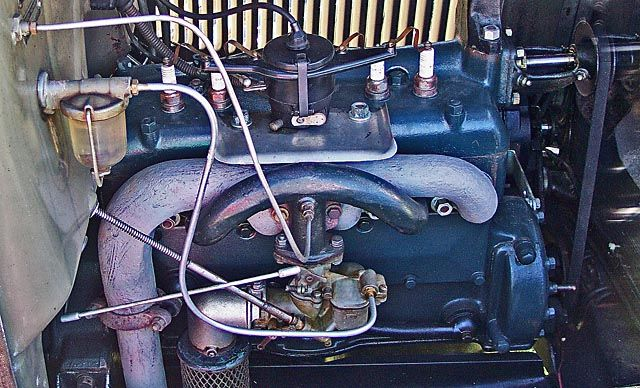

# George Riley and the Heads That Cracked

*The Two-Port and Four-Port Model A/B conversions*

!!! abstract "Article record"
    **Confidence:** Medium · **Source types:** secondary, forum/scrapbook · **Last verified:** 2026-10-12 (Round 1) · **Open issues:** WWII drone engine unverified · [How we rate this](../reference/source-standards.md)

George Riley was an inventor who raced cars, planes and boats. Hot Rod credits him with the inboard/outboard boat engine configuration and says he opened his shop in **1919** to make Model T speed equipment.[^hr]<a href="#q-1" title="Single source so far: see Open questions">◐</a>

## What he built

Riley's conversions were **F-heads**: intake valves moved to the head, exhaust valves left in the block, unlike Miller heads with both valves overhead.[^hr]

The **Two-Port** ("Valve-In-Head") was marketed from **1930**, advertised at 80 hp. Foundry problems in the Depression left about half the castings worthless.[^hemm] The **Racing Four Port** followed in 1933,[^hemm] first seen in competition in **August 1932** per Hot Rod.[^hr] Riley claimed up to 160 hp at 4,500 rpm.[^moas] The heads suited short oval-track races more than long ones.[^cm]<a href="#q-2" title="Open question: see the bottom of the page">?</a>

## Back from the dead

Decades later the Two-Port came back. Charlie Yapp's Secrets of Speed Society reproduced the Two-Port in cast iron from an original bought in 1998, with a redesigned water jacket.[^hemm]

## Open questions & disputed details

*From the detective's notebook: where the sources disagree, where we have only one, and what we are still looking for. Each item links back to its place in the story.*

**Single source so far:** Hot Rod credits him with the inboard/outboard boat engine configuration and says he opened his shop in **1919** to make Model T speed equipment. <a class="hr-q-back" href="#qr-1" title="Back to the story">↩</a>

### What the owners say ◐

Owners on the Ford Barn forum report that:[^fb]

- Riley made "B," "C" and "D" two-ports (D low-compression for trucks), and early two-ports had plugs on the driver's side and cracked.
- After 4-port production began, few if any 2-ports were made.
- Riley also built a radial outboard, a Model A-based two-cylinder, a racing side-draft carb, and a WWII drone engine that was "his monetary downfall."
- Aluminum 4-ports were made by **John Vesco** (San Diego) and later **George Butler** (San Bernardino).

These are unverified recollections, so they are marked for confirmation. <a class="hr-q-back" href="#qr-2" title="Back to the story">↩</a>

## Images

<figure markdown>
{ loading=lazy }
<figcaption markdown>A stock 1930 Ford Model A four-cylinder, the flathead engine that Riley's Two-Port and Four-Port conversions modified. Creator: Don O'Brien from Piketon, Ohio, United States. Date: 2005-10-15 01:46. Source: [Wikimedia Commons](https://commons.wikimedia.org/wiki/File:1930_Model_A_Engine_(54533660).jpg). License: [CC BY 2.0](https://creativecommons.org/licenses/by/2.0).</figcaption>
</figure>

## Visual references (external)

*These are copyrighted or rights-restricted images, so we link to them instead of copying them.*

- [Museum of American Speed, "Riley OHV" (photos of Riley heads)](https://www.museumofamericanspeed.org/riley-ohv.html)
- [Model A Ford Garage, 1930 Riley Valve-in-Head brochure](https://www.fordgarage.com/pages/1930rileyvalveinhead.htm)

[^hr]: Hot Rod, "Prehistoric Ford Four-Bangers." https://www.hotrod.com/news/hrdp-1210-vintage-ford-model-a-b-c-four-cylinder-engines
[^hemm]: Hemmings, "Keeping Secrets." https://www.hemmings.com/stories/keeping-secrets/
[^moas]: Museum of American Speed, "Riley OHV." https://www.museumofamericanspeed.org/riley-ohv.html
[^cm]: Miniature Engineering Craftsmanship Museum, "4-Port Riley Model A Racing Engine." https://craftsmanshipmuseum.com/exhibit/4-port-riley-model-a-racing-engine/
[^fb]: The Ford Barn forum, "Riley, George Overhead Valve Heads History Info." https://www.fordbarn.com/forum/showthread.php?t=25673
