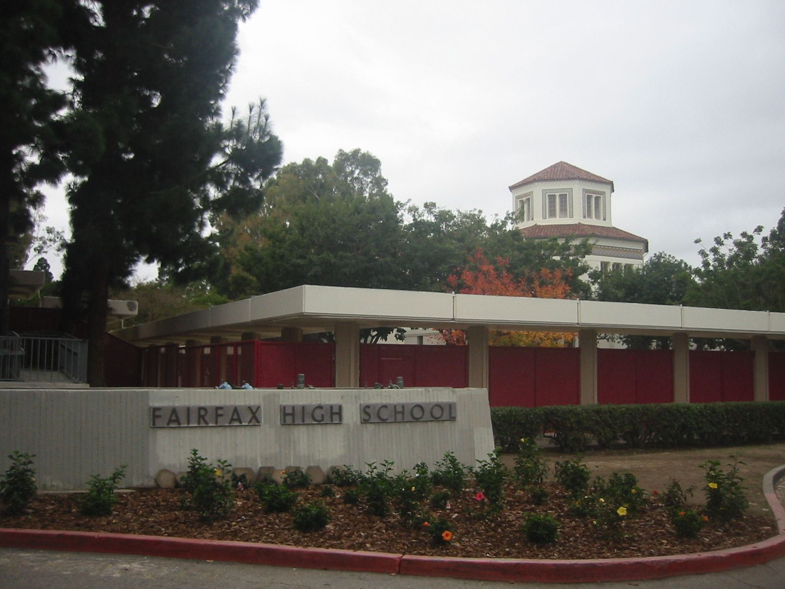

# Jimmy Summers: The Customizer Across from Fairfax High

*1913–1968*

!!! abstract "Article record"
    **Confidence:** Low–Medium · **Source types:** secondary · **Last verified:** 2026-10-12 (Round 1) · [How we rate this](../reference/source-standards.md)

His son Lee remembered how it began: Jimmy and his brother Bill worked as street-corner fender men. "They had tools in a bag, and they would go from block to block looking for cars that needed a fender repair."[^k]

James Merlin Traft Summers was born **September 22, 1913**, in Lewistown, Montana, and died **October 24, 1968**.[^k] Most of what we know comes from Sondre Kvipt's interviews with his children (Lee, Kris, Karen) and family albums, published in *The Rodder's Journal* #83 (2020) and on Kustomrama.[^k] **Nearly everything below comes from that one family-sourced research project.** ◐

## 7919 Melrose Avenue

By the late 1930s, his shop was at **7919 Melrose Ave.**, across from Fairfax High School.[^k] Alex Xydias, a Fairfax student, recalled "just four plastered walls, a bare concrete floor, and a gas jet" lit on cold mornings,[^k] and in a later interview said he watched the shop guys for hours "until they'd kick me out."[^sm] Tom Sparks (who worked for Roy Hagy c.1942–43) told Pat Ganahl that Summers "was like a god to us."[^k]

Xydias described the customer mindset: they "did not want Summers to provide them with a hot Ford as much as they wanted him to provide them with a fake Cord."[^k]

## What came out of the shop

*Motor Life* (May 1955) credited Summers with the **first channeling job**.[^k] ◐ Shop employee **Bob "Barbells" Fairman** built a chopped '36 Ford with full fadeaway fenders, the first Xydias had seen.[^k]

From 1946–47 Summers sold stamped **"Summers Fender Extensions"** for 1942–48 Chevrolets, Pontiacs and junior Buicks; a 1948 Hot Rod ad lists $69.50 per primered set.[^k] *Popular Mechanics* (May 1947) reported about one hand-tailored car per week.[^k]

In 1962 he built the body for Tony Nancy's dragster.[^k] And somewhere in the family albums sits his 1938 Muroc timing tag: 94.73 mph with a stock V8.[^k]

## Images

<figure markdown>
{ loading=lazy }
<figcaption markdown>Fairfax High School, Los Angeles, in 2006. Summers' Melrose Avenue shop stood across from it. Creator: Gary Minnaert (Minnaert). Date: 2006-12-16. Source: [Wikimedia Commons](https://commons.wikimedia.org/wiki/File:FairfaxHigh_Dec2006.jpg). License: Public domain.</figcaption>
</figure>

## Visual references (external)
*These are copyrighted or rights-restricted images, so we link to them instead of copying them.*

- [Kustomrama, Jimmy Summers (family album photos)](https://kustomrama.com/wiki/Jimmy_Summers)

[^k]: Kustomrama, "Jimmy Summers," drawing on Sondre Kvipt's family interviews and cited period magazines. https://kustomrama.com/wiki/Jimmy_Summers
[^sm]: StreetMuscle, "The Garage With Dennis Episode 14, So-Cal Speed Shop." https://www.streetmusclemag.com/news/video-the-garage-with-dennis-episode-14-so-cal-speed-shop/
