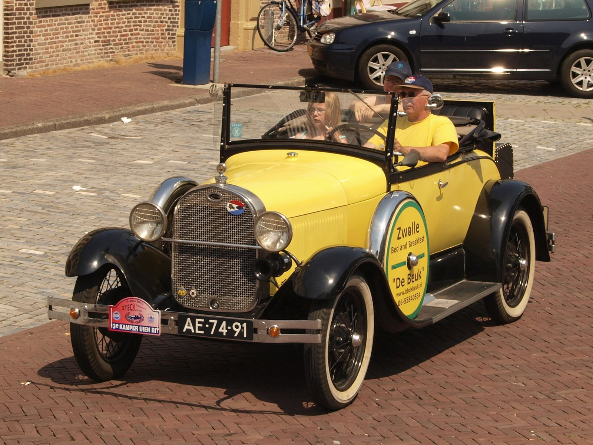

# Julian Doty: Seventy Years on the Lakes

*1922–2012*

!!! abstract "Article record"
    **Confidence:** Medium · **Source types:** oral (AHRF), secondary · **Last verified:** 2026-10-13 (Round 3) · [How we rate this](../reference/source-standards.md)

*Sources: Coachbuilt.com (census and directory research) and an AHRF profile built on Doty's recollections.*[^cb][^ahrf]

In 1934 Julian Doty made his first trip to Muroc with his uncle George, in George's Cragar-powered '29 Model A roadster.[^ahrf] He was born **December 10, 1922**, and died **May 2, 2012**. His mother Evelyn was George DuVall's sister.[^cb]<a href="#q-1" title="Sources disagree: see Open questions">⚠</a>

## A head on layaway

He paid for speed a little at a time. He bought a Miller-Schofield head for $120 at $5 a week. In 1940 his '31 Model A roadster topped 101 mph at Muroc, and he drove it on the street until 1972 (90,000 miles).[^ahrf]

The war took him to Germany, but not away from the lakes. In 1945, he wrote to *S.C.T.A. News* from Germany (Vol. II, No. 14): "I hope to have a car running next year."[^ahrf] It is a direct example of the wartime letters described on the [Veda Orr](veda-orr.md) page.

## The garage and the stolen lights

After the war he was back on the lakebed, this time running it. As SCTA starters in 1947–48, Doty and Sidewinders president Kong Jackson "stole some traffic signals, set them up and voila! more efficient starting."[^ahrf]<a href="#q-2" title="Single source so far: see Open questions">◐</a>

He also went east. In 1948 he crewed at Indy, helping Ed Winfield and Jean Marcenac with the Novis. On the way home, Ford men stopped them at a Detroit diner and showed them the unreleased flathead six on the dyno.[^ahrf]

At home there was the shop. The **B&S garage** (Baldwin & Sommerfeld), behind a Seaside station at Santa Monica & Spalding, built the Danny Sakai modified. It moved to Genesee Street in 1946 and ran until 1976.[^ahrf]

## The windshield patterns

Family work came too. In the late 1940s he did machine work at **Pacific Metal Products** (his uncle's employer) on intakes for Eddie Meyer, Tattersfield and Edmonds, plus the brightwork on the Muntz Jet.[^ahrf]<a href="#q-3" title="Sources disagree: see Open questions">⚠</a>

## The lakester and the autograph

The garage also built a lakester. The B&S wing-tank lakester won the SCTA points championship in 1956 and 1958. Its Tempest four used a DOHC head sketched on napkins by **Leo Goossen** and Arnold Birner at Edwards Steak House. Only five were cast. It set the F/L record of 165.13 mph in 1961.[^ahrf]

His signature mattered too. From 1972 he made and signed official SCTA timing slips. Mike Cook: "if your time slip doesn't have Julian's autograph on it, it's not worth anything."[^ahrf]

## Open questions & disputed details

*From the detective's notebook: where the sources disagree, where we have only one, and what we are still looking for. Each item links back to its place in the story.*

**Disputed.** **Was he at the founding?** Coachbuilt says DuVall and Doty were **charter members of the Hollywood Throttlers** and "were present when the SCTA was founded in November of 1937," and that Doty was a founding member of the **Sidewinders**.[^cb] Doty would have been about 14 at the founding. ◐ *Single-sourced; AHRF does not repeat it.* AHRF places the Hollywood Throttlers clubhouse next door to the original B&S garage.[^ahrf] Full story: [Muroc](../eras/1930s-dry-lakes-scta.md#may-or-march). <a class="hr-q-back" href="#qr-1" title="Back to the story">↩</a>

**Single source so far:** As SCTA starters in 1947–48, Doty and Sidewinders president Kong Jackson "stole some traffic signals, set them up and voila! more efficient starting." <a class="hr-q-back" href="#qr-2" title="Back to the story">↩</a>

**Disputed.** **When did he buy them?** Kustomrama says he bought them from So. Cal. Plating in **1946**;[^kr] Coachbuilt says "in the late 1940s." Coachbuilt quotes his ad: "Original DuVall V-Windshields For Any Car - $17.50, 6211 Banner Ave., Hollywood."[^cb] <a class="hr-q-back" href="#qr-3" title="Back to the story">↩</a>

## Images

<figure markdown>
{ loading=lazy }
<figcaption markdown>A stock 1929 Ford Model A roadster (Kampen, Netherlands). It shows the body type of George DuVall's Cragar-powered '29, in which Doty first went to Muroc in 1934. **It is not that car.** Creator: Alfvanbeem. Date: 2010-07-10. Source: [Wikimedia Commons](https://commons.wikimedia.org/wiki/File:1929_Ford_Model_A_roadster_AE-74-91.jpg). License: [CC0](http://creativecommons.org/publicdomain/zero/1.0/deed.en).</figcaption>
</figure>

## Visual references (external)

*These are copyrighted or rights-restricted images, so we link to them instead of copying them.*

- [AHRF, Julian Doty profile (photos)](https://ahrf.com/pioneer/julian-doty/)

[^cb]: Coachbuilt.com, "George DuVall (1913–1999)." http://www.coachbuilt.com/des/d/duvall/duvall.htm
[^ahrf]: American Hot Rod Foundation, "Julian Doty." https://ahrf.com/pioneer/julian-doty/
[^kr]: Kustomrama, "George DuVall." https://kustomrama.com/wiki/George_DuVall
