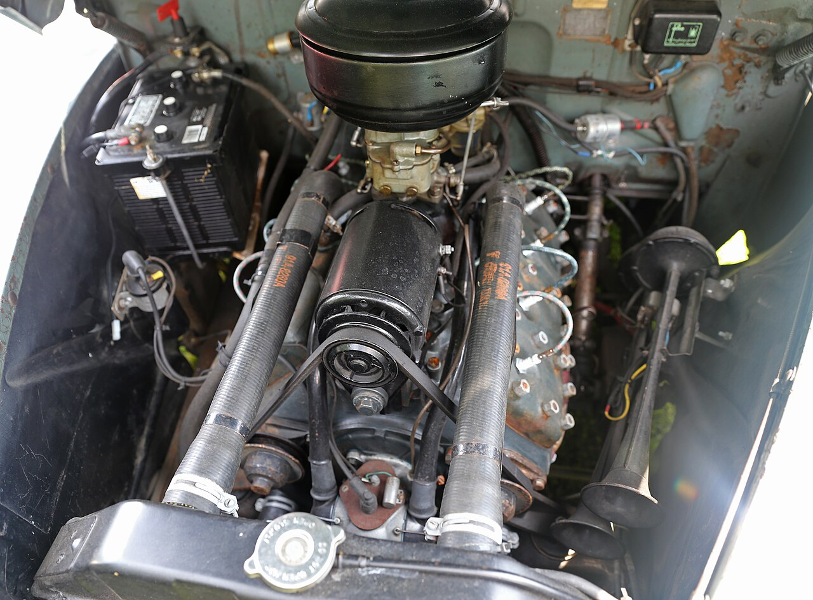
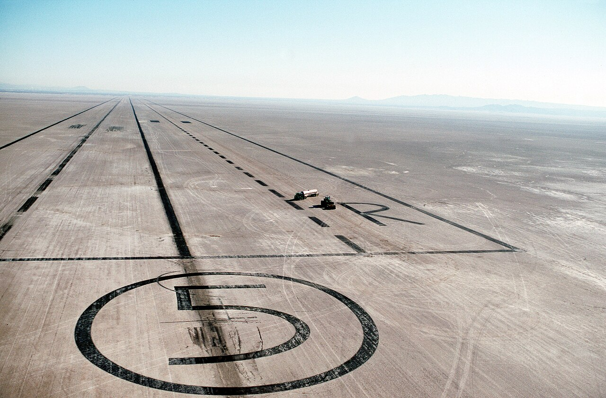

# Kong Jackson: "No organization. No nuthin'."

*Charles "Kong" Jackson, Sidewinders president and ignition maker*

!!! abstract "Article record"
    **Confidence:** Medium · **Source types:** oral (Medley 1988 via Fuel Curve), contemporaneous list post · **Last verified:** 2026-10-14 (Round 9) · **Open issues:** Death year conflict (2000 vs 2002) · [How we rate this](../reference/source-standards.md)

!!! quote "In their own words"
    "We were working on our cars when here came a Jeep and out jumped these guys with bayonets. Man, we just split!"

    — Kong Jackson to Tom Medley, 1988 (via Fuel Curve). [Full context in Voices](../voices/kong-jackson.md)

## Before the SCTA

Jackson raced the lakes when there were no rules at all. Fuel Curve (2023) quotes Jackson from Tom Medley's interview in Tex Smith's *Hot Rod History*: "Before the Road Runners, Ninety Mile an Hour, Sidewinders, and Throttlers formed the SCTA in 1938, guys were getting killed at the lakes, running into each other. No organization. No nuthin'."[^fc]<a href="#q-1" title="Sources disagree: see Open questions">⚠</a>

## Muroc, 1941

Then the war reached the lakebed. "Here came a Jeep and out jumped these guys with bayonets. Man, we just split!" The Army Air Corps camp was downwind of the racers' dust. Jackson told Medley that about 90 percent of the men racing that day were in the service within two months.[^fc]<a href="#q-2" title="Sources disagree: see Open questions">⚠</a>

## Kong ignition

After the war he built a flathead distributor with dual high-speed points and a four-lobe breaker cam "ground by... Ed Winfield." It had a cable control so the driver could advance or retard the timing from the seat. Fuel Curve says Clay Smith used this feature on the Lincoln team in the 1953 Mexican Road Race.[^fc]<a href="#q-3" title="Single source so far: see Open questions">◐</a>

Alex Xydias, quoted by Fuel Curve: "Kong was a really, really smart guy, who was president of the Sidewinders car club and timer at the lakes... I sold them at So-Cal Speed Shop. Think we charged 49 bucks." Xydias bought the whole business when Jackson was recalled for Korea.[^fc] See [Alex Xydias](alex-xydias.md). In later years **Kong Engineering** made flathead aluminum heads and intakes for the revival.[^fc][^ls]

## When did he die?

Even his death date is argued. The contemporaneous post (death Sept 4, 2000) is the stronger evidence, and we treat **2000** as the working date. A follow-up on the same list (Sept 2000) repeats the loss; Fuel Curve's "2002" remains unexplained. We have still found no LA Times or Daily News obituary; the list posts stand.<a href="#q-4" title="Sources disagree: see Open questions">⚠</a>

## Open questions & disputed details

*From the detective's notebook: where the sources disagree, where we have only one, and what we are still looking for. Each item links back to its place in the story.*

**Disputed.** Jackson's "1938" disagrees with the usual late-1937 founding date (see [Dry Lakes & the SCTA](../eras/1930s-dry-lakes-scta.md)). It is a recollection fifty years on. <a class="hr-q-back" href="#qr-1" title="Back to the story">↩</a>

**Disputed.** **A chronology muddle:** Fuel Curve has him joining the Army as an Air Force mechanic, stationed at Mojave, *and then* back at the lakes by 1938 in a '32 highboy.[^fc] The order of events needs checking. <a class="hr-q-back" href="#qr-2" title="Back to the story">↩</a>

**Single source so far:** Fuel Curve says Clay Smith used this feature on the Lincoln team in the 1953 Mexican Road Race. <a class="hr-q-back" href="#qr-3" title="Back to the story">↩</a>

**Disputed.** **The sources disagree.** A land-speed mailing-list post of **Sept 10, 2000**, by Katie Young Cortez, says he "passed away Monday (9/4)." She describes the funeral her father attended and says he left 8 children, 14 grandchildren and 2 great-grandchildren. It adds that he "began racing in 1938, I believe" and served in WWII and Korea.[^ls] Fuel Curve (2023) says he was at El Mirage "until his death in **2002**."[^fc] <a class="hr-q-back" href="#qr-4" title="Back to the story">↩</a>

**Next breadcrumbs:** his 1988 interview with Tom Medley; the "stolen traffic-signal starting lights" story ([Julian Doty](julian-doty.md)); Sidewinders banquet records.

## Images

<figure markdown>
{ loading=lazy }
<figcaption markdown>A stock 1941 Ford flathead V8. Kong ignitions replaced this engine's distributor. The engine is not fitted with one. Creator: Mr.choppers. Date: 2015-07-12. Source: [Wikimedia Commons](https://commons.wikimedia.org/wiki/File:1941_Ford_V8-11A_flathead_engine_in_a_Super_DeLuxe.jpg). License: [CC BY-SA 3.0](https://creativecommons.org/licenses/by-sa/3.0).</figcaption>
</figure>

<figure markdown>
{ loading=lazy }
<figcaption markdown>Rogers (formerly Muroc) Dry Lake as part of Edwards AFB in 1990. In 1941 Jackson saw Army Jeeps clear the racers off this lakebed. Creator: CMSgt Donald Sutherland, U.S. Air Force. Date: 1990-12-18. Source: [Wikimedia Commons](https://commons.wikimedia.org/wiki/File:Edwards_AFB_Runway_5_on_Rogers_Dry_Lake.jpg). License: Public domain.</figcaption>
</figure>

## Visual references (external)

*These are copyrighted or rights-restricted images, so we link to them instead of copying them.*

- [Fuel Curve, "'Kong' Jackson" (photos)](https://fuelcurve.com/kong-jackson/)

[^fc]: "'Kong' Jackson – The King of Early Flathead Ignitions," Fuel Curve, July 3, 2023. https://fuelcurve.com/kong-jackson/
[^ls]: Katie Young Cortez, "Loss of a Pioneer of Early Hot Rodding," land-speed list, Sept 10, 2000. http://ftp.team.net/html/land-speed/2000-09/msg00247.html
