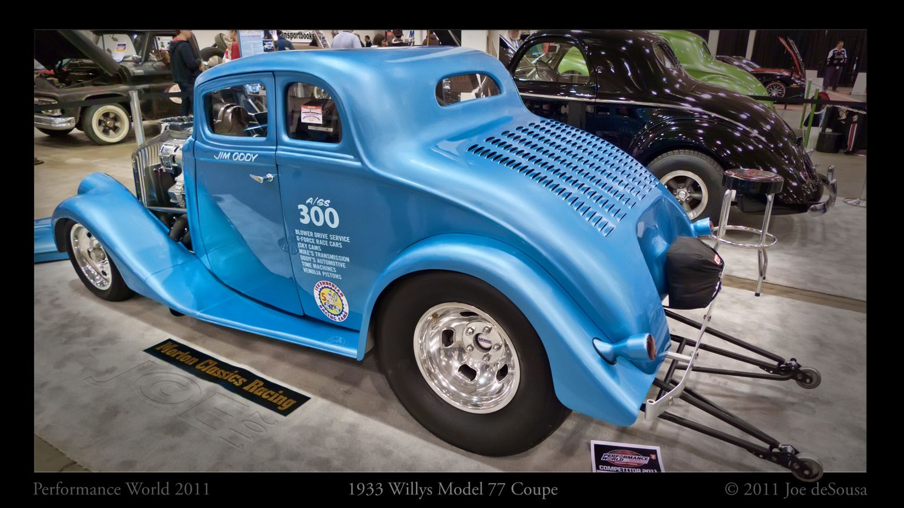

# Peggy Hart: The Racer Who Beat the Winners

*1914–1980, Santa Ana's racer-promoter*

!!! abstract "Article record"
    **Confidence:** Medium · **Source types:** obituaries, hall-of-fame biography, period magazine interview with C.J. Hart (*Hot Rod*, Jan 1980), book review of a clippings pamphlet · **Last verified:** 2026-10-15 (Round 10) · **Open issues:** none of Peggy's own 1950s words found yet (the California Digital Newspaper Collection was blocked to our fetcher); her cars and the timeline of her classes come from one hall-of-fame bio; ⚠ opening date (June 19 vs July 2, 1950) · [How we rate this](../reference/source-standards.md)

!!! quote "In their own words"
    "At that time, it was mainly roadsters and coupes. Peggy was going as fast as any of them, and beating a lot of guys. She was a trendsetter, a pioneer."

    — Steve Gibbs, NHRA, to the Press-Enterprise, 2004 (secondhand). [Full context in Voices](../voices/harts-santa-ana.md)

The Orange County Register called her "the only woman racer and one of the fastest women in the nation," and said she "often challenged the winners at the end, and beat them."[^ocr]<a href="#q-1" title="Single source so far: see Open questions">◐</a>

She raced regularly, and won, in a **1933 Willys coupe**.[^nhra][^pe] Steve Gibbs: "Peggy was going as fast as any of them, and beating a lot of guys. She was a trendsetter, a pioneer."[^pe04] Richard Parks: "She was a tenacious race car driver and drove on the drag strip and at the dry lakes."[^parks]

She was born Mary Margaret "Peggy" Riley, and she married Cloyce J. Hart in 1934.[^ocr] The International Drag Racing Hall of Fame lists her as **1914–1980** (inducted 1998).[^idrhof] She co-founded and co-ran the Santa Ana Drags with C.J. from 1950 ([Santa Ana](../eras/1950s-santa-ana-drags.md)).[^mshf][^lat]

A 2024 LinkedIn post calls her "the first woman dragster driver" (photo dated 1951).<a href="#q-2" title="Single source so far: see Open questions">◐</a>

Her death ended a long partnership. C.J. briefly retired after her death in 1980 and later joined the NHRA Safety Safari. Shortly before he died he said, "I've waited 24 years. I'm going to see Peggy."[^ocr][^pe04]

## Her cars, in order { #her-cars-in-order-round-10 }

The International Drag Racing Hall of Fame biography (Class of 1998) gives the fullest list we have found:[^idrbio] "the family **stocker**" in competition; then a "**Cadillac powered Model T roadster**"; then a "**Willys gas coupe**" (other sources call it a 1933 Willys);[^nhra][^pe] and "finally, turned **more than 130 mph** in 'Pappy's' **Cad-powered gas dragster in 1954**."

It adds: "She even drove at **El Mirage** dry lake and the **Bonneville Salt Flats**." Its own claim is cautious: Peggy "was **one of the first** women to drive a 'hot' car in competition on an organized drag strip."[^idrbio]<a href="#q-3" title="Single source so far: see Open questions">◐</a>

## C.J.'s version, 1980

*Hot Rod*'s Dave Wallace interviewed C.J. at the Harts' Lake Elsinore home for the January 1980 issue. Peggy died in 1980. He calls her C.J.'s "partner of 45 years," which fits their 1934 marriage, and writes: "she ran a **blown Cadillac dragster** back in 1954 that went 130 mph, says Hart with obvious pride, and she just missed a **two-way class record at Bonneville** one year 'when we lost Number Seven on the way back.'"[^hr80]

This is the only first-hand source for the Bonneville attempt. "Number Seven" is most likely a cylinder (the car lost a cylinder on the return run). That reading is ours, not Hart's.<a href="#q-4" title="Single source so far: see Open questions">◐</a>

The accounts differ on one detail, a supercharger. C.J. says "blown"; the hall of fame says "Cad-powered gas dragster." The two don't strictly conflict, but only C.J.'s account says it had a supercharger.

## Founder of the strip, not just the wife of one

In the Long & Tuttle clipping pamphlet ***Every Sunday Drag Races: Orange County Airport, Santa Ana***, "three men and one woman are given credit for opening this dragstrip": C.J. Hart, Frank Stillwell, Creighton Hunter and **Peggy Hart**. That is Richard Parks's summary in his 2012 review. Parks adds that "Peggy would take on all comers on the dragstrip and usually beat them handily."[^parksrev]

The pamphlet is a xeroxed set of newspaper clippings, "from the first race on **July 2, 1950**, through August 27, 1956." Parks says many were written by announcer **Don Tuttle** (at the strip after his 1952 Navy discharge), probably for the *Orange County Register*.[^parksrev] It has no page numbers, and Parks warns "the data is sometimes suspect."<a href="#q-5" title="Sources disagree: see Open questions">⚠</a><a href="#q-6" title="Open question: see the bottom of the page">?</a>

*See also:* [Santa Ana Drags](../eras/1950s-santa-ana-drags.md), [Voices: the Harts at Santa Ana](../voices/harts-santa-ana.md), [Voices: Strip Owners & Door-Slammers](../voices/strip-owners-and-door-slammers.md), [Veda Orr](veda-orr.md), [Doris Herbert](doris-herbert.md). <a class="hr-q-back" href="#qr-6" title="Back to the story">↩</a>

## Open questions & disputed details

*From the detective's notebook: where the sources disagree, where we have only one, and what we are still looking for. Each item links back to its place in the story.*

**Single source so far.** *"Only woman racer" appears in one source.*[^ocr] <a class="hr-q-back" href="#qr-1" title="Back to the story">↩</a>

**Single source so far.** *Unsourced claim; not adopted.*[^li] <a class="hr-q-back" href="#qr-2" title="Back to the story">↩</a>

**Single source so far.** *One source for the order of cars.*[^idrbio] <a class="hr-q-back" href="#qr-3" title="Back to the story">↩</a>

**Single source so far.** **Which Bonneville record did she miss?** C.J. Hart's 1980 *Hot Rod* interview is the only source, and it gives no year or class; we have seen no SCTA record entry.[^hr80] <a class="hr-q-back" href="#qr-4" title="Back to the story">↩</a>

**Disputed.** **When did the strip open?** C.J. told *Hot Rod* he opened "on **June 19, 1950**," and our [Santa Ana](../eras/1950s-santa-ana-drags.md) page follows that date.[^hr80] Yet the pamphlet's "first race" is July 2, 1950. June 19, 1950, was a **Monday**; July 2 was a Sunday. This may mean the strip opened (with its lease or a first practice) on June 19 and held its first Sunday race on July 2. Until a dated 1950 clipping is found, that is only a suggestion. **Unresolved.** <a class="hr-q-back" href="#qr-5" title="Back to the story">↩</a>

**Single source so far.** **What does the Long & Tuttle pamphlet say?** We have not seen a copy of *Every Sunday Drag Races: Orange County Airport, Santa Ana*; everything here about it comes from Richard Parks's 2012 review, which warns that "the data is sometimes suspect."[^parksrev] <a class="hr-q-back" href="#qr-6" title="Back to the story">↩</a>

### Still missing

None of **Peggy's own words** from the 1950s have turned up. Every quotation of her racing is secondhand (Gibbs, Parks, C.J.). We tried the California Digital Newspaper Collection for Santa Ana–area coverage from 1950 to 1959, but the site blocked our fetcher. The Long & Tuttle pamphlet is the best lead. Her Willys's class and times and any dry-lakes timing tags are also still open.

## Images

<figure markdown>
{ loading=lazy }
<figcaption markdown>A 1933 Willys Model 77 coupe, the model Peggy Hart raced at Santa Ana. **It is not her car.** Creator: Mustang Joe. Date: 2011-03-13 14:38. Source: [Wikimedia Commons](https://commons.wikimedia.org/wiki/File:1933_Willys_Model_77_Coupe_(5750458011).jpg). License: [CC0](https://creativecommons.org/publicdomain/zero/1.0/deed.en).</figcaption>
</figure>

<figure markdown>
{ loading=lazy }
<figcaption markdown>Orange County Airport in the 1950s, site of the Santa Ana Drags that she co-promoted. Creator: Orange County Archives. Date: 1950s (archive's date). Source: [Wikimedia Commons](https://commons.wikimedia.org/wiki/File:Orange_County_Airport,_1950s.jpg). License: [CC BY 2.0](https://creativecommons.org/licenses/by/2.0). Courtesy line requested by the archive: "Photo courtesy Orange County Archives."</figcaption>
</figure>

[^ocr]: Robin Hinch, Orange County Register (2004), reproduced at wediditforlove.com. https://wediditforlove.com/cj-2.html
[^nhra]: Phil Burgess, NHRA.com, June 26, 2004, reproduced at wediditforlove.com. https://wediditforlove.com/cj-2.html
[^pe04]: Lyle Spencer, Press-Enterprise (2004), reproduced at wediditforlove.com. https://wediditforlove.com/cj-2.html
[^parks]: Richard Parks, "Gone Racin'... To say goodbye to C.J. Hart" (2004), reproduced at wediditforlove.com. https://wediditforlove.com/cj-2.html
[^pe]: Johan Moreno, Press-Enterprise, Oct 1, 2015. https://www.pressenterprise.com/2015/10/01/santa-ana-drags-65-years-after-the-strip-was-founded-it-still-brings-back-fond-racing-memories/
[^mshf]: MSHF, "C. J. Hart." https://www.mshf.com/hall-of-fame/inductees/c-j-hart.html
[^lat]: Shav Glick, "C.J. 'Pappy' Hart, 93," Los Angeles Times, June 30, 2004. https://www.latimes.com/archives/la-xpm-2004-jun-30-me-hart30-story.html
[^idrhof]: Don Garlits Museum, International Drag Racing Hall of Fame, Class of 1998 list. https://garlits.com/hall-of-fame-inductees-2011/
[^idrbio]: Don Garlits Museum of Drag Racing, International Drag Racing Hall of Fame, "Peggy Hart" (Class of 1998). Accessed 2026-10-15. https://garlits.com/hall-of-fame/peggy-hart/
[^hr80]: Dave Wallace, "The Hart of Drag Racing," *Hot Rod*, January 1980 (web reprint Jan 1, 2023). Accessed 2026-10-15. https://www.hotrod.com/features/the-hart-of-drag-racing-january-1980-982-1130-22-1
[^parksrev]: Richard Parks, review of Leslie Long & Don Tuttle, *Every Sunday Drag Races: Orange County Airport, Santa Ana*, HotRod Hotline, Jan 13, 2012. Accessed 2026-10-15. https://hotrodhotline.com/every-sunday-drag-races-orange-county-airport-santa-ana-by-leslie-long-and-don-tuttle/
[^li]: David Walker, LinkedIn post, Dec 2024. https://www.linkedin.com/posts/david-walker-9a830740_while-shirley-muldowney-was-called-the-first-activity-7275146996112400384-fauL
