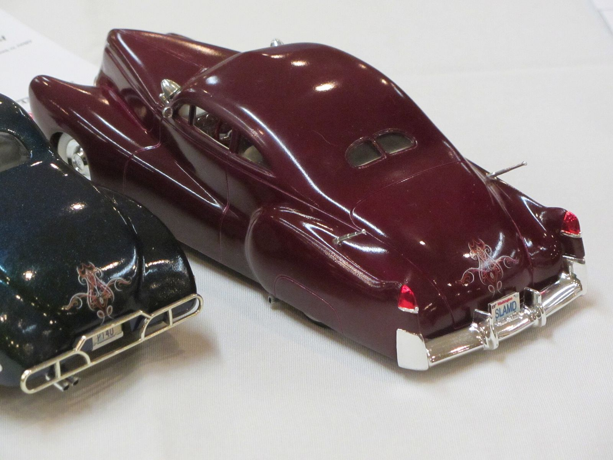

# Roy Hagy: The Man Who Wouldn't Use Lead

*The other prewar top-chopper*

!!! abstract "Article record"
    **Confidence:** Medium · **Source types:** oral (via Ganahl), secondary · **Last verified:** 2026-10-12 (Round 2) · [How we rate this](../reference/source-standards.md)

*Almost everything known here comes from one oral source: Tom Sparks, interviewed by Pat Ganahl for* The American Custom Car*, as relayed by Kustomrama.*[^k]<a href="#q-1" title="Single source so far: see Open questions">◐</a>

Tom Sparks worked for him around 1942–43, at about 15, and remembered the rule of the shop: "Hagy worked mostly on what we call fat-fender cars today: '36s, '39-'40s. He did mostly filling, removing handles, recessing license plates, and chopping tops. **Hagy didn't like to use much lead; he'd metal-finish everything.** ... And he always worked alone."[^k]

Sparks was an unpaid "sand boy" and learned gas welding and painting there.[^k]

## Where he fits

That makes Hagy one of the pioneers. Hagy and Jimmy Summers are named as two of the first LA shops to specialize in customizing production cars, as opposed to coachbuilders like Bohman & Schwartz or Coachcraft.[^k] His shop was on Vermont at Second Street. When Sparks worked there, Hagy was working out of a back room at Russell Johnson's paint shop.[^k]

Others learned from him too. George and Tom Bistagne learned bodywork from Hagy around 1939–40.[^k] One known car is Tommy Winship's 1940 Ford coupe (later Earl Bruce's), with a chopped top, filled quarter windows, rounded door corners, and dechromed trim.[^k]

Sparks also had a view on where chopping came from: "It had to start sometime in the mid- to late-1930s." He added a caveat: "We weren't in Hollywood, and we didn't go very far."[^k]

## Why it matters

That one rule is what sets him apart. Metal-finishing rather than leading puts Hagy against the grain of the "lead sled" era that followed ([Techniques](../cars/techniques-and-styles.md)).

## Open questions & disputed details

*From the detective's notebook: where the sources disagree, where we have only one, and what we are still looking for. Each item links back to its place in the story.*

**Single source so far:** *Almost everything known here comes from one oral source: Tom Sparks, interviewed by Pat Ganahl for* The American Custom Car*, as relayed by Kustomrama.* <a class="hr-q-back" href="#qr-1" title="Back to the story">↩</a>

## Images

<figure markdown>
{ loading=lazy }
<figcaption markdown>A **scale model** of a 1940 Mercury custom at a model-club show. It shows the smoothed "fat-fender" '39–'40 style Sparks says Hagy worked on. It is not a Hagy car. Creator: JOHN LLOYD from Concrete, Washington, United States. Date: 2016-02-28 10:32. Source: [Wikimedia Commons](https://commons.wikimedia.org/wiki/File:1940_Mercury_based_custom_(25173334639).jpg). License: [CC BY 2.0](https://creativecommons.org/licenses/by/2.0).</figcaption>
</figure>

## Visual references (external)

*These are copyrighted or rights-restricted images, so we link to them instead of copying them.*

- [Kustomrama, Roy Hagy](https://kustomrama.com/wiki/Roy_Hagy)

[^k]: Kustomrama, "Roy Hagy" (citing Pat Ganahl, *The American Custom Car*). https://kustomrama.com/wiki/Roy_Hagy
