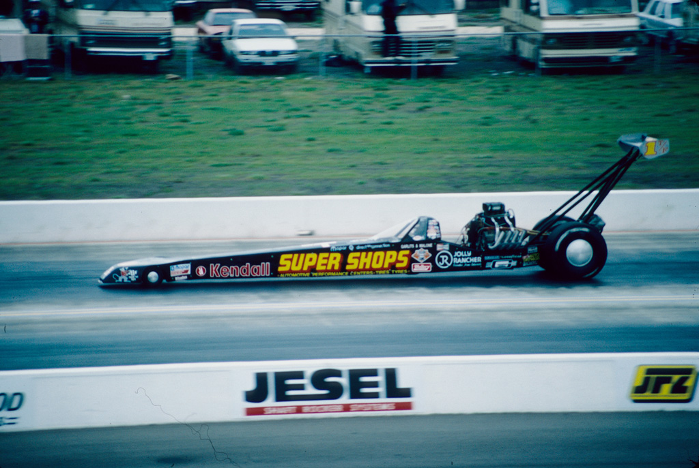
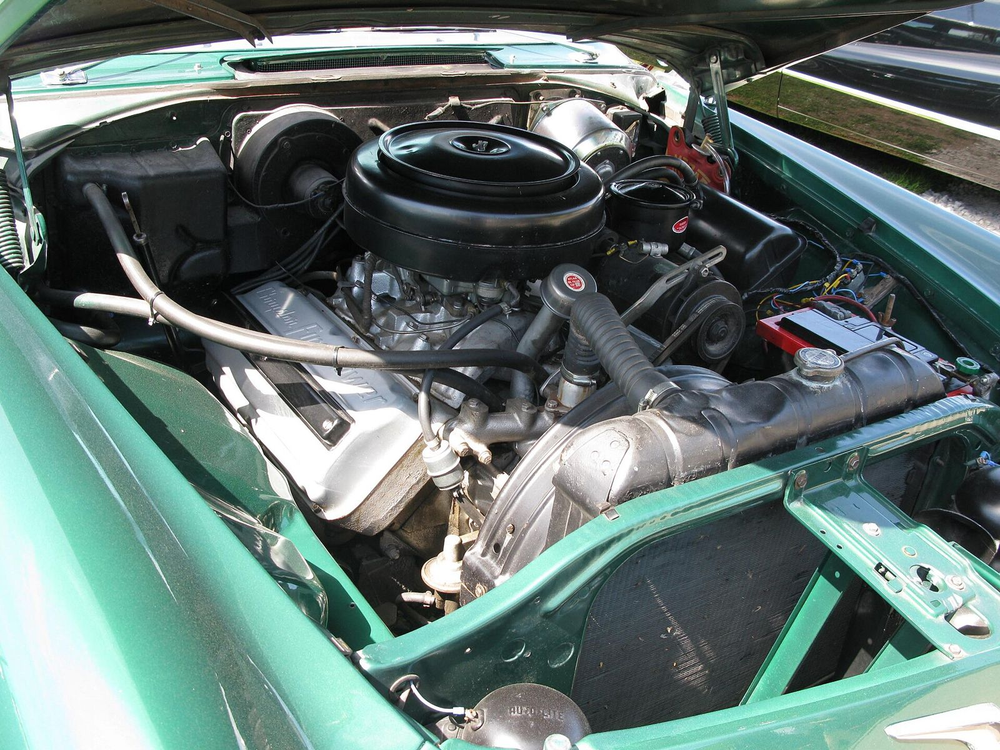

# Setto Postoian and the Swamp Rat Insult

*Serop Postoian, 1922–1995: Detroit's first drag hero*

!!! abstract "Article record"
    **Confidence:** Medium · **Source types:** HOF, secondary · **Last verified:** 2026-10-13 (Round 3) · **Open issues:** Riverside claim doubtful · [How we rate this](../reference/source-standards.md)

<figure markdown>
{ loading=lazy }
<figcaption markdown>Don Garlits in Swamp Rat XXX at Texas Motorplex on April 5, 1987 (uploader's caption). It is the descendant of the "Swamp Rat" name discussed below. Photo: twm1340 (Flickr), 1987-04-05 (per caption; file date 2007). Source: [Wikimedia Commons](https://commons.wikimedia.org/wiki/File:DonGarlitsSwampRatXXX.jpg). License: [CC BY-SA 2.0](https://creativecommons.org/licenses/by-sa/2.0).</figcaption>
</figure>

In 1959 Setto Postoian placed a Drag News ad calling Garlits "a swamp rat." Garlits adopted the insult as the name of all his cars.[^aw] The Michigan Motor Sports Hall of Fame calls Postoian an early idol of the teenage Garlits.[^mm]

*Principal source: Michigan Motor Sports Hall of Fame (inducted 1997).*[^mm]

## From Ford's engine shop to LA

Before WWII he worked in Ford's engine-rebuilding division in Detroit, then served three and a half years overseas and opened a gas station in Farmington afterward.[^mm]

He learned frame and front-end work from a former Bear Manufacturing school instructor. That led to an Indy pit-crew stint and his first ride in a hot rod, Jack McGrath's "full-house" '32 roadster.[^mm]

In **1950** he spent six weeks at McGrath's LA shop and met Joe Pisano and Ed Iskenderian.[^mm] That is an early East–West technology transfer.

## Farmington Speed Shop

Back home he opened **Farmington Speed Shop** and built a flathead roadster, then a DeSoto Hemi dragster, his first OHV engine.[^mm]<a href="#q-1" title="Sources disagree: see Open questions">⚠</a>

Then came the wins. He won back-to-back Top Fuel at the **World Series of Drag Racing** in 1957 and 1958 with a 392 Chrysler.[^mm]<a href="#q-2" title="Sources disagree: see Open questions">⚠</a> Full story: [The Upset at Cordova](../drag-racing/detroit-cordova.md#1957-the-garlits-upset).

Garlits told NHRA that Iskenderian made two blower kits, "one for me and one for Setto Postoian."[^nhra]

It ended suddenly. Postoian was seriously injured at Detroit Dragway in 1960 and never raced again. He had about 250 eliminator wins.[^mm]

## Open questions & disputed details

*From the detective's notebook: where the sources disagree, where we have only one, and what we are still looking for. Each item links back to its place in the story.*

**Possible error:** the MMSHOF says he won the "Riverside Nationals" four years running, 1953–56.[^mm] It needs checking against period results. <a class="hr-q-back" href="#qr-1" title="Back to the story">↩</a>

**Sources disagree: which engine won the World Series?** The MMSHOF says he won the 1957 and 1958 titles "after switching to a 392 cubic inch Chrysler."[^mm] BangShift describes the car that beat Garlits in both finals as an "unblown, carbureted 359-inch 354 Chrysler Hemi-powered nitro dragster."[^bs] Period results or photos would settle it. <a class="hr-q-back" href="#qr-2" title="Back to the story">↩</a>

## Images

<figure markdown>
{ loading=lazy }
<figcaption markdown>A 354 ci Chrysler FirePower Hemi in a 1956 Imperial (Sweden, 2015). BangShift says Postoian's Cordova-winning dragster had an unblown 354 Hemi bored to 359 ci. This is a stock street example. Creator: Herranderssvensson. Date: 2015-06-13. Source: [Wikimedia Commons](https://commons.wikimedia.org/wiki/File:1956_Chrysler_Firepower_hemi.jpg). License: [CC BY-SA 3.0](https://creativecommons.org/licenses/by-sa/3.0).</figcaption>
</figure>

[^mm]: Michigan Motor Sports Hall of Fame, "Serop 'Setto' Postoian." https://www.mmshof.org/index.php/inductees/inductees/326-serop-setto-postoian
[^aw]: Autoweek, "Swamp Rat Is a One-of-a-Kind Drag-Racing Treasure." https://www.autoweek.com/racing/nhra/a30456374/swamp-rat-is-a-one-of-a-kind-drag-racing-treasure/
[^bs]: BangShift, "Everything You Know About The Nitro Ban Is Wrong." https://bangshift.com/bangshift1320/everything-you-know-about-the-nitro-ban-is-wrong-the-real-history-of-the-infamous-nhra-nitro-ban/ (read 2026-10-22)
[^nhra]: NHRA, "Two legends: 'Big' and Bakersfield" (2025, search excerpt). https://nhra.sport/news/2025/two-legends-big-and-bakersfield
