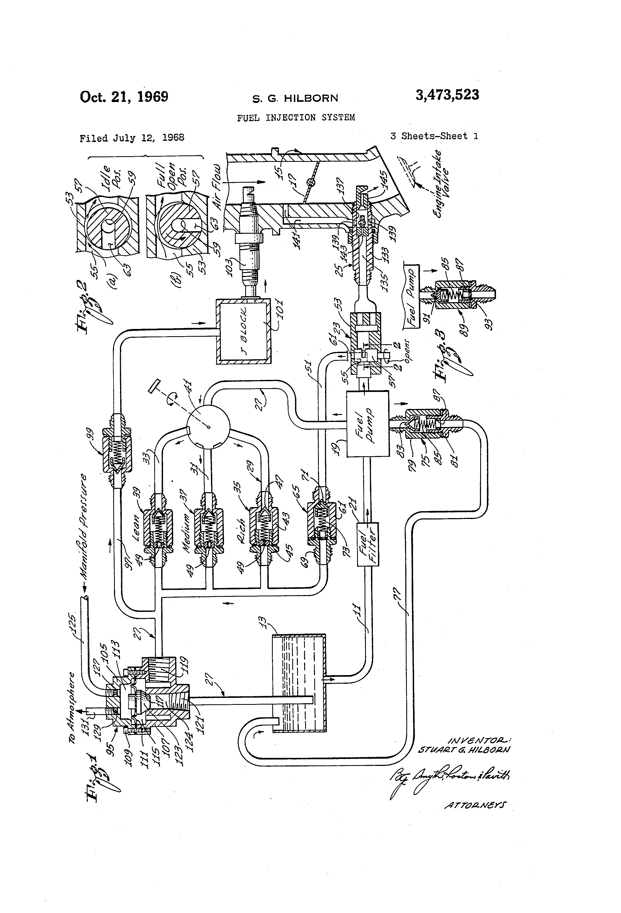
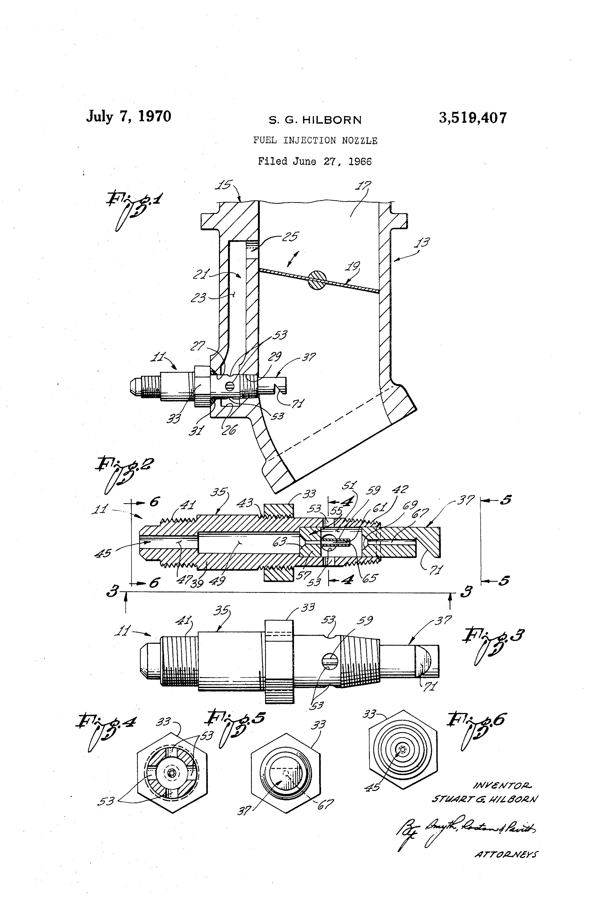
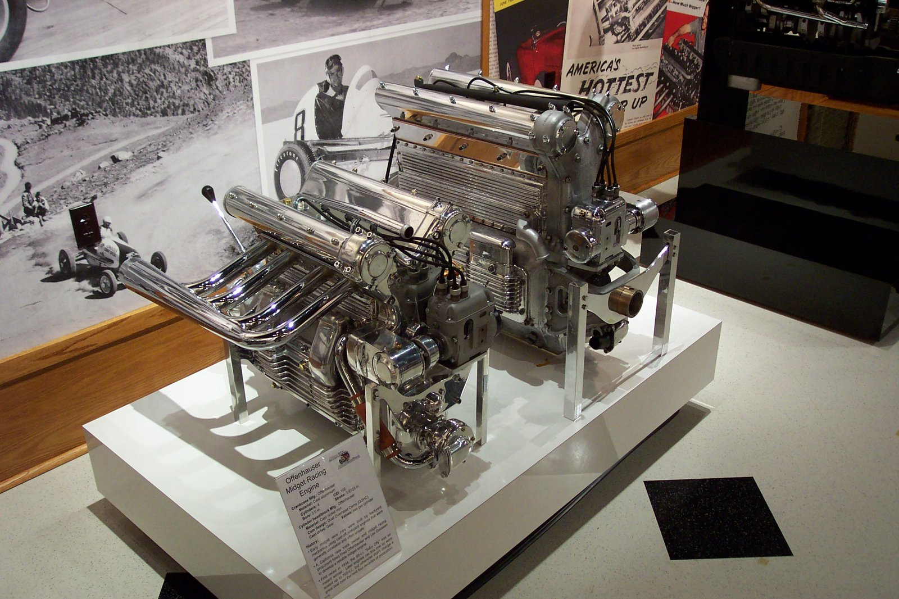
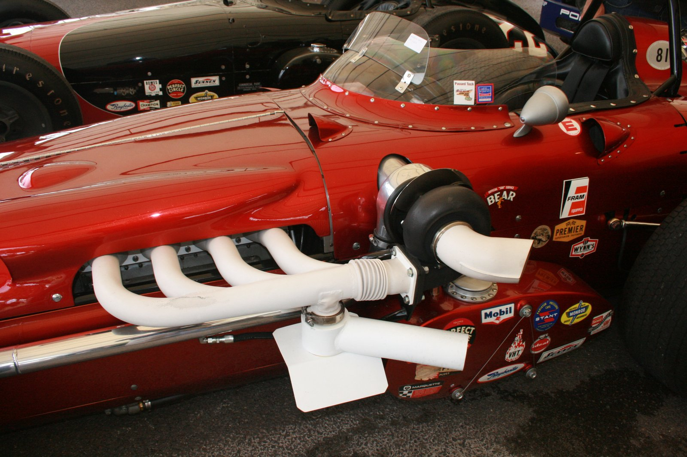

# Stuart Hilborn: Mechanical Fuel Injection from the Dry Lakes

!!! abstract "Article record"
    **Confidence:** Medium–High · **Source types:** Autoweek obituary (quotes AHRF + company site), SEMA heritage · **Last verified:** 2026-10-14 (Round 9) · **Open issues:** Exact July 1948 SCTA meet details beyond SEMA summary · [How we rate this](../reference/source-standards.md)

!!! quote "In their own words"
    "I was very impressed that they had doubled the horsepower of the cars as they came out of Detroit with virtually no money at all, just work... I decided I was going to have a race car."

    — Stuart Hilborn to the American Hot Rod Foundation (quoted in Autoweek, Dec 2013). [Full context in Voices](../voices/injection-and-tin.md)

**Stuart Garfield Hilborn** (Oct 9, 1917 – Dec 16, 2013) was a Calgary-born Southern California lakes racer who turned wartime experiments into **Hilborn Fuel Injection**—the mechanical constant-flow systems whose velocity stacks became a visual shorthand for mid-century race engines. Autoweek reported his injectors on **34 Indianapolis 500 winners**.[^aw][^sema]

## Lakes before the war
- First trip to the dry lakes: **Muroc, 1938**. He told AHRF he was struck that unpaid engine builders were doubling Detroit horsepower.[^aw]
- Neighbor **Eddie Miller** (Indy veteran) helped him build a flathead Model A. Autoweek: about **123 mph**; SEMA: about **120 mph** on the lakes. ⚠ Minor speed conflict between summaries.[^aw][^sema]
- Dec 7, 1941, he picked up a narrow streamliner previously raced by **Bill Warth**, then entered the **Army Air Corps** as a gunnery instructor. SEMA: only a couple of runs before service.[^sema]

## Crash, rebuild, 150 mph
- After the war he built a mechanical fuel injector and tested it on the streamliner, swapping between injection and multiple carbs.[^sema]
- **August 1947:** during a carbureted test a rear wheel collapsed; the car tumbled. Hilborn spent time in a body cast; **Eddie Miller Jr.** rebuilt the wrecked body while he recovered.[^sema]
- He promised his mother he would not drive again; **Howard (Howie) Wilson** drove. SEMA: Hot Rod put Hilborn and the car on the cover of its **fourth issue (April 1948)** at about **136 mph**; in **July 1948** Wilson ran **150.5 mph** at El Mirage—the first documented 150 mph lakes pass in that account.[^sema]
- Hilborn's own company-site text (quoted by Autoweek) says that after the rebuild the car "became the first car to break 150 mph," without naming the driver in that sentence. ◐ *SEMA's Wilson credit is the clearer race-day attribution.*[^aw]

Demand forced him out of racing into manufacturing: Offenhauser midget injectors first, then a business (Fuel Injection Engineering Co. / Hilborn Fuel Injection) that supplied oval track, drag, lakes, and Indy cars for decades.[^aw][^sema]

## Patents and later company history
- U.S. **3,473,523**, "Fuel Injection System," inventor Stuart G. Hilborn, assignee Fuel Injection Engineering Co., issued Jan 14, 1969.[^p3523]
- U.S. **3,519,407**, "Fuel Injection Nozzle," same inventor/assignee, issued **July 7, 1970**.[^p9407]
- SEMA Hall of Fame **1996**.[^sema]
- Died Dec 16, 2013, age 96, in Aliso Viejo, Calif.; survived by wife Ginny, children Edris and Duane.[^aw]
- Company later acquired by Holley (**2019** per Wikipedia summary); Holley announced ending Hilborn mechanical production in **Feb 2024**. ◐ *Post-1990 corporate history; cite secondary until Holley press is read in full.*[^wp]

**See also:** [Dry Lakes & the SCTA](../eras/1930s-dry-lakes-scta.md), [Patents](../reference/patents.md), [Fran Hernandez](fran-hernandez.md) (Cobbs dyno'd at Hilborn's shop per Hot Rod), [Injection & Tin voices](../voices/injection-and-tin.md).

## Images

<figure markdown>
{ loading=lazy }
<figcaption markdown>U.S. Patent 3,473,523, "Fuel Injection System," inventor Stuart G. Hilborn, assignee Fuel Injection Engineering Co. Sheet 1. Source: [Google Patents](https://patents.google.com/patent/US3473523A/en). License: Public domain (U.S. patent drawing).</figcaption>
</figure>

<figure markdown>
{ loading=lazy }
<figcaption markdown>U.S. Patent 3,519,407, "Fuel Injection Nozzle," inventor Stuart G. Hilborn. Sheet 1. Source: [Google Patents](https://patents.google.com/patent/US3519407A/en). License: Public domain (U.S. patent drawing).</figcaption>
</figure>

<figure markdown>
{ loading=lazy }
<figcaption markdown>El Mirage Dry Lake today (BLM). Hilborn tested injection here after WWII; SEMA places Wilson's 150.5 mph pass at El Mirage in July 1948. Creator: Bureau of Land Management California. Date: 2015-06-08. Source: [Wikimedia Commons](https://commons.wikimedia.org/wiki/File:El_Mirage_Dry_Lake_Off-Highway_Vehicle_Recreation_Area_(29486068103).jpg). License: Public domain.</figcaption>
</figure>

<figure markdown>
{ loading=lazy }
<figcaption markdown>Offenhauser midget racing engines on display. Hilborn told Autoweek that Offy midget injectors sold so well he left racing for manufacturing. These engines are not documented as Hilborn-equipped in the caption. Creator: JOHN LLOYD. Source: [Wikimedia Commons](https://commons.wikimedia.org/wiki/File:Offenhauser_Midget_racing_engines_(1715803460).jpg). License: [CC BY 2.0](https://creativecommons.org/licenses/by/2.0).</figcaption>
</figure>

<figure markdown>
{ loading=lazy }
<figcaption markdown>A Watson-Offenhauser Indianapolis-type race car on display. Hilborn systems became common on Offenhauser Indy engines; Autoweek reported Hilborn on 34 Indy 500 winners. This caption does not claim this specific car is Hilborn-equipped. Creator: Supermac1961. Source: [Wikimedia Commons](https://commons.wikimedia.org/wiki/File:Watson-Offenhauser_-_Flickr_-_Supermac1961.jpg). License: [CC BY 2.0](https://creativecommons.org/licenses/by/2.0).</figcaption>
</figure>

## Visual references (external)
- [SEMA News, "Stu Hilborn" (Petersen Archives cover photo)](https://www.sema.org/news-media/magazine/2014/18/stu-hilborn)
- [Hot Rod, Hilborn streamliner feature](https://www.hotrod.com/features/150-mph-stu-hillborn-streamliner-changed-history)

[^aw]: Mark Vaughn, "Fuel injection pioneer Stuart Hilborn: 1917-2013," Autoweek, Dec 15, 2013. https://www.autoweek.com/news/a1946706/fuel-injection-pioneer-stuart-hilborn-1917-2013/
[^sema]: Drew Hardin, "Stu Hilborn," SEMA News, May 2014. https://www.sema.org/news-media/magazine/2014/18/stu-hilborn
[^p3523]: US3473523A, Google Patents. https://patents.google.com/patent/US3473523A/en
[^p9407]: US3519407A, Google Patents. https://patents.google.com/patent/US3519407A/en
[^wp]: Wikipedia, "Stuart Hilborn" (secondary; Holley 2019/2024 claims). https://en.wikipedia.org/wiki/Stuart_Hilborn
