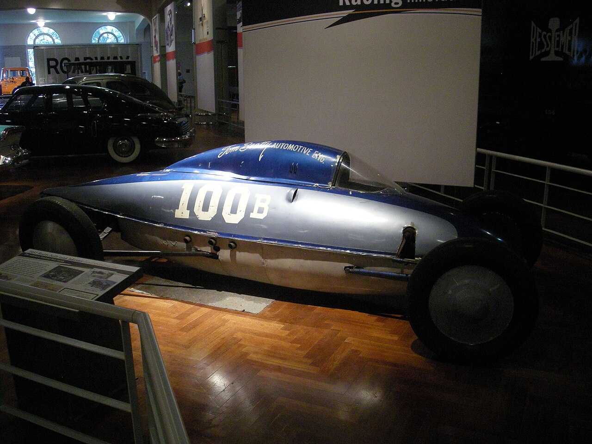

# Tom Beatty and the "Rust Bucket"

*The Glendale Strokers, a channeled roadster and a record-setting belly tank*

!!! abstract "Article record"
    **Confidence:** Medium · **Source types:** oral (Navarro via AHRF), period magazine (via auction text), auction catalog · **Last verified:** 2026-10-12 (Round 2) · **Open issues:** Record conflicts open · [How we rate this](../reference/source-standards.md)

<figure markdown>
{ loading=lazy }
<figcaption markdown>The belly tank lakester that the Henry Ford Museum displays as the "1951 Beatty belly tank lakester" (Dearborn, Mich., 2012). The identification is the photographer's and the museum's. We have not checked it against the Beatty records discussed below. Photo: Michael Barera, 2012-08-24. Source: [Wikimedia Commons](https://commons.wikimedia.org/wiki/File:Henry_Ford_Museum_August_2012_29_(1951_Beatty_belly_tank_lakester).jpg). License: [CC BY-SA 4.0](https://creativecommons.org/licenses/by-sa/4.0).</figcaption>
</figure>

Tom Beatty's channeled 1929 Ford roadster was unpainted and rusty, looking "gutted by a fire" (Hop Up, August 1951). It was clocked at 154.63 mph in 1951 with a '41 block, Navarro heads and manifold, and a GMC two-stroke diesel blower. It used an upside-down Model A front suspension, and the steering wheel was stripped to the wire core and wrapped in friction tape.[^rust]<a href="#q-1" title="Single source so far: see Open questions">◐</a>

## The club and the car port

Beatty was a Glendale club man. Barney Navarro joined the club in 1940 along with Tom Beatty, George Hill and Doane Spencer.[^ahrf]<a href="#q-2" title="Sources disagree: see Open questions">⚠</a>

The two stayed close. Navarro: "Tom lived next door to my shop and had a covered car port where he could do the welding and assembly work."[^ahrf]

## The belly tank

That car port produced the belly tank. Beatty built a ¾-in. chrome-moly truss chassis with swing-axle independent rear suspension, a modified Ford gearbox, and an inverted Model A front axle. Hop Up (Dec 1951) wrote: "Finally an original tank has come along."[^tank]<a href="#q-3" title="Sources disagree: see Open questions">⚠</a>

Then it went fast. In 1952 came 203 mph one-way and a 197.17 mph two-way record per AHRF;[^ahrf] 203.61 one-way per RM. It was Hot Rod's "Hot Rod of the Month" (Nov 1952) with a Rex Burnett cutaway.[^tank]

And it kept going. RM says it was SCTA Top Speed of the Season five straight years (1951–55), and again in 1959. It reached 211.267 mph in 1955 (the 16th member of the 200 MPH Club), switched to Olds power in 1958, and ran a 243.438 mph average in 1962.[^tank]<a href="#q-4" title="Single source so far: see Open questions">◐</a>

## The shop

By then Beatty was in business. He opened **Tom Beatty Automotive Engineering**, Sun Valley, in 1958, selling 6-71 blower manifolds and multi-belt drives.[^tank]

## Open questions & disputed details

*From the detective's notebook: where the sources disagree, where we have only one, and what we are still looking for. Each item links back to its place in the story.*

**Single source so far.** AHRF instead calls Beatty's Navarro-blown car a "'27."[^ahrf] <a class="hr-q-back" href="#qr-1" title="Back to the story">↩</a>

**Disputed.** **Strokers or Stokers?** AHRF writes "Glendale **Strokers**";[^ahrf] Kustomrama's club page is titled "Glendale **Stokers**." Kustomrama lists members including Beatty, Navarro, Spencer, Hill, Don Nicholson, Mac Schutt, Bob "Buzz" Buswell, Bill Davis and the Watson brothers.[^club] Kustomrama's Buswell caption also mentions a "Glendale Sidewinders," and Coachbuilt calls the Sidewinders "(Glendale, CA), the SCTA's first member club."[^cbg] The relationship between the clubs is unclear. The spelling needs a period source, such as an SCTA entry list or a club plaque photo. <a class="hr-q-back" href="#qr-2" title="Back to the story">↩</a>

**Disputed.** **1951 Bonneville.** AHRF gives a Class D Lakester *record* of 185.80 mph;[^ahrf] the RM Auctions text on Kustomrama gives a 188.284 mph *run*.[^tank] These may be a two-way record and a one-way best, which is unconfirmed. <a class="hr-q-back" href="#qr-3" title="Back to the story">↩</a>

**Single source so far.** *Auction-catalog source; check against SCTA/BNI records.*[^tank] <a class="hr-q-back" href="#qr-4" title="Back to the story">↩</a>

**Unresolved:** the RM text says Beatty "died later that year" after the tank was sold, but the sale date is unclear. **Death date unverified.**

## Visual references (external)

*These are copyrighted or rights-restricted images, so we link to them instead of copying them.*

- [Kustomrama, Tom Beatty's belly tank lakester (RM Auctions photos)](https://www.kustomrama.com/wiki/Tom_Beatty%27s_Belly_Tank_Lakester)

[^ahrf]: Tony Thacker, "Barney Navarro," AHRF. https://ahrf.com/pioneer/barney-navarro/ (accessed 2026-10-12)
[^club]: Kustomrama, "Glendale Stokers." https://kustomrama.com/wiki/Glendale_Stokers (accessed 2026-10-13)
[^rust]: Kustomrama, "Tom Beatty's 1929 Ford" (citing Hop Up, Aug 1951). https://kustomrama.com/wiki/Tom_Beatty's_1929_Ford (accessed 2026-10-13)
[^tank]: Kustomrama, "Tom Beatty's Belly Tank Lakester" (RM Auctions catalog text). https://www.kustomrama.com/wiki/Tom_Beatty%27s_Belly_Tank_Lakester (accessed 2026-10-12)
[^cbg]: Coachbuilt.com, "George DuVall." http://www.coachbuilt.com/des/d/duvall/duvall.htm (accessed 2026-10-13)
