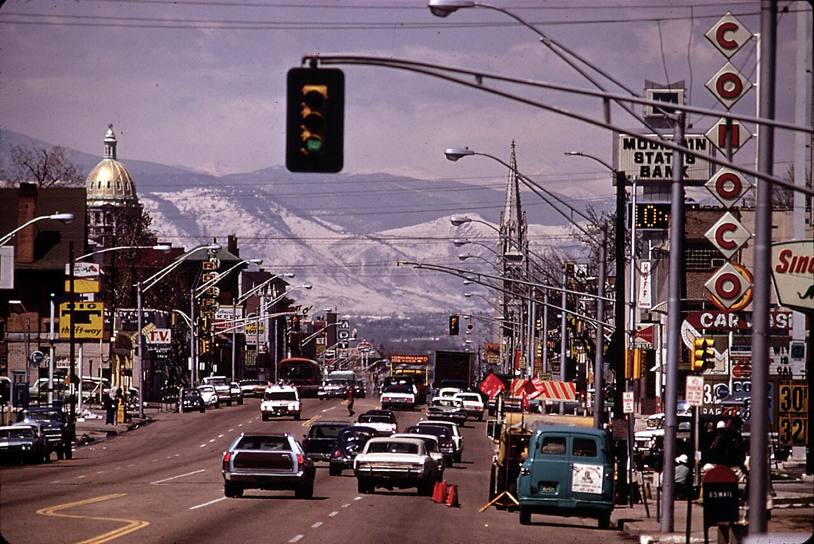

# Horrible Burgers and a Cinnamon Coke: Denver's 16th Street, Colfax and the Scotchman (1949–1977)

*Colfax, Broadway and one-way 16th Street, "horrible burgers" at the Scotchman, and car horns on October 11, 1977*

!!! abstract "Article record"
    **Confidence:** Medium (the routes agree across three independent memories; the Scotchman's dates and owners come from one local blogger's history; the dragster story is one man's, as told in his club's newsletter profile) · **Source types:** Grassroots a Denver Timing Association member profile on Red's Vintage Parts' *Hot Rodding Then and Now*; *PopBopRocktilUDrop* (a West High graduate's blog, 2021); *The H.A.M.B.* (2010); the *Colfax Avenue* local-history blog; a 1972 National Archives photograph · **Last verified:** 2026-11-12 (Round 39 citation review) · **Open issues:** ◐ the Scotchman's dates; ◐ the 39th and Peoria drags; ◐ the record and the fire · [How we rate this](../reference/source-standards.md)

!!! quote "In their own words"
    "On a summer Friday night only three things matter, jumping into my friend's car with the guys, tuning in to the Denver 'Tiger' – 950 KIMN and heading for downtown 16th street to join the Denver teen cruisin' parade on the one-way street."

    — A West High senior-to-be on July 12, 1963, *PopBopRocktilUDrop*, 2021.[^kim21]

## Broadway, Colfax and 16th

Denver teenagers cruised Colfax, Broadway and one-way 16th Street, crossed the viaduct to the Scotchman on Federal for "horrible burgers," and raced late at 39th and Peoria. Finley's crowd built a fuel dragster that nearly burned on the way home from Julesburg. The Scotchman closed on October 11, 1977, to a chorus of car horns.

Dennis Finley, who went through Mullins, South High and the Opportunity School in turn, ran around with four fellow gearheads from about 1956 in a '48 Chevy with a '53 Buick nailhead, a '36 LaSalle transmission and a '53 Olds rear end. "Their main cruising routes were Broadway, Colfax, and downtown's 16th Street," his profile says, with most nights spent at the drive-ins where hot rods gathered, and "considerable street racing."[^fin] He looked up to Joe Umphenour of the Chevrons, which Dennis thought was "THE club to belong to."[^fin]

Colfax was the long one. A cruiser posting as Ghost28 remembered running it "from east of aurora to down town Denver," then "the loop of 15th AND 16TH streets." For late-night racing, "we would head out to 39th and peoria," which usually lasted until two or a little later, "then the cops would shut us down because of complaints." Ghost28's memory is the only one, and it is undated.<a href="#q-2" title="Single source so far: see Open questions">◐</a>[^hamb10] The avenue was lined with drive-ins; the *Colfax Avenue* blog's list runs from Bimbo's, "Home of the Bimbo double-decker burger," at 4151 East Colfax, to the Holiday Drive-In at Cherry Street, "Open 25 Hours Daily."[^cfx]

<figure markdown>
{ loading=lazy }
<figcaption markdown>Colfax Avenue toward the State Capitol dome and the mountains, April 1972. Photo: Bruce McAllister, U.S. National Archives (identifier 544793), via Wikimedia Commons; public domain (U.S. government work). See [Image credits](../reference/image-credits.md).</figcaption>
</figure>

## Over the viaduct to the Scotchman

On a Friday night in July 1963, a West High senior-to-be and his friends tuned to KIMN, joined the one-way parade on 16th Street, crossed the viaduct that then tied 16th to North Denver and drove up Federal Boulevard to the Scotchman. They did not take his '50 Chevy coupe, "the 'black bomb,'" because its rear window had a West High Cowboy decal: "Not recommended for North Denver – turf of the North High Vikings."[^kim21]

The Frosted Scotchman had opened in 1949 at 4960 North Federal, selling Herman Christopher's "San-O-Serve" ice cream. Herman was not of Scottish origin – rather German – but his bright red hair gave birth to the ice cream parlor's name. Hamburgers came next, and a sense of humor: the menu advertised "horrible burgers" and "sloppy malts." After Christopher died in 1953 his nephew Carl Gerveny and Gerveny's mother ran it, and from the 1950s into the '70s it was "the spot for cruising teens on the west side," with 28 car spaces. The dates come from one blogger's history.<a href="#q-1" title="Single source so far: see Open questions">◐</a>[^kim21] Ghost28 remembered that "as long as you ordered something you could hang there for awhile"; another cruiser, paul hebert, answered him with the order: "horible burger & cinimon coke."[^hamb10]

A second Scotchman in Wheat Ridge had a jukebox inside that the teenagers, who seldom left their cars, never played. So it installed a remote wall box; the car hops in plaid skirts took the teenagers' coins and dropped them in, and the songs played over outside speakers.[^kim21]

## The Speed Specialists

Finley's crowd went from the street to the strip. His next car was a nearly new '57 Chevy pickup with fuelie heads, triple carbs and a Duntov cam, and with Pat Dugan, Herb Tornow and Bill Highfield he formed the Speed Specialist Racing Team and built a blown, nitro-burning Chrysler Hemi AA fuel dragster, painted yellow and white, making nearly everything for it themselves because the speed parts did not yet exist. They raced it at Continental Divide, Julesburg, Cheyenne, Pueblo, Scottsbluff and Great Bend.[^fin]

The first trip was to a two-day meet at Julesburg. Their rule was that if the car was not ready by six on Friday evening they would not go; they worked through the night, left at Saturday noon, and finished the throttle linkage at the track. On its first run Sunday morning it backfired and took out the timing cover, gears and chain. Since they had paid their entry, they talked the NHRA man into letting Finley run his triple-carb pickup in a stock class, and it set the state class record for about half an hour. No year is given for the Julesburg trip.<a href="#q-3" title="Single source so far: see Open questions">◐</a>[^fin]

On the way home Highfield flicked a cigarette out of the pickup's window, and it landed on the tarp over the dragster. A flathead '48 Merc from Denver following the convoy saw the smoke but couldn't catch up. When Finley finally stopped, the Merc slid up alongside, and the driver's girlfriend jumped out while it was still moving, landed in the pickup's bed and threw the cans of nitro out of it. "We liked to have never found two of them!" Then the roadside grass caught fire, and they stamped that out too.[^fin] In 1959, at the NHRA Nationals in Great Bend, their first-round opponent was "some unknown gearhead by the name of Garlits." Did they win? "No, but we might have scared him ever so slightly!"[^fin]

## Lights out

By the early 1970s gas was dearer, cruisers ordered a Coke instead of a burger, and Gerveny decided to close rather than sell. On October 11, 1977, the Scotchman's neon went out for the last time, with hundreds of teenagers parked in and around the lot and along Federal. "When the lights went out the blare of car horns extended a fond farewell to a teenage friend."[^kim21] Finley drove 18-wheelers, became a firefighter, raised five children with his wife Nora, built a red '32 Ford three-window, and joined the Denver Timing Association in 1998. "The cars are just a means to meeting good people and making new friends."[^fin]

The towns to the north had their own loops. On the same H.A.M.B. thread, cruisers named Main Street in Longmont and "'D' block in Greeley."[^hamb10]

The cruise had been Colfax, Broadway and 16th Street. The Scotchman had "horrible burgers." On October 11, 1977, the lights went out to a chorus of car horns.

*See also:* [The Denver Timing Association](../drag-racing/denver-timing-association-bandimere.md); [Mountain View and Colorado beyond Bandimere](../drag-racing/mountain-view-erie-colorado-strips.md); [Greybull and Cheyenne](../drag-racing/greybull-cheyenne-wyoming-strips.md), one of the Speed Specialists' strips; [Dragging Main](dragging-main.md); [Cruising](cruising-overview.md).

## Open questions & disputed details

*From the detective's notebook: where the sources disagree, where we have only one, and what we are still looking for. Each item links back to its place in the story.*

**Single source so far.** **When did the Scotchman open and close, and who ran it?** The 1949 opening, Christopher's death in 1953, the Gervenys and the October 11, 1977 closing come from one blogger's history, without citations.[^kim21] The *Rocky Mountain News* and *Denver Post* for October 1977 should have the closing. <a class="hr-q-back" href="#qr-1" title="Back to the story">↩</a>

**Single source so far.** **Did Denver's street racers really meet at 39th and Peoria?** Only Ghost28's memory, undated.[^hamb10] <a class="hr-q-back" href="#qr-2" title="Back to the story">↩</a>

**Single source so far.** **When did the pickup set its record and catch fire?** Both are Finley's stories, retold in his club profile; no year is given for the Julesburg trip.[^fin] <a class="hr-q-back" href="#qr-3" title="Back to the story">↩</a>

### Next leads

The *Rocky Mountain News* and *Denver Post* on 16th Street cruising and police (1955–70) and the Scotchman's closing (October 1977); the Chevrons club; *Billboard*, 1960 (the Wheat Ridge wall box); Denver Public Library's Western History photo collection for the drive-ins.

## Sources

[^fin]: "Dennis Finley," *Hot Rodding, Then and Now* (Denver Timing Association member profiles), Red's Vintage Parts. https://reds-vintage-parts.com/hot-rodding-then-and-now/61-dennis-finley (accessed 2026-11-12)
[^kim21]: craigr244, "Cruisin' Along with KIMN – Remember the Scotchman!," *PopBopRocktilUDrop*, August 31, 2021. https://kimsloans.wordpress.com/tag/cruisin-in-the-1960s-in-denver/ (accessed 2026-11-12)
[^hamb10]: "What street/City did you cruise in High School?," page 5 (posts by paul hebert quoting Ghost28, and by FunnyCar65 quoting 38FLATTIE, February 5, 2010), *The H.A.M.B.* https://www.jalopyjournal.com/forum/threads/what-street-city-did-you-cruise-in-high-school.443468/page-5 (accessed 2026-11-12)
[^cfx]: "Diners and Drive-Ins," *Colfax Avenue* (local-history blog). https://www.colfaxavenue.org/p/diners-and-drive-ins.html (accessed 2026-11-12)
