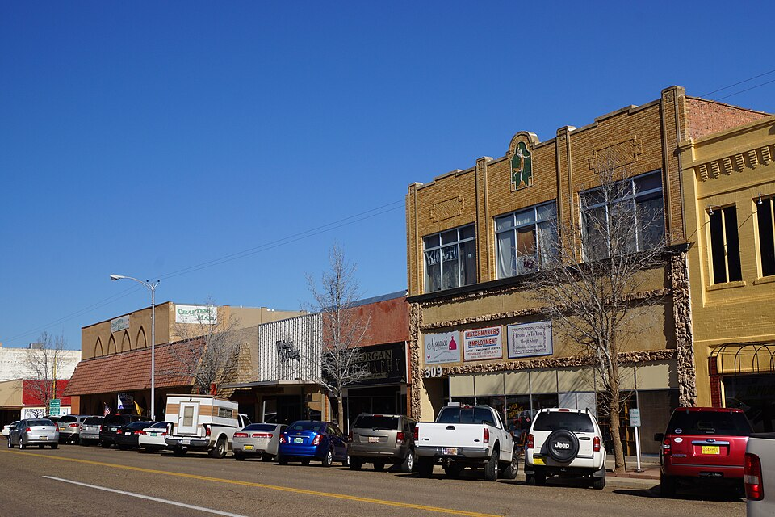

# Eight Blocks of Brick: Dragging Main in Clovis, New Mexico

*Friday and Saturday nights, Sunday afternoons, and a loop out First and back on Prince*

!!! abstract "Article record"
    **Confidence:** Medium (several firsthand memories agree on what dragging Main was like; they disagree on when it began and ended) · **Source types:** Grassroots a hometown blog of readers' memories (Mil's Place, 2014); hometown newspaper columns and stories (*Clovis News Journal* / *Eastern New Mexico News*, 2014–15); state tourism guide · **Last verified:** 2026-11-17 (Round 42) · **Open issues:** ⚠ when it began; ⚠ when it ended · [How we rate this](../reference/source-standards.md)

!!! quote "In their own words"
    "In those days gasoline was twenty-five cents a gallon. With several kids in the car, we could easily buy twelve gallons of gas."

    — Milburn Moore, *Mil's Place*, July 12, 2014.[^mil14]

<figure markdown>
{ loading=lazy }
<figcaption markdown>Downtown Clovis on a winter afternoon, January 17, 2017. The cars at the curb are parked. Photo: Greg Gjerdingen, via Wikimedia Commons, CC BY 2.0. See [Image credits](../reference/image-credits.md).</figcaption>
</figure>

## Bumper to bumper on Sunday

In Clovis, dragging Main was not one era. It was the town's weekend for decades, and people who did it still cannot agree when it started or when it stopped. What they agree on is what it was: a slow loop of the same few blocks, and the place you met everybody.

Milburn Moore, a Clovis native who writes a hometown blog, figured in 2014 that dragging Main in cars "likely began sometime in the thirties"; most kids his age learned about it in the forties, when they got their licenses.<a href="#q-1" title="Sources disagree: see Open questions">⚠</a> The times were Friday and Saturday nights and Sunday afternoon. "On Sundays, traffic was bumper-to-bumper—better not look around." He did look around, and rear-ended Jimmy Abernethy in front of Montgomery Ward. Meador's Chevrolet charged $55 to fix his dad's pickup.[^mil14]

Main was eight blocks, and kids got tired of it. Moore's crowd would go out First, circle back on Prince to 14th, then Thornton, Grand and Main again. He remembered seeing Bobby Joe dragging Main in "his neat little maroon 48 Chevrolet coupe" after a Friday night football game, around 1952.[^mil14]

## Circling the Foxy

Susan Stebbins Mallory, writing to the same blog, remembered going out First to circle a drive-in, back to Main, then out Seventh to circle the Foxy. When gas started costing more, kids parked around Gateway Auto at Main and Sixth and stood around talking and watching the cars. On Sundays they dragged Main until six and then had to go home. The best part was turning around at the end of Main near the train station: "Do you remember the crows which gathered in the trees around there and the city had trouble getting rid of them?" She left Clovis for the last time in 1968, she wrote, "and there was no dragging Main then."<a href="#q-2" title="Sources disagree: see Open questions">⚠</a>[^mil14]

Art Snipes, Clovis High class of 1951, wrote that he worked at Safeway on Saturday nights, "swinging a mop up and down those long aisles while everyone else was dragging Main." It still worked out. Dragging Main one Friday night, he spotted Wanda King in front of Standridge Drug, circled the block and asked her to get in, "the beginning of a long and beautiful relationship that lasted over 61 years."[^mil13]

## The brick street again

In 2014, Gene Porter and Bryan Boone talked about how Clovis had nothing for car people to do. "Boone said, 'We're just gonna do it and see how it turns out,'" Porter recalled.[^enmn15] Porter set the revival for June 28, 2014, from 5 p.m. to midnight, and invited everyone with cars, trucks or bikes to "rumble the bricks of Main Street." The police, he said, were supporting it "as long as we obey the traffic laws."[^ed14] Porter said it "exploded": more than a thousand cars registered and 3,500 to 4,000 people came. The first year cost the two about $5,000; the second, $20,000.[^enmn15]

Both men had done it themselves. Porter graduated in the '80s and spent the week getting his 1965 Chevy truck ready. "We could turn loose, our parents weren't around, we got to meet girls; that was the thing," he said. Boone, 56, said, "My parents can remember dragging Main in the late 40s." His son, newly licensed in 2014, dragged Main with a cousin, and "they drove around and did Chinese fire drills."[^enmn15] In 2017 the cruise joined the Clovis Music Festival, and the state tourism department counts more than 15,000 people.[^nmt]

Whatever year it started, dragging Main in Clovis was the same thing to each generation that told about it: the eight blocks, the loop, and somebody you met there.

*See also:* [Dragging Main](dragging-main.md); [Hot August Nights](../media/hot-august-nights-reno-1986.md), Reno's cruise that also began as a nostalgia night.

## Open questions & disputed details

*From the detective's notebook: where the sources disagree, where we have only one, and what we are still looking for. Each item links back to its place in the story.*

**Disputed.** **When did dragging Main in Clovis begin?** Moore (2014) says it "likely began sometime in the thirties," with his generation learning it in the forties.[^mil14] Boone's parents remembered it in the late 1940s.[^enmn15] The state tourism guide says "Starting in the 1950s."[^nmt] <a class="hr-q-back" href="#qr-1" title="Back to the story">↩</a>

**Disputed.** **When did it end?** Mallory says there was no dragging Main when she left in 1968.[^mil14] A blog commenter who graduated in 1970 wrote, "we got to drag main all through my high school years," and had been told it "was just stopped a few years ago."[^mil14] Porter, who graduated in the 1980s, said he dragged Main on weekends.[^enmn15] It may have faded and come back; no city ordinance or police notice has been found. <a class="hr-q-back" href="#qr-2" title="Back to the story">↩</a>

### Next leads

The *Clovis News-Journal* for city action against cruising (1960s–1990s); Clovis High yearbooks; the Mil's Place photo posts from the 2014 revival.

## Sources

[^mil14]: Mil [Milburn Moore], "'Draggin' Main' --- When Did It Begin?," *Mil's Place* (blog), July 12, 2014, with reader comment of August 4, 2015. https://milmoore.blogspot.com/2014/07/draggin-main-when-did-it-begin.html (accessed 2026-11-17)
[^mil13]: Art Snipes (Clovis High, class of 1951), letter printed in Mil [Milburn Moore], "Main Street and Hotel Clovis---C.H.S. 'Kids' Remember!," *Mil's Place* (blog), January 9, 2013. http://milmoore.blogspot.com/2013/01/main-street-and-hotel-clovis-chs-kids.html (accessed 2026-11-17)
[^ed14]: David Stevens, "From the editor's desk: This won't be a drag," *Eastern New Mexico News* (*Clovis News Journal*), June 18, 2014. https://www.easternnewmexiconews.com/story/2014/06/18/news/from-the-editors-desk-this-wont-be-a-drag/72866.html (accessed 2026-11-17)
[^enmn15]: "Get ready to roll at Draggin' Main," *Eastern New Mexico News*, June 23, 2015. https://www.easternnewmexiconews.com/story/2015/06/23/news/get-ready-to-roll-at-draggin-main/74368.html (accessed 2026-11-17)
[^nmt]: Stewart Green, "A Spectator's Guide to the Clovis Music Festival and Draggin' Main," New Mexico True (New Mexico Tourism Department). https://www.newmexico.org/blog/post/a-spectators-guide-to-the-clovis-music-festival-and-draggin-main/ (accessed 2026-11-17)
