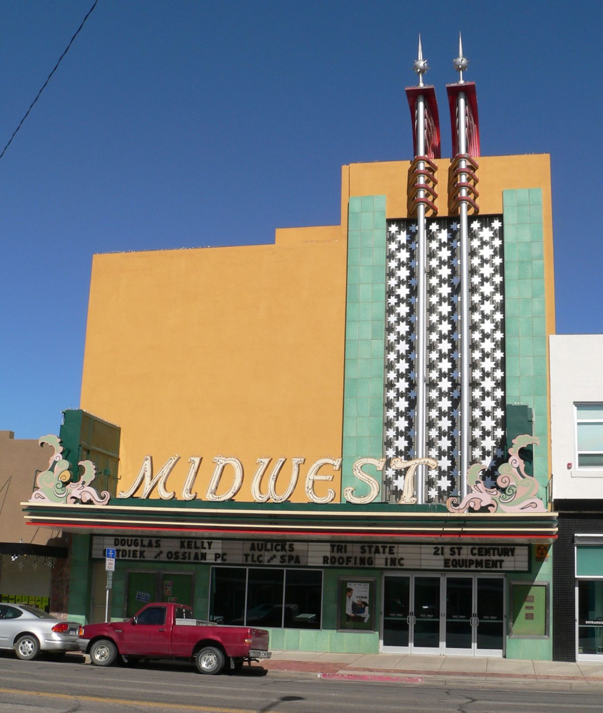
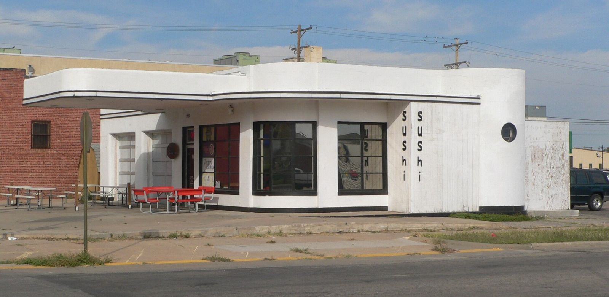

# Dragging Main: The Small-Town Loop, in the Kids' Own Words (1950s–1980s)

!!! abstract "Article record"
    **Confidence:** Medium · **Source types:** Grassroots high school yearbooks (Franklin, N.C., 1957–58; Scottsbluff, Neb., 1979; Hays, Kan., 1987), a university oral history (Richmond, Calif., interviews of 1985), and one small-town newspaper editorial already on this wiki (Twin Falls, Idaho, 1957), all read as scanned OCR · **Last verified:** 2026-10-20 (Round 18) · **Open issues:** yearbooks speak for the students who wrote them, not for a whole town ◐; the 1987 Hays yearbook gives two different starting points for the loop ◐; no ordinance, arrest count or police record for any of these loops has been found yet; "dragging Main" meant a slow loop in some places and a race in others, and the sources rarely say which · [How we rate this](../reference/source-standards.md)

!!! quote "In their own words"
    "Dragging Main has a long history. Our parents dragged Main, and our parents' parents."

    — **Kathy Lennox and Dawn Shields**, students, in the 1987 Hays High School yearbook, Hays, Kansas.[^hays87]

Every town with one main street and too many teenagers invented the same thing and gave it the same name. You got in the car, you drove from one end of Main to the other, you turned around, and you did it again until midnight. Nobody needed a club, a strip or a sanction. They called it **dragging Main**.

The big cruise strips on this wiki, from [Woodward](woodward.md) to [Van Nuys](van-nuys.md), have books and documentaries. The small ones mostly have yearbooks. This page collects what the kids themselves wrote down, town by town. None of these loops is tied to a famous builder or company. They are recorded here as what they were: **regional repeat gatherings**, every Friday and Saturday night, for decades.

## Two meanings of one word

The phrase could mean two different things. In **Twin Falls, Idaho**, in 1957, a woman told the local paper that some girls had invited her to go "dragging Main," which they said meant racing any other carload of teenagers down the avenue (see [Main Avenue, Twin Falls](twin-falls-main-avenue.md)). Everywhere else in this file, it means a slow parade. The yearbooks below describe looking, honking and turning around, not racing. When an old-timer says he "dragged Main," it is worth asking which kind.

## Franklin, North Carolina (1957–58): a hobby you could list

In the Franklin High School yearbook, *The Laurel Leaf*, every senior listed a motto, activities, a hobby and future plans. In 1957, one senior gave his hobby as "Dragging Main, resting," and another simply as "Dragging Main."[^ff57] The next year's seniors listed "Hunting, fishing, loafing, and dragging main" and "Driving, loafing, and dragging main." Both of the 1958 seniors gave the Air Force as a future plan.[^ff58]

That is the whole record, and it says a lot. In a small North Carolina town in 1957, dragging Main was ordinary enough to print beside hunting and fishing as something a boy did with his time.<a href="#q-1" title="Single source so far: see Open questions">◐</a>

## Richmond, California (1950s): "You would have a hard time getting across"

On the West Coast, the record is an adult's. In 1985 the University of California's Regional Oral History Office interviewed a longtime Richmond couple, **Harry and Marguerite Williams**, for a series on the city's history. The interviewer, Judith Dunning, asked about the 1950s. Marguerite Williams, born in 1924, remembered the cruise as a traffic problem.

"These kids would tie the streets up dragging the main. You would have a hard time getting across," she said. The town had little else for teenagers to do, she said, with no movie theaters, and "they were dragging the main over on San Pablo, but they didn't want them to do it in Richmond."[^rich85] She recalled police stopping drivers, checking identification and looking for beer, and she said the tickets did not fall evenly on every group of kids, a complaint that came up at the city council more than once.[^rich85]<a href="#q-2" title="Single source so far: see Open questions">◐</a>

Hers is the only adult voice on this page, and the only one who did not enjoy it.

## Scottsbluff, Nebraska (1979): Broadway and McDonald's

Two decades later, the kids were writing it down again. The 1979 Scottsbluff High School yearbook gave a page to Saturday nights. One caption shows a senior who "spends his Saturday evening in the usual manner by dragging main." Another shows a junior who "escapes the usual routine of dragging main by attending the show," and says "A long line at the show is the usual Saturday night Broadway scene."[^sb79]

The page's text is written as a carload of teenagers talking, with a red Camaro to chase, a yellow light to make, and a one-way alley ("That's okay, we're only going one way."). Then the writers step back: "Anyone or anything we looked for was sure to be found while dragging main." Mainstreet and McDonald's "were our favorite weekend hangouts," and McDonald's "saw everything from traffic jams to jams of people, from fights to laughter of friends."[^sb79] Their verdict on the grown-ups: "Our parents thought we were just wasting gas but we knew better. It was worth it."[^sb79]

Scottsbluff had organized drag racing too. *Car Craft*'s national strip calendar for July 1961 lists "Scottsbluff, Neb." with dates in July and September.[^cc6107] The source does not name a strip or a club, and nothing ties those meets to the Broadway loop.

<figure markdown>
{ loading=lazy }
<figcaption markdown>The Midwest Theater on Broadway between 17th and 18th streets, Scottsbluff, Nebraska (built 1946; photo 2010). The 1979 yearbook calls a long line "at the show" the usual Saturday night Broadway scene. It does not name the theater, so this is context, not identification. Creator: Ammodramus. Date: 2010-08-04. Source: [Wikimedia Commons](https://commons.wikimedia.org/wiki/File:Midwest_Theater_(Scottsbluff)_from_W_1.JPG). License: Public domain.</figcaption>
</figure>

## Hays, Kansas (1987): the full route

The best description we have found is a two-page spread in the 1987 Hays High School yearbook, signed by **Kathy Lennox and Dawn Shields**. It opens with a claim nobody would dispute: "One thing Hays has in common with towns of every size across America -the teenagers drag Main."[^hays87]

Then it gives the route. Draggers "usually enter Main on or around Thirteenth street, the Fox Theater corner." They drive all the way down Main to **Fourth Street and the Varsity Drive-In**, "a hangout for "couples to be" or friends who just want to meet," and turn around.[^hays87]<a href="#q-3" title="Single source so far: see Open questions">◐</a>

The writers explain why it worked: dragging Main "is a way to centralize all weekend activities. Usually by driving down once, you can see all of your friends."[^hays87] Most draggers were from Hays High and Thomas More Prep, with visitors from Ellis, Victoria, Russell and Plainville. "After all, the nearest "city" is Salina, 90 miles away." College students drove it once or twice after the bars and parties.[^hays87]

Not everyone was charmed. The older generation thought it "a waste of gas and time," and the writers conceded the point: it was "very hard to cross Main between 8 p.m. and 12 a.m. on Friday or Saturday nights." Then the counterweight: "Frankly, some parents are glad that their kids are on Main rather than getting into trouble somewhere else."[^hays87] Their forecast: "it looks like dragging Main will continue for a long time."

<figure markdown>
{ loading=lazy }
<figcaption markdown>A streamlined former filling station at 700 Main Street, Hays, Kansas, in 2014, on the stretch of Main between Thirteenth and Fourth streets that the 1987 yearbook says the draggers drove. The yearbook does not mention this building. Creator: Ammodramus. Date: 2014-09-22. Source: [Wikimedia Commons](https://commons.wikimedia.org/wiki/File:Hays,_Kansas_700_Main_Street_from_SW_1.JPG). License: [CC0](http://creativecommons.org/publicdomain/zero/1.0/deed.en).</figcaption>
</figure>

## What the four towns share

Three of them had a fixed route between two landmarks: a theater at one end and a drive-in at the other (Hays); a main street and a McDonald's (Scottsbluff); one avenue and not the next town's (Richmond). The adults complained the same way, about wasted gas and a street you couldn't cross. Richmond in the 1950s and Hays in 1987 say nearly the same thing about the traffic, 30 years apart.

There was a sense of inheritance, too. "Our parents dragged Main, and our parents' parents," Hays wrote in 1987.[^hays87] Franklin's seniors had been doing it 30 years earlier.

*See also:* [Cruising overview](cruising-overview.md); [Main Avenue, Twin Falls](twin-falls-main-avenue.md); [Summer Avenue, Memphis](summer-avenue-memphis.md); [Modesto](modesto.md), the loop that became a movie; and [Hot Rod Club, Third Row](../drag-racing/high-school-hot-rod-clubs.md), the yearbooks' other car story.<a href="#q-4" title="Open question: see the bottom of the page">?</a>; [Central Avenue, Albuquerque](central-avenue-albuquerque.md).

## Open questions & disputed details

*From the detective's notebook: where the sources disagree, where we have only one, and what we are still looking for. Each item links back to its place in the story.*

**Single source so far.** We have not found a Franklin newspaper item about it. <a class="hr-q-back" href="#qr-1" title="Back to the story">↩</a>

**Single source so far.** It is one witness's memory, recorded some 30 years later. We have not found the council minutes. <a class="hr-q-back" href="#qr-2" title="Back to the story">↩</a>

**Single source so far.** **Where did the drag start?** One source, two versions: the 1987 Hays yearbook says draggers entered Main around Thirteenth Street, and a caption on the same spread says "starting from about Eighth and Main."[^hays87] Both end at the Varsity. <a class="hr-q-back" href="#qr-3" title="Back to the story">↩</a>

### Next leads

The *Hays Daily News* and the *Scottsbluff Star-Herald* for any cruising ordinance; the Varsity Drive-In's years; the 1955 Colbert, Okla., yearbook (a search excerpt mentions "dragging Main" in a class prophecy, but the scan would not download); Richmond city council minutes of the 1950s; more yearbooks with the phrase. <a class="hr-q-back" href="#qr-4" title="Back to the story">↩</a>

## Sources

[^ff57]: Senior pages, *The Laurel Leaf* [1957], Franklin High School, Franklin, N.C. (North Carolina Digital Heritage Center scan, Internet Archive), OCR. https://archive.org/details/laurelleaf19571957fran (accessed 2026-10-20)
[^ff58]: Senior pages, *The Laurel Leaf* [1958], Franklin High School, Franklin, N.C. (North Carolina Digital Heritage Center scan, Internet Archive), OCR. https://archive.org/details/laurelleaf19581958fran (accessed 2026-10-20)
[^rich85]: Harry Wheaton Williams Sr. and Marguerite Williams, interviewed by Judith Dunning, 1985, *Reflections of a Longtime Black Family in Richmond* (Regional Oral History Office, The Bancroft Library, University of California, Berkeley, c1990), pp. 143–144, section "Dragging the Main, 1950s." Internet Archive scan, OCR. https://archive.org/details/longtimeblackfam00willrich (accessed 2026-10-20)
[^sb79]: Saturday-night pages ("Saturday Nights"), *1979 Scottsbluff High School Yearbook*, Scottsbluff, Neb. (Classmates.com scan, Internet Archive), OCR. https://archive.org/details/classmates-yearbook-49316-1979-scottsbluff-high-school (accessed 2026-10-20)
[^cc6107]: National drag strip calendar, *Car Craft*, July 1961 (Internet Archive scan), OCR. https://archive.org/details/sim_car-craft_1961-07_9_3 (accessed 2026-10-20)
[^hays87]: Kathy Lennox and Dawn Shields, "Dragging Main" spread, *1987 Hays High School Yearbook*, Hays, Kan. (Classmates.com scan, Internet Archive), OCR. https://archive.org/details/classmates-yearbook-10383-1987-hays-high-school (accessed 2026-10-20)
