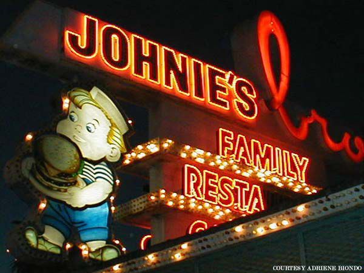
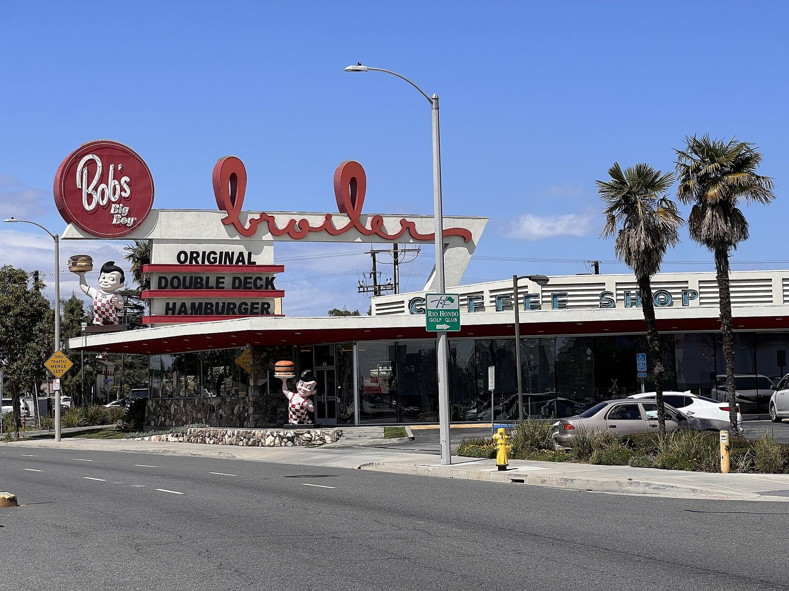

# Harvey's Broiler: Teenage Paris on a Former Chicken Farm

*Harvey's Broiler / Johnie's, Downey, 1958–1970; revived 1987–90*

!!! abstract "Article record"
    **Confidence:** Medium · **Source types:** LA Conservancy, newspaper (LA Times 1989, 2007), LAist (2024) owner interview · **Last verified:** 2026-10-13 (Round 8) · **Open issues:** Drive-in end date not re-verified · [How we rate this](../reference/source-standards.md)

Harvey and Minnie Ortner opened **Harvey's Broiler** in 1958 on a former chicken farm. Architect Paul B. Clayton designed it in the Googie style with a 65-foot sign, and the LA Conservancy calls it "the largest drive-in restaurant in Southern California" when it opened.[^lac][^laist] Tom Wolfe used it as a setting: "Teenage Paris! Harvey's Drive-in!" (quoted by LAist).[^laist]

## In their own words

The drive-in's purpose, as later told:

> "It was where kids got together to find out what was going on. … they would find out where's the party, where's the race, where's something going on that they wanted to go to."
>
> — **Jim Louder**, current owner (Bob's Big Boy Broiler), LAist (Jan 7, 2024). He is retelling the site's history, not his own memory.[^laist]

At the 1989 revival, the people who had been there remembered:

> "This was our old stomping ground. … You got your cherry Cokes and hamburgers and circled around Harvey's."
>
> — **Marty Krumm**, 44, who grew up in Downey, at cruise night, LA Times (Jan 12, 1989).[^lat89]

> "There's an essence this restaurant has that none other has. We can relive the time we spent here, the girls we went out with . . ."
>
> — **Lee McCullough**, 46, who started cruise night and had cruised Harvey's when it opened, 1989.[^lat89]

## The custom-car neighborhood

Louder puts the drive-in at the center of a scene: "This area in the late '50s was considered sort of the heartbeat of the custom car movement … There was customizers and painters up and down here on Firestone Boulevard."[^laist]<a href="#q-1" title="Single source so far: see Open questions">◐</a> The quote doesn't name any shops.<a href="#q-2" title="Sources disagree: see Open questions">⚠</a>

Cruising has since come back into the law's favor. A new California law, in effect from January 2024, means "cities can no longer ban lowriders and cruising," according to LAist. LAist does not give the bill number.[^laist]

## Open questions & disputed details

*From the detective's notebook: where the sources disagree, where we have only one, and what we are still looking for. Each item links back to its place in the story.*

**Single source so far:** Louder: "This area in the late '50s was considered sort of the heartbeat of the custom car movement … There was customizers and painters up and down here on Firestone Boulevard." <a class="hr-q-back" href="#qr-1" title="Back to the story">↩</a>

**Disputed.** **Who owned it, and when?** The LA Times (1989) says Ortner sold to Smyriniotis in **1965**. The 2007 LA Times quotes the owner as saying he bought it "in 1968." LAist says the name changed "in the late '60s."[^lat89][^lat07][^laist] <a class="hr-q-back" href="#qr-2" title="Back to the story">↩</a>

**Which shops?** Louder's quote about customizers and painters on Firestone Boulevard doesn't name any shops; that is the next lead.

## Images

<figure markdown>
{ loading=lazy }
<figcaption markdown>The Johnie's Broiler neon sign at night in 2002, before the 2007 partial demolition. Creator: Adriene Biondo via User:Astroluxe. Date: 2002. Source: [Wikimedia Commons](https://commons.wikimedia.org/wiki/File:JB_Neon_Sign_Nite_2002.jpg). License: [CC BY-SA 3.0](https://creativecommons.org/licenses/by-sa/3.0).</figcaption>
</figure>

<figure markdown>
{ loading=lazy }
<figcaption markdown>The rebuilt building, now Bob's Big Boy Broiler, April 2023. Creator: Josh Lim (Sky Harbor). Date: 2023-04-03 12:14:41. Source: [Wikimedia Commons](https://commons.wikimedia.org/wiki/File:Bob%27s_Big_Boy_Broiler_(Downey,_California),_April_2023.jpg). License: [CC BY-SA 4.0](https://creativecommons.org/licenses/by-sa/4.0).</figcaption>
</figure>

[^lac]: LA Conservancy, "Bob's Big Boy Broiler." https://www.laconservancy.org/learn/historic-places/bobs-big-boy-broiler/ (accessed 2026-10-13)
[^laist]: LAist, "With The Ban On Cruising And Lowriding Lifted, A Visit To One Of The Spots In Downey Where It All Started" (Jan 7, 2024). https://laist.com/news/los-angeles-activities/with-the-ban-on-cruising-and-lowriding-lifted-a-visit-to-one-of-the-spots-in-downey-where-it-all-started (accessed 2026-10-13)
[^lat89]: "Cruise Night Takes 'Em Back," LA Times (Jan 12, 1989). https://www.latimes.com/archives/la-xpm-1989-01-12-hl-158-story.html (accessed 2026-10-13)
[^lat07]: "Getting fired up over Johnie's Broiler," LA Times (Dec 23, 2007). https://www.latimes.com/archives/la-xpm-2007-dec-23-me-broiler23-story.html (accessed 2026-10-13)
