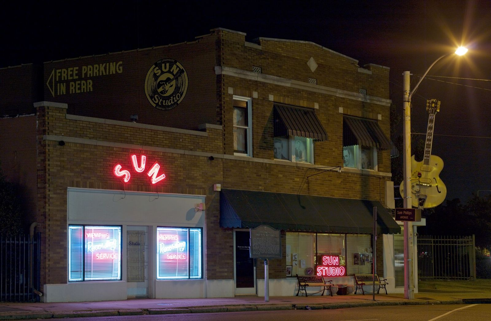
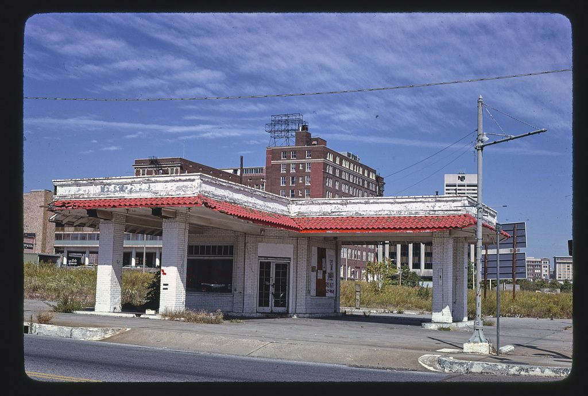

# Memphis and the Mid-South

*A bomber base, a bo-weevil and a missing Sun Records story*

!!! abstract "Article record"
    **Confidence:** Medium · **Source types:** Grassroots small-town newspaper race results (1962), club history site, school history site, SEMA article (citing Hot Rod 1955), obituary/recollection, photo index · **Last verified:** 2026-10-13 (Round 6); Sun Records section updated 2026-10-16 (Round 15); Bootheel section added 2026-10-21 (Round 19); Kingfish, Lunati and Rodders additions 2026-10-22 (Round 20) · **Open issues:** Halls start year ⚠; September 1955 meet result ◐; Two-Lane Blacktop at Lakeland ◐; no independent Sun Records link; one company claim about the Union and Marshall corner ◐ · [How we rate this](../reference/source-standards.md)

!!! quote "In their own words"
    "I became interested in drag racing in 1953 just as it was starting to come on. … I got in touch with Wally at Hot Rod to offer my help."

    — Ray Godman, NHRA.com, 2014. [Full context in Voices](../voices/ray-godman.md)

## Halls: racing on an old bomber base

The drags ran at an abandoned WWII air base at **Halls, Tennessee**, about 70 miles from the city.<a href="#q-1" title="Sources disagree: see Open questions">⚠</a>

The biggest day there was the **September 1955 NHRA Drag Safari meet**: 84 cars, 471 runs and about 3,500 spectators. SEMA News (citing Hot Rod, Dec 1955) has Bob James of the **Dallas Custom Racing Team** winning at 123.11 mph over the Godman & Dyer A/MR Model T.[^sema]<a href="#q-2" title="Single source so far: see Open questions">◐</a> Texans showed up at a Tennessee meet, so it was a Mid-South circuit rather than a city scene.

## Ray Godman and Lakeland Dragway (1960–79)

By 1960 Memphis had a strip of its own. Ray Godman was a Korean War veteran who had been wounded by a sniper, and he became an NHRA advisor. He and Red Dyer won their class at the 1955 Great Bend Nationals. He was a partner in **Lakeland Dragway**, which opened **July 4, 1960**. Its first starter was **Buster Couch**, later NHRA's chief starter. He also ran the Bo-Weevil Top Fuel car with Preston Davis.[^sema][^bs]

Lakeland also ran as Lakeland International Raceway and Shelby County International Raceway, and had a USAC road course by 1969. It closed in 1979.[^dm] It is reportedly a location in *Two-Lane Blacktop* (1971).<a href="#q-3" title="Single source so far: see Open questions">◐</a>

Later, Memphis Motorsports Park (later Memphis International Raceway) hosted the first **Hot Rod Fastest Street Car Shootout** in 1992.<a href="#q-4" title="Single source so far: see Open questions">◐</a>

## Road trips to the Bootheel (1962–66)

Memphis cars went north to race, too. At the SEMO Drag Strip on the old Malden Air Base in Missouri, on July 22, 1962, **Bill Taylor of Memphis** was top eliminator in an AA dragster and **Kenneth McKee of Memphis** was little eliminator in a Chevy-powered B gas Willys, against 97 entries.[^sk62] The strip's 1965 opening-day ad appears to headline a Tennessee fuel dragster that reads like Ray Godman's Bo-Weevil, but the scan is garbled.<a href="#q-5" title="Single source so far: see Open questions">◐</a> On Easter Sunday 1966 Malden's ad brought the Kingfish blown Barracuda north. The Sunday before, Larry Reyes had run 9.02 seconds at 157 mph in it for a new Lakeland track record. It raced "JOE LUNATI'S 1966 427 CORVAIR," and Lunati broke his differential warming up for the rematch.[^sk66a][^sk66b] See [Memphis Comes to the Bootheel](../drag-racing/semo-malden-drag-strip.md).

## The Memphis Rodders (1947)

The city's car-club scene goes back further. The **Memphis Rodders** date from 1947 (club site).[^mr] A Commercial Appeal photo reproduced by the club shows a Rodders exhibit at **Klyce Motors, 17 S. Cleveland**, on **March 15, 1952**.[^mr]<a href="#q-6" title="Single source so far: see Open questions">◐</a> Jimmy Fulghum's '32, a club car, survives and is now owned by David Kelley (club site).[^mr]<a href="#q-7" title="Single source so far: see Open questions">◐</a>

The club's best-known alumnus in the parts business is **[Joe Lunati](../people/joe-lunati.md)**, who "began drag racing with the Memphis Rodders in the early '60s," opened his own cam shop in 1968 (his family says 1969<a href="#q-8" title="Sources disagree: see Open questions">⚠</a>), and was still showing up at Rodders reunions late in life.[^edel] His family called him "a cornerstone in the Memphis drag racing history."[^lunobit]

## Street Rod Nationals

The street-rod crowd came too. Memphis hosted the 2nd Nationals (1971) and again in 1975 and 1980.[^cn] See [NSRA](../street-rodding/nsra-early-nationals.md).

## Sun Records?

We looked for a documented link between Sun Records-era musicians and Memphis builders or clubs and **found none**. We aren't going to invent one. The photo below shows the place and the period only.

There is one company claim, and it is about a street corner, not a musician. COMP Cams says its founders' Racing Head Service rented a shop "at the corner of Union and Marshall, which happened to be Sun Studios, where Elvis was discovered."<a href="#q-9" title="Single source so far: see Open questions">◐</a> Read the full story, with its doubts, in [COMP Cams & Racing Head Service](../companies/comp-cams-rhs.md).[^comp15]

The Rodders also traveled. Chilton's *Motor Age* (June 1955, sponsor-written) says the Rodders of Memphis "won second place last year with a speed of 130.05 mph" at the ATAA's 1954 World Series (the scan cuts the sentence before it, so the category is unclear), and lists the Memphis Rodders among the 1955 contingents. See [Half Day, Illinois](../drag-racing/half-day-ataa-maremont.md).[^r12ma]

## Open questions & disputed details

*From the detective's notebook: where the sources disagree, where we have only one, and what we are still looking for. Each item links back to its place in the story.*

**Disputed.** **When did they start?** 1953 (NHRA-related account) vs 1955 (Memphis Tech High history).[^mth][^sema] <a class="hr-q-back" href="#qr-1" title="Back to the story">↩</a>

**Single source so far.** **Who won the September 1955 meet?** Only SEMA News, citing *Hot Rod* (Dec 1955), gives the result: Bob James of the Dallas Custom Racing Team over the Godman & Dyer A/MR Model T.[^sema] An earlier draft said other summaries gave Godman & Dyer Top Eliminator. Neither the Memphis Tech High page (read in its 2024 Wayback copy) nor the BangShift obituary says so, so we have dropped that. The Tech High page has Godman and Dyer winning their *class* at the 1955 Great Bend Nationals, a different event.[^mth][^bs] We still want the *Hot Rod* report itself. <a class="hr-q-back" href="#qr-2" title="Back to the story">↩</a>

**Single source so far.** We have this from secondary sources only.[^dm][^tl] <a class="hr-q-back" href="#qr-3" title="Back to the story">↩</a>

**Single source so far.** This is from a search summary and needs a primary source; see the Research Trail. <a class="hr-q-back" href="#qr-4" title="Back to the story">↩</a>

**Single source so far:** The strip's 1965 opening-day ad appears to headline a Tennessee fuel dragster that reads like Ray Godman's Bo-Weevil, but the scan is garbled. <a class="hr-q-back" href="#qr-5" title="Back to the story">↩</a>

**Single source so far.** **The club's early dates.** The 1947 founding and the March 15, 1952 exhibit at Klyce Motors come from the Memphis Rodders' own site, which reproduces a *Commercial Appeal* photo.[^mr] We have not seen the photo in the paper itself. Lead: the *Commercial Appeal* for March 1952. <a class="hr-q-back" href="#qr-6" title="Back to the story">↩</a>

**Single source so far:** Jimmy Fulghum's '32, a club car, survives and is now owned by David Kelley (club site). <a class="hr-q-back" href="#qr-7" title="Back to the story">↩</a>

**Disputed.** **1968 or 1969?** Edelbrock's 2023 statement dates Lunati's cam shop to 1968,[^edel] and his family's obituary says 1969.[^lunobit] See [Joe Lunati](../people/joe-lunati.md#q-3). <a class="hr-q-back" href="#qr-8" title="Back to the story">↩</a>

**Single source so far.** That is the company's own history, we have not seen a city directory or a contemporary paper that places the shop there, and SEMA's retelling of a 1971 *Hot Rod* profile says only that RHS moved to "bigger digs in a Memphis suburb," without naming the corner. <a class="hr-q-back" href="#qr-9" title="Back to the story">↩</a>

## Images

<figure markdown>
{ loading=lazy }
<figcaption markdown>Sun Studio, 706 Union Ave, Memphis (2008). It is included for context; we have no documented hot rod tie. Creator: Carol M. Highsmith. Date: Taken on 11 October 2008, 21:03 (according to Exif data). Source: [Wikimedia Commons](https://commons.wikimedia.org/wiki/File:Sun_Records_Studio,_Memphis,_Tennessee_LCCN2010630851.tif). License: Public domain.</figcaption>
</figure>

<figure markdown>
{ loading=lazy }
<figcaption markdown>An old gas station at 2nd & Vance, Memphis, photographed by John Margolies in 1979, the year Lakeland Dragway closed. It is a roadside landscape only. Creator: The Library of Congress from Washington, DC, United States. Date: Taken in 1979. Source: [Wikimedia Commons](https://commons.wikimedia.org/wiki/File:Old_gas_station,_2nd_%26_Vance,_Memphis,_Tennessee_LOC_37555793280.jpg). License: [No restrictions](https://www.flickr.com/commons/usage/).</figcaption>
</figure>

## Visual references (external)

*These images are copyrighted, so we link to them instead.*

- [Memphis Rodders history photos (Klyce Motors 1952)](http://www.memphisrodders.com/)
- [carnut.com Memphis Nationals photos](https://www.carnut.com/show/nats75/memind.html)

[^mr]: Memphis Rodders, club history. http://www.memphisrodders.com/
[^mth]: Memphis Tech High School history site, "Raymond Godman: Stock Car Racer." The original page (https://www.memphistechhigh.com/miscellaneous/raygodman/raygodman.html) returns 404; read in the Wayback Machine copy of Aug 15, 2024: https://web.archive.org/web/20240815160737/http://www.memphistechhigh.com/miscellaneous/raygodman/raygodman.html (accessed 2026-10-22)
[^sema]: SEMA News, "Drag Racing, Memphis Style" (June 2024; citing Hot Rod, Dec 1955). https://www.sema.org/news-media/magazine/2024/06/drag-racing-memphis-style
[^dm]: Daily Memphian, "Sundays were for racing at Lakeland International." https://dailymemphian.com/article/52861/lakeland-international-raceway-drag-racing-the-lake-district
[^tl]: Memphis Rodders, "Two-Lane Memories." http://memphisrodders.com/files/dc0cc7ae4bcfcaca80f74cf5a4b24ce3-12.html
[^bs]: BangShift, "Raymond Godman Has Died." https://bangshift.com/bangshift1320/pioneering-drag-racing-legend-raymond-godman-died-war-hero-helped-set-foundation-mid-south-drag-racing/
[^cn]: carnut.com, "NSRA Nats Memphis 71" and "Memphis 75" galleries. https://www.carnut.com/show/71/nats/natp2.html ; https://www.carnut.com/show/nats75/memind.html
[^r12ma]: M. Robert Wolfson (Maremont Automotive Products, Inc.), "The World Series Comes Early" and "For 1955 Hot Rodders," Chilton's *Motor Age*, June 1955 (scanned OCR; sponsor-written). https://archive.org/details/sim_motor-age_1955-06_74_7 (accessed 2026-10-15)
[^comp15]: "The History of COMP Cams," COMP Cams (company site). https://www.compcams.com/about-us (accessed 2026-10-16)
[^sk62]: "Sixteen Area Drivers Take Malden Races," *Sikeston Daily Standard* (Sikeston, Mo.), July 23, 1962. Page OCR. https://archive.org/details/sikeston-daily-standard-1962-07-23 (accessed 2026-10-21)
[^sk66a]: Malden Drag Strip Easter display ad, *Sikeston Daily Standard* (Sikeston, Mo.), Apr. 8, 1966. Page OCR. https://archive.org/details/sikeston-daily-standard-1966-04-08 (accessed 2026-10-22)
[^sk66b]: "Hundreds See Kingfish Set Strip Record," *Sikeston Daily Standard*, Apr. 12, 1966. Page OCR. https://archive.org/details/sikeston-daily-standard-1966-04-12 (accessed 2026-10-22)
[^edel]: "Edelbrock Group Mourns Lunati Cams Founder, Joe Lunati," Edelbrock Group, Sept. 14, 2023. https://www.edelbrockgroup.com/corporate-news/2023/09/14/edelbrock-group-mourns-lunati-cams-founder-joe-lunati/ (accessed 2026-10-22)
[^lunobit]: "Joe Lunati, August 7, 1935 – September 13, 2023," obituary, Memphis Funeral Home, via Dignity Memorial. https://www.dignitymemorial.com/obituaries/memphis-tn/joe-lunati-11461265 (accessed 2026-10-22)
