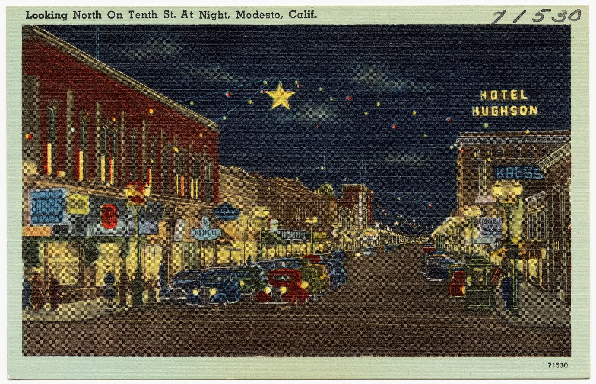
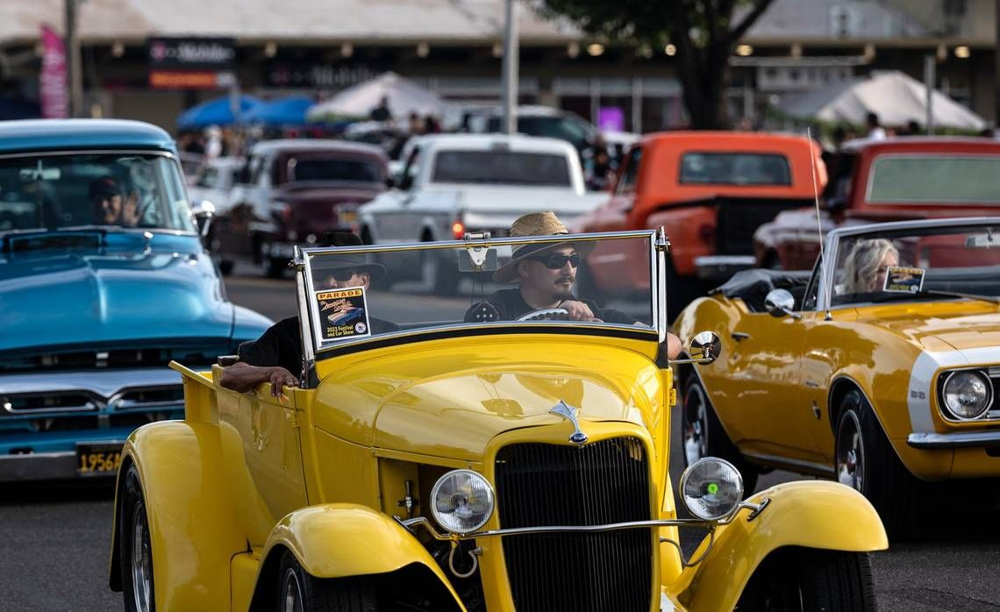

# Modesto: Draggin' 10th

*10th Street and McHenry Avenue, 1950s–1993*

!!! abstract "Article record"
    **Confidence:** Medium · **Source types:** Grassroots newspaper (LA Times Feb & Mar 1990), city ordinance record (Stanislaus County Library), historical marker (HMdb), museum page · **Last verified:** 2026-10-13 (Round 8) · **Open issues:** ⚠ ban year (1990 ordinance vs 1993 "banned") · [How we rate this](../reference/source-standards.md)

*American Graffiti* (1973) was set in a 1962 version of Modesto, which the LA Times describes as "a small valley town of about 30,000," though most of the film was shot elsewhere.[^lat90]

Then the cruise outgrew the town. By 1990, according to city officials, up to 6,000 teenagers from around the San Joaquin Valley crowded McHenry Ave on weekend nights.[^lat90b]

## In their own words

That year the police chief, a car-club leader and a magazine editor all weighed in:

> "The days are long gone when a couple hundred local guys drove up and down the street looking for girls. … There's too many cruisers out there now and they're causing too much trouble."
>
> — **Police Chief Gerald McKenzie**, LA Times (Feb 6, 1990).[^lat90]

> "Cruising is part of our history, part of our life style here . . . they can't just outlaw it."
>
> — **Phillip (Tiny) Stuart**, past president of the Modesto Area Drag Racer's Assn., 1990.[^lat90]

> "Because the towns usually only had one main drag, they'd end up driving down one end and back the other. … It had a lot to do with creating the whole custom car movement in Southern California."
>
> — **Pat Ganahl**, then editor of *Rod & Custom*, LA Times (1990).[^lat90]

## Policing

The city acted. On **March 27, 1990**, the city passed anti-cruising and anti-loitering ordinances. One barred passing the same spot on McHenry more than once every four hours. Dennis Lema of the Central California Coalition of Car Clubs vowed to challenge them.[^lib][^lat90b]<a href="#q-1" title="Sources disagree: see Open questions">⚠</a>

## The film and the main drag

When George Lucas was a teenager, "draggin' 10th" was the place to cruise (LA Times 1990). Pat Ganahl's comment ties the small-town main drag to the custom-car tradition. For the late-1940s club scene behind the cruise, see [Modesto's Century Toppers](../drag-racing/modesto-century-toppers.md).

*See also:* [Woodward](woodward-ordinances.md).

## Open questions & disputed details

*From the detective's notebook: where the sources disagree, where we have only one, and what we are still looking for. Each item links back to its place in the story.*

**Disputed.** **1993?** The HMdb marker text says that after Graffiti Night grew huge, "Cruising was banned in Modesto; an ordinance that remains in force today." That contradicts the documented 1990 ordinance. It may be a second measure or simply a mistake on the marker.[^hm] <a class="hr-q-back" href="#qr-1" title="Back to the story">↩</a>

**Not yet sourced:** the film's influence on the 1970s [street-rod revival](../street-rodding/index.md) is often claimed, but we haven't sourced it yet.

## Images

<figure markdown>
{ loading=lazy }
<figcaption markdown>"Looking North On Tenth St. At Night, Modesto, Calif.", a Tichnor Brothers postcard from about 1930–45. It shows 10th Street before the "Draggin' 10th" era. Creator: Tichnor Brothers, Publisher. Date: between circa 1930 and circa 1945date QS:P,+1950-00-00T00:00. Source: [Wikimedia Commons](https://commons.wikimedia.org/wiki/File:Looking_North_On_Tenth_St._At_Night,_Modesto,_Calif_(71530).jpg). License: Public domain.</figcaption>
</figure>

<figure markdown>
{ loading=lazy }
<figcaption markdown>Car show at the American Graffiti festival, Modesto, June 2024. This is the revival. Creator: Andy Alfaro. Date: 2024-06-04. Source: [Wikimedia Commons](https://commons.wikimedia.org/wiki/File:American_Graffiti_Festival_Modesto,_CA.jpg). License: [CC0](http://creativecommons.org/publicdomain/zero/1.0/deed.en).</figcaption>
</figure>

[^gm]: Graffiti USA Classic Car Museum, "Modesto Historic Cruise Route." https://www.graffitiusamuseum.com/cruise_route/ (accessed 2026-10-13)
[^lat90]: LA Times, "Modesto Made It Immortal but Now May Ban Cruising" (Feb 6, 1990). https://www.latimes.com/archives/la-xpm-1990-02-06-mn-195-story.html (accessed 2026-10-13)
[^lat90b]: Miles Corwin, "Modesto's Cruisers Vow to Defy New Ban," LA Times (Mar 29, 1990). https://www.latimes.com/archives/la-xpm-1990-03-29-mn-199-story.html (accessed 2026-10-13)
[^lib]: Stanislaus County Library, Stanislaus Memory Project, "Modesto Cruising Ordinance" (1990-03-27). https://www.stanislauslibrary.org/memories/about_ordinance.shtm (accessed 2026-10-13)
[^hm]: HMdb, "Graffiti Summer" historical marker. https://www.hmdb.org/m.asp?m=223773 (accessed 2026-10-13)
