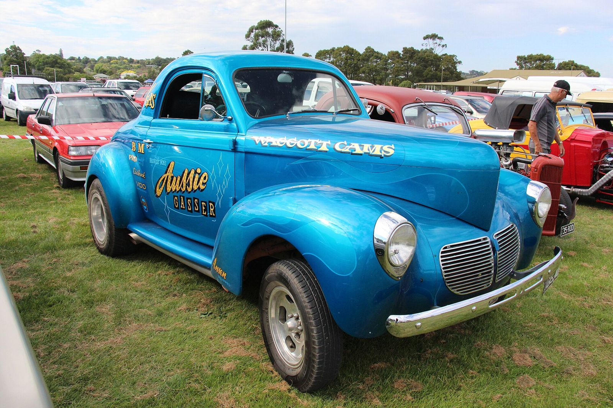
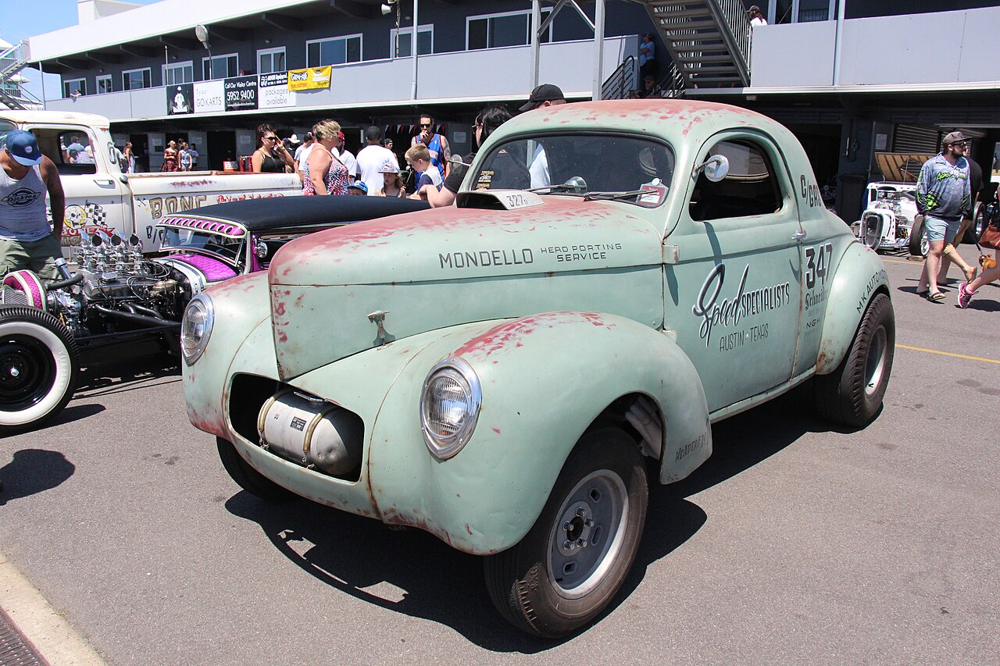

# The Ohio Gassers

*Cleveland, Dayton, Columbus and the door-slammer Midwest*

!!! abstract "Article record"
    **Confidence:** Medium · **Source types:** Grassroots racer-journalist photo histories (Jim Hill, East Coast Drag Times HOF, 2016), *Hot Rod* (Jim Hill, 2015), enthusiast archive with family obituary text and oral history (JR Thompson), NHRA · **Last verified:** 2026-10-16 (Round 14) · **Open issues:** ⚠ Hassel's 1963 class (B/Gas vs C/Gas); ⚠ who built the 1968 Mr. Gasket Camaro; Chuck Finders's death date resolved as May 17, 2009 (Round 14); Hill brother's name (Bill vs Tom) · [How we rate this](../reference/source-standards.md)

!!! quote "In their own words"
    "I'd pay a thousand bucks for a tenth of a second!"

    — Ron Hassel, Cleveland gasser racer, as quoted by Jim Hill in *Hot Rod*, Nov 23, 2015. [More in Voices](../voices/strip-owners-and-door-slammers.md)

"The Ohio Gassers" was **never a chartered club**. Jim Hill, who raced and photographed the era, calls it an "unofficial group of peers who became known in drag racing lore as 'The Ohio Gassers.'"[^ecmg] It was a loose circle of 1950s Cleveland high-school friends and their rivals across the state. They ran Gas Coupe and Sedan cars (the "gassers"), mostly small-block Chevys in Willys, Anglias and Tri-Five Chevys, and later Modified Production. Out of that circle came [Mr. Gasket](../companies/mr-gasket.md), a Crane Cams sales manager, Funny Car pioneer [Eddie Schartman](../people/eddie-schartman.md), the chassis builder of the [Red Baron](../cars/hill-bros-red-baron.md), and a blues bassist.

## Why gassers, and why here

Hill describes the Midwest as a region of heavy industry where men "brought with them a strong love of the auto." There, "full-bodied, full-fendered vehicles were preferred for racing, first on deserted streets and rural roads, later on circle tracks and drag strips."[^ecgm]

In *Hot Rod* he argues that class racing drew full grandstands "on the east side of the Rockies," while "over on the Left Coast, nitro and dragsters were tradition." He says the term **"door-slammer"** originated in the West and was "originally intended as a negative."[^hr15]<a href="#q-1" title="Single source so far: see Open questions">◐</a>

The Hrudkas' circle raced at **[Thompson](../drag-racing/chardon-road-ravens-thompson-drag-strip.md), Dragway 42 (West Salem), [Quaker City](../drag-racing/quaker-city-salem.md) and National Trail Raceway**. In the short northern Ohio season "an ambitious racer could run 4–5 times per week."[^ecmg]

## Who was in it

Jim Hill's list of the group includes Eddie Schartman, Ron Hassel, Sam Gellner, Gene Schwartz, the Hill brothers, Virgil Cates, David Meal, Mickey Hart, Dave Koffel, Arlen Vanke, the Rodriguez brothers "and a long list of Gasser notables, all from Ohio."[^ecgm] *Hot Rod* names Hassel's high-school pals as Joe and Tom Hrudka, Schartman, Gellner, Schwartz and the Hill brothers.[^hr15]

### Ron Hassel, "Ronnie Red Wheels" (Cleveland)

Hassel got the street name "Ronnie Red Wheels" because he "loved to paint stock steel rims that bright color." He began with a **'56 Chevy two-door** and held "numerous NHRA class records."[^hr15]

He then ran the **Hassel & Vogelsong '40 Willys** in B and C/Gas. Hill's photo shows him "during B/Gas class runs at The Nationals, 1963."[^ecgm]<a href="#q-2" title="Sources disagree: see Open questions">⚠</a>

In **1965** he left Ohio for South Florida as **sales manager for Crane Cams**. There he teamed with **Ronnie Cox** and won **B/Gas at the 1966 Nationals** in a **'48 Anglia**. The Hrudkas also loaned him their Dave Meal–built **'48 Thames "Pie Wagon"** A/Gas panel, which he ran in Florida with his own engine and transmission: high-nine-second ETs at 140 mph. Hill's photo of it is from Palm Beach International Raceway.[^ecgm][^ecmg]

In **1967** he returned to Cleveland "shortly after the Nationals" as **Mr. Gasket's National Sales Manager**. He drove Joe Hrudka's '48 Anglia D/Gasser with his own engine and transmission, and lost the 1967 Nationals C/Gas trophy to the **Russo & Santo** four-door Willys of New York.[^ecgm] He is an East Coast Drag Times Hall of Fame member.[^ecgm]

### Dave Meal (Cleveland), the builder

Hill calls him "the notably talented Cleveland race car builder."[^ecgm] He built the Hrudkas' **'40 Willys C/Gasser**: injected small-block Chevy, four-speed, "8,000 rpm power," 11-second, 120-mph runs at Dragway 42, with the front wheels up "through first two gears." It carried an early Mr. Gasket logo.[^ecmg]

In **1965** he built the A/Gas **'48 Thames panel "Pie Wagon,"** "very light, flimsy and flexy."[^ecmg]<a href="#q-3" title="Sources disagree: see Open questions">⚠</a>

### Chuck Finders (chassis builder)

His son's farewell, posted by JR Thompson, says Finders started drag racing in **1958**, made his last full run "in the 90's," and owned **CF Engineering**, "builder of Chassis and Bodies of 1933–1941 Willys."[^jrt1]

The **"Dark Horse"** was a '33 Willys with a **Tim Woods** engine, painted to match **Stone-Woods-Cook** colors and "added to the SWC team to help meet booking commitments." The farewell says it was sometimes "quicker than the SWC 'A' car."[^jrt1]<a href="#q-4" title="Single source so far: see Open questions">◐</a> *Family account.*

The **"Traveler"** was the same car, rebuilt with partners **Bill Altizer and Neal Kibler**. It "set and held both speed and low ET in B/GS (**146.57 MPH in 9.76 ET**) in November 1964."[^jrt1]<a href="#q-5" title="Single source so far: see Open questions">◐</a>

In **1967**, Ken Kull writes, "I had Chuck come in **from Ohio**," and says Finders built the Hill brothers' **Red Baron** in eleven days while "Pete and Bill just kept bringing him fried chicken."[^jrthill] See [Red Baron](../cars/hill-bros-red-baron.md).

In the **1970s** he ran fuel Funny Cars and contended in Division 3. He lost a leg in a late-1970s racing accident. The farewell says Don Garlits "ran down to the accident then ran back to the tower and asked everyone to pray for Chuck." He came back to win his class in Willys.[^jrt1]<a href="#q-6" title="Single source so far: see Open questions">◐</a>

Finders was born **July 16, 1939**. The same page gives his death as both **May 27, 2009** and "Sunday, **May 17**, 2009."[^jrt1] **Resolved: May 17.** May 17, 2009, was a Sunday, and two reports were published before May 27: a UK hot rod forum thread whose first post, dated 19 May 2009, reports his death (seen only as a search excerpt; the forum blocked our fetch<a href="#q-7" title="Single source so far: see Open questions">◐</a>), and BangShift's news item "Drag Racing's Chuck Finders Passes," dated May 26, 2009, which also announced a June 7 remembrance at the NHRA Museum.[^nsrauk][^bangshift] "May 27" is most likely a typo. We still haven't found a newspaper obituary. A memorial was held at the NHRA Museum, Pomona, June 7, 2009.[^jrt1]

### Gene Schwartz (Cleveland): E/Gas and the blues

He ran two **E/Gas '52 Chevys**. The first, a Deluxe coupe, was lost in a crash. The second, a '52 sedan "hastily built to compete in the 1966 Nationals," wore psychedelic "Strawberry Fields Forever" paint. He held NHRA ET and mph records in E/Gas. Sam Gellner, also of Cleveland, was his favorite engine builder.[^ecgm]

Hill notes that Schwartz and his brother Glenn are also "world-class blues bass guitar" players who performed for many years with **Robert Lockwood**. Schwartz was inducted into the East Coast Drag Times Hall of Fame in **2016**.[^ecgm]

### The Hrudka brothers (Cleveland)

Their '55 Chevy won **D/Gas at the 1962 NHRA Nationals**. Their homemade gaskets, sold "out of the trunk of Joe's '57 Chevy," became **Mr. Gasket** (named 1964, incorporated 1967).[^ecmg] See [Mr. Gasket](../companies/mr-gasket.md) for the company history and its conflicts.

## Around the state

| Place | People and shops (per Jim Hill) |
|---|---|
| **Akron** | [Arlen Vanke](../people/arlen-vanke.md), Otie Smith, the Arfons brothers. See [Akron Fulton Airport strip](../drag-racing/akron-fulton-airport.md) |
| **Dayton** | Jerry Ault (Ault & James Speed Shop; Model T B/Gas; '63 Corvette F/Gas). **"Ohio George" Montgomery** of George's Speed Shop ('33 Willys A/GS, Cadillac, then blown Chevy, then SOHC Ford). Montgomery was nicknamed "The Easter Bunny" because he rarely went west and "only ran at the Nationals." He won Little Eliminator at the **1960 Nationals, Detroit Dragway**, taking a Ford Falcon Ranchero as the prize. Also the Stoltz & Velasquez '40 Willys (Paul's Automotive)[^ecgm] |
| **Mansfield** | **Virgil Cates**, "The Flying Junkman": one '33 Willys run as C/Gas, then C/Altered, with which "Cates won the NHRA World Championship Comp Eliminator title in **1965**"[^ecgm] <a href="#q-8" title="Single source so far: see Open questions">◐</a> |
| **Columbus** | **Gil Kirk's Rod Shop** team, later the Nationwise-Rod Shop team: Stickel & Riffle, Jim Thompson–Bob Riffle Anglias, Eckard & Kirk. **Jeg Coughlin** (JEGS; blown Hemi Austin A/GS). See [Midwest & East](midwest-east.md)[^ecgm] |
| **Cleveland** | The Hill brothers ([Red Baron](../cars/hill-bros-red-baron.md)); the Rodriguez brothers' '56 D/Gas; Ron Hutter's "Hut's Dyno Shop"; Mickey Hart's Hart Automotive A/GS Willys; Tim McDonald's Corvette[^ecgm] |
| **Toledo / Cincinnati** | Dick Titsworth's Seaport Automotive Anglia; Dick Weinle, racer and later owner of **Edgewater** raceway, Cleves[^ecgm] |
| **Statewide** | **Barbara Hamilton**: "the first woman licensed by NHRA to drive a supercharged race car in competition" ('37 Willys), ECDT HOF 2004[^ecgm] <a href="#q-9" title="Single source so far: see Open questions">◐</a> *"first" is a tribute claim.* **Fred Hurst**: candy-apple-red '40 Willys, then a Barracuda and an Opel GT with Hemi power[^ecgm] |

## The money behind class wins

There was money in it, too. Hill's *Hot Rod* piece explains why a Nationals class "T" sticker mattered so much to these racers. In **1966 Harvey Crane** began refunding the cam and valvetrain price to class winners. NHRA then limited class cash to **$100 in 1967**, but by **1969** "a class winner displaying all the correct decals could collect nearly $2,000." Hill adds that he "wrote all the hot copy for Harvey Crane."[^hr15]<a href="#q-11" title="Single source so far: see Open questions">◐</a> This ties the Ohio scene to the [Camgrinder Wars](../eras/1950s-camgrinder-wars.md).<a href="#q-10" title="Sources disagree: see Open questions">⚠</a>

*See also:* [Mr. Gasket](../companies/mr-gasket.md), [Eddie Schartman](../people/eddie-schartman.md), [Arlen Vanke](../people/arlen-vanke.md), [Red Baron](../cars/hill-bros-red-baron.md), [Akron Fulton Airport strip](../drag-racing/akron-fulton-airport.md), [Bob Bartel](../people/bob-bartel.md) (World Series at Cordova, where the Moody & Jones '37 Chevy also won), [Midwest & East](midwest-east.md).

## Open questions & disputed details

*From the detective's notebook: where the sources disagree, where we have only one, and what we are still looking for. Each item links back to its place in the story.*

**Single source so far.** **Was "door-slammer" a Western insult?** That is Jim Hill's opinion, as a participant-journalist.[^hr15] <a class="hr-q-back" href="#qr-1" title="Back to the story">↩</a>

**Disputed.** **B/Gas or C/Gas in 1963?** Hill's photo caption puts him in B/Gas class runs at the 1963 Nationals;[^ecgm] *Hot Rod* says that in 1963 "he won **C/Gas** with a 1940 Willys."[^hr15] We have not seen the 1963 class-winner list. <a class="hr-q-back" href="#qr-2" title="Back to the story">↩</a>

**Disputed.** **Who built the 1968 Mr. Gasket Test Car?** It was a blown big-block Camaro, A/GS. One Hill piece says "Joe Hrudka had **Dave Meal** build" it. His Mr. Gasket history says it "was built by **Hrudka Bros.**"[^ecgm][^ecmg] Both may be true: Meal as fabricator, the Hrudkas as owners. The car "saw little racing action" before A/GS faded in favor of Funny Car match-race money.[^ecgm] <a class="hr-q-back" href="#qr-3" title="Back to the story">↩</a>

**Single source so far.** **Was the Dark Horse quicker than the SWC car?** The car's Tim Woods engine, its Stone-Woods-Cook colors, its booking role and "quicker than the SWC 'A' car" all come from Chuck Finders Jr.'s farewell on JR Thompson's site.[^jrt1] Lead: *Drag News* booking ads for Stone-Woods-Cook in the 1960s. <a class="hr-q-back" href="#qr-4" title="Back to the story">↩</a>

**Single source so far.** **146.57 mph in 9.76?** The B/GS records come from the farewell page; we have seen no record sheet.[^jrt1] <a class="hr-q-back" href="#qr-5" title="Back to the story">↩</a>

**Single source so far.** **Did Garlits stop to pray?** The story that Garlits ran to the wreck, then to the tower to ask everyone "to pray for Chuck," and came back to win his class comes only from the farewell page.[^jrt1] <a class="hr-q-back" href="#qr-6" title="Back to the story">↩</a>

**Single source so far.** **Did Finders die in May 2009?** The May 19, 2009 report of Finders's death comes to us only as a search excerpt, because the forum blocked our fetch.[^nsrauk] BangShift's May 26 item is readable and supports the date.[^bangshift] A newspaper obituary would settle it. <a class="hr-q-back" href="#qr-7" title="Back to the story">↩</a>

**Single source so far.** **A 1965 world title for Cates?** That Virgil Cates won the NHRA World Championship Comp Eliminator title in 1965 comes only from Jim Hill's East Coast Drag Times Hall of Fame article.[^ecgm] Lead: NHRA's 1965 World Finals results. <a class="hr-q-back" href="#qr-8" title="Back to the story">↩</a>

**Single source so far.** **The first woman licensed for a supercharged car?** Barbara Hamilton's "first" comes from her East Coast Drag Times Hall of Fame entry (2004), a tribute claim, as relayed in Jim Hill's article.[^ecgm] <a class="hr-q-back" href="#qr-9" title="Back to the story">↩</a>

**Disputed.** **Pete and Bill, or Pete and Tom?** Hill names the Hill brothers "Pete and Bill" in his 2016 Midwest piece, matching Pete Hill's own letter on the [Red Baron](../cars/hill-bros-red-baron.md) page, but "Pete and Tom Hill" in his Mr. Gasket piece.[^ecgm][^ecmg] We use **Pete and Bill**. <a class="hr-q-back" href="#qr-10" title="Back to the story">↩</a>

**Single source so far.** **Nearly $2,000 a class win?** Hill wrote Crane's ad copy, so he is an interested party, and the figures are his.[^hr15] <a class="hr-q-back" href="#qr-11" title="Back to the story">↩</a>

## Images

<figure markdown>
{ loading=lazy }
<figcaption markdown>A 1940 Willys Americar gasser-style coupe at a 2017 show: the '40 Willys gas-class body that the Hrudka/Meal C/Gasser and the Hassel & Vogelsong car used. **Not an Ohio car.** Creator: Sicnag. Date: 2017-01-08 09:27. Source: [Wikimedia Commons](https://commons.wikimedia.org/wiki/File:1940_Willys_Americar_440_Gasser_Coupe_(31932008310).jpg). License: [CC BY 2.0](https://creativecommons.org/licenses/by/2.0).</figcaption>
</figure>

<figure markdown>
{ loading=lazy }
<figcaption markdown>A 1941 Willys Americar gasser-style coupe at a 2017 show, the type of 1933–41 Willys that Chuck Finders' CF Engineering specialized in. **Not a Finders car.** Creator: Sicnag (Flickr). Date: 2017-01-08. Source: [Wikimedia Commons](https://commons.wikimedia.org/wiki/File:1941_Willys_Americar_441_Gasser_Coupe_(32189280151).jpg). License: [CC BY 2.0](https://creativecommons.org/licenses/by/2.0).</figcaption>
</figure>

## Visual references (external)

*These are copyrighted or rights-restricted images, so we link to them instead of copying them.*

- [East Coast Drag Times HOF, "Gassers Midwest: Fast and Fabulous" (Jim Hill photos: Hassel, Montgomery, Cates, Schwartz, Rod Shop)](https://eastcoastdragtimeshalloffame.com/gassers-midwest-fast-and-fabulous/)
- [East Coast Drag Times HOF, "Mr. Gasket: From the Trunk of a '57 Chevy to Wall Street" (Meal's '40 Willys and Pie Wagon)](https://eastcoastdragtimeshalloffame.com/mr-gasket-from-the-trunk-of-a-57-chevy-to-wall-street/)
- [JR Thompson, "Chuck Finders ~ Gasser Legend" (with *Gasser Gossip* "Original Darkhorse" articles)](http://www.jrthompson.net/chuckfinders.html)

[^ecgm]: Jim Hill, "Gassers Midwest: Fast and Fabulous," East Coast Drag Times Hall of Fame, Aug 4, 2016. Accessed 2026-10-15. https://eastcoastdragtimeshalloffame.com/gassers-midwest-fast-and-fabulous/
[^ecmg]: Jim Hill, "Mr. Gasket: From The Trunk Of A '57 Chevy To Wall Street," East Coast Drag Times Hall of Fame, Apr 1, 2016. Accessed 2026-10-15. https://eastcoastdragtimeshalloffame.com/mr-gasket-from-the-trunk-of-a-57-chevy-to-wall-street/
[^hr15]: Jim Hill, "Sportsman Racers Winning Class at Indy Was Their High Mark," *Hot Rod*, Nov 23, 2015. Accessed 2026-10-15. https://www.hotrod.com/news/sportsman-racers-winning-class-at-indy-was-their-high-mark
[^nsrauk]: "Gasser Fans" thread, NSRA (UK) forum archive; first post dated 19-05-09 reports the death (search excerpt only; the page was behind a bot check). https://forum.nsra.org.uk/archive/index.php/t-28331.html (accessed 2026-10-16)
[^bangshift]: Brian Lohnes, "Drag Racing's Chuck Finders Passes," BangShift.com, May 26, 2009. https://bangshift.com/general-news/drag-racing-s-chuck-finders-passes/ (accessed 2026-10-16)
[^jrt1]: JR Thompson, "Gasser Reunion 2002 ~ Chuck Finders," including "Farewell, Chuck Finders" by Chuck Finders Jr. Accessed 2026-10-15. http://www.jrthompson.net/gasserreunionchuckfinders.html
[^jrthill]: JR Thompson, "Gasser Legends ~ The Hill Bros." (Ken Kull text). Accessed 2026-10-15. http://www.jrthompson.net/hillbroswillys.html
