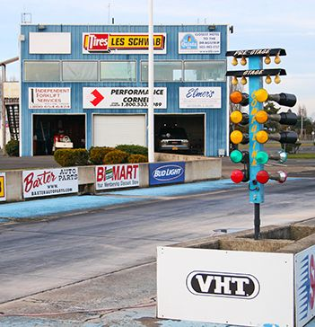

# Pacific Northwest: Councils, Woodburn and Fiberglass

*Where the volunteers ran the show*

!!! abstract "Article record"
    **Confidence:** Medium · **Source types:** Grassroots council/track sites, Wikipedia (◐), company history · **Last verified:** 2026-10-13 (Round 6) · **Open issues:** Woodburn early details only via Wikipedia/track site · [How we rate this](../reference/source-standards.md)

## A council, then a strip

In the Portland area, clubs organized through a **council**. The MHRC was founded in 1954, with Dee Wescott as first president, alongside "community members and elected officials." It runs the **Portland Roadster Show** with volunteers.[^mhrc][^wes]

The council's strip came seven years later. Woodburn opened in **June 1961** as an **eighth-mile** strip operated jointly by the MHRC and the **Northwest Timing Association**. It was lengthened to a quarter mile in 1963, and Jim Livingston bought it in 1972 (Wikipedia; track site).[^wd][^wda]<a href="#q-1" title="Single source so far: see Open questions">◐</a> Before Woodburn, Portland-area racers used the area of the vanished Vanport site, now Portland International Raceway (Jefferson61).[^pir]<a href="#q-2" title="Single source so far: see Open questions">◐</a>

## Fiberglass and volunteers

The council's first president had another claim on history. [Wescott's](../street-rodding/fiberglass-suppliers.md) of Boring, Oregon (1954), and Cal Automotive's founders, Navy men from Whidbey Island, put the Northwest at the start of the fiberglass street-rod body trade.[^wes]

That is what set the Northwest apart. Shows and strips were run by **civic-minded volunteer councils** with elected officials involved, rather than by promoters or magazines. Rain also meant more emphasis on indoor shows and coachwork.

*See also:* [*Street Rod* magazine (Portland, 1971–73)](../media/street-rod-magazine-portland.md), Bruce Miller and Bruce Craig's monthly, with technical editor Russ Meeks and photographer Dale Moreau.

## Open questions & disputed details

*From the detective's notebook: where the sources disagree, where we have only one, and what we are still looking for. Each item links back to its place in the story.*

**Single source so far:** It was lengthened to a quarter mile in 1963, and Jim Livingston bought it in 1972 (Wikipedia; track site). <a class="hr-q-back" href="#qr-1" title="Back to the story">↩</a>

**Single source so far:** Before Woodburn, Portland-area racers used the area of the vanished Vanport site, now Portland International Raceway (Jefferson61). <a class="hr-q-back" href="#qr-2" title="Back to the story">↩</a>

## Images

<figure markdown>
{ loading=lazy }
<figcaption markdown>Woodburn Dragstrip's starting line (undated modern photo). Creator: RedSpar. Date: undated. Source: [Wikimedia Commons](https://commons.wikimedia.org/wiki/File:Woodburnpic.jpg). License: Public domain.</figcaption>
</figure>

## Visual references (external)

*These images are copyrighted, so we link to them instead.*

- [Jefferson61: PIR history photos](https://www.jefferson61.com/PIR-Part-1.htm)

[^mhrc]: Multnomah Hot Rod Council, "About Us." https://www.mhrc.org/about-us
[^wes]: Wescott's, "About Wescott's" (PDF), http://www.wescottsauto.com/Information/AboutWescotts.pdf ; Rod & Custom, "Dee Wescott Passed Away," https://www.hotrod.com/news/0901rc-dee-wescott-passed-away ; Kustomrama, "Dee Wescott," https://kustomrama.com/wiki/Dee_Wescott
[^wd]: Wikipedia, "Woodburn Dragstrip." https://en.wikipedia.org/wiki/Woodburn_Dragstrip
[^wda]: Woodburn Dragstrip, "About Us." https://woodburndragstrip.com/about-us/
[^pir]: Jefferson61, "PIR Part 1." https://www.jefferson61.com/PIR-Part-1.htm
