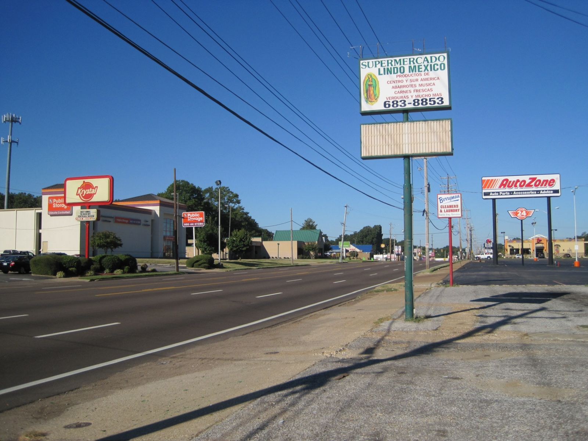

# Summer Avenue, Memphis

*1950s–1960s: "a good drive around drag"*

!!! abstract "Article record"
    **Confidence:** Low · **Source types:** Grassroots literary nonfiction with interviews (storySouth, Ellen Morris Prewitt), oral history project description (Southern Foodways Alliance, 2021) · **Last verified:** 2026-10-13 (Round 8) · **Open issues:** No contemporary newspaper source yet; ties to clubs unproven; the first McDonald's in Memphis ⚠ · [How we rate this](../reference/source-standards.md)

Summer Avenue was lined with drive-ins, motels and some of the first chain businesses: the first Holiday Inn (1952) and "one of the first" Memphis McDonald's locations.[^sfa]<a href="#q-2" title="Sources disagree: see Open questions">⚠</a>

## In their own words

> "Summer Avenue was a hangout place for kids then. Shoney's, Robilio's, Krystal – they'd circle. The first McDonald's in Memphis was next door to here. It was a good drive around drag."
>
> — **Jim Burge**, owner of the Peanut Shoppe. From Ellen Morris Prewitt, "Summer Avenue," storySouth (undated).[^ss]

Prewitt also reports that VW mechanic **John Bain** (MoonBugs) "drag-raced on Summer" as a young man, and quotes him: "Summer was it."[^ss]

One name on Burge's list has a racing echo. Marshall Robilio was a Memphis Rodders racer (see [Ray Godman](../voices/ray-godman.md) and [Memphis](memphis.md)), but the restaurant's tie to his family is unconfirmed.<a href="#q-1" title="Open question: see the bottom of the page">?</a>

## Open questions & disputed details

*From the detective's notebook: where the sources disagree, where we have only one, and what we are still looking for. Each item links back to its place in the story.*

**Open question.** **Was Robilio's restaurant connected to Marshall Robilio's family?** Burge names the restaurant;[^ss] Marshall Robilio raced with the Memphis Rodders (see [Memphis](memphis.md)). No source we have read connects the two. Lead: a Memphis city directory or the restaurant's own history. <a class="hr-q-back" href="#qr-1" title="Back to the story">↩</a>

**Disputed.** **The first McDonald's in Memphis?** The Southern Foodways Alliance says that when McDonald's came to Memphis, "one of the first locations opened here";[^sfa] Jim Burge, quoted by storySouth, says "The first McDonald's in Memphis was next door to here."[^ss] A city directory or the company's opening list would settle it. <a class="hr-q-back" href="#qr-2" title="Back to the story">↩</a>

**Next lead:** the Commercial Appeal archives (1955–70) for police action on Summer.

## Images

<figure markdown>
{ loading=lazy }
<figcaption markdown>Summer Avenue in the Berclair neighborhood, Memphis, Sept 2010. Creator: Thomas R Machnitzki. Date: 2010-09-19. Source: [Wikimedia Commons](https://commons.wikimedia.org/wiki/File:Summer_Ave_Berclair_Memphis_TN_2010-09-19.jpg). License: [CC BY 3.0](https://creativecommons.org/licenses/by/3.0).</figcaption>
</figure>

[^ss]: Ellen Morris Prewitt, "Summer Avenue," storySouth. http://storysouth.com/stories/summer-avenue/ (accessed 2026-10-13)
[^sfa]: Southern Foodways Alliance, "Summer Avenue, Memphis" oral history project (Nov 2021). https://www.southernfoodways.org/oral-history/summer-avenue-memphis/ (accessed 2026-10-13)
