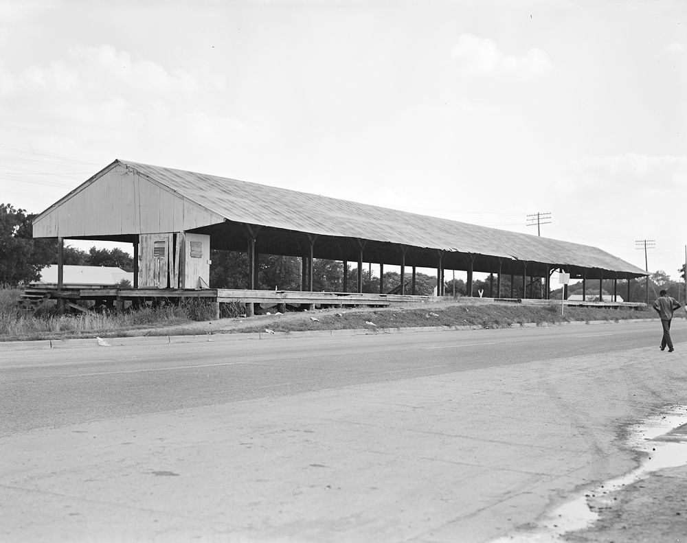
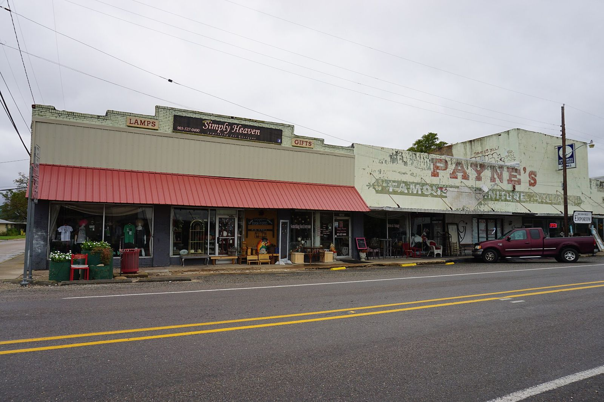

# Texas: Three Stopwatches at Caddo Mills

*The Chaparrals, the Turtles and the distance problem*

!!! abstract "Article record"
    **Confidence:** Medium · **Source types:** enthusiast press (Dragzine), forum recollections, club lore · **Last verified:** 2026-10-13 (Round 6) · **Open issues:** Club founding dates are mostly ◐ · [How we rate this](../reference/source-standards.md)

## Caddo Mills (1951)

Caddo Mills was an old airfield before it was a strip. The first organized race on the abandoned WWII airfield at **Caddo Mills** was held **Aug 19, 1951**. It was arranged by Dallas's **Chaparral Roadster Club** with local officials. There were 56 cars at a **$1 entry**, timed with **three hand-held stopwatches** (Dragzine).[^dz] The strip became Texas's first NHRA-sanctioned drag strip.[^dz]

Later the North Texas Timing Association ran it with Chrondek timers.[^dz]<a href="#q-1" title="Single source so far: see Open questions">◐</a> Recollections on Drag List add detail from people who were there.[^dl]

## The clubs and the road

The clubs were older than the strip. The **Chaparral Roadster Club** (Dallas) was founded in 1949 with Jim Overbey as its first president, according to Karl Knecht, who posted Overbey's photo album.[^hamb]<a href="#q-2" title="Single source so far: see Open questions">◐</a> In the same account, the **Fort Worth Turtles** formed in 1948.[^hamb]<a href="#q-3" title="Single source so far: see Open questions">◐</a>

Texas teams also travelled. The **Dallas Custom Racing Team** won at Memphis's Halls meet in 1955 ([Memphis](memphis.md)). It is evidence of a Southern circuit that Texas teams travelled.[^sema]

By 1957 there was a different model on the Gulf Coast: [Houston Freeway Dragstrip](../drag-racing/houston-freeway-dragstrip.md), a purpose-built quarter-mile on I-45 near Dickinson. It complements Caddo's airfield model with a Gulf Freeway-side commercial strip (NHRA Division 4).

## How Texas differed

Still, racing was concentrated on **ex-military airfields away from the city**, run by clubs. The same thing happened at Halls (TN) and on SoCal's own airstrips. The difference is distance: Texans drove 40+ miles to race, and SoCal's dry lakes had no counterpart.

*See also:* [Gene Snow](../people/gene-snow.md) (Fort Worth; *Rambunctious*), [Houston Freeway](../drag-racing/houston-freeway-dragstrip.md) (the Gay family's track at Dickinson), and two small-town clubs: [Canyon's Orchids, Plugs and Celtics](../drag-racing/canyon-orchids-celtics-amarillo.md) near Amarillo and [Cameron's Accelerators](../drag-racing/cameron-accelerators.md).

## Open questions & disputed details

*From the detective's notebook: where the sources disagree, where we have only one, and what we are still looking for. Each item links back to its place in the story.*

**Single source so far.** **Chrondek timers?** That the North Texas Timing Association later ran Caddo Mills with Chrondek timers comes only from Dragzine.[^dz] <a class="hr-q-back" href="#qr-1" title="Back to the story">↩</a>

**Single source so far.** **Founded in 1949?** The date and Overbey's role as founding president come only from Karl Knecht's opening post on the H.A.M.B., drawn from Overbey's album.[^hamb] Lead: Dallas papers, 1949–51. <a class="hr-q-back" href="#qr-2" title="Back to the story">↩</a>

**Single source so far.** **The Turtles in 1948?** The date comes only from Karl Knecht's opening post on the H.A.M.B. thread built on Jim Overbey's album.[^hamb] Lead: Fort Worth papers, 1948–49. <a class="hr-q-back" href="#qr-3" title="Back to the story">↩</a>

## Images

<figure markdown>
{ loading=lazy }
<figcaption markdown>The MKT cotton loading shed at Caddo Mills, June 1962, photographed by Everett L. DeGolyer Jr. (SMU Libraries). It shows the farm town that hosted the strip, **not the strip**. Creator: SMU Central University Libraries. Date: Taken in June 1962. Source: [Wikimedia Commons](https://commons.wikimedia.org/wiki/File:Missouri-Kansas-Texas,_Cotton_Loading_Shed,_Caddo_Mills,_Texas_(16721035298).jpg). License: [No restrictions](https://www.flickr.com/commons/usage/).</figcaption>
</figure>

<figure markdown>
{ loading=lazy }
<figcaption markdown>Main Street, Caddo Mills, Texas (2015). Creator: Michael Barera. Date: Taken on 7 November 2015. Source: [Wikimedia Commons](https://commons.wikimedia.org/wiki/File:Caddo_Mills_November_2015_2_(Main_Street).jpg). License: [CC BY-SA 4.0](https://creativecommons.org/licenses/by-sa/4.0).</figcaption>
</figure>

## Visual references (external)

*These images are copyrighted, so we link to them instead.*

- [Dragzine: Caddo Mills photos](https://www.dragzine.com/news/flashback-friday-texas-first-nhra-sanctioned-drag-strip/)
- [Jalopy Journal: film of drag racing at Caddo Mills](https://www.jalopyjournal.com/?p=59810)

[^dz]: Dragzine, "Flashback Friday: Texas' First NHRA-Sanctioned Drag Strip." https://www.dragzine.com/news/flashback-friday-texas-first-nhra-sanctioned-drag-strip/
[^dl]: Drag List, "More Memories of Caddo Mills" (Dec 2001). https://www.draglist.com/stories/SOD%20Dec%202001/SOD-123101.htm
[^hamb]: Karl Knecht ("KKrod"), opening post, "Hot Rod History and Photos Dallas Texas 1949 on – Caddo Mills Drag Races," The H.A.M.B. (Jalopy Journal forum). https://www.jalopyjournal.com/forum/threads/hot-rod-history-and-photos-dallas-texas-1949-on-caddo-mills-drag-races.970495/ (accessed 2026-10-22)
[^sema]: SEMA News, "Drag Racing, Memphis Style" (2024). https://www.sema.org/news-media/magazine/2024/06/drag-racing-memphis-style
