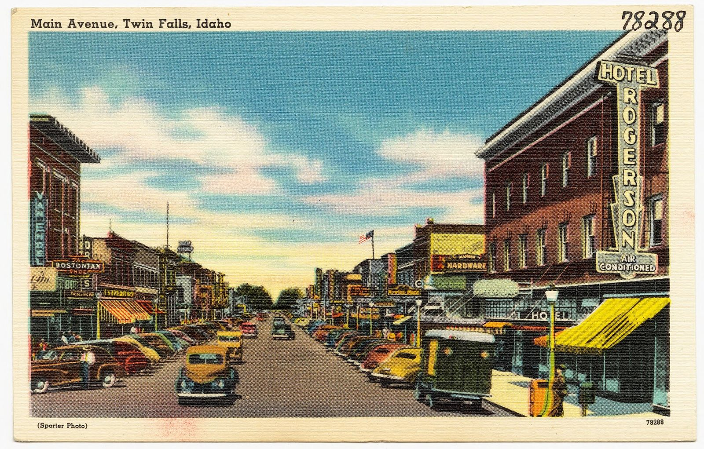
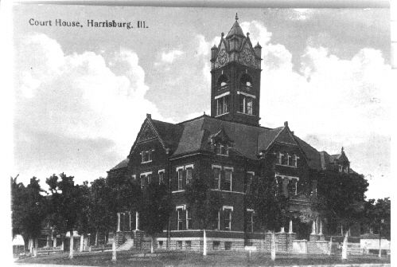

# Twin Falls, Idaho: The Main Avenue "Drag Strip" and the Club That Wanted a Real One (1957–1965)

!!! abstract "Article record"
    **Confidence:** Medium · **Source types:** Grassroots local daily newspaper (*Times-News*, Twin Falls: an editorial, police-court columns, city-commission reports, club notices and a reader's column, 1957–1965, read as scanned page OCR); one item from a southern Illinois daily (*Harrisburg Daily Register*, 1957) · **Last verified:** 2026-10-17 (Round 16) · **Open issues:** the OCR is rough, so we quote only clean passages and some names and figures are uncertain (flagged); we found no report that a strip was ever built on the Joslin Field lease, and the club was still looking for land in 1961, 1962 and 1964 ◐; the Harrisburg tombstone story is one sentence of hearsay in one paper ◐ · [How we rate this](../reference/source-standards.md)

!!! quote "In their own words"
    "Unless we stop this drag racing on the streets of Twin Falls, we have learned by experience to expect that more will be killed."

    — **Editorial**, *Times-News*, Twin Falls, June 30, 1957, under the headline "Our Main Avenue 'Drag Strip.'" (The scan reads "wc" for "we.")[^ed1957]

In the summer of 1957 the Twin Falls *Times-News* stopped calling Main Avenue a street. In its court column it put the street's nickname in quotation marks, the way you'd hold something at arm's length. A Jerome driver was fined for speeding on the Main avenue "drag strip." A Twin Falls man was fined for using the "drag strip" to make a U-turn. A week later another driver paid for 35 miles an hour in a 25 zone on the Main avenue west "drag strip."[^pc1957]

The paper had a reason. A week earlier a 3-year-old boy had been killed. A coroner's jury held two teenage boys, 15 and 14, responsible; the editorial called it the first death of its kind in the city. It blamed the grown-ups more than the boys: city officials, police and the courts, who it said had shrugged at "making race tracks out of our principal streets."[^ed1957]

## Dragging Main

The same editorial is the best description we have of what Main Avenue looked like after dark. Readers had written in by the hundreds, it said. One woman was invited by some girls to go "dragging Main," which they told her meant racing any other carload of teenagers down the avenue. A businessman complained of the "latest wrinkle": several carloads driving abreast as slowly as possible while they passed soft-drink bottles from window to window. A visitor from Weiser asked a reporter whether the town had any law and order at all, and said nobody could sleep in a downtown hotel until 1:30 in the morning for the engines, the screeching rubber and the horns.[^ed1957]

The court column kept the quotation marks for years. By December 1957 City Police Judge J. O. Pumphrey had begun handing out heavier fines for speeding on the Main Avenue "drag strip," the front page reported, and warned that they would get heavier still if the speeding didn't stop.[^fines1957] In August 1958 a driver caught in a radar check was fined $13 and costs for speeding on the Main avenue east "drag strip."[^pc1958]

<figure markdown>
{ loading=lazy }
<figcaption markdown>Main Avenue, Twin Falls, Idaho, on a linen postcard from about 1930–45, before the years this page covers. Creator: Tichnor Brothers, publisher (Boston Public Library, Tichnor Brothers collection #78288). Date: c. 1930–1945. Source: [Wikimedia Commons](https://commons.wikimedia.org/wiki/File:Main_Avenue,_Twin_Falls,_Idaho_(78288).jpg). License: Public domain.</figcaption>
</figure>

## The club that offered to pay

In July 1960 the paper announced an "organizational meeting" of the **Magic Valley Timing Association** at the Idaho Power Company auditorium, open to anyone interested in drag racing.[^org1960]

By the end of August its president, **Gary Nelson** of Twin Falls, was in front of the city commission with a sketch: a quarter-mile strip, a return road, a pit area, a mandatory safety-inspection area, and bales of hay to protect spectators. The paper's headline said the council had given the "drag racers" some encouragement. The club had 33 paid members, and so far its dues had gone to the National Hot Rod Association. It needed several thousand dollars, which members planned to raise themselves, and it asked the city only for the land; members would do the work. The county's probate judge, whom the paper described as the teenagers' idea of an enemy, told the commissioners the young men had the right approach, because they had stopped asking taxpayers to pay for a strip.[^council1960] ◐ *The scan is badly garbled here: the dollar figure looks like $3,500 and the judge's name is unreadable, so we give neither as fact.*

Four days earlier a reader had already made the joke in the paper's "Pot Shots" column, under the heading "Four Lanes to Drag": with one-way traffic planned for Main starting Oct. 1, the kids would now have a four-lane drag strip.[^pot1960]

On October 18, 1960, the city commission "voted unanimously" to lease the club a strip of land at **Joslin Field**, the airport. The city manager recommended it with conditions: the area fenced and kept clean, the runway approaches kept clear, operating hours set so that nearby residents weren't disturbed, and a lease of at least five years. The city attorney was told to draw it up, subject to federal aviation rules.[^lease1960]

## What happened next

The paper checked in on the club in August 1961, ten months after the lease vote, with a long Sunday feature. The **Magic Valley Timing Association** now had about 30 members and an NHRA charter. Its roots went back a few years to a club called the **Road Lords**, which became the **Coachmen**; the MVTA itself had been organized "about a year ago." Members met every Wednesday evening in the basement of Carleson's garage to trade ideas for their projects, which mostly came out of club talk or the hot rod magazines. For a while there had been an auxiliary for wives and girlfriends, the **Magic Valley Timettes**, who held rummage sales, but it was not active just then. The cars around town had names lettered on their fenders: Twilight Zone, Friendly Persuasion, Alley Oop, Rebel Rouser.[^feat1961] ◐ *The scan is rough. The garage's name and some of the car names are our best reading.*

The paper said the club's main goal was still to build a drag strip somewhere in the Magic Valley. Until then, members went to the "drags" at Boise and Pocatello. The feature called the MVTA small, energetic and controversial. Gary Nelson, still president, said that although plenty of people linked the group with "dragging Main," "the club looks down on such activities," and a member cited for a driving violation was penalized by the club.[^feat1961]

*From the detective's notebook:* that answers part of the question this page left open. Ten months after the Joslin Field vote, the club was still talking about building a strip, not running one. In October 1961 two members took prizes at the season's last drag races, held at **Pocatello**. Nelson won his gas class with a Corvette-powered Ford pickup, and Ed Boss won altered coupe with a Model A coupe and an Oldsmobile engine, then took best overall construction at the Pocatello car show.[^poc1961] ◐ *The model years in the scan are illegible.* In September 1962 the members met at Nelson's home and re-elected him, with **Terry Thornton** as vice president and **Calvin Gould** as secretary. They talked about engines, about merchandise members had to sell or trade, and, in a garbled line, about land for a drag strip.[^off1962] ◐ We still find no strip.

The club did what other clubs in town did. At the March 1963 Red Cross blood drawing, the MVTA gave six pints, tying the power company, the typographical union and Sears Roebuck.[^blood1963] In February 1964, with car clubs from Twin Falls, Buhl and Burley at the meeting, members elected **Merlin Hudson** of Buhl president. Four Buhl Lions came to explain a fundraiser: **Moore's All-American Redheads**, a touring women's basketball team, would play the Faux Cigar store team in the Buhl high school gym on March 15, and the proceeds would be split, half to the Redheads and half to the timing association.[^hudson1964] Tickets were sold at service stations, the Twin Falls Cigar store, and by any MVTA member.[^redheads1964]

In March 1964 a new club, the **Avenger Rod and Custom Car club** ("Custom" is half-legible in the scan), was formed at city hall with eight charter members. It was NHRA-sanctioned and part of the timing association, and its goal, the paper said, was "to get a drag strip for the Magic Valley region."[^aveng1964] Three and a half years after the Joslin Field vote, there was still no strip. ◐ *No source we read says outright that the lease was dropped.*

The club found another stage. In July 1965 the paper announced the **first annual MVTA Rod and Custom Show** for July 24 and 25.[^show1965] In May 1972 a notice called members to a special meeting to reorganize the association.[^reorg1972]

## The nickname traveled

Twin Falls wasn't the only town where the paper put a public road in quotation marks. In August 1957 the *Harrisburg Daily Register* in southern Illinois reported that a monument works in Eldorado had told Saline County Sheriff William Barrett that one of its stones was missing. Someone quoted in the item, a man named Lane, thought it had been stolen to "add weight" to a drag-racing car, because Liberty road was being used as a "drag strip." A reward was offered.[^harris1957] ◐ *One paper, one person's guess, and an OCR scan with the columns run together.*

<figure markdown>
{ loading=lazy }
<figcaption markdown>The Saline County Courthouse, Harrisburg, Illinois, in 1917, forty years before the tombstone report; context only. Creator: unknown (uploaded to English Wikipedia by Ruhe1986; Rootsweb Saline County page). Date: 1917. Source: [Wikimedia Commons](https://commons.wikimedia.org/wiki/File:Harrisburg,_IL_1917_Saline_County_Courthouse.jpg). License: Public domain.</figcaption>
</figure>

For other towns that argued about a strip in the same years, see [What the City Planners Wrote (1955)](../drag-racing/planners-report-1955.md), [March 1957: America Argues About Drag Strips](../drag-racing/march-1957-drag-strip-survey.md) and [Would You Rather Have a Picnic? (June 1957)](../drag-racing/recreation-1957-pro-and-con.md). For the other cruise streets we have sourced, see the [cruising overview](cruising-overview.md).

**Visual references (external):** the *Times-News* pages themselves, linked in the footnotes, are scans on the Internet Archive.

[^ed1957]: Editorial, "Our Main Avenue 'Drag Strip,'" *Times-News* (Twin Falls, Idaho), Sunday, June 30, 1957, read as page OCR. https://archive.org/details/The_Times_News_Idaho_Newspaper_1957_06_30 (accessed 2026-10-16)
[^pc1957]: Justice-court items, *Times-News*, June 30, 1957 (Carrol Cunningham of Jerome; Joseph Hopper of Twin Falls) and July 7, 1957 (the Main avenue west "drag strip"). https://archive.org/details/The_Times_News_Idaho_Newspaper_1957_06_30 ; https://archive.org/details/The_Times_News_Idaho_Newspaper_1957_07_07 (accessed 2026-10-16)
[^fines1957]: "Fines Increased for 'Drag Strip' Speed," *Times-News*, Dec. 6, 1957, p. 1. https://archive.org/details/The_Times_News_Idaho_Newspaper_1957_12_06 (accessed 2026-10-16)
[^pc1958]: Police-court items, *Times-News*, Aug. 1, 1958 (Loran A. Duensing, 18; radar check). https://archive.org/details/The_Times_News_Idaho_Newspaper_1958_08_01 (accessed 2026-10-16)
[^org1960]: "Meeting Slated," *Times-News*, July 27, 1960. https://archive.org/details/The_Times_News_Idaho_Newspaper_1960_07_27 (accessed 2026-10-16)
[^council1960]: "Some Encouragement Given 'Drag Racers' by City Council," *Times-News*, Aug. 30, 1960 (OCR heavily garbled in places). https://archive.org/details/The_Times_News_Idaho_Newspaper_1960_08_30 (accessed 2026-10-16)
[^pot1960]: "Four Lanes to Drag," reader's item in "Pot Shots," *Times-News*, Aug. 26, 1960. https://archive.org/details/The_Times_News_Idaho_Newspaper_1960_08_26 (accessed 2026-10-16)
[^lease1960]: "Commission Okays 'Drag Strip' Lease," *Times-News*, Oct. 18, 1960, p. 1. https://archive.org/details/The_Times_News_Idaho_Newspaper_1960_10_18 (accessed 2026-10-16)
[^poc1961]: "Cars Place for 2 Hollister Men," *Times-News*, Oct. 19, 1961. https://archive.org/details/The_Times_News_Idaho_Newspaper_1961_10_19 (accessed 2026-10-16)
[^feat1961]: "Local 'Hot Rod' Group Promoting Building of Dragstrip for Valley" (continued as "Local 'Hot Rod' Group Is Promoting Building of Magic Valley Drag Strip"), *Times-News*, Aug. 13, 1961, read as page OCR (rough). https://archive.org/details/The_Times_News_Idaho_Newspaper_1961_08_13 (accessed 2026-10-17)
[^off1962]: "Officers Picked At Timing Meet," *Times-News*, Sept. 17, 1962. https://archive.org/details/The_Times_News_Idaho_Newspaper_1962_09_17 (accessed 2026-10-17)
[^blood1963]: Blood-drawing report ("150-Pint Quota by 73 Pints"), *Times-News*, Mar. 19, 1963. https://archive.org/details/The_Times_News_Idaho_Newspaper_1963_03_19 (accessed 2026-10-17)
[^hudson1964]: "Buhl Man Is President of Timing Group," *Times-News*, Feb. 23, 1964. https://archive.org/details/The_Times_News_Idaho_Newspaper_1964_02_23 (accessed 2026-10-17)
[^redheads1964]: "'Red Heads' Ticket Sales Are Outlined," *Times-News*, Mar. 15, 1964. https://archive.org/details/The_Times_News_Idaho_Newspaper_1964_03_15 (accessed 2026-10-17)
[^aveng1964]: "New Car Club Elects Officers," *Times-News*, Mar. 29, 1964. https://archive.org/details/The_Times_News_Idaho_Newspaper_1964_03_29 (accessed 2026-10-16)
[^show1965]: "Custom Car Show Scheduled Here July 24-25," *Times-News*, July 18, 1965. https://archive.org/details/The_Times_News_Idaho_Newspaper_1965_07_18 (accessed 2026-10-16)
[^reorg1972]: Club notice, *Times-News*, May 19, 1972. https://archive.org/details/The_Times_News_Idaho_Newspaper_1972_05_19 (accessed 2026-10-16)
[^harris1957]: *Harrisburg Daily Register* (Harrisburg, Ill.), Aug. 29, 1957 (missing-tombstone item; page OCR with columns interleaved). https://archive.org/details/harrisburg-daily-register-1957-08-29 (accessed 2026-10-16)
