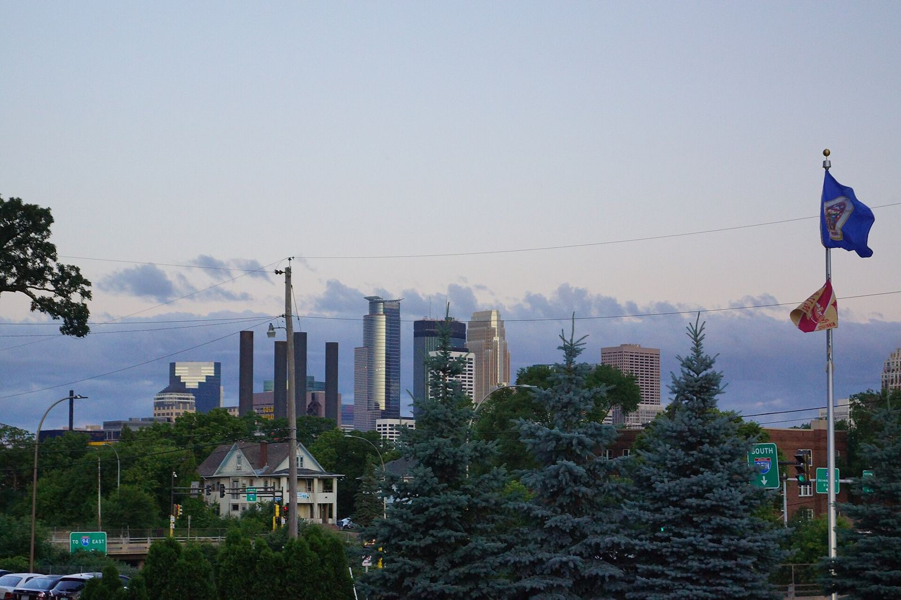
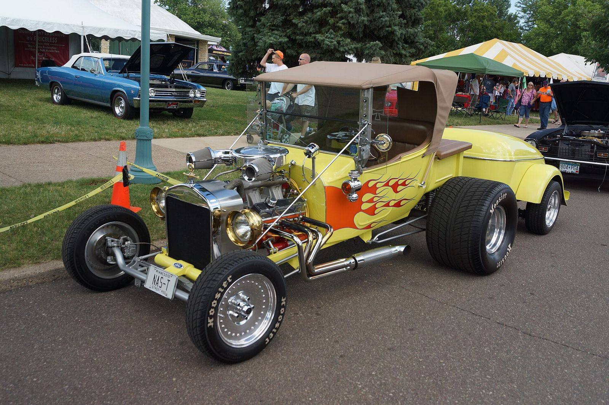

# Upper Midwest: Streets Before Strips

*The street rod association came first, in 1967, and the Nationals at Peoria came after*

!!! abstract "Article record"
    **Confidence:** Medium · **Source types:** Grassroots association history, obituary, founder-era recollections (HotRod Hotline) · **Last verified:** 2026-10-13 (Round 6) · **Open issues:** First-year car counts approximate · [How we rate this](../reference/source-standards.md)

In Minnesota the street came before the strip. The Minnesota Street Rod Association began in 1967, when Jerry Johnson (member #1) proposed uniting the St. Paul and Minneapolis clubs into one body.[^hh50][^jj] By 1970 the MSRA was strong enough to co-host the first Street Rod Nationals at Peoria with the Slo-Pokes.[^rc] The street rod association came first. Drag racing came second.

## Back to the 50's

Four years after Peoria, the MSRA held an event of its own. The first Back to the 50's was held on a Friday night, June 21, 1974, at the Midway Shopping Center, St. Paul, with a cruise to Porky's Drive-In.[^msra][^lc74] The club's history page puts the crowd at about 125–150 cars; the club magazine's report the next month counted more than 250.[^msra][^lc74] It was a rehearsal for hosting the 5th Nationals in St. Paul that year: the July 1974 *LineChaser* called it a "pre-promotion for the NSRA Street Rod Nationals," and members handed out more than 2,500 handbills for the Nats.[^lc74] The whole night is told in [A Tune-Up for the Nats](../street-rodding/back-to-the-50s-msra-st-paul-1974.md).

Eligibility was 1964 and older, looser than the NSRA's 1948 line.[^msra]

It later moved to the State Fairgrounds and became one of the biggest street-rod gatherings anywhere (HotRod Hotline; ClassicCars Journal).[^hh2][^cc] We have not verified a current car count.

A cold climate and long distances shaped a culture of summer driving events and cruises rather than year-round racing. The street rod association had come first, and drag racing came second.

*See also:* [Lake Street and University Avenue](lake-street-university.md), and farther west, ["Go Out to Scribner"](../drag-racing/nebraska-go-out-to-scribner.md) (Lincoln, Neb.).

## Open questions & disputed details

*From the detective's notebook: where the sources disagree, where we have only one, and what we are still looking for. Each item links back to its place in the story.*

### Next leads

The *St. Paul Dispatch* and *Pioneer Press* for June 22, 1974, on the first Back to the 50's (see [A Tune-Up for the Nats](../street-rodding/back-to-the-50s-msra-st-paul-1974.md#q-1) for the car-count question).

## Images

<figure markdown>
{ loading=lazy }
<figcaption markdown>The Minneapolis skyline from the Minnesota State Fairgrounds during the MSRA's 44th Back to the 50's, June 2017 (per the uploader). Creator: Greg Gjerdingen from Willmar, USA. Date: 2017-06-24 05:30. Source: [Wikimedia Commons](https://commons.wikimedia.org/wiki/File:Minneapolis_from_State_Fairgrounds_(34746107124).jpg). License: [CC BY 2.0](https://creativecommons.org/licenses/by/2.0).</figcaption>
</figure>

<figure markdown>
{ loading=lazy }
<figcaption markdown>A 1923 T street rod at the State Fairgrounds, St. Paul (2016). Creator: Greg Gjerdingen from Willmar, USA. Date: 2016-07-15 15:22. Source: [Wikimedia Commons](https://commons.wikimedia.org/wiki/File:1923_Ford_Model_T_Street_Rod_(28288217871).jpg). License: [CC BY 2.0](https://creativecommons.org/licenses/by/2.0).</figcaption>
</figure>

## Visual references (external)

*These images are copyrighted, so we link to them instead.*

- [HotRod Hotline: History of Back to the Fifties, Part II](https://hotrodhotline.com/history-of-back-to-the-fifties-part-ii/)

[^hh50]: HotRod Hotline, "Fifty Years of the MSRA." https://hotrodhotline.com/fifty-years-of-the-msra/ (accessed 2026-10-13)
[^jj]: HotRod Hotline, "MSRA Founding Member Jerry Johnson Passes Away." https://hotrodhotline.com/msra-founding-member-jerry-johnson-passes-away/ (accessed 2026-10-13)
[^msra]: Minnesota Street Rod Association, "History." https://msra.com/about-msra/history/ (accessed 2026-10-13)
[^lc74]: Jerry Johnson, report in the MSRA *LineChaser*, July 1974, with the members' February 2012 look-back, reposted as "History of Back to the Fifties, Part I," HotRod Hotline, April 12, 2013. https://hotrodhotline.com/history-of-back-to-the-fifties-part-i/ (accessed 2026-11-18)
[^hh2]: HotRod Hotline, "History of Back to the Fifties, Part II." https://hotrodhotline.com/history-of-back-to-the-fifties-part-ii/ (accessed 2026-10-13)
[^cc]: ClassicCars.com Journal, "'Back to the 50's' celebrates hot rod culture's golden age" (2018). https://journal.classiccars.com/2018/06/30/back-to-the-50s-celebrates-hot-rod-cultures-golden-age/ (accessed 2026-10-12)
[^rc]: Dick Martin, "1st Street Rod Nationals," Rod & Custom (2007). https://www.hotrod.com/news/0710rc-1st-street-rod-nationals (accessed 2026-10-12)
