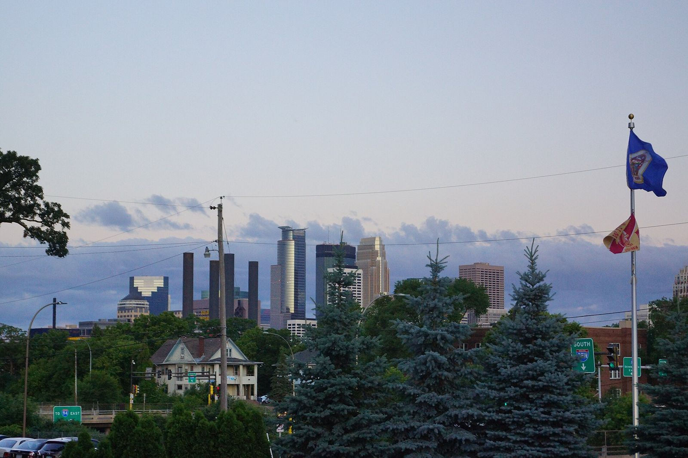

# Upper Midwest: Streets Before Strips

*MSRA and Back to the 50's*

!!! abstract "Article record"
    **Confidence:** Medium · **Source types:** Grassroots association history, obituary, founder-era recollections (HotRod Hotline) · **Last verified:** 2026-10-13 (Round 6) · **Open issues:** First-year car counts approximate · [How we rate this](../reference/source-standards.md)

## MSRA (1967)

The **Minnesota Street Rod Association** began in 1967, when Jerry Johnson (member #1) proposed uniting the St. Paul and Minneapolis clubs into one body.[^hh50][^jj] By 1970 the MSRA was strong enough to co-host the first Street Rod Nationals at Peoria with the Slo-Pokes.[^rc]

## Back to the 50's (1974)

The first Back to the 50's was held **June 23–25, 1974**, at the **Midway Shopping Center**, St. Paul. It drew about 125–150 cars and included a cruise to Porky's Drive-In (MSRA).[^msra] The MSRA treats it as a rehearsal for hosting the **5th Nationals** in St. Paul that year.[^msra]<a href="#q-1" title="Single source so far: see Open questions">◐</a>

Eligibility was **1964 and older**, looser than the NSRA's 1948 line.[^msra]

It later moved to the State Fairgrounds and became one of the biggest street-rod gatherings anywhere (HotRod Hotline; ClassicCars Journal).[^hh2][^cc] We report no current car count here because we have not verified one.

## How it differed

Here the *street rod association* came first and drag racing came second. A cold climate and long distances shaped a culture of summer driving events and cruises rather than year-round racing.

## Open questions & disputed details

*From the detective's notebook: where the sources disagree, where we have only one, and what we are still looking for. Each item links back to its place in the story.*

**Single source so far:** The MSRA treats it as a rehearsal for hosting the **5th Nationals** in St. Paul that year. <a class="hr-q-back" href="#qr-1" title="Back to the story">↩</a>

## Images

<figure markdown>
{ loading=lazy }
<figcaption markdown>The Minneapolis skyline from the Minnesota State Fairgrounds during the MSRA's 44th Back to the 50's, June 2017 (per the uploader). Creator: Greg Gjerdingen from Willmar, USA. Date: 2017-06-24 05:30. Source: [Wikimedia Commons](https://commons.wikimedia.org/wiki/File:Minneapolis_from_State_Fairgrounds_(34746107124).jpg). License: [CC BY 2.0](https://creativecommons.org/licenses/by/2.0).</figcaption>
</figure>

<figure markdown>
{ loading=lazy }
<figcaption markdown>A 1923 T street rod at the State Fairgrounds, St. Paul (2016). Creator: Greg Gjerdingen from Willmar, USA. Date: 2016-07-15 15:22. Source: [Wikimedia Commons](https://commons.wikimedia.org/wiki/File:1923_Ford_Model_T_Street_Rod_(28288217871).jpg). License: [CC BY 2.0](https://creativecommons.org/licenses/by/2.0).</figcaption>
</figure>

## Visual references (external)

*These images are copyrighted, so we link to them instead.*

- [HotRod Hotline: History of Back to the Fifties, Part II](https://hotrodhotline.com/history-of-back-to-the-fifties-part-ii/)

[^hh50]: HotRod Hotline, "Fifty Years of the MSRA." https://hotrodhotline.com/fifty-years-of-the-msra/
[^jj]: HotRod Hotline, "MSRA Founding Member Jerry Johnson Passes Away." https://hotrodhotline.com/msra-founding-member-jerry-johnson-passes-away/
[^msra]: Minnesota Street Rod Association, "History." https://msra.com/about-msra/history/
[^hh2]: HotRod Hotline, "History of Back to the Fifties, Part II." https://hotrodhotline.com/history-of-back-to-the-fifties-part-ii/
[^cc]: ClassicCars.com Journal, "'Back to the 50's' celebrates hot rod culture's golden age" (2018). https://journal.classiccars.com/2018/06/30/back-to-the-50s-celebrates-hot-rod-cultures-golden-age/
[^rc]: Dick Martin, "1st Street Rod Nationals," Rod & Custom (2007). https://www.hotrod.com/news/0710rc-1st-street-rod-nationals
