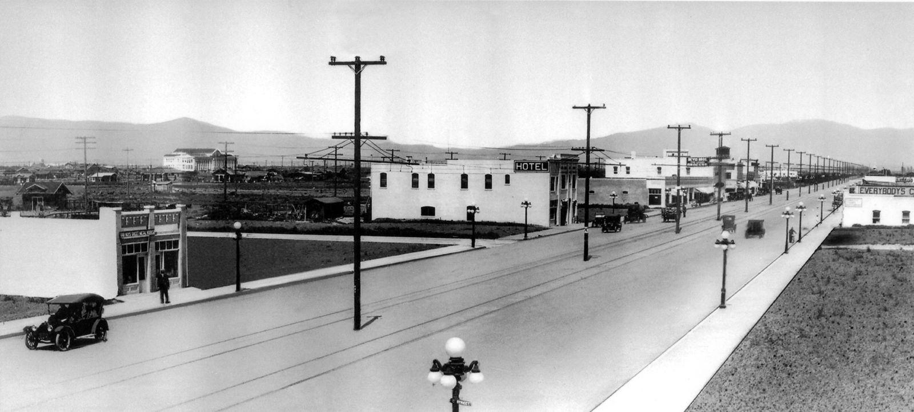
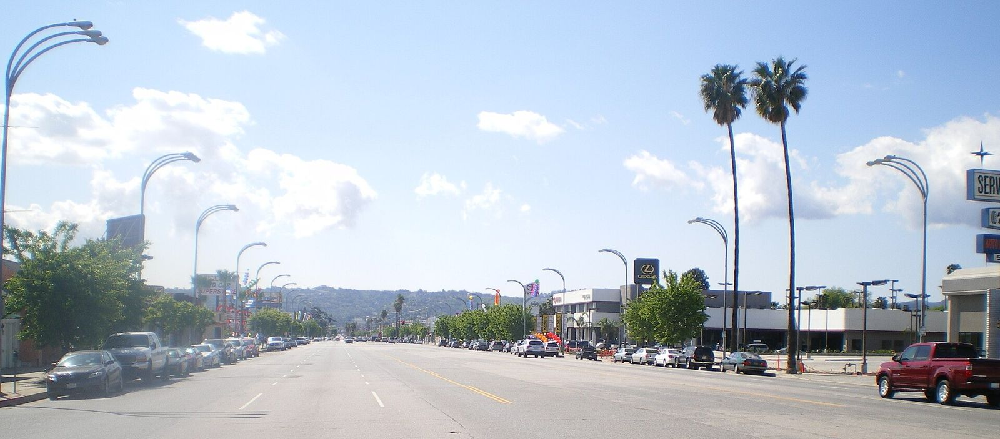

# Van Nuys Boulevard

*San Fernando Valley, 1950s–1980s*

!!! abstract "Article record"
    **Confidence:** Medium-High · **Source types:** newspaper (LA Times 1986, 2010), period magazine (Hot Rod July 1981; Car Craft 2009), photographer interview (CNN 2017) · **Last verified:** 2026-10-13 (Round 8) · **Open issues:** ⚠ closure year · [How we rate this](../reference/source-standards.md)

The custom, the LA Times Magazine said in 1986, went back to a "regular Saturday-night parade down the boulevard" in **1912**. It says that by the mid-1950s cruisers came "from as far away as Santa Barbara and San Diego," with crowds of up to 20,000 including onlookers in lawn chairs, and that the RTD rerouted buses on cruise nights.[^lat86]

**Location:** Van Nuys Blvd, Los Angeles. McCloskey gives "a 3-mile stretch from Ventura Boulevard to about Sherman Way," while Hot Rod (1981) describes police closing "two miles."[^cnn][^hr81] · **Peak:** mid-1950s to 1970s, with Wednesday "club nights." · **Revival:** monthly cruises from June 2009 (Van Nuys Cruising Association).

## The turnarounds

Every cruise needs places to turn around. On Van Nuys they were the Hughes supermarket lot, June Ellen's Donuts and Bob's Big Boy (McCloskey).[^cnn] Hot Rod (July 1981) noted that when police closed the street, "the action picks up at the local McDonald's parking lot." The cars of that era included supercars, VW Beetles and mini-trucks.[^hr81]

## In their own words

The people who were there, on both sides of the law, mostly remember the fun:

> "You had everything from your Mustangs to lowriders and hot rods. ... Essentially you were out there to see your friends, show off your car and just sort of be there. It was the place for young people to be."
>
> — **Rick McCloskey**, photographer, recalling summer 1972, CNN (2017).[^cnn]

> "I think that 90 percent of the people out on the Boulevard are out there to have a good time. … They like to cruise and show off their cars, and they like to meet people."
>
> — **LAPD Capt. Arthur Sjoquist**, the officer who closed the boulevard, Hot Rod (July 1981). This is a contemporary account, not a memory.[^hr81]

> "Remember when we were young and the cops were old? … Now the cops are young and we're old."
>
> — **Reid Stolz**, 51, Van Nuys Cruising Association, LA Times (Jan 13, 2010).[^lat10]

## Policing and the end

The crowds brought the rules. Signs reading "No Stopping 9 p.m. to 12 Midnight" went up in 1980. The LA Times (1986) says major crime on cruise nights was up "five to 10 times" by 1978.[^lat86]

Sjoquist told Hot Rod that earlier captains had tried no-parking signs and ticket sweeps. When "confronted with Wednesday-night crowds of 10,000 to 15,000," the LAPD got permission to close the street at its discretion.[^hr81]<a href="#q-1" title="Sources disagree: see Open questions">⚠</a>

## The Re-Cruise and the comeback

The cruise did not die; it moved. Older rodders moved to a monthly Friday-night "Bob's Drive-In Re-Cruise" at three Bob's Big Boys, one of them the original 1936 Glendale location. Hot Rod (1981) names organizer Joe Marino.[^hr81] It foreshadowed today's [Bob's Burbank Friday nights](bobs-big-boy-river-road.md).

Then it came back to the boulevard. The 2009 revival staged from the **Rydell Chevrolet (formerly Paradise Pontiac)** lot. Stolz's announcement began as a post on the H.A.M.B.[^cc]

## Open questions & disputed details

*From the detective's notebook: where the sources disagree, where we have only one, and what we are still looking for. Each item links back to its place in the story.*

**Disputed.** **When did it end?** The LA Times (2010) says 1981; Hot Rod, writing in July 1981, puts the first closures in the previous July (1980); the LA Times (1986) gives full barricading in 1983; Car Craft (2009) says "around 1980."[^lat10][^hr81][^lat86][^cc] <a class="hr-q-back" href="#qr-1" title="Back to the story">↩</a>

## Images

<figure markdown>
{ loading=lazy }
<figcaption markdown>Van Nuys Boulevard in 1913, a year after the Saturday-night parade tradition the LA Times traces to 1912. Creator: Unknown authorUnknown author. Date: 1913. Source: [Wikimedia Commons](https://commons.wikimedia.org/wiki/File:Van_Nuys_Boulevard,_1913_(LAVC01).jpg). License: Public domain.</figcaption>
</figure>

<figure markdown>
{ loading=lazy }
<figcaption markdown>Van Nuys Boulevard looking south toward the Santa Monica Mountains, March 2008. Creator: Cbl62 (talk). Date: 2008-03. Source: [Wikimedia Commons](https://commons.wikimedia.org/wiki/File:Van_Nuys_Boulevard_Street_Scene.JPG). License: Public domain.</figcaption>
</figure>

## Visual references (external)

*These images are copyrighted, so we link to them instead.*

- [CNN: Rick McCloskey's 1972 Van Nuys photos](https://www.cnn.com/style/gallery/tbt-cruising-van-nuys-los-angeles)
- [Hot Rod, "Summer Nights, 1981" (period photos)](https://www.hotrod.com/features/cruisin-july-1981-982-1156-24-1)

[^lat86]: "Los Angeles Times Magazine Map No. 8: Van Nuys," LA Times (May 11, 1986). https://www.latimes.com/archives/la-xpm-1986-05-11-tm-5371-story.html (accessed 2026-10-13)
[^cnn]: CNN Style, "Cruising Van Nuys Boulevard in 1972" (Jan 26, 2017). https://www.cnn.com/style/gallery/tbt-cruising-van-nuys-los-angeles (accessed 2026-10-13)
[^hr81]: Hot Rod, "Summer Nights, 1981: Kids of All Ages Play in the Street" (July 1981). https://www.hotrod.com/features/cruisin-july-1981-982-1156-24-1 (accessed 2026-10-13)
[^lat10]: "Cruise night returns to Van Nuys Boulevard," LA Times (Jan 13, 2010). https://www.latimes.com/archives/la-xpm-2010-jan-13-la-me-cruising13-2010jan13-story.html (accessed 2026-10-13)
[^cc]: Car Craft, "Wednesday Night Cruising Returns to the Boulevard" (Nov 2009). https://www.hotrod.com/news/ccrp-0911-van-nuys-boulevard (accessed 2026-10-13)
