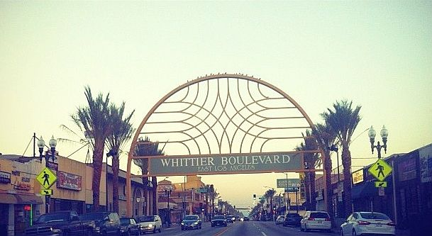

# Whittier Boulevard

*East Los Angeles, 1960s–1979; 2017 revival*

!!! abstract "Article record"
    **Confidence:** Medium · **Source types:** Grassroots newspaper (LA Times 1979 via 2017 archive feature; LA Times 2017), local history blog (Barrio Boychik 2015) · **Last verified:** 2026-10-13 (Round 8) · **Open issues:** ⚠ closure date; violence figures come from the Sheriff's Dept · [How we rate this](../reference/source-standards.md)

The LA Times called cruising Whittier "an odd ritual–a cross among a harmless urban mating dance, a California car obsession, a relief from boredom and a senseless flirtation with death" in 1979, and "a tradition gone sour, tarnished by gang violence." It quoted the Sheriff's Department: 16 homicides on Whittier in the past year and a half, half of all gang-related deaths in its East LA jurisdiction.[^lat79] Every Friday, Saturday and Sunday, from 9:30 p.m. to 5 a.m., all vehicles were barred from the mile-long stretch.[^lat17]

**Location:** Whittier Blvd, East LA. The mile between Atlantic Blvd and Eastern Ave was the core. · **Peak:** 1960s to 1970s; the street drew national attention through the film *Boulevard Nights* (1979). · **Later:** cruising returned in 2017, under a 1997 county ordinance.<a href="#q-1" title="Open question: see the bottom of the page">?</a>

## In their own words

> "It's like a way of life for us. … It did die out for maybe 15 years or so. … We've started bringing it back."
>
> — **Eli Garcia**, organizer of the revived cruises, LA Times (July 2017). He says the events have run since 2015.[^lat17]

> "There's good people that have amazing cars. But then you've got that 10% that want to show off and they want to just tear down Whittier Boulevard."
>
> — **Gina Jojola**, CHP public information officer, 2017.[^lat17]

## Ties

This is a regional repeat gathering, documented for its policing history more than for links to specific shops or builders. The later lowrider scene and its magazine (*Lowrider*, mentioned through Rodriguez) are a separate thread we haven't yet researched.

## Open questions & disputed details

*From the detective's notebook: where the sources disagree, where we have only one, and what we are still looking for. Each item links back to its place in the story.*

### Closure, ⚠ two dates

The LA Times archive feature (2017) says: "On Aug. 31, 1979, the Sheriff's Department closed Whittier between Atlantic and Eastern." A 2017 news article says barricades went up "in September 1979."[^lat79][^lat17]

Barrio Boychik (2015) dates a ban to **Friday, March 23, 1979**, the night of a confrontation it describes through former *Lowrider* reporter **Roberto Rodriguez**. Rodriguez says he was beaten by deputies while taking photographs and won his criminal trial more than seven years later, and the blog quotes his count of "538 people … arrested." *Secondhand, quoted from his own account; not independently verified.*[^bb] Both dates may be right: a crackdown in March and formal barricades from late August. <a class="hr-q-back" href="#qr-1" title="Back to the story">↩</a>

## Images

<figure markdown>
{ loading=lazy }
<figcaption markdown>A sign on Whittier Boulevard, East Los Angeles (2013). Creator: User:Jocelinyy. Date: 6 June 2013 (original upload date). Source: [Wikimedia Commons](https://commons.wikimedia.org/wiki/File:Sign_on_Whittier_Blvd_in_East_Los_Angeles_2013-06-05_18-13.jpg). License: [CC BY-SA 3.0](https://creativecommons.org/licenses/by-sa/3.0).</figcaption>
</figure>

## Visual references (external)

*These images are copyrighted, so we link to them instead.*

- [LA Times: 1979 roadblock photos (Rick Meyer)](https://www.latimes.com/visuals/photography/la-me-fw-archives-1979-cruising-on-whittier-blvd-stopped-20170801-story.html)
- [Calisphere/LAPL: Herald Examiner photos, Sept 9, 1979 (Anne Knudsen)](https://calisphere.org/item/12480db0fefde379a8973dbe6d6db081/). These are licensed through LAPL, not openly.

[^lat79]: LA Times, "From the Archives: In 1979, no more cruising on Whittier Boulevard" (Sept 7, 2017; quoting the 1979 Times). https://www.latimes.com/visuals/photography/la-me-fw-archives-1979-cruising-on-whittier-blvd-stopped-20170801-story.html (accessed 2026-10-13)
[^lat17]: LA Times, "Officials looking to curb cruising on Whittier Boulevard once more" (July 2017). https://www.latimes.com/local/california/la-me-ln-cruising-whittier-boulevard-20170721-story.html (accessed 2026-10-13)
[^bb]: Barrio Boychik, "The Cruising Culture of East Los Angeles" (Dec 29, 2015). https://barrioboychik.wordpress.com/2015/12/29/the-cruising-culture-of-east-los-angeles/ (accessed 2026-10-13)
