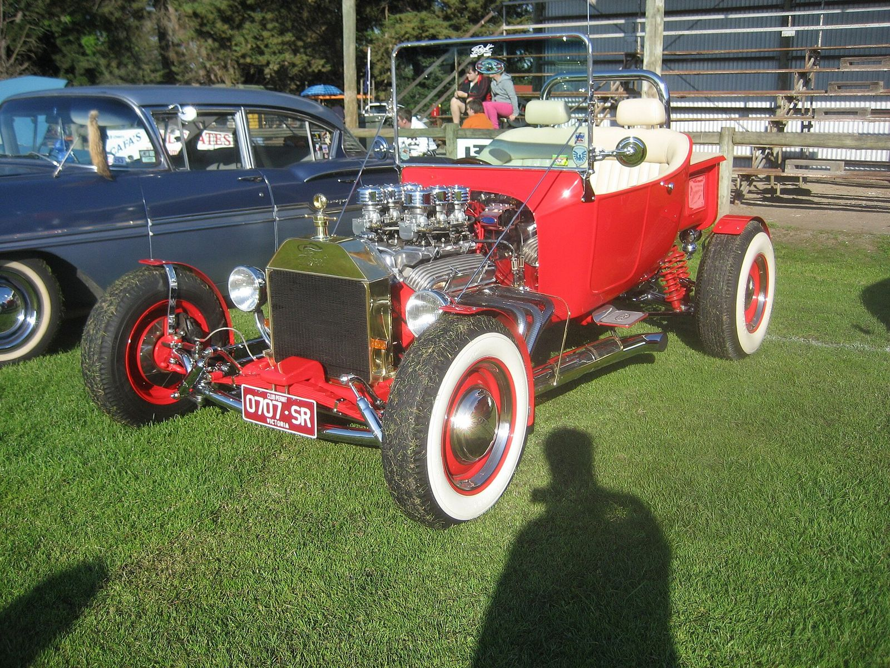

# Fiberglass for the Fenderless

*Early street rod body suppliers, 1957–1980s*

!!! abstract "Article record"
    **Confidence:** Medium · **Source types:** company histories, period ads (via secondary), obituary · **Last verified:** 2026-10-13 (Round 6) · **Open issues:** Who was "first" in fiberglass bodies · [How we rate this](../reference/source-standards.md)

Street rodding needed old bodies, and steel ones were running out. Fiberglass reproductions filled the gap.

## The T roadster bodies

Take a 1957 magazine ad. An ad for Diablo Speed Shop's fiberglass T roadster body appeared in Hot Rod in **August 1957**, priced at **$149.50**. It was bought by Buzz Pitzen<a href="#q-1" title="Single source so far: see Open questions">◐</a> (Kustomrama).[^dia]

Three years later came Cal Automotive. Bud Lang and Curt Hamilton were Navy buddies from Whidbey Island and members of the Alky-Haulers club. Their T body ad ran in **Car Craft, August 1960**, at **$109.50 and $124.50**. Dean Jeffries prepared a rented steel '23 T body and Nat Reeder made the mold (TBucketPlans).[^cal] The first buyer was reportedly "Wild Willy" Borsch.<a href="#q-2" title="Single source so far: see Open questions">◐</a>

These bodies became the **T-bucket** boom of the 1960s.

## Wescott's of Boring, Oregon

Up north, the story starts earlier. Dee Wescott started making fiberglass parts near Portland in **1954**. He was the first president of the Multnomah Hot Rod Council (1954).[^wes][^mhrc]

**Fiberglass fenders** for early Fords followed; Hot Rod covered them in Aug 1958. Ford complained, and Wescott's "Fenders FOR Fords" flyer followed.[^wes]<a href="#q-3" title="Single source so far: see Open questions">◐</a>

According to Wescott's company history, it added a 1931 coupe body (1969) and a roadster (about 1971).<a href="#q-4" title="Single source so far: see Open questions">◐</a> In the 1980s it restricted its line to 1926–48 Fords, matching the NSRA's 1948 cutoff.[^wes] Dee Wescott died in 2009.[^wes]

That northern start is the point. The street-rod parts business is usually associated with SoCal. Two of the important fiberglass players, Wescott's and Cal Automotive's founders, had **Pacific Northwest** roots.<a href="#q-5" title="Open question: see the bottom of the page">?</a>

## Open questions & disputed details

*From the detective's notebook: where the sources disagree, where we have only one, and what we are still looking for. Each item links back to its place in the story.*

**Single source so far:** It was bought by Buzz Pitzen (Kustomrama). <a class="hr-q-back" href="#qr-1" title="Back to the story">↩</a>

**Single source so far:** The first buyer was reportedly "Wild Willy" Borsch. <a class="hr-q-back" href="#qr-2" title="Back to the story">↩</a>

**Single source so far:** Ford complained, and Wescott's "Fenders FOR Fords" flyer followed. <a class="hr-q-back" href="#qr-3" title="Back to the story">↩</a>

**Single source so far:** According to Wescott's company history, it added a 1931 coupe body (1969) and a roadster (about 1971). <a class="hr-q-back" href="#qr-4" title="Back to the story">↩</a>

**Open question.** We have not confirmed which company had the first fiberglass Ford body. <a class="hr-q-back" href="#qr-5" title="Back to the story">↩</a>

## Images

<figure markdown>
{ loading=lazy }
<figcaption markdown>A modern T-bucket hot rod, the body style popularized by Cal Automotive-type fiberglass Ts. The car is not identified to a maker. Creator: Sicnag. Date: 2010-10-02 21:07. Source: [Wikimedia Commons](https://commons.wikimedia.org/wiki/File:Ford_Model_T_Bucket_Hot_Rod.jpg). License: [CC BY 2.0](https://creativecommons.org/licenses/by/2.0).</figcaption>
</figure>

<figure markdown>
{ loading=lazy }
<figcaption markdown>A 1923 T street rod (St. Paul, 2016). We don't know whether the body is steel or fiberglass. Creator: Greg Gjerdingen from Willmar, USA. Date: 2016-07-15 15:22. Source: [Wikimedia Commons](https://commons.wikimedia.org/wiki/File:1923_Ford_Model_T_Street_Rod_(28288217871).jpg). License: [CC BY 2.0](https://creativecommons.org/licenses/by/2.0).</figcaption>
</figure>

## Visual references (external)

*These images are copyrighted, so we link to them instead.*

- [Kustomrama: Dee Wescott](https://kustomrama.com/wiki/Dee_Wescott)
- [TBucketPlans: The real history of the fiberglass T-bucket body](https://www.tbucketplans.com/the-real-history-of-the-fiberglass-t-bucket-body/)

[^dia]: Kustomrama, "Diablo Speed Shop." https://www.kustomrama.com/wiki/Diablo_Speed_Shop
[^cal]: TBucketPlans, "Cal Automotive: Fiberglass T-Bucket Body Pioneers," Parts 1–2. https://www.tbucketplans.com/cal-automotive-fiberglass-t-bucket-body-pioneers-part-1/ ; https://www.tbucketplans.com/cal-automotive-fiberglass-t-bucket-body-pioneers-part-2/
[^wes]: Wescott's, "About Wescott's" (PDF), http://www.wescottsauto.com/Information/AboutWescotts.pdf ; Rod & Custom, "Dee Wescott Passed Away," https://www.hotrod.com/news/0901rc-dee-wescott-passed-away ; Kustomrama, "Dee Wescott," https://kustomrama.com/wiki/Dee_Wescott
[^mhrc]: Multnomah Hot Rod Council, "About Us." https://www.mhrc.org/about-us
