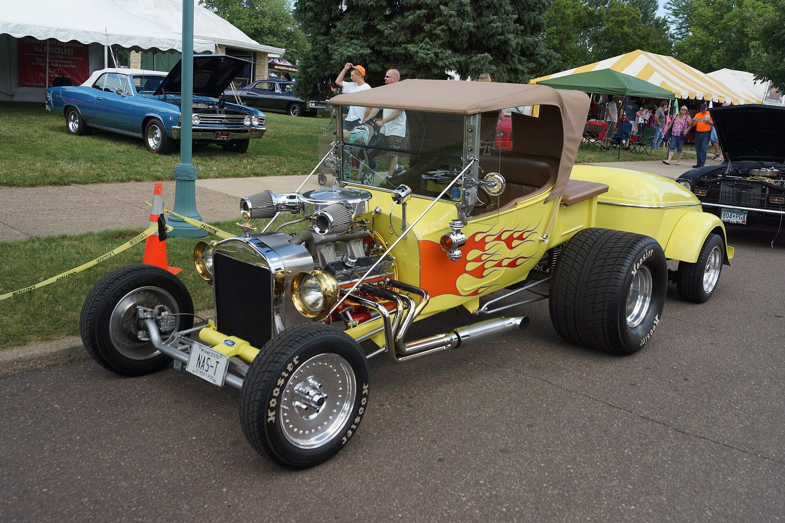
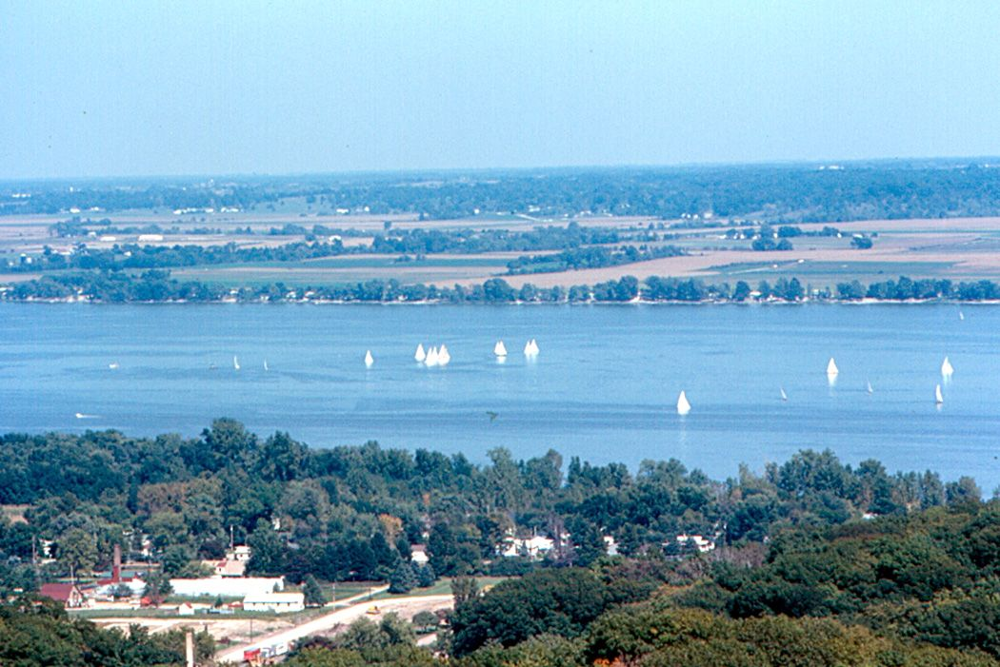
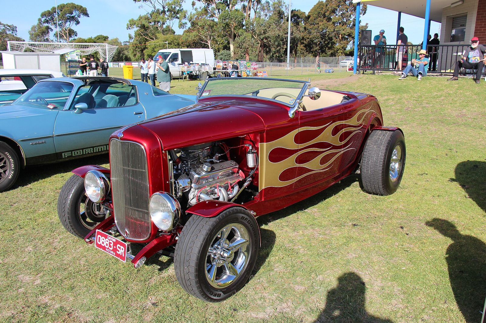

# NSRA and the Early Street Rod Nationals (1970–1980s)

!!! abstract "Article record"
    **Confidence:** Medium · **Source types:** participant recollection (Medley, Brizio via R&C), Hagerty, NSRA, MSRA founder recollection · **Last verified:** 2026-10-13 (Round 6) · **Open issues:** 1970 car count; 1971 Memphis count unverified · [How we rate this](../reference/source-standards.md)

!!! quote "In their own words"
    "STREET RODDER originally covered the whole spectrum of street activity. … There was no 1948 cut-off year."

    — Jim Clark, first Street Rodder editor, 2012. [Full context in Voices](../voices/street-rodder-founding.md)

## From Peoria to an association
- Tom Medley recalled that he, Tex Smith, Bud Bryan and Jim "Jake" Jacobs planned the 1970 event, and that the Petersen "7th floor" management said no. The Peoria **Slo-Pokes** hosted, and the new Minnesota Street Rod Association (MSRA) helped.[^rc] It was held in a hayfield. For more, see [1970 Street Rod Nationals](../eras/1970s-street-rod-nationals.md).
- **⚠ Size:** Hagerty says about 600 cars;[^hag] other accounts give much smaller numbers for the cross-country rally. Our 1970 page goes through these.
- 1970 AMBR winner **Andy Brizio** drove his '23 T to Peoria (R&C sidebar).[^rc]
- The **NSRA** was formed in the event's wake. Dick Wells was its first president; SEMA later hired him (Hagerty).[^hag] ◐ ⚠ **Conflict (Round 10):** the 99W *Street Rod* history says Portland publisher **Bruce Miller** "held NSRA membership number #1 as he was the first President." Tex Smith's 1978 list of NSRA founders includes Miller. See [*Street Rod* magazine](street-rod-magazine-portland.md#bruce-miller-and-the-nsra). Unresolved.

## Moving Nationals
- 1971: **Memphis** (the 2nd Nationals); Memphis hosted again in 1975 and 1980 (carnut.com photo index).[^cn] Secondary accounts put 1971 at about 1,200–1,300 rods (TBucketPlans; Hot Rod, Oct 1972 "Street!" is cited in search summaries).[^tb71] ◐
- 1974: **St. Paul** (5th Nationals). According to MSRA history, the MSRA's first **Back to the 50's** (June 1974) was a test run for the 5th Nationals.[^msra] See [Upper Midwest](../regions/upper-midwest.md).
- In the 1980s the Nationals rotated with Columbus, Ohio, on a three-year cycle. They moved to **Louisville** in 1988 and settled there permanently in the 1990s (Hagerty).[^hag] ◐

## The 1948-and-older rule
NSRA eligibility was limited to cars built in **1948 and earlier**, and later 1949-and-up cars were handled through a separate street-machine track. Wikipedia reports a switch in 2010 to a rolling "30 years and older" rule.[^wp] ◐ This needs an NSRA rulebook or *Street Scene* source. The MSRA's 1974 Back to the 50's used a looser **1964-and-older** cutoff.[^msra] The KKOA set '62-and-older in 1983.[^hr83] Each group set its own cutoff year.

## Images

<figure markdown>
{ loading=lazy }
<figcaption markdown>A 1923 Ford Model T street rod at the Street Machine Summer Nationals, St. Paul, MN, July 2016. It is a typical pre-'48 NSRA-eligible body style, not a car from the period. Creator: Greg Gjerdingen from Willmar, USA. Date: 2016-07-15 15:22. Source: [Wikimedia Commons](https://commons.wikimedia.org/wiki/File:1923_Ford_Model_T_Street_Rod_(28288217871).jpg). License: [CC BY 2.0](https://creativecommons.org/licenses/by/2.0).</figcaption>
</figure>

<figure markdown>
{ loading=lazy }
<figcaption markdown>Peoria Heights, Sept 1970, a month after the first Nationals. It shows the place and the year, **not the event**. Creator: Roger Wollstadt. Date: 1970-09-19. Source: [Wikimedia Commons](https://commons.wikimedia.org/wiki/File:Peoria_Heights_-_View_from_Water_Tower_1970.jpg). License: [CC BY-SA 2.0](https://creativecommons.org/licenses/by-sa/2.0).</figcaption>
</figure>

<figure markdown>
{ loading=lazy }
<figcaption markdown>A modern '32 Ford roadster street rod, the most popular NSRA-era base. It is not a car from the period. Creator: Sicnag. Date: 2014-12-17. Source: [Wikimedia Commons](https://commons.wikimedia.org/wiki/File:1932_Ford_Roadster_Hot_Rod_(16068067015).jpg). License: [CC BY 2.0](https://creativecommons.org/licenses/by/2.0).</figcaption>
</figure>

## Visual references (external)
*These images are copyrighted, so we link to them instead.*

- [carnut.com: Street Rod Nationals photo index (1971, 1975, 1980 Memphis)](https://www.carnut.com/show/nats75/memind.html)
- [Hagerty: "Celebrating the 55th year of the NSRA Street Rod Nationals"](https://www.hagerty.com/media/events/celebrating-the-55th-year-of-the-nsra-street-rod-nationals/)

[^rc]: Dick Martin, "1st Street Rod Nationals," Rod & Custom (2007). https://www.hotrod.com/news/0710rc-1st-street-rod-nationals
[^hag]: Hagerty, "Celebrating the 55th year of the NSRA Street Rod Nationals." https://www.hagerty.com/media/events/celebrating-the-55th-year-of-the-nsra-street-rod-nationals/
[^cn]: carnut.com, "NSRA Nats Memphis 71" and "Memphis 75" galleries. https://www.carnut.com/show/71/nats/natp2.html ; https://www.carnut.com/show/nats75/memind.html
[^msra]: Minnesota Street Rod Association, "History." https://msra.com/about-msra/history/
[^wp]: Wikipedia, "National Street Rod Association." https://en.wikipedia.org/wiki/National_Street_Rod_Association
[^hr83]: Hot Rod, "Tough Sledding," May 1983. https://www.hotrod.com/features/tough-sledding-may-1983-982-1178-84-1
[^tb71]: TBucketPlans, "1971 Street Rod Nationals: Leg Show T-Bucket." https://www.tbucketplans.com/1971-street-rod-nationals-leg-show-t-bucket/
