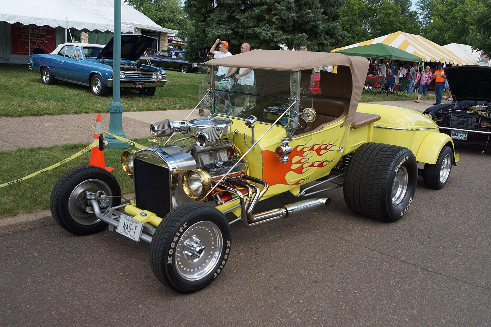
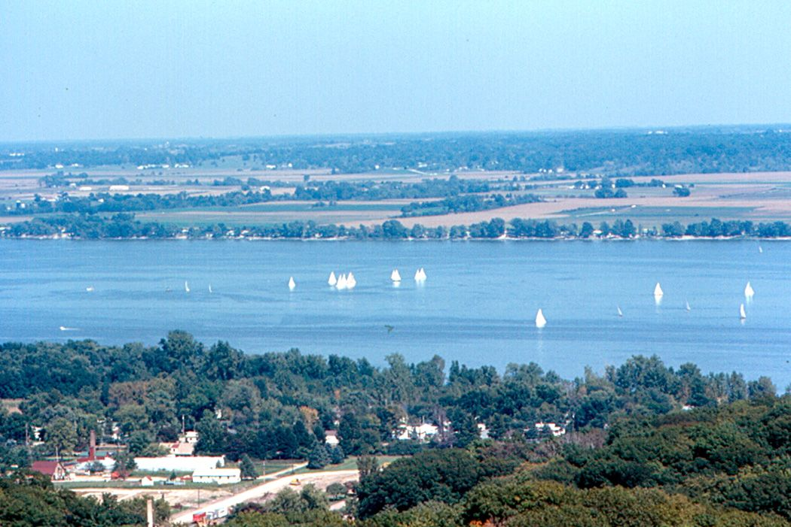
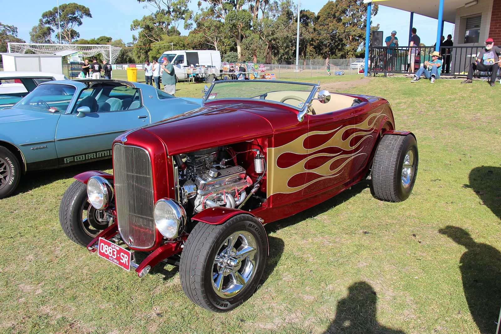

# From a Hayfield to an Association

*The hayfield the bosses had already refused, the association that followed, and the model year that decided who could come*

!!! abstract "Article record"
    **Confidence:** Medium · **Source types:** participant recollection (Medley, Brizio via R&C), Hagerty, NSRA, MSRA founder recollection · **Last verified:** 2026-10-13 (Round 6) · **Open issues:** 1970 car count; 1971 Memphis count unverified · [How we rate this](../reference/source-standards.md)

!!! quote "In their own words"
    "STREET RODDER originally covered the whole spectrum of street activity. … There was no 1948 cut-off year."

    — Jim Clark, first Street Rodder editor, 2012. [Full context in Voices](../voices/street-rodder-founding.md)

## From Peoria to an association

The Street Rod Nationals began as a hayfield meet the bosses had already turned down, and the association that followed drew a line at how old a street rod had to be.

In 1970 Tom Medley, Tex Smith, Bud Bryan, and Jim "Jake" Jacobs planned it anyway. The Petersen "7th floor" management said no.[^rc] They held it in a hayfield in Peoria, Illinois. The Peoria **Slo-Pokes** hosted, and the new Minnesota Street Rod Association, the MSRA, helped.[^rc] 600 street rods came.[^hag] About 200 of their drivers ran the rally, and 1970 AMBR winner Andy Brizio drove his '23 T there from California.[^rc] The weekend itself is on the [1970 Street Rod Nationals](../eras/1970s-street-rod-nationals.md) page.

The **NSRA** was formed in the event's wake. Hagerty says Dick Wells was its first president, and that SEMA later hired him.[^hag]<a href="#q-2" title="Single source so far: see Open questions">◐</a><a href="#q-3" title="Sources disagree: see Open questions">⚠</a> Other accounts give the office to Bruce Miller, a publisher in Portland, or call Wells "the first active president." The sources sit side by side on the [Dick Wells](../people/dick-wells.md) page.

## Moving Nationals

The meet did not stay in the hayfield. In 1971 the Nationals went to **Memphis**, the 2nd Nationals. Memphis hosted again in 1975 and 1980, which a carnut.com photo index places.[^cn] Secondary accounts, TBucketPlans among them, put that 1971 count at about 1,200–1,300 rods. They point at *Hot Rod*'s October 1972 story "Street!", which we have only as a search summary.[^tb71]<a href="#q-4" title="Single source so far: see Open questions">◐</a>

Three years later it was **St. Paul**, the 5th Nationals, in 1974. The MSRA's first **Back to the 50's**, in June 1974, was a test run for it.[^msra] See [Upper Midwest](../places/upper-midwest.md). In the 1980s the Nationals rotated with Columbus, Ohio, on a three-year cycle. The account does not name the other stops. They moved to **Louisville** in 1988 and, Hagerty says, settled there for good in the 1990s.[^hag]<a href="#q-5" title="Single source so far: see Open questions">◐</a>

## The 1948-and-older rule

The moves were the show finding a home. The unusual part was the line the association drew while it traveled.

Jim Clark, first editor of *Street Rodder*, said in 2012 that the magazine had started with no 1948 cutoff. His line is at the top of this page. The NSRA drew one anyway. Eligibility was limited to cars built in **1948 and earlier**, and 1949-and-up cars went through a separate street-machine track.[^wp] Wikipedia reports a switch in 2010 to a rolling "30 years and older" rule.<a href="#q-6" title="Single source so far: see Open questions">◐</a>[^wp] The MSRA's 1974 Back to the 50's used a looser **1964-and-older** cutoff.[^msra] The Kustom Kemps of America, the KKOA, set '62-and-older in 1983.[^hr83] Each group picked its own year.

The bosses had said no, and the hayfield happened anyway. *Street Rodder* had not drawn a year. The association did, and that line is what it kept.

*See also:* [Peoria 1970](../voices/peoria-1970.md).

## Open questions & disputed details

*From the detective's notebook: where the sources disagree, where we have only one, and what we are still looking for. Each item links back to its place in the story.*

**Single source so far.** **Was Wells the first president?** Hagerty says so;[^hag] other accounts give the title to Bruce Miller or call Wells the first *active* president. See [Dick Wells](../people/dick-wells.md) for the sources side by side. <a class="hr-q-back" href="#qr-2" title="Back to the story">↩</a>

**Disputed.** **Miller or Wells?** The 99W *Street Rod* history says Portland publisher **Bruce Miller** "held NSRA membership number #1 as he was the first President"; Hagerty and three other sources name Dick Wells.[^hag] The sources are on [Dick Wells](../people/dick-wells.md#q-3). <a class="hr-q-back" href="#qr-3" title="Back to the story">↩</a>

**Single source so far.** **1,200–1,300 rods in 1971?** The count comes from TBucketPlans; the *Hot Rod* report it is said to rest on (Oct 1972, "Street!") we know only from search summaries.[^tb71] <a class="hr-q-back" href="#qr-4" title="Back to the story">↩</a>

**Single source so far.** **Louisville for good in the 1990s?** The 1988 move and the later permanent settling come only from Hagerty.[^hag] The Kentucky page on [Midwest & East](../places/midwest-east.md) dates the first Louisville Nationals to 1988 too. <a class="hr-q-back" href="#qr-5" title="Back to the story">↩</a>

**Single source so far.** **A "30 years and older" rule from 2010?** Only Wikipedia reports it; it needs an NSRA rulebook or *Street Scene* source.[^wp] <a class="hr-q-back" href="#qr-6" title="Back to the story">↩</a>

**Who was the first president?** Tex Smith's 1978 list of NSRA founders includes Bruce Miller; see [*Street Rod* magazine](../media/street-rod-magazine-portland.md#bruce-miller-and-the-nsra). [Dick Wells](../people/dick-wells.md) sets out every source. Wells's own sketch says he was "the first active president"; Gray Baskerville's 2001 recollection lists Bruce Miller among five out-of-state friends who "chipped in" and names no president. The conflict stays open.

## Images

<figure markdown>
{ loading=lazy }
<figcaption markdown>A 1923 Ford Model T street rod at the Street Machine Summer Nationals, St. Paul, MN, July 2016. It is a typical pre-'48 NSRA-eligible body style, not a car from the period. Creator: Greg Gjerdingen from Willmar, USA. Date: 2016-07-15 15:22. Source: [Wikimedia Commons](https://commons.wikimedia.org/wiki/File:1923_Ford_Model_T_Street_Rod_(28288217871).jpg). License: [CC BY 2.0](https://creativecommons.org/licenses/by/2.0).</figcaption>
</figure>

<figure markdown>
{ loading=lazy }
<figcaption markdown>Peoria Heights, Sept 1970, a month after the first Nationals. It shows the place and the year, **not the event**. Creator: Roger Wollstadt. Date: 1970-09-19. Source: [Wikimedia Commons](https://commons.wikimedia.org/wiki/File:Peoria_Heights_-_View_from_Water_Tower_1970.jpg). License: [CC BY-SA 2.0](https://creativecommons.org/licenses/by-sa/2.0).</figcaption>
</figure>

<figure markdown>
{ loading=lazy }
<figcaption markdown>A modern '32 Ford roadster street rod, the most popular NSRA-era base. It is not a car from the period. Creator: Sicnag. Date: 2014-12-17. Source: [Wikimedia Commons](https://commons.wikimedia.org/wiki/File:1932_Ford_Roadster_Hot_Rod_(16068067015).jpg). License: [CC BY 2.0](https://creativecommons.org/licenses/by/2.0).</figcaption>
</figure>

## Visual references (external)

*These images are copyrighted, so we link to them instead.*

- [carnut.com: Street Rod Nationals photo index (1971, 1975, 1980 Memphis)](https://www.carnut.com/show/nats75/memind.html)
- [Hagerty: "Celebrating the 55th year of the NSRA Street Rod Nationals"](https://www.hagerty.com/media/events/celebrating-the-55th-year-of-the-nsra-street-rod-nationals/)

[^rc]: Dick Martin, "1st Street Rod Nationals," Rod & Custom (2007). https://www.hotrod.com/news/0710rc-1st-street-rod-nationals (accessed 2026-10-12)
[^hag]: Hagerty, "Celebrating the 55th year of the NSRA Street Rod Nationals." https://www.hagerty.com/media/events/celebrating-the-55th-year-of-the-nsra-street-rod-nationals/ (accessed 2026-10-12)
[^cn]: carnut.com, "NSRA Nats Memphis 71" and "Memphis 75" galleries. https://www.carnut.com/show/71/nats/natp2.html ; https://www.carnut.com/show/nats75/memind.html (accessed 2026-10-13)
[^msra]: Minnesota Street Rod Association, "History." https://msra.com/about-msra/history/ (accessed 2026-10-13)
[^wp]: Wikipedia, "National Street Rod Association." https://en.wikipedia.org/wiki/National_Street_Rod_Association (accessed 2026-10-12)
[^hr83]: Hot Rod, "Tough Sledding," May 1983. https://www.hotrod.com/features/tough-sledding-may-1983-982-1178-84-1 (accessed 2026-10-13)
[^tb71]: TBucketPlans, "1971 Street Rod Nationals: Leg Show T-Bucket." https://www.tbucketplans.com/1971-street-rod-nationals-leg-show-t-bucket/ (accessed 2026-10-13)
